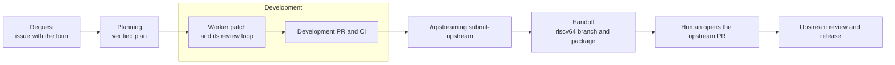

# Pipeline

A contribution moves through a fixed sequence of stages. Trusted code decides when each stage starts, authorizes every remote effect, and records the outcome in `.state/`. Models only judge: they plan, write patches, and review them. The [Security Model]({{ '/security/' | relative_url }}) explains the separation.

## Overview

| Stage | What happens | Page |
|:------|:-------------|:-----|
| Request | An issue labelled `upstreaming-request` is parsed and frozen. | [Requests]({{ '/pipeline/requests/' | relative_url }}) |
| Planning | The planner researches the project and returns a plan that trusted code verifies. | [Planning]({{ '/pipeline/planning/' | relative_url }}), [Contribution Guidelines]({{ '/pipeline/contribution-guidelines/' | relative_url }}) |
| Development | The worker proposes a bounded patch on a fork, reproduced in the `riscv64` image, and reviews it with fresh reviewers before trusted code publishes it. | [Development]({{ '/pipeline/development/' | relative_url }}) |
| Reports and History | Each task reports what it tried, and a later task reads that history. | [Reports and History]({{ '/pipeline/history/' | relative_url }}) |
| Submission | A human requests submission; trusted workflows prepare the upstream branch and a package. | [Submission and Handoff]({{ '/pipeline/submission/' | relative_url }}) |
| Upstream review and release | The controller observes the upstream PR, its review, and its release. | [Transition Engine]({{ '/state-machine/engine/' | relative_url }}#upstream-review-and-release) |

## Branches

Two branches of the fork matter, and each has one writer.

| Branch | Purpose | Written by |
|:-------|:--------|:-----------|
| `riscv64-dev` | Development. Fork provisioning creates it from the frozen base. A worker task, the development PR, its CI, and head observation use it. Nothing changes it for upstreaming. | Fork provisioning and the worker's publication |
| `riscv64` | The head of the upstream pull request. | The handoff workflow only |

## Following a contribution

- The [status page]({{ '/status/' | relative_url }}) shows every contribution, its state, and its event log.
- The [state machine]({{ '/state-machine/' | relative_url }}) defines every state and transition.
- Humans steer a contribution with `/upstreaming` commands on its tracking issue. The [commands]({{ '/state-machine/engine/' | relative_url }}#commands) section lists them, and the tracking issue offers the next commands that apply.
- A human wait is not forgotten: the controller posts [reminders]({{ '/state-machine/engine/' | relative_url }}#reminders) at a fixed cadence.
