<!-- Generated by scripts/generate_state_machine_doc.py from the lifecycle table in lifecycle.py. Do not edit; change the table and regenerate. -->

# Decisions
{: .no_toc }

This page records the decisions behind the [lifecycle table]({{ '/state-machine/table/' | relative_url }}). The open items come first: each is a question that is not settled, and until it is, the table entry it names is the working definition. The settled decisions follow, each with the slice of the table that now holds it. Items keep their number when they are settled, so the open items are numbered after the settled ones. Each diagram shows only the states and verbs involved: thick arrows are the table transitions the item is about, dashed arrows are transitions an option of an open item would add (labelled with the option), and a node with a dashed border is a state the table does not have.

<details open markdown="block">
  <summary>Contents</summary>
  {: .text-delta }
1. TOC
{:toc}
</details>

## Rules behind the decisions

1. Infrastructure exhaustion goes to the phase's `waiting_human`. It never ends the generation.
2. Park means "the approach is not working" or "a human said stop". Nothing parks from `upstream_review` automatically.
3. A Result is reused only while the pipeline ran continuously. Any stop of unknown length (pause, human wait, park) invalidates it; the next step is fresh Work.
4. The plan is refreshed after a park, and after a pause or human wait longer than 7 days in provisioning or development. It is never refreshed automatically from `handoff.awaiting_submission` or `handoff.waiting_upstream_pr`; there a human uses `/upstreaming refresh`.
5. Every row with a `Work: allocate` or `Work: reallocate` effect charges one per-generation counter, `work_total`. `lifecycle check` verifies this.
6. Prefer a guard or a derived status over a new state or flag.
7. Every stop that clears the requested Work also clears `pending_publication`: the flag set verbs, `park_contribution`, `abandon`, and every other transition that ends the generation. `lifecycle check` verifies this.

## Open items

No item is open.

## Settled decisions

### 1. Pause semantics

What `pause` stops, and whether `resume_pause` changes the revision.

**Decision.** `pause` clears the requested Work and the pending publication, and records `paused_at`. A Result held for publication is invalidated: it is not published, and no publish retry is launched while paused. `resume_pause` bumps the revision, so a Result that lands during the pause no longer matches and takes `record_late_effect`. Observations, including CI on the exact head, still fold. The publisher's final check reads `paused`.

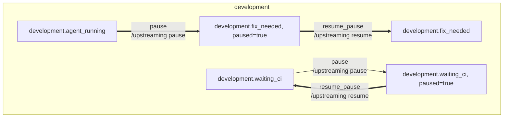

### 2. Park quiescence and the generation fence

How `restart_generation` knows the ended generation is quiescent, and how a late Result of that generation is kept out of the new one.

**Decision.** The generation is part of the Work identity. A Result of another generation is never folded and the publisher refuses it; it takes `record_late_effect`. Work and the pending publication are cleared at park and at abandon, so a publication that was pending when the generation ended never keeps `restart_generation` from applying; a branch its worker run already pushed is recorded by head observation in the phases that observe the head. Quiescence for `restart_generation` is: no open operation and no pending publication.

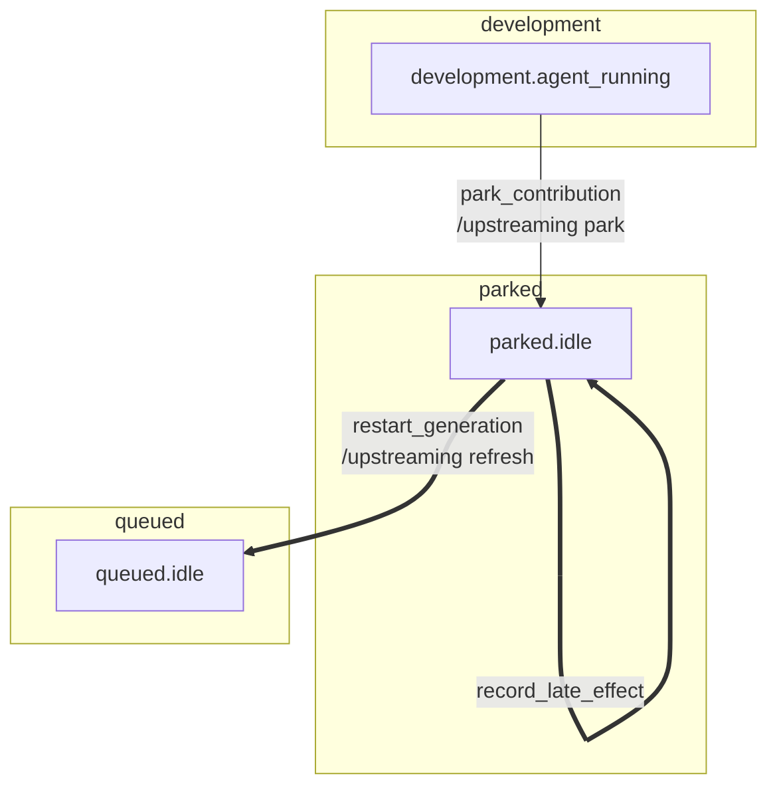

### 3. Resume targets of recorded human waits in upstream review

Where a resume from `upstream_review.waiting_human` leads.

**Decision.** Two verbs, each guarded by the pending action, so exactly one applies. `resume_upstream_review` leads to `upstream_review.waiting_ci` after a closed PR that is observed open again, after a reviewer was answered, and after a head change. `resume_upstream_revision` leads to `upstream_review.fix_needed` only when revision Work failed. Dispatch exhaustion does not park.

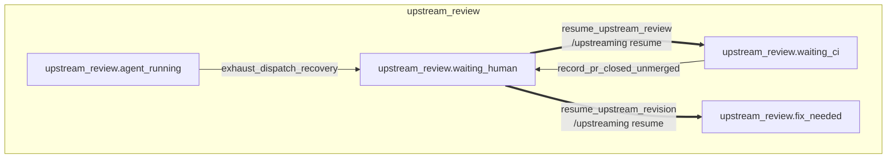

### 4. Handoff entry and the handoff commands

Whether `handoff.awaiting_submission`, `submit_upstream`, and the observed `verify_upstream_pr` replace the `request-handoff`, `approve-handoff`, and `register-upstream-pr` commands.

**Decision.** They do. Nomination enters `handoff.awaiting_submission`, one `submit_upstream` command drives the handoff, and `verify_upstream_pr` is an observation. The three commands are retired. The reminder in `handoff.waiting_upstream_pr` states when an observed PR does not match.

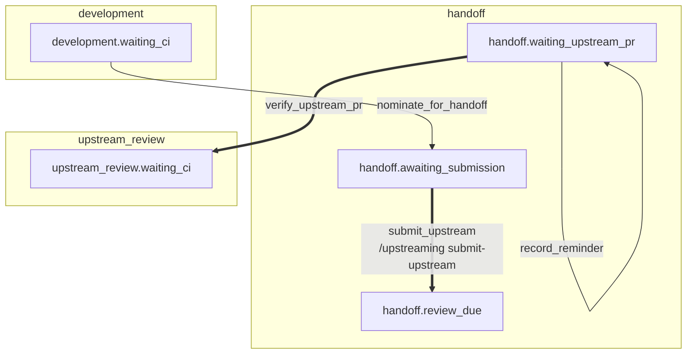

### 5. One terminal phase for work that is not needed

Whether `closed.idle` with `terminal_reason` replaces the separate terminal phases `no_work`, `deferred`, `abandoned`, and `already_released`.

**Decision.** It does: one `closed.idle` with `terminal_reason`. Existing records are migrated.

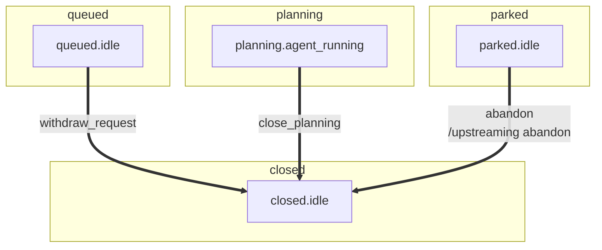

### 6. Capacity waits

Whether lack of capacity, a planned operation, or a pending publication retry is an activity.

**Decision.** It is not. There is no `waiting_capacity` state or flag: the contribution stays in its state while a guard such as a free worker slot or available capacity does not hold, and the status page shows the unmet guard.

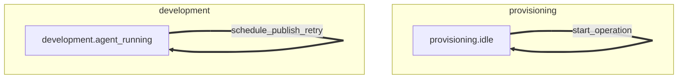

### 7. Repair-budget exhaustion

Where repair-budget exhaustion is decided, and what it does.

**Decision.** Exhaustion is decided at `development.fix_needed` only. The first time `repair_attempts_cluster` or `no_progress` is exhausted in a generation, the tick row `refresh_on_exhaustion` leads to `queued.idle` and starts both counters again, but not `work_total`. Once that automatic refresh is used, `exhaust_repair_attempts` parks.

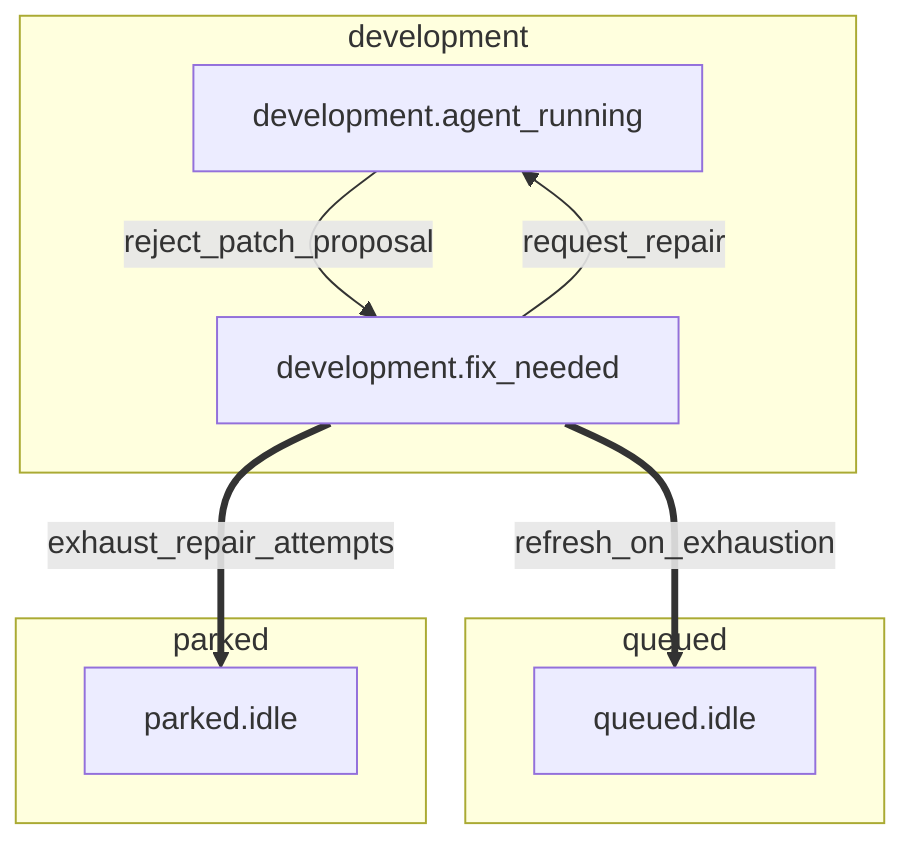

### 8. Planning retry budget

Which budget `reject_plan` charges.

**Decision.** A dedicated `planning_attempts` budget with the key `retries.planning_attempts` (3) and its own counter. A Result without a plan charges it too instead of going straight to `planning.waiting_human`.

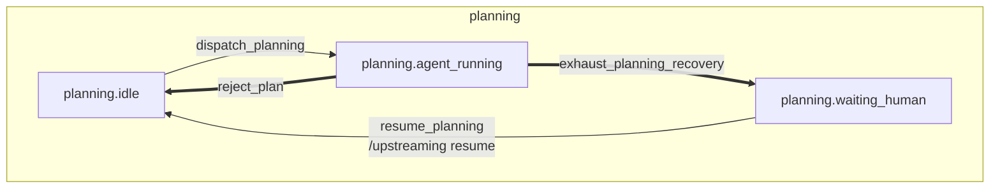

### 9. Publication recovery exhaustion and its resume

From which states `exhaust_publish_recovery` is taken, and where `resume_development` leads.

**Decision.** In development, `exhaust_publish_recovery` leaves only `development.agent_running`. `resume_development` leads to `development.fix_needed`, clears `pending_publication`, and requests fresh Work. Automatic publish retries still reuse the Result.

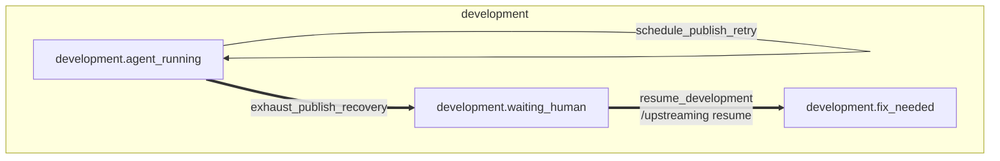

### 10. Dispatch and Work recovery exhaustion targets

Whether dispatch exhaustion and Work exhaustion lead to the same place.

**Decision.** Both wait for a human: `exhaust_work_recovery` leads to the phase's `waiting_human` in planning, development, and upstream review, like `exhaust_dispatch_recovery`. An observed development PR that does not match the record takes `record_pr_mismatch` to `development.waiting_human`.

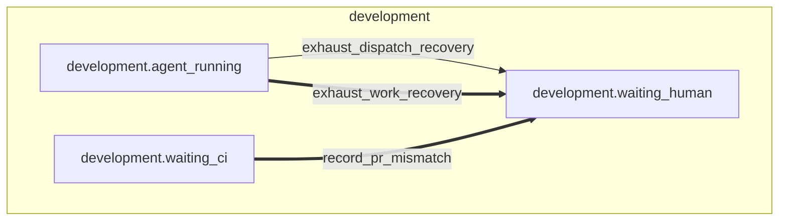

### 11. Where park and refresh apply

From which states `park_contribution` and `refresh_planning` are accepted.

**Decision.** `park_contribution` is one rule: every non-terminal state, guarded by no open operation, except `handoff.waiting_upstream_pr`, `release_wait.*`, and `upstream_review.*` other than `upstream_review.waiting_human`. `refresh_planning` stays explicit: `development.fix_needed`, `development.waiting_ci`, `development.waiting_human`, `handoff.awaiting_submission`, and `handoff.waiting_upstream_pr`. Both are accepted while paused.

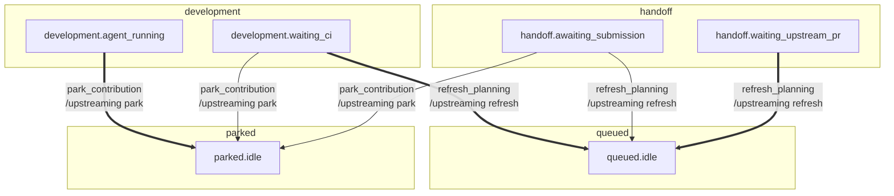

### 12. Return path after refresh

Where a refreshed planning that decides to develop leads.

**Decision.** `readmit_development` leads to `development.fix_needed` on the existing fork. The guard of `admit_development` is the complement: no refresh recorded, or the recorded fork or development PR no longer matches.

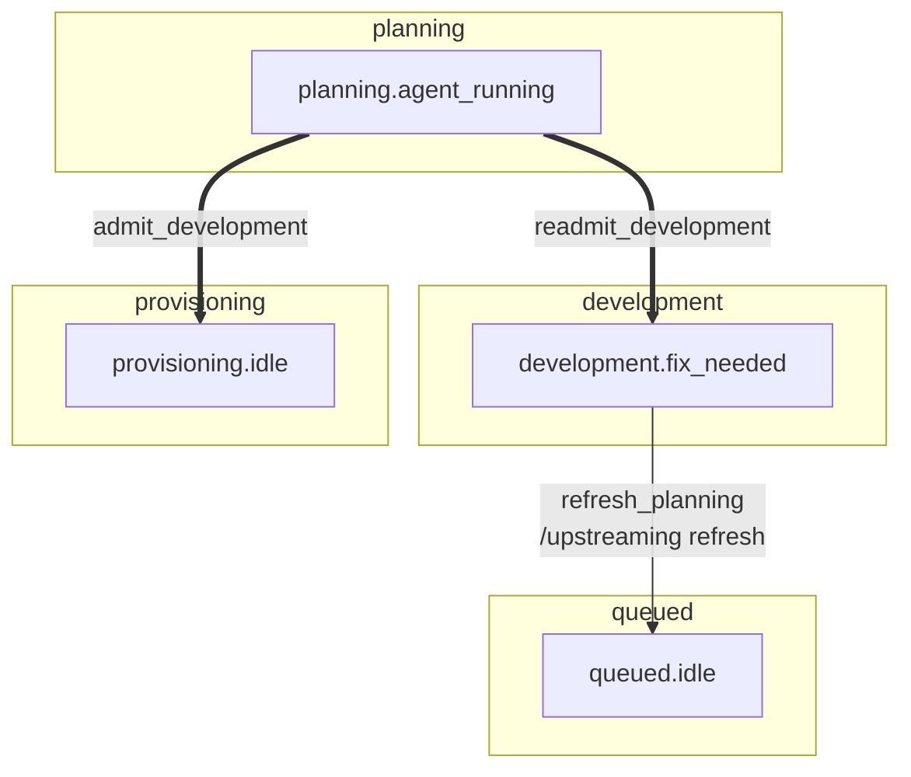

### 13. Park by plan decision and park by command

Whether parking from planning is one verb or two.

**Decision.** Two verbs. `park_planning` is the Result transition taken on a plan decision and no longer carries the `/upstreaming park` label; `park_contribution` is the command.

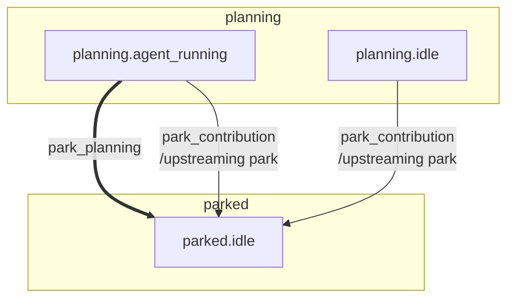

### 14. Beginning the planning

Whether `begin_planning` and `dispatch_planning` are two writes.

**Decision.** Two transitions, written in two commits.

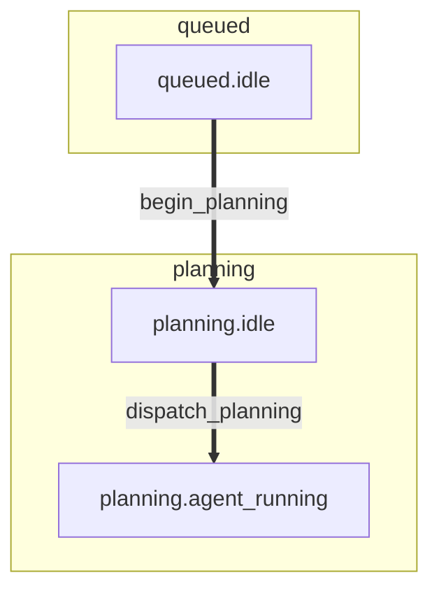

### 15. Provisioning failures

How provisioning failures are recovered, and whether the `approve-scope` and `provision` commands stay.

**Decision.** `approve-scope` and `provision` are retired. The `provisioning_attempts` budget and `exhaust_provisioning_attempts` are removed; a human parks explicitly. `close_planning` no longer leaves `provisioning.idle`. Exhausting `operation_launch` waits for a human and does not park.

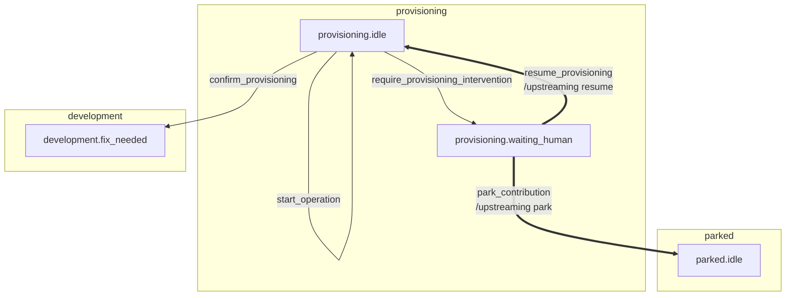

### 16. Upstream revision outcomes

What happens when revision Work in upstream review is rejected or reports no change.

**Decision.** A rejected proposal takes `reject_patch_proposal` to `upstream_review.fix_needed` and charges `no_progress`. When no change is needed, `require_reviewer_answer` leads to `upstream_review.waiting_human` with a pending action to answer the reviewer. `upstream_review.agent_running` has `schedule_publish_retry` and `exhaust_publish_recovery`. Every exhaustion in upstream review leads to `upstream_review.waiting_human`.

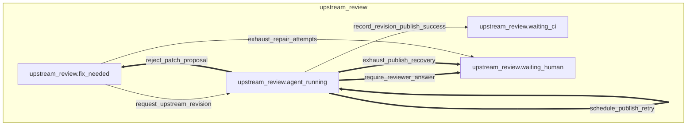

### 17. Commands without table rows

Which commands become table rows and which are retired.

**Decision.** Retired: `request-handoff`, `approve-handoff`, `register-upstream-pr`, `approve-scope`, `provision`, `restart`, `clarify`, `revise-scope`, and `force-develop`. `abandon` leads from `parked.idle` to `closed.idle` with `terminal_reason=abandoned`. `/upstreaming refresh` from `parked.idle` accepts an optional class, paths, and reason, stored as `admission_override`; `restart_generation` still runs the complete planning, and `admit_development` accepts a verified plan decision develop, or a decision park with a recorded override. `authorize-followup` is an intake command outside the table.

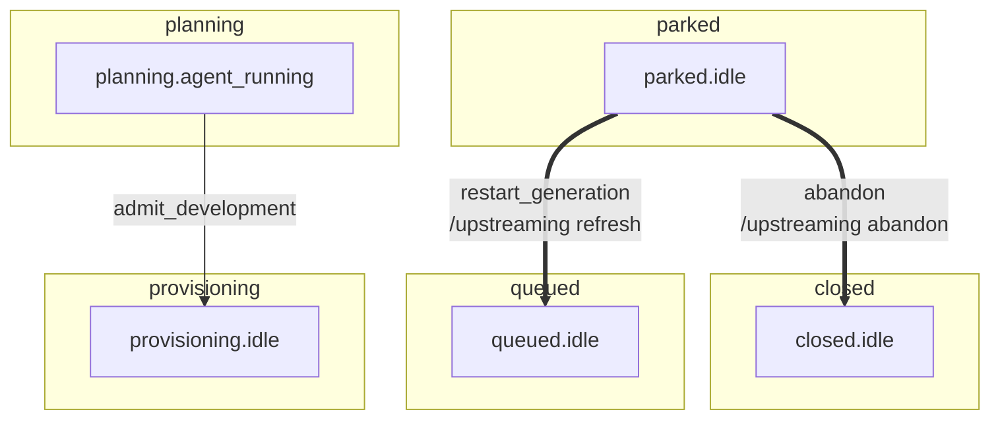

### 18. Observations and outcomes without verbs

Whether CI passing without nomination, a CI access wait, and a withdrawn obsolete repair become table verbs.

**Decision.** None does; all three leave the controller. Green CI without nomination stays in `development.waiting_ci`. A CI access failure is collector health, not contribution state. An obsolete repair is not withdrawn; its Result is judged stale on arrival and takes `record_late_effect`.

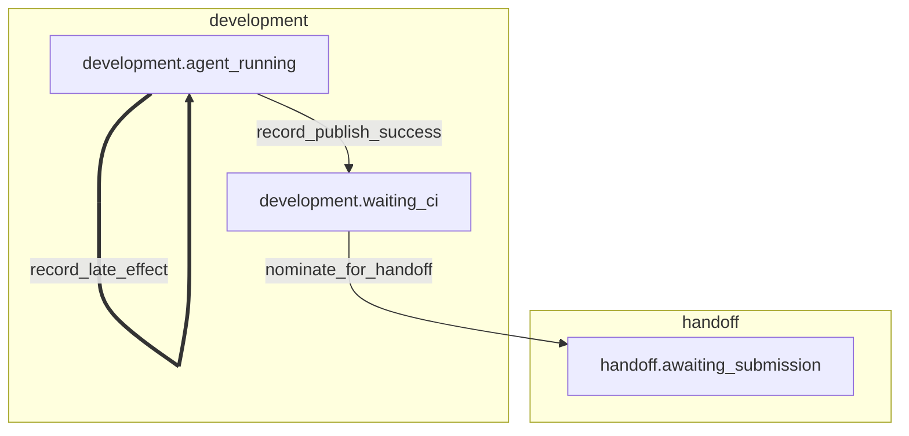

### 19. Late Results during handoff

What a late Result does in the handoff states.

**Decision.** One rule for every state: a Result that does not match the current generation, revision, and requested Work is recorded by `record_late_effect` and never changes state. `record_head_change` leads from `handoff.awaiting_submission` to `development.waiting_ci`, bumps the revision, and clears the CI evidence. `return_for_repair` from `handoff.waiting_ci` also fires when the head differs from the clean head, and then keeps the recorded CI evidence.

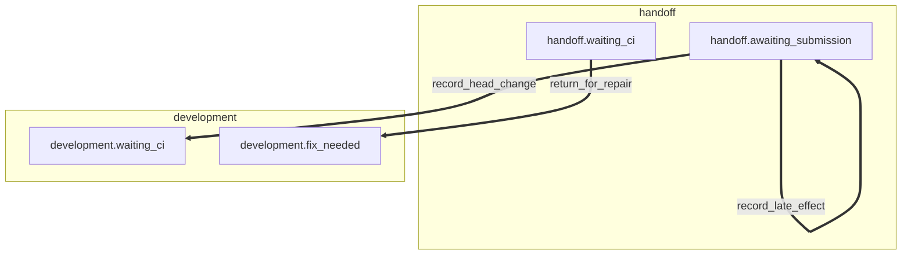

### 20. Budget keys

Whether budgets get their own `policy.json` keys.

**Decision.** Keys are split by what is spent. `work_total` reads `retries.max_attempts_per_contribution`, `work_recovery` reads `retries.work_recovery`, `planning_attempts` reads `retries.planning_attempts`, and the infrastructure budgets share `retries.infrastructure_per_head_failure`. The reminder interval reads `human_sla_business_days.reminder`. Each Result records its token usage in the events.

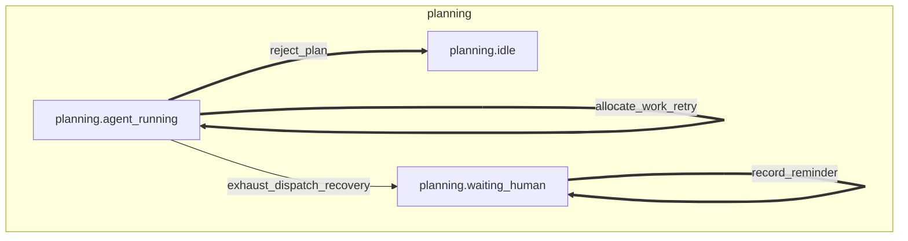

### 21. Flaky CI reruns

How a CI failure is classified before a rerun.

**Decision.** The repair worker classifies. A Result reporting a failure not caused by the patch takes `request_ci_rerun` from `development.agent_running` to `development.waiting_ci` and charges `flaky_reruns`; it replaces `record_no_change`. When `flaky_reruns` is exhausted, or the Work carries feedback, the outcome counts as `reject_patch_proposal`. The collector reruns on its own only jobs that were cancelled or lost their runner, in `development.waiting_ci` and `handoff.waiting_ci`, within `interrupted_reruns` per head. Upstream CI is never rerun.

```mermaid
flowchart TB
    subgraph development["development"]
        development_agent_running["development.agent_running"]
        development_waiting_ci["development.waiting_ci"]
        development_fix_needed["development.fix_needed"]
    end
    subgraph handoff["handoff"]
        handoff_waiting_ci["handoff.waiting_ci"]
    end

    development_agent_running ==>|request_ci_rerun| development_waiting_ci
    development_agent_running -->|reject_patch_proposal| development_fix_needed
    development_waiting_ci -->|record_ci_failure| development_fix_needed
    development_waiting_ci ==>|rerun_interrupted_ci| development_waiting_ci
    handoff_waiting_ci ==>|rerun_interrupted_ci| handoff_waiting_ci
```

### 22. Revision bumps

Which rows bump the revision.

**Decision.** One rule: revision +1 on every transition that invalidates requested or approved work, and on every resume, flags included. No other row bumps; `confirm_provisioning` lost its bump. `python -m lifecycle check` enforces the rule on every row.

```mermaid
flowchart TB
    subgraph provisioning["provisioning"]
        provisioning_idle["provisioning.idle"]
    end
    subgraph development["development"]
        development_fix_needed["development.fix_needed"]
    end
    subgraph handoff["handoff"]
        handoff_building_upstream_branch["handoff.building_upstream_branch"]
        handoff_waiting_human["handoff.waiting_human"]
    end
    subgraph release_wait["release_wait"]
        release_wait_idle["release_wait.idle"]
        release_wait_waiting_human["release_wait.waiting_human"]
    end

    provisioning_idle ==>|confirm_provisioning| development_fix_needed
    handoff_building_upstream_branch -->|exhaust_upstream_branch_retries| handoff_waiting_human
    handoff_waiting_human ==>|resume_upstream_branch<br/>/upstreaming resume| handoff_building_upstream_branch
    release_wait_idle -->|require_release_intervention| release_wait_waiting_human
    release_wait_waiting_human ==>|resume_release_observation<br/>/upstreaming resume| release_wait_idle
```

### 23. Blocked flag

Whether a block changes the activity, and whether `blocked` is a flag of its own.

**Decision.** A block does not change the activity. `blocked` is merged into `paused`: one flag with a reason and who set it, a human or the controller. The controller sets it when the upstream identity changes. The `block` command is retired; `pause` accepts an optional reason.

```mermaid
flowchart TB
    subgraph development["development"]
        development_waiting_ci["development.waiting_ci"]
        development_waiting_ci_paused["development.waiting_ci, paused=true"]
    end

    development_waiting_ci ==>|pause<br/>/upstreaming pause| development_waiting_ci_paused
    development_waiting_ci ==>|pause_on_identity_change| development_waiting_ci_paused
    development_waiting_ci_paused -->|resume_pause<br/>/upstreaming resume| development_waiting_ci
```

### 24. Remote operation states

Whether remote operations get their own table.

**Decision.** They do: an operation table with the states planned, applying, uncertain, confirmed, failed, and not launched, under the same checks. `/upstreaming resolve-operation` lives there. The human waits of the handoff operations are one `handoff.waiting_human`. Later: publication retries move into the operation table.

```mermaid
flowchart TB
    subgraph open_operations["open"]
        op_planned["planned"]
        op_applying["applying"]
        op_uncertain["uncertain"]
    end
    subgraph closed_operations["closed"]
        op_confirmed["confirmed"]
        op_failed["failed"]
        op_not_launched["not_launched"]
    end

    start_1(( )) -->|record_intent| op_planned
    op_planned -->|begin_effect| op_applying
    op_planned -->|resolve_confirmed<br/>/upstreaming resolve-operation| op_confirmed
    op_planned -->|resolve_failed<br/>/upstreaming resolve-operation| op_failed
    op_planned -->|resolve_not_launched<br/>/upstreaming resolve-operation| op_not_launched
    op_applying -->|record_response| op_uncertain
    op_applying -->|record_failure| op_failed
    op_applying -->|resolve_confirmed<br/>/upstreaming resolve-operation| op_confirmed
    op_applying -->|resolve_failed<br/>/upstreaming resolve-operation| op_failed
    op_applying -->|resolve_not_launched<br/>/upstreaming resolve-operation| op_not_launched
    op_uncertain -->|confirm_by_discovery| op_confirmed
    op_uncertain -->|record_discovery| op_uncertain
    op_uncertain -->|resolve_confirmed<br/>/upstreaming resolve-operation| op_confirmed
    op_uncertain -->|resolve_failed<br/>/upstreaming resolve-operation| op_failed
    op_uncertain -->|resolve_not_launched<br/>/upstreaming resolve-operation| op_not_launched
    op_confirmed --> end_2(( ))
    op_failed --> end_3(( ))
    op_not_launched --> end_4(( ))
```

## Settled open items

### O1. Merge `development.idle` and `development.fix_needed`

Whether the two states in which development Work is due become one.

**Decision.** One state, `development.fix_needed`: development Work is due. `confirm_provisioning` enters it. `request_repair` applies while a failing CI job is recorded for the head; `request_patch` applies otherwise. `development.idle` and its own exhaustion row are removed, also from the states that accept `refresh_planning`.

```mermaid
flowchart TB
    subgraph provisioning["provisioning"]
        provisioning_idle["provisioning.idle"]
    end
    subgraph development["development"]
        development_fix_needed["development.fix_needed"]
        development_agent_running["development.agent_running"]
    end
    subgraph parked["parked"]
        parked_idle["parked.idle"]
    end

    provisioning_idle ==>|confirm_provisioning| development_fix_needed
    development_fix_needed ==>|request_patch| development_agent_running
    development_fix_needed ==>|request_repair| development_agent_running
    development_fix_needed -->|exhaust_repair_attempts| parked_idle
```

### O2. State after a pause that clears requested Work

Which state a contribution is in after `pause` cleared its requested Work.

**Decision.** `pause` in an `agent_running` state leads to the state in which the Work is due again: `planning.idle`, `development.fix_needed`, or `upstream_review.fix_needed`. It is the one exception to a flag keeping phase and activity, and the description of the flag states it.

```mermaid
flowchart TB
    subgraph planning["planning"]
        planning_agent_running["planning.agent_running"]
        planning_idle_paused["planning.idle, paused=true"]
    end
    subgraph development["development"]
        development_agent_running["development.agent_running"]
        development_fix_needed_paused["development.fix_needed, paused=true"]
    end
    subgraph upstream_review["upstream_review"]
        upstream_agent_running["upstream_review.agent_running"]
        upstream_fix_needed_paused["upstream_review.fix_needed, paused=true"]
    end

    planning_agent_running ==>|pause<br/>/upstreaming pause| planning_idle_paused
    development_agent_running ==>|pause<br/>/upstreaming pause| development_fix_needed_paused
    upstream_agent_running ==>|pause<br/>/upstreaming pause| upstream_fix_needed_paused
```

### O3. The `block` command after the flag merge

Whether `/upstreaming block` stays a command once `blocked` is merged into `paused`.

**Decision.** It is retired. `pause` accepts an optional reason, and a pause set by the controller always records one.

```mermaid
flowchart TB
    subgraph development["development"]
        development_waiting_ci["development.waiting_ci"]
        development_waiting_ci_paused["development.waiting_ci, paused=true"]
    end

    development_waiting_ci ==>|pause<br/>/upstreaming pause| development_waiting_ci_paused
    development_waiting_ci ==>|pause_on_identity_change| development_waiting_ci_paused
    development_waiting_ci_paused -->|resume_pause<br/>/upstreaming resume| development_waiting_ci
```

### O4. `resume_stale` with an open operation

Whether `resume_stale` needs quiescence, as `refresh_planning` does.

**Decision.** It does: `resume_stale` requires that no Work is requested, no operation is open, and no publication is pending. Until then no resume applies, and the rejection names the open operation.

```mermaid
flowchart TB
    subgraph provisioning["provisioning"]
        provisioning_idle["provisioning.idle"]
        provisioning_idle_paused["provisioning.idle, paused=true"]
    end
    subgraph queued["queued"]
        queued_idle["queued.idle"]
    end

    provisioning_idle_paused -->|resume_pause<br/>/upstreaming resume| provisioning_idle
    provisioning_idle_paused ==>|resume_stale<br/>/upstreaming resume| queued_idle
```

### O5. Resume while paused in a human wait

Which transition one `/upstreaming resume` takes when a contribution is both paused and in a human wait.

**Decision.** Two resumes. The first clears the flag; its reply states that the contribution still waits for a human and names the pending action. The second leaves the human wait.

```mermaid
flowchart TB
    subgraph development["development"]
        development_waiting_human_paused["development.waiting_human, paused=true"]
        development_waiting_human["development.waiting_human"]
        development_fix_needed["development.fix_needed"]
    end

    development_waiting_human_paused ==>|resume_pause<br/>/upstreaming resume| development_waiting_human
    development_waiting_human ==>|resume_development<br/>/upstreaming resume| development_fix_needed
```

### O6. Resume after a budget is exhausted

What a resume does to the counter whose exhaustion caused the human wait.

**Decision.** The resume starts again the one counter named in `pending_human_action.counter`, and no other. The event records the actor, the counter, and its count at that point. It was settled for `exhaust_work_total`, `exhaust_planning_recovery`, and `exhaust_repair_attempts` in upstream review; O14 extends it to every exhaustion that leads to a human wait.

```mermaid
flowchart TB
    subgraph planning["planning"]
        planning_idle["planning.idle"]
        planning_agent_running["planning.agent_running"]
        planning_waiting_human["planning.waiting_human"]
    end
    subgraph upstream_review["upstream_review"]
        upstream_fix_needed["upstream_review.fix_needed"]
        upstream_waiting_human["upstream_review.waiting_human"]
    end

    planning_idle -->|exhaust_work_total| planning_waiting_human
    planning_agent_running -->|exhaust_planning_recovery| planning_waiting_human
    planning_waiting_human ==>|resume_planning<br/>/upstreaming resume| planning_idle
    upstream_fix_needed -->|exhaust_repair_attempts| upstream_waiting_human
    upstream_waiting_human ==>|resume_upstream_revision<br/>/upstreaming resume| upstream_fix_needed
```

### O7. Budget for collector reruns

Whether reruns of cancelled or runner-lost jobs are bounded.

**Decision.** They are: `rerun_interrupted_ci` charges the budget `interrupted_reruns`, counted per head, which reads the shared `retries.infrastructure_per_head_failure`. When it is exhausted, `exhaust_interrupted_reruns` leads to the human wait of the phase with `pending_human_action=ci_interrupted`, and `resume_ci` returns to the CI wait, reruns the jobs, and starts `interrupted_reruns` again for the head (O14).

```mermaid
flowchart TB
    subgraph development["development"]
        development_waiting_ci["development.waiting_ci"]
        development_waiting_human["development.waiting_human"]
    end
    subgraph handoff["handoff"]
        handoff_waiting_ci["handoff.waiting_ci"]
        handoff_waiting_human["handoff.waiting_human"]
    end

    development_waiting_ci -->|rerun_interrupted_ci| development_waiting_ci
    development_waiting_ci ==>|exhaust_interrupted_reruns| development_waiting_human
    development_waiting_human ==>|resume_ci<br/>/upstreaming resume| development_waiting_ci
    handoff_waiting_ci -->|rerun_interrupted_ci| handoff_waiting_ci
    handoff_waiting_ci ==>|exhaust_interrupted_reruns| handoff_waiting_human
    handoff_waiting_human ==>|resume_ci<br/>/upstreaming resume| handoff_waiting_ci
```

### O8. Limits and names chosen without a decision

Values and names the decisions left open.

**Decision.** `retries.max_attempts_per_contribution` stays 24, `retries.work_recovery` stays 2, and the verb names stay. The human waits of handoff are one `handoff.waiting_human`: four resume verbs leave it, each guarded by its `pending_human_action`, so exactly one applies (the submission review, the branch write, CI on the clean head, and the package).

```mermaid
flowchart TB
    subgraph handoff["handoff"]
        handoff_review_due["handoff.review_due"]
        handoff_agent_running["handoff.agent_running"]
        handoff_building_upstream_branch["handoff.building_upstream_branch"]
        handoff_waiting_ci["handoff.waiting_ci"]
        handoff_preparing_submission["handoff.preparing_submission"]
        handoff_waiting_human["handoff.waiting_human"]
    end

    handoff_review_due -->|exhaust_work_total| handoff_waiting_human
    handoff_agent_running -->|exhaust_work_recovery| handoff_waiting_human
    handoff_building_upstream_branch -->|exhaust_upstream_branch_retries| handoff_waiting_human
    handoff_waiting_ci -->|exhaust_interrupted_reruns| handoff_waiting_human
    handoff_preparing_submission -->|exhaust_comment_retries| handoff_waiting_human
    handoff_waiting_human ==>|resume_submission_review<br/>/upstreaming resume| handoff_review_due
    handoff_waiting_human ==>|resume_upstream_branch<br/>/upstreaming resume| handoff_building_upstream_branch
    handoff_waiting_human ==>|resume_ci<br/>/upstreaming resume| handoff_waiting_ci
    handoff_waiting_human ==>|resume_submission_preparation<br/>/upstreaming resume| handoff_preparing_submission
```

### O9. Reminder of the locked upstream-PR wait

Whether the reminder rule also covers the `locked` kind.

**Decision.** It does: the rule covers the `gate`, `human_wait`, and `locked` kinds, and the separate row is removed. In `handoff.waiting_upstream_pr` the package link is part of the reminder text. The reminder keeps the state, so the locked wait still has exactly its three exits.

```mermaid
flowchart TB
    subgraph handoff["handoff"]
        handoff_awaiting_submission["handoff.awaiting_submission"]
        handoff_waiting_upstream_pr["handoff.waiting_upstream_pr"]
        handoff_waiting_human["handoff.waiting_human"]
    end

    handoff_awaiting_submission -->|record_reminder| handoff_awaiting_submission
    handoff_waiting_upstream_pr ==>|record_reminder| handoff_waiting_upstream_pr
    handoff_waiting_human -->|record_reminder| handoff_waiting_human
```

### O10. Where a development PR mismatch is observed

From which states `record_pr_mismatch` leads to `development.waiting_human`.

**Decision.** From `development.waiting_ci` only, where the development PR is observed.

```mermaid
flowchart TB
    subgraph development["development"]
        development_waiting_ci["development.waiting_ci"]
        development_waiting_human["development.waiting_human"]
    end

    development_waiting_ci ==>|record_pr_mismatch| development_waiting_human
```

### O11. Admission override against a park or close decision

Which plan decisions a recorded `admission_override` overrides.

**Decision.** A decision park only: with a recorded override, `admit_development` accepts a verified plan that decides park. A verified decision close still takes `close_planning`, and the reply states that the override was not applied.

```mermaid
flowchart TB
    subgraph planning["planning"]
        planning_agent_running["planning.agent_running"]
    end
    subgraph provisioning["provisioning"]
        provisioning_idle["provisioning.idle"]
    end
    subgraph parked["parked"]
        parked_idle["parked.idle"]
    end
    subgraph closed["closed"]
        closed_idle["closed.idle"]
    end

    planning_agent_running ==>|admit_development| provisioning_idle
    planning_agent_running -->|park_planning| parked_idle
    planning_agent_running ==>|close_planning| closed_idle
```

### O12. Resume after a reviewer was answered

Where the resume leads when the pending action was to answer the reviewer.

**Decision.** Two verbs. `resume_upstream_review` leads to `upstream_review.waiting_ci` when the pending action is `pr_closed_unmerged` (the PR is observed open again), `answer_reviewer`, or `upstream_head_changed`; after `answer_reviewer` it clears the pending feedback. `resume_upstream_revision` leads to `upstream_review.fix_needed` only when revision Work failed: dispatch, Work, publication, or budget exhaustion. `record_upstream_ci_failure` fires once per head and CI run, so the failure that was answered does not request a revision again.

```mermaid
flowchart TB
    subgraph upstream_review["upstream_review"]
        upstream_waiting_ci["upstream_review.waiting_ci"]
        upstream_fix_needed["upstream_review.fix_needed"]
        upstream_agent_running["upstream_review.agent_running"]
        upstream_waiting_human["upstream_review.waiting_human"]
    end

    upstream_waiting_ci ==>|record_upstream_ci_failure| upstream_fix_needed
    upstream_agent_running -->|require_reviewer_answer| upstream_waiting_human
    upstream_waiting_human ==>|resume_upstream_review<br/>/upstreaming resume| upstream_waiting_ci
    upstream_waiting_human ==>|resume_upstream_revision<br/>/upstreaming resume| upstream_fix_needed
```

### O13. The revision rule as checked

Which rows count as invalidating requested or approved work.

**Decision.** The rule stays derived from the effects: a resume, a generation bump, a fresh Work graph, a change of scope, feedback, refresh, handoff request, approval, or clean head, a recorded head change (observed, or read back by a Result), and a rejected Result after which the same Work is due again. Under it `replan_development` bumps and `park_planning` does not, because a park is a stop and the restart bumps.

```mermaid
flowchart TB
    subgraph planning["planning"]
        planning_agent_running["planning.agent_running"]
    end
    subgraph parked["parked"]
        parked_idle["parked.idle"]
    end
    subgraph development["development"]
        development_agent_running["development.agent_running"]
        development_fix_needed["development.fix_needed"]
    end

    planning_agent_running ==>|park_planning| parked_idle
    development_agent_running ==>|replan_development| development_fix_needed
```

### O14. The rerun counter after `resume_ci`

Whether `resume_ci` starts `interrupted_reruns` again for the head.

**Decision.** It does, in both `development.waiting_human` and `handoff.waiting_human`. The rule has no exception: every exhaustion that leads to a human wait names its counter in `pending_human_action.counter`, and every resume from that wait starts exactly that counter again. This holds for the budgets spent on infrastructure failures too: `dispatch_recovery`, `work_recovery`, `publish_recovery`, `operation_launch`, `upstream_branch`, `submission_comment`, and `interrupted_reruns`. `require_provisioning_intervention` names `operation_launch` when that budget is the cause and no counter for its other causes. `resume_stale` starts the named counter again like every other resume. The check verifies the rule for every exhaustion and every resume.

```mermaid
flowchart TB
    subgraph development["development"]
        development_waiting_ci["development.waiting_ci"]
        development_waiting_human["development.waiting_human"]
    end
    subgraph handoff["handoff"]
        handoff_waiting_ci["handoff.waiting_ci"]
        handoff_building_upstream_branch["handoff.building_upstream_branch"]
        handoff_waiting_human["handoff.waiting_human"]
    end

    development_waiting_ci -->|exhaust_interrupted_reruns| development_waiting_human
    development_waiting_human ==>|resume_ci<br/>/upstreaming resume| development_waiting_ci
    handoff_waiting_ci -->|exhaust_interrupted_reruns| handoff_waiting_human
    handoff_waiting_human ==>|resume_ci<br/>/upstreaming resume| handoff_waiting_ci
    handoff_building_upstream_branch -->|exhaust_upstream_branch_retries| handoff_waiting_human
    handoff_waiting_human -->|resume_upstream_branch<br/>/upstreaming resume| handoff_building_upstream_branch
```

### O15. The first patch after a rejected proposal

Which verb requests Work when a proposal was rejected before the head had any CI evidence.

**Decision.** `request_patch`: a rejected proposal records no failing CI job for the head. `request_patch` charges `work_total` and requires that `no_progress` remains; it does not charge `repair_attempts_cluster`.

```mermaid
flowchart TB
    subgraph development["development"]
        development_fix_needed["development.fix_needed"]
        development_agent_running["development.agent_running"]
    end
    subgraph queued["queued"]
        queued_idle["queued.idle"]
    end
    subgraph parked["parked"]
        parked_idle["parked.idle"]
    end

    development_fix_needed ==>|request_patch| development_agent_running
    development_agent_running ==>|reject_patch_proposal| development_fix_needed
    development_fix_needed -->|request_repair| development_agent_running
    development_fix_needed -->|refresh_on_exhaustion| queued_idle
    development_fix_needed -->|exhaust_repair_attempts| parked_idle
```

### O16. Exhaustion of `work_total` found while Work is running

Whether the resume after `exhaust_work_recovery` starts `work_total` again when `work_total` was the exhausted budget.

**Decision.** It does. When a Work retry cannot be allocated because `work_total` is exhausted, `exhaust_work_recovery` records `pending_human_action.counter=work_total`, and one resume starts it again, in planning, development, and upstream review. When `work_recovery` itself is exhausted, it names `work_recovery`. The slice shows planning and development; in upstream review `resume_upstream_revision` does the same.

```mermaid
flowchart TB
    subgraph planning["planning"]
        planning_agent_running["planning.agent_running"]
        planning_waiting_human["planning.waiting_human"]
        planning_idle["planning.idle"]
    end
    subgraph development["development"]
        development_agent_running["development.agent_running"]
        development_waiting_human["development.waiting_human"]
        development_fix_needed["development.fix_needed"]
    end

    planning_agent_running ==>|exhaust_work_recovery| planning_waiting_human
    planning_waiting_human ==>|resume_planning<br/>/upstreaming resume| planning_idle
    development_agent_running ==>|exhaust_work_recovery| development_waiting_human
    development_waiting_human ==>|resume_development<br/>/upstreaming resume| development_fix_needed
```

### O17. Names and values chosen for the settled items

Names and values the decisions left open.

**Decision.** They stay. `interrupted_reruns` allows as many reruns per head as `retries.infrastructure_per_head_failure` (2), without a free first one. Its exhaustion verb is `exhaust_interrupted_reruns`, and `resume_ci` is the resume verb in both `development.waiting_human` and `handoff.waiting_human`. The pending actions of the handoff wait are `upstream_branch_failed`, `upstream_branch_blocked`, `submission_comment_failed`, `ci_interrupted`, and those of the review Work (`work_budget_exhausted`, `dispatch_failed`, `work_failed`). An exhaustion names its counter in `pending_human_action.counter`.

```mermaid
flowchart TB
    subgraph handoff["handoff"]
        handoff_building_upstream_branch["handoff.building_upstream_branch"]
        handoff_waiting_ci["handoff.waiting_ci"]
        handoff_preparing_submission["handoff.preparing_submission"]
        handoff_waiting_human["handoff.waiting_human"]
    end

    handoff_building_upstream_branch -->|exhaust_upstream_branch_retries| handoff_waiting_human
    handoff_waiting_ci ==>|rerun_interrupted_ci| handoff_waiting_ci
    handoff_waiting_ci ==>|exhaust_interrupted_reruns| handoff_waiting_human
    handoff_preparing_submission -->|exhaust_comment_retries| handoff_waiting_human
    handoff_waiting_human ==>|resume_ci<br/>/upstreaming resume| handoff_waiting_ci
```

### O18. Exhaustion of `work_total` found when development Work is due

Where `work_total` exhaustion leads when it is found at `development.fix_needed`.

**Decision.** To the human wait, as in the other phases. At `development.fix_needed`, exhaustion of `work_total` takes `exhaust_work_total` to `development.waiting_human` with `pending_human_action.counter=work_total`, and one resume starts it again. `exhaust_repair_attempts` parks only for `repair_attempts_cluster` and `no_progress`, after `refresh_on_exhaustion` is used. The reply at exhaustion states the number of Work allocations spent and names both `/upstreaming resume` and `/upstreaming park`. The guards of `request_patch`, `request_repair`, `refresh_on_exhaustion`, `exhaust_repair_attempts`, and `exhaust_work_total` are mutually exclusive, and the check verifies it: the first four require that `work_total` remains.

```mermaid
flowchart TB
    subgraph development["development"]
        development_fix_needed["development.fix_needed"]
        development_agent_running["development.agent_running"]
        development_waiting_human["development.waiting_human"]
    end
    subgraph queued["queued"]
        queued_idle["queued.idle"]
    end
    subgraph parked["parked"]
        parked_idle["parked.idle"]
    end

    development_fix_needed -->|request_patch| development_agent_running
    development_fix_needed -->|request_repair| development_agent_running
    development_fix_needed -->|refresh_on_exhaustion| queued_idle
    development_fix_needed ==>|exhaust_repair_attempts| parked_idle
    development_fix_needed ==>|exhaust_work_total| development_waiting_human
    development_waiting_human ==>|resume_development<br/>/upstreaming resume| development_fix_needed
    development_waiting_human -->|park_contribution<br/>/upstreaming park| parked_idle
```

### O19. Pending feedback and the Work that answers it

Which row clears `pending_feedback_evidence_ids` in development and upstream review.

**Decision.** The Work request carries the pending feedback ids present at allocation, in `active_work.feedback_evidence_ids`. `record_publish_success` clears exactly those ids, and `record_revision_publish_success` does the same in upstream review; feedback recorded while the Work ran stays pending. `reject_patch_proposal`, `replan_development`, `record_head_change`, every resume that requests Work again, and both refresh verbs keep the pending feedback; `resume_upstream_review` still clears it after a human answered the reviewer. A fresh Work graph and a publish retry carry the same ids. Work that carries feedback cannot take `request_ci_rerun`: that outcome counts as `reject_patch_proposal`. The check verifies each of these.

```mermaid
flowchart TB
    subgraph development["development"]
        development_fix_needed["development.fix_needed"]
        development_agent_running["development.agent_running"]
        development_waiting_ci["development.waiting_ci"]
    end

    development_waiting_ci -->|record_actionable_review| development_fix_needed
    development_fix_needed -->|request_patch| development_agent_running
    development_fix_needed -->|request_repair| development_agent_running
    development_agent_running ==>|record_publish_success| development_waiting_ci
    development_agent_running ==>|reject_patch_proposal| development_fix_needed
    development_agent_running -->|replan_development| development_fix_needed
    development_agent_running ==>|request_ci_rerun| development_waiting_ci
```

### O20. An actionable review at the submission gate

How a review on the candidate head is recorded when it leaves `handoff.awaiting_submission`.

**Decision.** By its own row. `record_actionable_review` leads from `handoff.awaiting_submission` to `development.fix_needed`: it bumps the revision once, sets `pending_feedback_evidence_ids`, and clears `clean_head_sha`, `handoff_request`, and `pending_human_action`. `return_for_repair` from the gate keeps the CI failure cause only and sets `last_ci_evidence_id`. The two guards are exclusive: a CI failure on the candidate head applies first, and a review observed with it is recorded in the same observation by `record_actionable_review` in `development.fix_needed`, so the repair Work carries both. That row also records a review posted on the recorded head while Work is due.

```mermaid
flowchart TB
    subgraph handoff["handoff"]
        handoff_awaiting_submission["handoff.awaiting_submission"]
    end
    subgraph development["development"]
        development_fix_needed["development.fix_needed"]
        development_agent_running["development.agent_running"]
    end

    handoff_awaiting_submission ==>|return_for_repair| development_fix_needed
    handoff_awaiting_submission ==>|record_actionable_review| development_fix_needed
    development_fix_needed ==>|record_actionable_review| development_fix_needed
    development_fix_needed -->|request_patch| development_agent_running
    development_fix_needed -->|request_repair| development_agent_running
```

### O21. An explanation-only comment at the submission gate

What an explanation-only comment on the development PR does while the contribution waits for `submit-upstream`.

**Decision.** `record_explanation` is a row of `handoff.awaiting_submission` that keeps the state: the comment is recorded and linked from the event log of the website. No Work is requested and nothing is answered automatically; the revision, the candidate head, and the CI evidence are kept, so the pending `submit-upstream` request stays valid.

```mermaid
flowchart TB
    subgraph handoff["handoff"]
        handoff_awaiting_submission["handoff.awaiting_submission"]
        handoff_review_due["handoff.review_due"]
    end

    handoff_awaiting_submission ==>|record_explanation| handoff_awaiting_submission
    handoff_awaiting_submission -->|submit_upstream<br/>/upstreaming submit-upstream| handoff_review_due
```

### O22. Where the rerun counts of a head are kept

Which record field holds the counts of `flaky_reruns` and `interrupted_reruns`.

**Decision.** `budget.reruns = {head_sha, flaky, interrupted}`, for the current head only. It starts again whenever the recorded head changes: on `record_publish_success`, `record_head_change`, and `confirm_clean_head`. `request_ci_rerun` counts `flaky`, `rerun_interrupted_ci` counts `interrupted`, and `resume_ci` starts `interrupted` again. Counts recorded for another head are counts of zero for the current one.

```mermaid
flowchart TB
    subgraph development["development"]
        development_agent_running["development.agent_running"]
        development_waiting_ci["development.waiting_ci"]
        development_waiting_human["development.waiting_human"]
    end
    subgraph handoff["handoff"]
        handoff_building_upstream_branch["handoff.building_upstream_branch"]
        handoff_waiting_ci["handoff.waiting_ci"]
    end

    development_agent_running ==>|record_publish_success| development_waiting_ci
    development_agent_running -->|request_ci_rerun| development_waiting_ci
    development_waiting_ci ==>|record_head_change| development_waiting_ci
    development_waiting_ci -->|rerun_interrupted_ci| development_waiting_ci
    development_waiting_ci -->|exhaust_interrupted_reruns| development_waiting_human
    development_waiting_human -->|resume_ci<br/>/upstreaming resume| development_waiting_ci
    handoff_building_upstream_branch ==>|confirm_clean_head| handoff_waiting_ci
    handoff_waiting_ci -->|rerun_interrupted_ci| handoff_waiting_ci
```

### O23. The budget of a repair driven only by review feedback

Which cluster a repair charges when no CI job failed.

**Decision.** None: `repair_attempts_cluster` is charged only when a failing CI job is recorded for the head. In development, `request_repair` is guarded by that, and `request_patch` by its complement: it covers the first patch, a rejected proposal, and a repair driven only by feedback, and charges `work_total` only. In upstream review, `request_upstream_revision` keeps the failing-job guard and the cluster charge, and `request_review_revision` covers a revision driven only by feedback and charges `work_total` only. All four require that `no_progress` remains. Exhaustion of `repair_attempts_cluster` applies only while a failing CI job is recorded, so in each state exactly one of the rows applies; the check verifies it.

```mermaid
flowchart TB
    subgraph development["development"]
        development_fix_needed["development.fix_needed"]
        development_agent_running["development.agent_running"]
    end
    subgraph upstream_review["upstream_review"]
        upstream_fix_needed["upstream_review.fix_needed"]
        upstream_agent_running["upstream_review.agent_running"]
        upstream_waiting_human["upstream_review.waiting_human"]
    end

    development_fix_needed ==>|request_patch| development_agent_running
    development_fix_needed -->|request_repair| development_agent_running
    upstream_fix_needed -->|request_upstream_revision| upstream_agent_running
    upstream_fix_needed ==>|request_review_revision| upstream_agent_running
    upstream_fix_needed -->|exhaust_repair_attempts| upstream_waiting_human
```

### O24. A proposal before the fork exists

Whether patch Work can be requested before `confirm_provisioning`.

**Decision.** It cannot. Patch Work is requested only from `development.fix_needed`, which is entered after `confirm_provisioning`. The guard of `request_patch` is write admission only. The checks on `scope_paths` and `scope_coverage_complete` are a guard of `admit_development`, so an incomplete patch scope is refused before a fork is provisioned. No proposal is held without a write to the fork, so a stop clears the pending publication and nothing is published after it.

```mermaid
flowchart TB
    subgraph planning["planning"]
        planning_agent_running["planning.agent_running"]
    end
    subgraph provisioning["provisioning"]
        provisioning_idle["provisioning.idle"]
    end
    subgraph development["development"]
        development_fix_needed["development.fix_needed"]
        development_agent_running["development.agent_running"]
        development_fix_needed_paused["development.fix_needed, paused=true"]
    end

    planning_agent_running ==>|admit_development| provisioning_idle
    provisioning_idle -->|confirm_provisioning| development_fix_needed
    development_fix_needed ==>|request_patch| development_agent_running
    development_agent_running -->|pause<br/>/upstreaming pause| development_fix_needed_paused
```

### O25. When a planning run decides close

When a plan may decide close, and who confirms it.

**Decision.** Only when no riscv64 work is needed because PyPI already serves riscv64 for the latest release of every distribution of the request: a riscv64 wheel, or pure-Python wheels only. The reconciler reads PyPI itself before it takes `close_planning` and sets `terminal_reason` `already_released` when a riscv64 wheel is published, else `no_work`; a close that PyPI does not confirm takes `reject_plan` within `planning_attempts`. PyPI is the one registry a close is confirmed from: each PyPI project must name the upstream repository, and a project that is not released on PyPI is parked with the evidence that riscv64 is served. Every other reason to stop is a park, which a human can restart with `/upstreaming refresh`.

```mermaid
flowchart TB
    subgraph planning["planning"]
        planning_agent_running["planning.agent_running"]
        planning_idle["planning.idle"]
        planning_waiting_human["planning.waiting_human"]
    end
    subgraph closed["closed"]
        closed_idle["closed.idle"]
    end

    planning_agent_running ==>|close_planning| closed_idle
    planning_agent_running ==>|reject_plan| planning_idle
    planning_agent_running ==>|exhaust_planning_recovery| planning_waiting_human
```

### O26. Trusted CI rerun

Which credential reruns the jobs of a fork's workflow run, how a rerun is recorded, and which row applies when it fails.

**Decision.** No new workflow and nothing in the dispatcher. A failure the repair worker reports not caused by the patch (`no_change`) is rerun by the trusted publication job of the worker run, or of its publish-only retry, with a token for the one verified fork that carries only `actions: write`, bound to the exact head and attempt. Interrupted CI is rerun by the development PR workflow in `development.waiting_ci`, and in `handoff.waiting_ci` by the handoff workflow, launched by the controller, with the same kind of token; each workflow executes only the reruns of its own phase. A rerun is an operation of kind `ci_rerun` whose receipt is the readback of the new run attempt; the attempt is a monotonic counter, so every retry reads it first and a rerun operation is never left `uncertain`. `request_ci_rerun` is taken only once the rerun is read back or nothing needed rerunning; a rerun that is refused or not read back, and a `no_change` Result without the receipt, is a failed publication (`schedule_publish_retry`, then `exhaust_publish_recovery`), and a moved head takes `replan_development`. A failed interrupted rerun fires no row: the next observation takes `rerun_interrupted_ci` again within `interrupted_reruns`, then `exhaust_interrupted_reruns`; a planned rerun of a paused contribution is closed the same way, since no receipt can arrive while paused. The wait after `request_ci_rerun` has no pending action and no reminder; CI ends it. `resume_ci` launches nothing: it restarts `interrupted_reruns`, and the first observation after it reruns. Interrupted means a required job that was cancelled, or a blocking job that failed with a runner-loss annotation, so a head whose CI the gate would read as failed is never nominated; `timed_out` and every other executed failure are real failures and win over a rerun. Only `development.waiting_ci` and `handoff.waiting_ci` classify lost runners. Each run is rerun with `rerun-failed-jobs`, at most 5 runs per request, and a rerun reserves no runner capacity. The repair attempt charged at allocation is not refunded.

```mermaid
flowchart TB
    subgraph development["development"]
        development_agent_running["development.agent_running"]
        development_waiting_ci["development.waiting_ci"]
        development_waiting_human["development.waiting_human"]
        development_fix_needed["development.fix_needed"]
    end

    development_agent_running ==>|request_ci_rerun| development_waiting_ci
    development_agent_running -->|schedule_publish_retry| development_agent_running
    development_agent_running -->|exhaust_publish_recovery| development_waiting_human
    development_agent_running -->|replan_development| development_fix_needed
    development_waiting_ci ==>|rerun_interrupted_ci| development_waiting_ci
    development_waiting_ci ==>|exhaust_interrupted_reruns| development_waiting_human
    development_waiting_ci -->|record_ci_failure| development_fix_needed
    development_waiting_human -->|resume_ci<br/>/upstreaming resume| development_waiting_ci
```

### O27. Pending feedback when CI passes

What happens in `development.waiting_ci` when CI passes on the exact head while actionable feedback is still pending (after a push while Work was due for a review, or feedback the published Work did not carry).

**Decision.** `return_for_feedback` leads to `development.fix_needed`: it records the passing CI evidence, keeps the revision and the pending feedback, and `request_patch` then requests a repair that carries the feedback. A head change never clears pending feedback; only a published Result does. The guards of `nominate_for_handoff` and `return_for_feedback` are exclusive, and the check verifies that every state that blocks a nomination on pending feedback has such a row.

```mermaid
flowchart TB
    subgraph development["development"]
        development_fix_needed["development.fix_needed"]
        development_waiting_ci["development.waiting_ci"]
        development_agent_running["development.agent_running"]
    end
    subgraph handoff["handoff"]
        handoff_awaiting_submission["handoff.awaiting_submission"]
    end

    development_fix_needed -->|record_head_change| development_waiting_ci
    development_waiting_ci ==>|return_for_feedback| development_fix_needed
    development_waiting_ci -->|nominate_for_handoff| handoff_awaiting_submission
    development_fix_needed -->|request_patch| development_agent_running
    development_agent_running -->|record_publish_success| development_waiting_ci
```

### O28. An uncertain publication in development

What a Result whose push was not read back (`uncertain`) takes in `development.agent_running`.

**Decision.** In development, an uncertain Result is a failed publication, exactly as in upstream review: it takes `schedule_publish_retry` (or `exhaust_publish_recovery`), which clears the Work and holds the Result, so no Work recovery takes its completed graph. `record_publish_success` is taken only when the publication is confirmed: by a `published` Result (its own operation confirmed), by the publish-only retry reading back the head the lost push left (it confirms the open operation of the earlier attempt when its Result is folded), or by the operation of an earlier attempt of the held Result being confirmed in the operation store, including a retry rejected as stale behind it. The row then names the confirmed operation, which the development PR request requires. The retry is bounded by `publish_recovery`, then `exhaust_publish_recovery` leads to `development.waiting_human` with the pending action `publication_infrastructure_failure` and the reminders of every human wait. No new state, verb, budget, flag, or record field.

```mermaid
flowchart TB
    subgraph development["development"]
        development_agent_running["development.agent_running"]
        development_waiting_ci["development.waiting_ci"]
        development_waiting_human["development.waiting_human"]
        development_fix_needed["development.fix_needed"]
    end

    development_agent_running -->|schedule_publish_retry| development_agent_running
    development_agent_running -->|exhaust_publish_recovery| development_waiting_human
    development_agent_running ==>|record_publish_success| development_waiting_ci
    development_agent_running -->|replan_development| development_fix_needed
```

### O29. A CI failure on the clean head

What a blocking CI failure on the clean head of `riscv64` records when it returns the contribution to development.

**Decision.** Its evidence. `return_for_repair` from `handoff.waiting_ci` sets `last_ci_evidence_id` to the failing evidence of the clean head. When the clean head is another commit than the development head, that evidence names the candidate head it was built from (`ci.candidate_head_sha`), so the failing job is the job of the head and `request_repair` charges its cluster. A moved `riscv64` has no CI verdict and keeps the recorded evidence of the candidate head. `return_for_repair` from `handoff.building_upstream_branch` reads no CI and sets none.

```mermaid
flowchart TB
    subgraph handoff["handoff"]
        handoff_waiting_ci["handoff.waiting_ci"]
    end
    subgraph development["development"]
        development_fix_needed["development.fix_needed"]
        development_agent_running["development.agent_running"]
    end

    handoff_waiting_ci ==>|return_for_repair| development_fix_needed
    development_fix_needed ==>|request_repair| development_agent_running
```

### O30. A moved `riscv64` before the package is posted

What a package attempt in `handoff.preparing_submission` takes when its final check finds that `riscv64` no longer resolves to the clean head (moved, deleted, or renamed). The state had no row for it, so the attempt failed as an infrastructure failure and ended in a human wait whose resume led to the same step.

**Decision.** `return_for_repair` to `development.fix_needed`, guarded by `riscv64` of the fork not resolving to the clean head, as from `handoff.building_upstream_branch` and `handoff.waiting_ci`. Nothing is posted and nothing is written to `riscv64`. The row bumps the revision, clears the handoff fields, and keeps the recorded CI evidence, since a moved branch has no CI verdict; it charges no `submission_comment` budget. The workflow reports the failure class `moved`; the reconciler reads `riscv64` again before it fires the row, and a branch read at the clean head, or not read, is folded as an infrastructure failure (`retry_submission_comment`, then `exhaust_comment_retries`). A missing branch counts as moved only when the fork is read under its recorded repository id.

```mermaid
flowchart TB
    subgraph handoff["handoff"]
        handoff_preparing_submission["handoff.preparing_submission"]
        handoff_waiting_human["handoff.waiting_human"]
    end
    subgraph development["development"]
        development_fix_needed["development.fix_needed"]
    end

    handoff_preparing_submission ==>|return_for_repair| development_fix_needed
    handoff_preparing_submission -->|retry_submission_comment| handoff_preparing_submission
    handoff_preparing_submission -->|exhaust_comment_retries| handoff_waiting_human
```

## Further settled changes

### Plan refresh after a stop

When a stop of unknown length makes the plan stale.

**Change.** The plan is refreshed after a park (`restart_generation`, `/upstreaming refresh`, always runs the complete planning) and after a pause or human wait longer than `refresh.stale_after_days` (7) in provisioning or development. There, `resume_stale` (`/upstreaming resume`) leads to `queued.idle` with the effects of `refresh_planning`; the clock is the older of `paused_at` and `pending_human_action.requested_at`, and the normal resume verbs carry the complementary guard, so exactly one applies. `resume_stale` also requires that no Work is requested, no operation is open, and no publication is pending. A pause in planning needs no rule because the Work was cleared. Handoff, upstream review, and release waits are never refreshed automatically; in `handoff.awaiting_submission` and `handoff.waiting_upstream_pr` a human uses `/upstreaming refresh`.

```mermaid
flowchart TB
    subgraph provisioning["provisioning"]
        provisioning_waiting_human["provisioning.waiting_human"]
        provisioning_idle["provisioning.idle"]
    end
    subgraph development["development"]
        development_waiting_ci_paused["development.waiting_ci, paused=true"]
        development_waiting_ci["development.waiting_ci"]
    end
    subgraph queued["queued"]
        queued_idle["queued.idle"]
    end

    provisioning_waiting_human -->|resume_provisioning<br/>/upstreaming resume| provisioning_idle
    provisioning_waiting_human ==>|resume_stale<br/>/upstreaming resume| queued_idle
    development_waiting_ci_paused -->|resume_pause<br/>/upstreaming resume| development_waiting_ci
    development_waiting_ci_paused ==>|resume_stale<br/>/upstreaming resume| queued_idle
```

### Budgets

What each budget counts and where its exhaustion leads.

**Change.** Every row that allocates or reallocates Work charges the per-generation `work_total`. `provisioning_attempts` and `repair_attempts_total` are removed. Exhaustion of an infrastructure budget leads to a human wait of the same phase and never ends the generation. The budgets table of the lifecycle table page lists every budget with its charge, counter, limit, and exhaustion.

```mermaid
flowchart TB
    subgraph planning["planning"]
        planning_idle["planning.idle"]
        planning_agent_running["planning.agent_running"]
        planning_waiting_human["planning.waiting_human"]
    end

    planning_idle ==>|dispatch_planning| planning_agent_running
    planning_idle ==>|exhaust_work_total| planning_waiting_human
    planning_agent_running -->|allocate_work_retry| planning_agent_running
    planning_agent_running ==>|exhaust_work_recovery| planning_waiting_human
```

### No automatic park from upstream review

A generation restarted after an automatic park would write the fork ref that is the upstream PR head.

**Change.** `exhaust_work_recovery` and `exhaust_repair_attempts` no longer park from `upstream_review`; they wait for a human. `restart_generation` requires that no upstream PR is open.

```mermaid
flowchart TB
    subgraph upstream_review["upstream_review"]
        upstream_agent_running["upstream_review.agent_running"]
        upstream_fix_needed["upstream_review.fix_needed"]
        upstream_waiting_human["upstream_review.waiting_human"]
    end
    subgraph parked["parked"]
        parked_idle["parked.idle"]
    end
    subgraph queued["queued"]
        queued_idle["queued.idle"]
    end

    upstream_agent_running ==>|exhaust_work_recovery| upstream_waiting_human
    upstream_fix_needed ==>|exhaust_repair_attempts| upstream_waiting_human
    upstream_waiting_human -->|park_contribution<br/>/upstreaming park| parked_idle
    parked_idle ==>|restart_generation<br/>/upstreaming refresh| queued_idle
```

### Every Work allocation is charged

`request_patch` and `record_no_change` charged nothing, so the first patch could loop without bound, and with CI evidence on the head it had no automatic exit.

**Change.** `request_patch` charges `work_total`, `request_ci_rerun` replaces `record_no_change`, and `replan_development` leads to `development.fix_needed`.

```mermaid
flowchart TB
    subgraph development["development"]
        development_agent_running["development.agent_running"]
        development_waiting_ci["development.waiting_ci"]
        development_fix_needed["development.fix_needed"]
    end

    development_fix_needed ==>|request_patch| development_agent_running
    development_agent_running ==>|replan_development| development_fix_needed
    development_agent_running -->|request_ci_rerun| development_waiting_ci
    development_fix_needed -->|request_repair| development_agent_running
```

### Reminders for every human step

`handoff.awaiting_submission` had no reminder although it is the only mandatory human step.

**Change.** `record_reminder` is a rule of the `gate`, `human_wait`, and `locked` kinds.

```mermaid
flowchart TB
    subgraph handoff["handoff"]
        handoff_awaiting_submission["handoff.awaiting_submission"]
        handoff_review_due["handoff.review_due"]
    end

    handoff_awaiting_submission ==>|record_reminder| handoff_awaiting_submission
    handoff_awaiting_submission -->|submit_upstream<br/>/upstreaming submit-upstream| handoff_review_due
```

### Head change in upstream review

`upstream_review.waiting_ci` had no head-change row.

**Change.** A head change that the pipeline did not publish takes `record_head_change` to `upstream_review.waiting_human`. The head a revision of the pipeline published is recorded by `record_revision_publish_success`, at a new revision, from the head the publisher read back on `riscv64`; a publication whose push was not read back is a failed publication.

```mermaid
flowchart TB
    subgraph upstream_review["upstream_review"]
        upstream_agent_running["upstream_review.agent_running"]
        upstream_waiting_ci["upstream_review.waiting_ci"]
        upstream_waiting_human["upstream_review.waiting_human"]
    end

    upstream_waiting_ci ==>|record_head_change| upstream_waiting_human
    upstream_agent_running -->|record_revision_publish_success| upstream_waiting_ci
```

### Explanations in upstream review

Replies to reviewers are only safe on the development PR.

**Change.** In `upstream_review`, `record_explanation` records the comment and links it from the event log of the website; nothing is posted on the upstream PR.

```mermaid
flowchart TB
    subgraph upstream_review["upstream_review"]
        upstream_waiting_ci["upstream_review.waiting_ci"]
    end

    upstream_waiting_ci ==>|record_explanation| upstream_waiting_ci
```

### Infrastructure failure of the branch write

The handoff state that writes the clean head had no row for an infrastructure failure of the lease write.

**Change.** The lease write retries within its budget and then leads to the human wait `handoff.waiting_human`, like the other handoff operation. The write is now the one of `riscv64` in `handoff.building_upstream_branch`: `retry_upstream_branch` within `upstream_branch`, then `exhaust_upstream_branch_retries`.

```mermaid
flowchart TB
    subgraph handoff["handoff"]
        handoff_building_upstream_branch["handoff.building_upstream_branch"]
        handoff_waiting_human["handoff.waiting_human"]
        handoff_waiting_ci["handoff.waiting_ci"]
    end

    handoff_building_upstream_branch ==>|retry_upstream_branch| handoff_building_upstream_branch
    handoff_building_upstream_branch ==>|exhaust_upstream_branch_retries| handoff_waiting_human
    handoff_waiting_human ==>|resume_upstream_branch<br/>/upstreaming resume| handoff_building_upstream_branch
    handoff_building_upstream_branch -->|confirm_clean_head| handoff_waiting_ci
```

### Resumes of handoff and release waits bump the revision

The resume of the development PR closure (retired since: the development PR is never closed), `resume_submission_preparation`, and `resume_release_observation` did not bump the revision.

**Change.** They bump it, like every resume.

```mermaid
flowchart TB
    subgraph handoff["handoff"]
        handoff_preparing_submission["handoff.preparing_submission"]
        handoff_waiting_human["handoff.waiting_human"]
    end

    handoff_preparing_submission -->|exhaust_comment_retries| handoff_waiting_human
    handoff_waiting_human ==>|resume_submission_preparation<br/>/upstreaming resume| handoff_preparing_submission
```

### Three exits from the locked upstream-PR wait

`handoff.waiting_upstream_pr` was defined as having exactly two exits.

**Change.** It has three: `verify_upstream_pr`, `retract_submission`, and `refresh_planning`, the last with the guards of `retract_submission` (exact revision, exact clean head, quiescent). The check enforces the three exits.

```mermaid
flowchart TB
    subgraph handoff["handoff"]
        handoff_waiting_upstream_pr["handoff.waiting_upstream_pr"]
    end
    subgraph upstream_review["upstream_review"]
        upstream_waiting_ci["upstream_review.waiting_ci"]
    end
    subgraph development["development"]
        development_fix_needed["development.fix_needed"]
    end
    subgraph queued["queued"]
        queued_idle["queued.idle"]
    end

    handoff_waiting_upstream_pr -->|verify_upstream_pr| upstream_waiting_ci
    handoff_waiting_upstream_pr -->|retract_submission<br/>/upstreaming retract-pr| development_fix_needed
    handoff_waiting_upstream_pr ==>|refresh_planning<br/>/upstreaming refresh| queued_idle
```

### An error in one contribution's processing

Whether an unexpected error while the controller processes one contribution stops the tick for every contribution.

**Change.** It does not. Staging is all or nothing per contribution: everything the tick staged for the contribution (record, events, operations, evidence) is discarded, none of its effects is requested, and the tick continues with the other contributions. The controller then takes `pause_on_processing_error` on the record as it was committed before the tick: a set verb of `paused` that applies in every non-terminal state and keeps the state. It records the error class, the message, and the run id in `paused_reason`, `paused_by=controller`, and `paused_at`, and follows the pause semantics: the requested Work and the pending publication are cleared, and `resume_pause` bumps the revision. The error is posted on the tracking issue and listed in the tick report under `alerts`. Errors in two or more contributions in one tick are a pipeline failure: the whole tick stops, nothing is committed, and no contribution is paused. An error outside any contribution (state load, policy, schema validation of the store, the commit) stops the whole tick as before. Expected rejections (a refused transition of a command, a rejected command, an intake error) are rejected with a reason and pause nothing. A collector failure for one contribution skips that contribution for the tick with no state change and no pause, and the report records it. Stop commands are still applied first; when applying one fails, the contribution is treated as errored and nothing is launched for it in that tick.

```mermaid
flowchart TB
    subgraph development["development"]
        development_waiting_ci["development.waiting_ci"]
        development_waiting_ci_paused["development.waiting_ci, paused=true"]
        development_agent_running["development.agent_running"]
        development_fix_needed_paused["development.fix_needed, paused=true"]
        development_fix_needed["development.fix_needed"]
    end

    development_waiting_ci ==>|pause_on_processing_error| development_waiting_ci_paused
    development_agent_running ==>|pause_on_processing_error| development_fix_needed_paused
    development_waiting_ci_paused -->|resume_pause<br/>/upstreaming resume| development_waiting_ci
    development_fix_needed_paused -->|resume_pause<br/>/upstreaming resume| development_fix_needed
```

### Development on `riscv64-dev`, upstreaming from a reviewed `riscv64`

Which branches development and the upstream PR use, whether the development PR is closed at submission, and how the upstream PR follows the project's pull request template, contributing instructions, commit conventions, and reviewers.

**Change.** Development happens on `riscv64-dev`: fork provisioning creates it from the base, and worker Work, publication, the development PR, its CI, and head observation use it. It is never changed for upstreaming, and the development PR is never closed: the development PR closure, its operation, budget, state, and resume are removed. `submit_upstream` leads to `handoff.review_due`, where `request_submission_rewrite` allocates uncredentialed rewrite Work (`handoff.agent_running`). The rewrite reshapes the non-debug commits of the approved series after the plan's measured commit conventions (squashing or splitting only where the contributing instructions or reviewers require it) and writes the upstream PR title and description after the pull request template and contributing instructions, which take precedence over the pipeline's instructions for content and style. Trusted code checks every commit, the same final tree, the attribution trailers, the measurable rules, and the template's required sections: `accept_submission_rewrite` bumps the revision and leads to `handoff.review_pending`, where `request_submission_review` allocates separate uncredentialed review Work (`handoff.reviewing`) in a fresh context that reviews exactly the rewritten series and text against the template, the contributing instructions, the commit conventions, and the reviewers' expectations and can change nothing. `accept_submission_review` leads to `handoff.building_upstream_branch`, which creates `riscv64` from the rewritten series or replaces it under a lease, never while an upstream PR is open from it (`require_branch_intervention`). A failed rewrite check (`reject_submission_rewrite`) or a failed review (`reject_submission_review`) returns to development with the reasons as pending feedback and posts nothing; a Result that is not usable is a Work retry (`allocate_work_retry`, `exhaust_work_recovery`), not a verdict. A rewrite whose artifact expires before `riscv64` is built (`expire_submission_rewrite`) leads back to `handoff.review_due`. CI runs on the clean head of `riscv64` as before, the package names `riscv64` and the reviewed title and description, and verification, reminders, and the retraction refer to `riscv64`. A retraction leaves `riscv64` as it is.

```mermaid
flowchart TB
    subgraph handoff["handoff"]
        handoff_awaiting_submission["handoff.awaiting_submission"]
        handoff_review_due["handoff.review_due"]
        handoff_agent_running["handoff.agent_running"]
        handoff_review_pending["handoff.review_pending"]
        handoff_reviewing["handoff.reviewing"]
    end
    subgraph development["development"]
        development_fix_needed["development.fix_needed"]
    end

    handoff_awaiting_submission -->|submit_upstream<br/>/upstreaming submit-upstream| handoff_review_due
    handoff_review_due ==>|request_submission_rewrite| handoff_agent_running
    handoff_agent_running ==>|accept_submission_rewrite| handoff_review_pending
    handoff_agent_running ==>|reject_submission_rewrite| development_fix_needed
    handoff_review_pending -->|request_submission_review| handoff_reviewing
    handoff_reviewing ==>|reject_submission_review| development_fix_needed
```

### When `riscv64` may not be written

Which states of the fork keep the build of `riscv64` from writing it.

**Change.** `require_branch_intervention` applies when a pull request is open from `riscv64`, upstream or in the fork, when `riscv64-dev` is missing on the fork, or when the record's development branch is not `riscv64-dev`: `riscv64` is not written, the reason is recorded, and a human resolves it and resumes (`resume_upstream_branch`).

```mermaid
flowchart TB
    subgraph handoff["handoff"]
        handoff_building_upstream_branch["handoff.building_upstream_branch"]
        handoff_waiting_human["handoff.waiting_human"]
    end

    handoff_building_upstream_branch ==>|require_branch_intervention| handoff_waiting_human
    handoff_waiting_human -->|resume_upstream_branch<br/>/upstreaming resume| handoff_building_upstream_branch
```

### CI on a clean head of `riscv64` that has no pull request

How CI runs on a rebuilt `riscv64` head that has another tree than the candidate head, and what happens when it never runs.

**Change.** The build of `riscv64` (`confirm_clean_head`) dispatches the project's required CI workflow on `riscv64` when the workflow, read as data at the clean head, accepts `workflow_dispatch` with no required input, and reads its run back by head; the fork token gains `actions: write` on the one fork for it. `confirm_clean_head` records when the wait for CI began (`clean_head_ci_since`). `require_clean_head_ci` leads from `handoff.waiting_ci` to `handoff.waiting_human` with the pending action `clean_head_ci_missing` at once when no run exists and the workflow cannot be dispatched, and in any case when CI is not complete 12 hours after the wait began; reminders apply, and `resume_clean_head_ci` returns to `handoff.waiting_ci`, observes CI again, and starts the wait again. The wait also starts again when CI is started again: on `rerun_interrupted_ci` there and on `resume_ci` from the human wait.

```mermaid
flowchart TB
    subgraph handoff["handoff"]
        handoff_building_upstream_branch["handoff.building_upstream_branch"]
        handoff_waiting_ci["handoff.waiting_ci"]
        handoff_waiting_human["handoff.waiting_human"]
    end

    handoff_building_upstream_branch -->|confirm_clean_head| handoff_waiting_ci
    handoff_waiting_ci ==>|require_clean_head_ci| handoff_waiting_human
    handoff_waiting_human ==>|resume_clean_head_ci<br/>/upstreaming resume| handoff_waiting_ci
```

### Head change while development Work is due

`development.fix_needed` had no row for a fork head that moved while Work was due, so no Work could be requested for the recorded head and nothing recorded the new one.

**Change.** A head change in `development.fix_needed` takes `record_head_change` to `development.waiting_ci`: the new head is recorded, the revision is bumped, the rerun counts start again, and CI is awaited for the new head. The pending feedback is kept, and `return_for_feedback` makes Work due again once CI passes on the new head.

```mermaid
flowchart TB
    subgraph development["development"]
        development_fix_needed["development.fix_needed"]
        development_waiting_ci["development.waiting_ci"]
    end

    development_fix_needed ==>|record_head_change| development_waiting_ci
```

### Projects of any language

Whether planning and development serve projects other than Python wheels.

**Change.** They do: a project in any language (Go, Rust, C or C++, Java, JavaScript, Python, or another) is planned and developed for riscv64 on its own build, test, and release tooling, and Python wheels are one case among others. A plan of schema version 3 records the project (languages, build systems, build and test, release channels with their riscv64 status, and the riscv64 toolchain); stored plans of versions 1 and 2 stay readable. The path coverage areas and the admission classes keep their names with a language-neutral meaning. A decision close is still confirmed from PyPI only, and each PyPI project must name the upstream repository.

```mermaid
flowchart TB
    subgraph planning["planning"]
        planning_agent_running["planning.agent_running"]
    end
    subgraph provisioning["provisioning"]
        provisioning_idle["provisioning.idle"]
    end
    subgraph parked["parked"]
        parked_idle["parked.idle"]
    end
    subgraph closed["closed"]
        closed_idle["closed.idle"]
    end

    planning_agent_running -->|admit_development| provisioning_idle
    planning_agent_running -->|park_planning| parked_idle
    planning_agent_running ==>|close_planning| closed_idle
```

### A parked contribution restarts with refresh

Which command starts a new generation from `parked.idle`.

**Change.** In `parked.idle` the clean restart (`restart_generation`) and its admission override are requested with `/upstreaming refresh`, also while paused, and the new generation then stays paused until a resume. `/upstreaming resume` there only ends a pause; on a contribution that is not paused it is rejected with a reply that names the refresh form, and `class` and `paths` on a resume are rejected with the refresh form of the override. A state of kind `generation_end` has a refresh exit and no resume row.

```mermaid
flowchart TB
    subgraph parked["parked"]
        parked_idle["parked.idle"]
    end
    subgraph queued["queued"]
        queued_idle["queued.idle"]
    end
    subgraph closed["closed"]
        closed_idle["closed.idle"]
    end

    parked_idle ==>|restart_generation<br/>/upstreaming refresh| queued_idle
    parked_idle -->|abandon<br/>/upstreaming abandon| closed_idle
```

### Interrupted CI on the clean head

`handoff.waiting_ci` had the rows `rerun_interrupted_ci` and `exhaust_interrupted_reruns`, but CI on the clean head was read unclassified and nothing reran it: a cancelled job waited for `require_clean_head_ci`, and a job that lost its runner read as a failure and returned to development.

**Change.** CI on the clean head is read with lost runners classified. A required job that was cancelled or lost its runner, with no job failed on its own, takes `rerun_interrupted_ci` with a `ci_rerun` operation on the head the runs are on (`riscv64` at the clean head, or `riscv64-dev` at the approved candidate head whose tree it has), executed by the `ci-rerun` job of the handoff workflow with a token of the destination App for the one fork that carries only `actions: write`, minted after a check of the head of `main` and of the operation; `exhaust_interrupted_reruns` waits for a human with `ci_interrupted` once `interrupted_reruns` is spent. The executor's stale fence is that `riscv64` still resolves to the clean head. Interrupted CI takes a row before the bounded wait, which applies only when no row could be taken; `rerun_interrupted_ci` and `resume_ci` start that wait again (`clean_head_ci_since`), so one incident never needs two human resumes. Passing CI behind an open operation keeps the wait. An executed blocking failure still takes `return_for_repair`. The rerun counts stay keyed on the fork head, which `confirm_clean_head` starts again, so no record field changes.

```mermaid
flowchart TB
    subgraph handoff["handoff"]
        handoff_waiting_ci["handoff.waiting_ci"]
        handoff_waiting_human["handoff.waiting_human"]
    end

    handoff_waiting_ci ==>|rerun_interrupted_ci| handoff_waiting_ci
    handoff_waiting_ci ==>|exhaust_interrupted_reruns| handoff_waiting_human
    handoff_waiting_human ==>|resume_ci<br/>/upstreaming resume| handoff_waiting_ci
```

### Reports of successful Work and the history every Work carries

What a worker remembers of the work before it.

**Change.** The owner asked that "the report generated by a successful worker must be fed to subsequent runs of the worker", "so that it remembers everything that was tried before, so it doesn't flip flop", and decided: "I want the report from a successful worker to be saved for future worker only. If a worker failed, you can just discard the report". Every patch, repair, revision, submission rewrite and submission review Work returns a report (`schemas/worker_report.schema.json`, at most 32 KiB, a limit the worker is told); a Work whose payload carries a history and returns an otherwise acceptable Result without a valid report is rejected by the trusted gate (`reject_patch_proposal`, or Work without a usable Result at submission), while a blocked Result stays `worker_blocked` whatever its report. The report is stored as `worker_report` evidence only when one of six rows folds the Result: `record_publish_success`, `record_revision_publish_success`, `accept_submission_rewrite`, `accept_submission_review`, and the two accepted no-change rows `request_ci_rerun` and `require_reviewer_answer`. Such a row never drops the report of Work that carries a history: the reconciler checks the bytes the gate checked, and a report it cannot store pauses the contribution instead of folding the Result without it. A worker counts as successful when its own Result is accepted, whatever CI says afterwards: "if the CI fails after a worker pass, the report from the worker should absolutely be used", so the CI entry of the history names the report of the head it ran on. Every other fold discards the report, and the rejection reasons of a failed worker are not fed forward either; a rewrite or review with a fail verdict is a rejection, while its verdict and reasons stay recorded as submission evidence. Planning writes no report: the verified plan is its report. When Work is allocated, the tick records its history (`work_history` evidence, derived from the Work id) in the same commit: the steering of the owner and one chronological timeline of every successful report, the CI runs and reviews that followed, and the submission verdicts, all generations included. It is capped at 64 KiB and condensed deterministically, oldest first, never dropped uncounted. The payload names it by pinned commit and SHA-256, and a trusted pre-agent step fetches and verifies it; the dispatcher defers Work whose history is not committed yet, within `retry_dispatch`. No record field changes.

```mermaid
flowchart TB
    subgraph development["development"]
        development_agent_running["development.agent_running"]
        development_waiting_ci["development.waiting_ci"]
    end
    subgraph handoff["handoff"]
        handoff_agent_running["handoff.agent_running"]
        handoff_review_pending["handoff.review_pending"]
        handoff_reviewing["handoff.reviewing"]
        handoff_building_upstream_branch["handoff.building_upstream_branch"]
    end

    development_agent_running ==>|record_publish_success| development_waiting_ci
    development_agent_running -->|request_ci_rerun| development_waiting_ci
    handoff_agent_running ==>|accept_submission_rewrite| handoff_review_pending
    handoff_reviewing ==>|accept_submission_review| handoff_building_upstream_branch
```

### Human steering

How the owner steers the workers and the planner.

**Change.** The owner asked that "every user's comment must also be included (tracking issue description/comments, pr reviews/comments, etc.), to allow the user to stir the work of the worker" and that "the tracking issue's description must of course be included in the planning prompt". The tracking issue description (when edited) and comments, and the reviews, review comments and comments of the development PR and the upstream PR, are collected when Work is allocated and recorded as `human_steering` evidence with author, time and link; every Work, planning included, receives them in its history. Only accounts in the command authority steer. An edited description is steering only when the issue author is in the command authority, as at intake; the REST API does not name the editor, so an edit by another collaborator of such an issue cannot be told apart. On the upstream PR, accounts whose association is OWNER, MEMBER or COLLABORATOR are recorded as maintainer feedback, never steering; other accounts and bots are counted, not recorded. Steering is append-only (an edit is a new version naming the one it supersedes; a deleted comment stays recorded), never fires a row, never sets `review_scope_extension`, and can never widen allowed paths, operations or credentials. The frozen intake description stays the request identity and the plan's digest. All of this text is untrusted: redacted, bounded, never rendered on the tracking issue or the status page, and given to agents as a data file separate from their instructions. If GitHub cannot be read for it, the contribution is skipped for the tick and the Work is not allocated without it, except that a list GitHub answers as gone or not accessible (404, 410 or 451) is named as unreadable in the history, which no retry would change.

```mermaid
flowchart TB
    subgraph development["development"]
        development_fix_needed["development.fix_needed"]
        development_agent_running["development.agent_running"]
    end
    subgraph planning["planning"]
        planning_idle["planning.idle"]
        planning_agent_running["planning.agent_running"]
    end

    development_fix_needed -->|request_patch| development_agent_running
    development_fix_needed ==>|request_repair| development_agent_running
    planning_idle ==>|dispatch_planning| planning_agent_running
```
