<!-- Generated by scripts/generate_state_machine_doc.py from the lifecycle table in lifecycle.py. Do not edit; change the table and regenerate. -->

# Open decisions
{: .no_toc }

Each item is a question about the [lifecycle table]({{ '/state-machine/table/' | relative_url }}) that is not settled. Until it is, the table entry the item names is the working definition. Each diagram shows only the states and verbs involved: thick arrows are the table transitions in question, dashed arrows are transitions an option would add (labelled with the option), and a node with a dashed border is a state the table does not have.

<details open markdown="block">
  <summary>Contents</summary>
  {: .text-delta }
1. TOC
{:toc}
</details>

## 1. Pause semantics

What `pause` stops, and whether `resume_pause` changes the revision.

**Table.** `pause` only sets `paused`; Work and activity are kept, and the `paused` mask fences ticks and non-stop commands. `resume_pause` clears the flag without a revision bump. The controller today also clears the requested Work at `pause` and bumps the revision at resume, so a Result for the paused revision is dropped as stale.

- **A.** Keep the table: pause is a launch and allocation fence only; Results, operations, and observations fold normally and may change phase or activity.
- **B.** Clear the requested Work at `pause` and bump the revision at `resume_pause`.
- **C.** As A, but hold every Result or observation that would change phase until `resume_pause`.

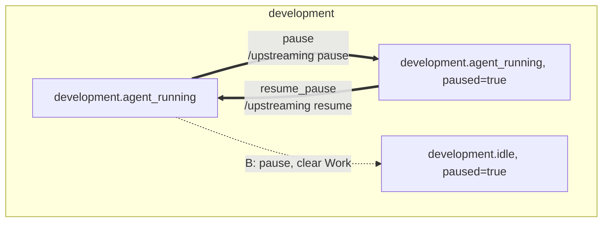

## 2. Park quiescence and the generation fence

How `restart_generation` knows the ended generation is quiescent, and how a late Result of that generation is kept out of the new one.

**Table.** Every transition into `parked.idle` clears the requested Work. `restart_generation` requires quiescence, and `record_late_effect` reconciles a late published Result for audit. Work carries no generation, so quiescence cannot see Work cleared at park.

- **A.** Keep the Work at park, marked stopped; quiescence waits until its claim is terminal or its Result is folded.
- **B.** Clear the Work at park but record it as parked Work that quiescence checks.
- **C.** Add the generation to the Work identity and drop any Result of another generation as a late effect. Combines with A or B.

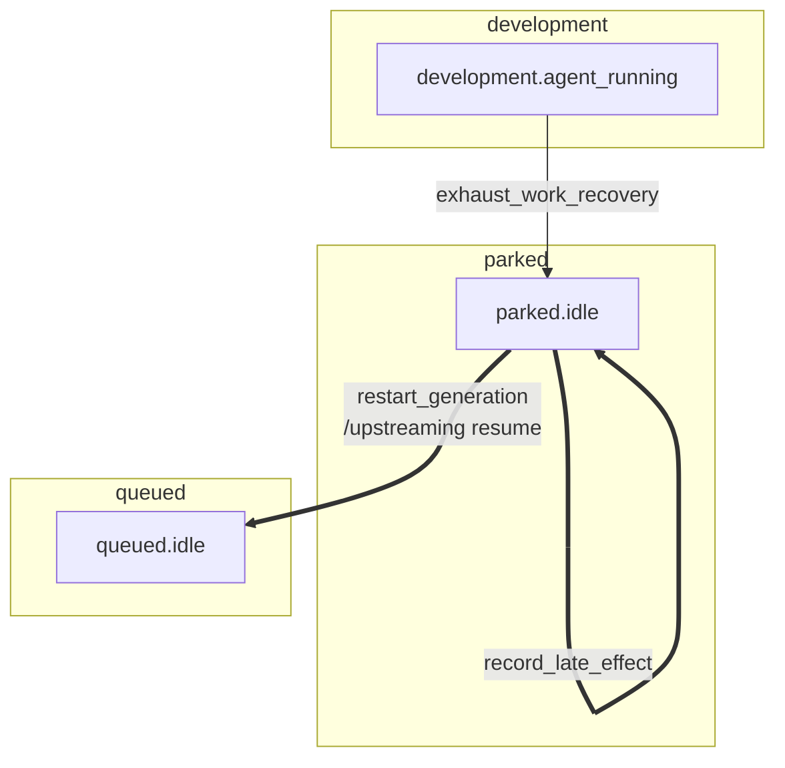

## 3. Resume targets of recorded human waits in upstream review

Where `resume_upstream_review` leads when the wait was entered by `exhaust_dispatch_recovery` rather than by `record_pr_closed_unmerged`.

**Table.** `resume_upstream_review` always leads to `upstream_review.waiting_ci`.

- **A.** Make the resume target depend on the recorded `pending_human_action`: `upstream_review.fix_needed` for Work and publication failures, `upstream_review.waiting_ci` for a closed PR.
- **B.** Park on dispatch exhaustion in upstream review instead of waiting for a human.
- **C.** Allow no automatic Work in upstream review until its rows are settled.

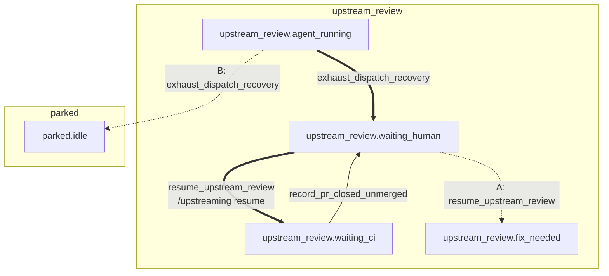

## 4. Handoff entry and the handoff commands

Whether `handoff.awaiting_submission`, `submit_upstream`, and the observed `verify_upstream_pr` replace the `request-handoff`, `approve-handoff`, and `register-upstream-pr` commands the controller accepts today.

**Table.** Nomination enters `handoff.awaiting_submission`; one `submit_upstream` command drives the handoff sub-states; `verify_upstream_pr` is an observation. The table has no rows for the three commands; the controller today enters `handoff.waiting_human` and registers the upstream PR by command.

- **A.** Keep the table and retire the three commands.
- **B.** Keep `register-upstream-pr` as a command exit of `handoff.waiting_upstream_pr` instead of the observation.
- **C.** Name the entry state `handoff.waiting_human` and keep the commands.

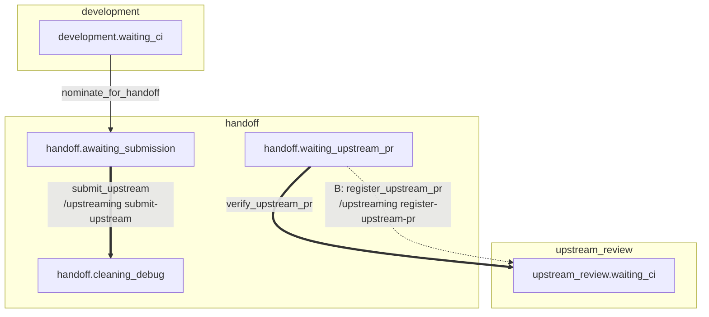

## 5. One terminal phase for work that is not needed

Whether `closed.idle` with `terminal_reason` replaces the separate terminal phases `no_work`, `deferred`, `abandoned`, and `already_released` the record schema has today.

**Table.** `withdraw_request` and `close_investigation` lead to `closed.idle`; the reason is `terminal_reason`.

- **A.** Keep `closed.idle` and migrate existing records.
- **B.** Keep the separate terminal phases, rendered as `closed`.

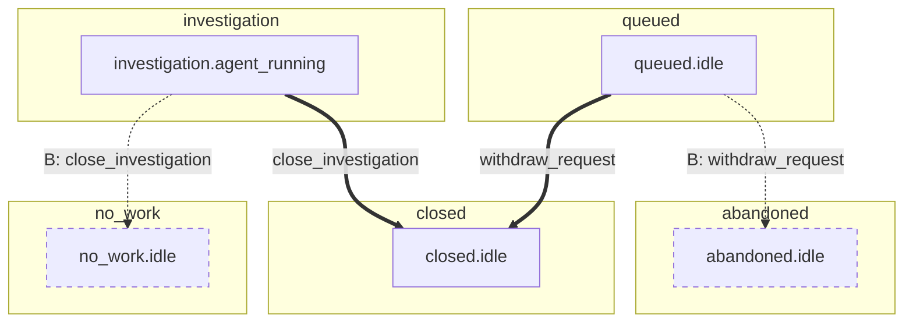

## 6. Capacity waits

Whether lack of capacity, a planned operation, or a pending publication retry is an activity.

**Table.** There is no `waiting_capacity` activity: `start_operation` and `schedule_publish_retry` keep the state, and the pending operation or publication is read from `active_operation_id` and `pending_publication`. The controller today writes `waiting_capacity` in these cases.

- **A.** Keep the table.
- **B.** Add `waiting_capacity` states to the table.
- **C.** Model the wait as a flag beside `paused`.

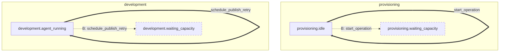

## 7. Repair-budget exhaustion

Whether `no_progress` exhaustion parks straight from `development.agent_running` or through `development.fix_needed`.

**Table.** `reject_patch_proposal` charges `no_progress` and leads to `development.fix_needed`, where `exhaust_repair_attempts` parks when any repair budget is exhausted at allocation.

- **A.** Keep the table.
- **B.** Add `exhaust_repair_attempts` from `development.agent_running` for the `no_progress` streak.

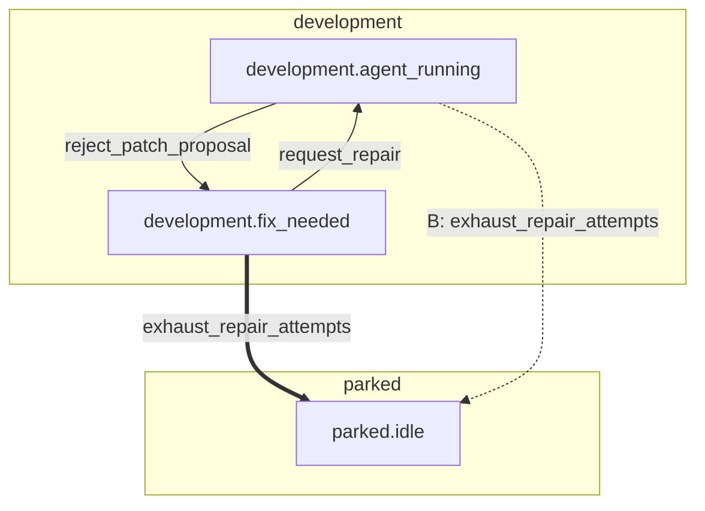

## 8. Investigation retry budget

Which budget `reject_dossier` charges.

**Table.** `reject_dossier` charges `investigation_attempts`, which counts against `retries.max_attempts_per_contribution`.

- **A.** Keep the table.
- **B.** Add a dedicated `retries.investigation_attempts` key.
- **C.** Charge `work_recovery` instead.

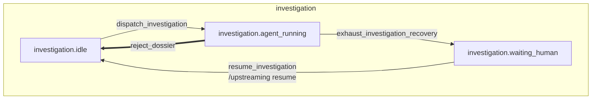

## 9. Publication recovery exhaustion and its resume

From which states `exhaust_publish_recovery` is taken, and where `resume_development` leads.

**Table.** `exhaust_publish_recovery` leaves only `development.agent_running`; `resume_development` leads to `development.fix_needed`.

- **A.** Keep the table.
- **B.** Also take `exhaust_publish_recovery` from `development.fix_needed` and resume to `development.idle`.

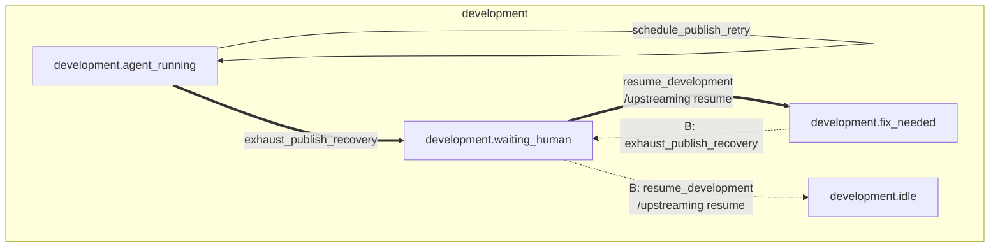

## 10. Dispatch and Work recovery exhaustion targets

Whether dispatch exhaustion and Work exhaustion should lead to the same place.

**Table.** `exhaust_dispatch_recovery` waits for a human; `exhaust_work_recovery` parks. A stale rejection takes `replan_development`. A development PR resource that does not match has no row.

- **A.** Keep the table.
- **B.** Both wait for a human.
- **C.** Both park.

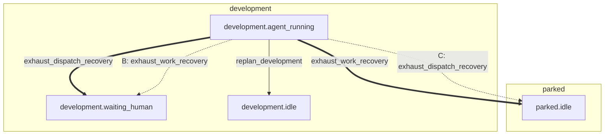

## 11. Where park and refresh apply

From which states `park_contribution` and `refresh_investigation` are accepted.

**Table.** Each state lists them explicitly: `park_contribution` from idle, fix-needed, gate, and human-wait states, never from `handoff.waiting_upstream_pr`; `refresh_investigation` from `development.idle` and `handoff.awaiting_submission`. The controller today accepts `park` from every non-terminal state and `refresh` from every development and handoff activity when no Work or operation is active.

- **A.** Allow both from every non-terminal state except the listed exclusions, with quiescence guards.
- **B.** Keep the explicit rows.

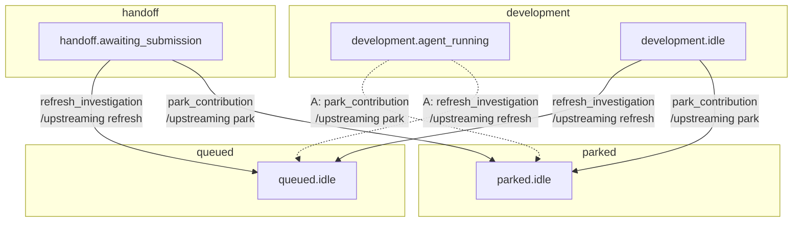

## 12. Return path after refresh

Where a refreshed investigation that decides to develop leads.

**Table.** `readmit_development` leads to `development.fix_needed` on the existing fork; `admit_development` without a recorded refresh leads to `provisioning.idle`.

- **A.** Keep the table.
- **B.** Always provision again through `admit_development`.

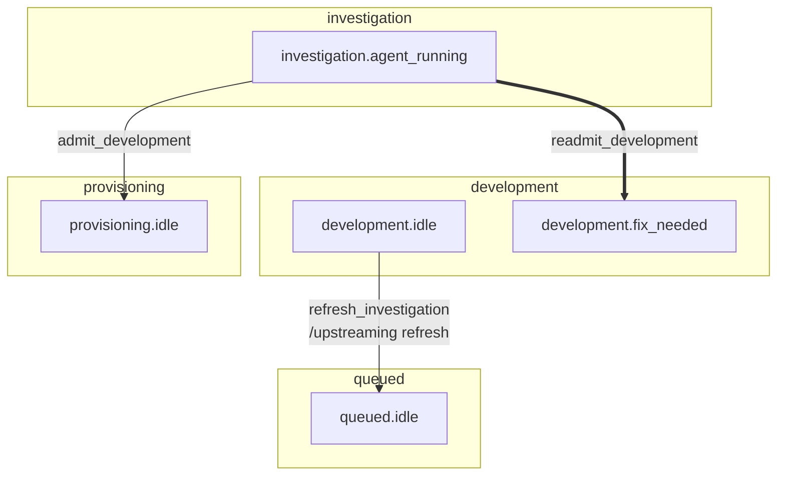

## 13. Park by dossier decision and park by command

Whether parking from investigation is one verb or two.

**Table.** Two verbs: `park_investigation` is a Result transition taken on a dossier decision; `park_contribution` is the `/upstreaming park` command.

- **A.** Keep two verbs.
- **B.** One verb with two triggers.

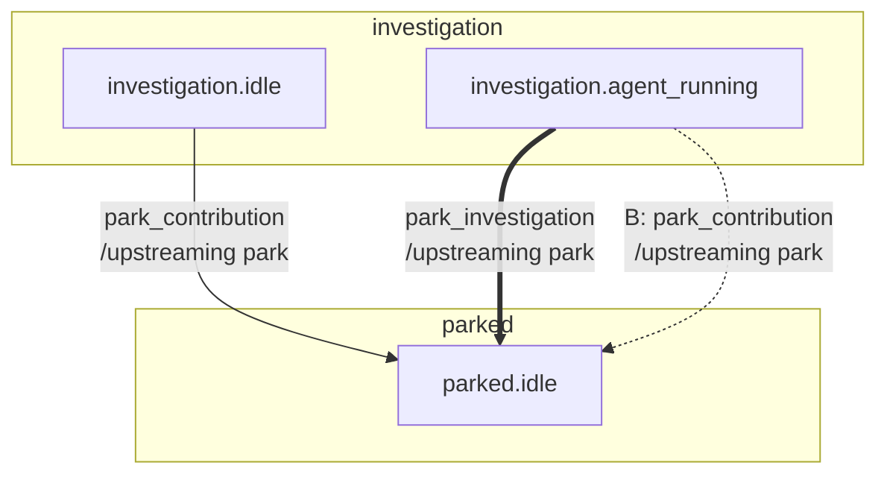

## 14. Beginning the investigation

Whether `begin_investigation` and `dispatch_investigation` are two writes.

**Table.** `begin_investigation` leads to `investigation.idle`, and `dispatch_investigation` allocates Work from there. The controller today writes `investigation.agent_running` directly from `queued.idle`.

- **A.** Keep two transitions, written in two commits.
- **B.** One compound write from `queued.idle` to `investigation.agent_running` that records both events.

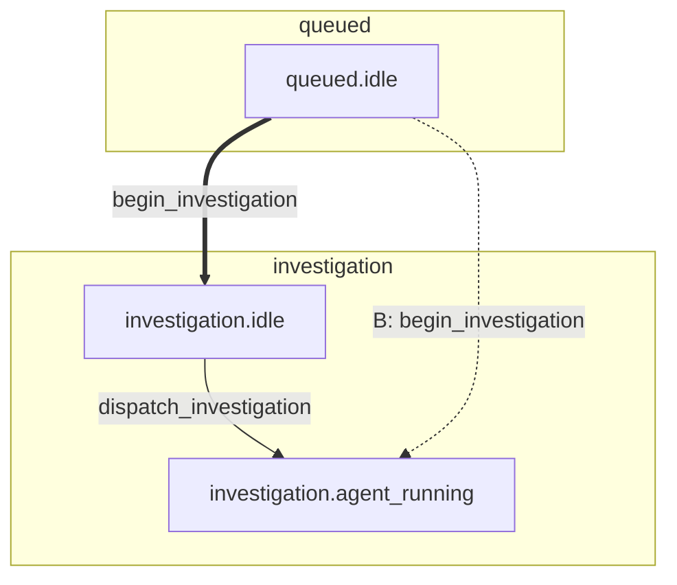

## 15. Provisioning failures

How provisioning failures are recovered, and whether the `approve-scope` and `provision` commands the controller accepts today stay.

**Table.** `start_operation` charges `operation_launch`; its exhaustion and unsafe prerequisites take `require_provisioning_intervention`. `resume_provisioning` charges `provisioning_attempts`, and `exhaust_provisioning_attempts` parks. `close_investigation` also leaves `provisioning.idle`.

- **A.** Keep the table and retire `approve-scope` and `provision`.
- **B.** Keep the commands as the resume path.
- **C.** Park directly when `operation_launch` is exhausted.

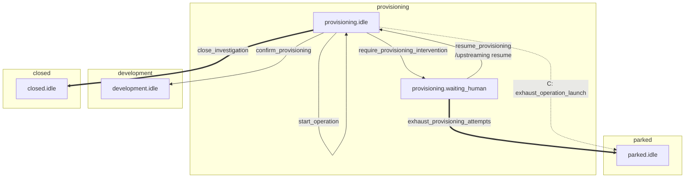

## 16. Upstream revision outcomes

What happens when revision Work in upstream review is rejected or reports no change.

**Table.** `upstream_review.agent_running` has no rejection or no-change transition; only `record_revision_publish_success` and the recovery transitions leave it.

- **A.** Mirror development: add `reject_patch_proposal` and `record_no_change`.
- **B.** Send every unusable revision outcome to `upstream_review.waiting_human`.

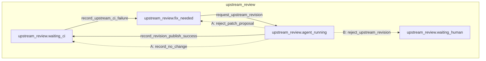

## 17. Commands without table rows

Which commands the controller accepts today become table rows: `abandon`, `restart`, `clarify`, `revise-scope`, `force-develop`, `approve-scope`, `provision`, `request-handoff`, `approve-handoff`, `register-upstream-pr`, and `authorize-followup`.

**Table.** None of them has a row. `block` is the `blocked` flag.

- **A.** Add a row for each command that stays, such as `abandon` to `closed.idle` and `force-develop` from `parked.idle`.
- **B.** Retire the commands that table verbs replace (the handoff commands, `approve-scope`, `provision`, `abandon`, and `restart`).

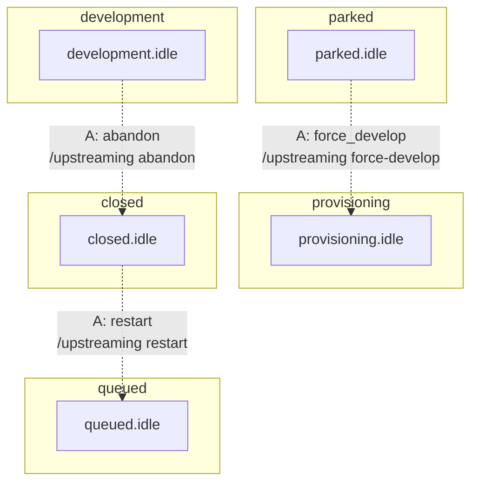

## 18. Observations and outcomes without verbs

Whether CI passing without nomination, a CI access wait, and a withdrawn obsolete repair become table verbs.

**Table.** The table has no rows for them. The controller today moves to an idle activity when CI passes without nomination, to `waiting_human` without a pending action on a CI access wait, and back to `waiting_ci` when an obsolete repair is withdrawn.

- **A.** Name each as a verb in the table.
- **B.** Make them self-transitions that never change phase or activity.
- **C.** Remove them from the controller.

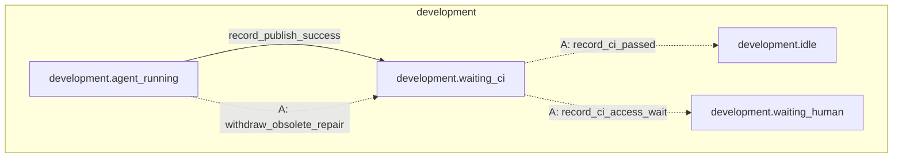

## 19. Late Results during handoff

What a late published Result does in the handoff states.

**Table.** No handoff state has a Result transition, so a late Result changes nothing there. The controller today folds a late published Result in handoff and moves to `waiting_ci`.

- **A.** Keep the table: ignore late Results in handoff.
- **B.** Record them with `record_late_effect`, as in `parked.idle`.
- **C.** Accept them only before `handoff.waiting_upstream_pr`.

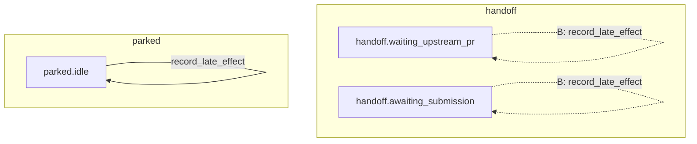

## 20. Budget keys

Whether budgets get their own `policy.json` keys.

**Table.** `dispatch_recovery`, `work_recovery`, `publish_recovery`, `operation_launch`, `provisioning_attempts`, `internal_pr_closure`, and `submission_comment` share `retries.infrastructure_per_head_failure`; `investigation_attempts` and `repair_attempts_total` share `retries.max_attempts_per_contribution`. The `record_reminder` interval of 7 days is not a policy key.

- **A.** One policy key per budget, plus a reminder interval key.
- **B.** Keep shared keys.

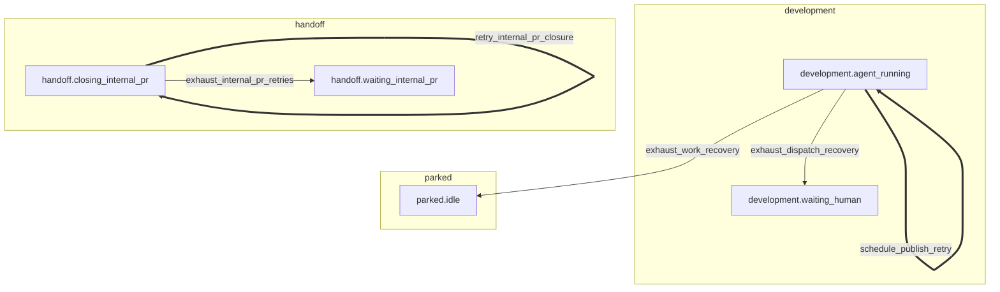

## 21. Flaky CI reruns

How a CI failure is classified flaky before `rerun_failed_ci` is taken.

**Table.** `rerun_failed_ci` charges `flaky_reruns`; when it is exhausted or the failure is not flaky, `record_ci_failure` is taken. The classification is not defined.

- **A.** The worker classifies the failure and requests a rerun.
- **B.** The collector classifies from job logs.
- **C.** Drop `rerun_failed_ci` and repair every failure.

```mermaid
flowchart TB
    subgraph development["development"]
        development_waiting_ci["development.waiting_ci"]
        development_fix_needed["development.fix_needed"]
    end

    development_waiting_ci ==>|rerun_failed_ci| development_waiting_ci
    development_waiting_ci -->|record_ci_failure| development_fix_needed
```

## 22. Revision bumps

Whether the `revision` effect of every row is the complete revision rule.

**Table.** Each row states whether it bumps the revision. Examples: `allocate_work_retry` and `confirm_provisioning` bump, `resume_pause` does not, `resume_block` does.

- **A.** The table is the complete rule.
- **B.** Bump only on changed requested work, and drop the bumps the table adds beyond it.

```mermaid
flowchart TB
    subgraph development["development"]
        development_waiting_ci["development.waiting_ci"]
        development_waiting_ci_paused["development.waiting_ci, paused=true"]
        development_waiting_ci_blocked["development.waiting_ci, blocked=true"]
        development_agent_running["development.agent_running"]
    end

    development_waiting_ci -->|pause<br/>/upstreaming pause| development_waiting_ci_paused
    development_waiting_ci_paused ==>|resume_pause<br/>/upstreaming resume| development_waiting_ci
    development_waiting_ci -->|block<br/>/upstreaming block| development_waiting_ci_blocked
    development_waiting_ci_blocked ==>|resume_block<br/>/upstreaming resume| development_waiting_ci
    development_agent_running ==>|allocate_work_retry| development_agent_running
```

## 23. Blocked flag

Whether `block` changes the activity.

**Table.** `block` only sets `blocked_reason`. The controller today also sets the activity to `waiting_human`.

- **A.** Keep the table.
- **B.** Also enter the phase's `waiting_human` activity.

```mermaid
flowchart TB
    subgraph development["development"]
        development_waiting_ci["development.waiting_ci"]
        development_waiting_ci_blocked["development.waiting_ci, blocked=true"]
        development_waiting_human_blocked["development.waiting_human, blocked=true"]
    end

    development_waiting_ci ==>|block<br/>/upstreaming block| development_waiting_ci_blocked
    development_waiting_ci_blocked -->|resume_block<br/>/upstreaming resume| development_waiting_ci
    development_waiting_ci -.->|"B: block<br/>/upstreaming block"| development_waiting_human_blocked
```

## 24. Remote operation states

Whether remote operations get their own table beside this one.

**Table.** The table names operation receipts as triggers but does not model the operation's own states (planned, applying, uncertain, confirmed, failed, not launched). Publication retries live in `pending_publication`.

- **A.** Add an operation table with the same tests.
- **B.** Leave operations outside the table.
- **C.** Move publication retries into the operation table.

```mermaid
flowchart TB
    subgraph provisioning["provisioning"]
        provisioning_idle["provisioning.idle"]
        provisioning_waiting_human["provisioning.waiting_human"]
    end
    subgraph development["development"]
        development_idle["development.idle"]
    end

    provisioning_idle ==>|start_operation| provisioning_idle
    provisioning_idle -->|require_provisioning_intervention| provisioning_waiting_human
    provisioning_idle -->|confirm_provisioning| development_idle
```
