<!-- Generated by scripts/generate_state_machine_doc.py from the lifecycle table in lifecycle.py. Do not edit; change the table and regenerate. -->

# Decisions
{: .no_toc }

This page records the decisions behind the [lifecycle table]({{ '/state-machine/table/' | relative_url }}). The open items come first: each is a question that is not settled, and until it is, the table entry it names is the working definition. The settled decisions follow, each with the slice of the table that now holds it. Items keep their number when they are settled, so the open items are numbered after the settled ones. Each diagram shows only the states and verbs involved: thick arrows are the table transitions the item is about, dashed arrows are transitions an option of an open item would add (labelled with the option), and a node with a dashed border is a state the table does not have.

<details open markdown="block">
  <summary>Contents</summary>
  {: .text-delta }
1. TOC
{:toc}
</details>

## Rules behind the decisions

1. Infrastructure exhaustion goes to the phase's `waiting_human`. It never ends the generation.
2. Park means "the approach is not working" or "a human said stop". Nothing parks from `upstream_review` automatically.
3. A Result is reused only while the pipeline ran continuously. Any stop of unknown length (pause, human wait, park) invalidates it; the next step is fresh Work.
4. The plan is refreshed after a park, and after a pause or human wait longer than 7 days in provisioning or development. It is never refreshed automatically from `handoff.awaiting_submission` or `handoff.waiting_upstream_pr`; there a human uses `/upstreaming refresh`.
5. Every row with a `Work: allocate` or `Work: reallocate` effect charges one per-generation counter, `work_total`. `lifecycle check` verifies this.
6. Prefer a guard or a derived status over a new state or flag.
7. Every stop that clears the requested Work also clears `pending_publication`: the flag set verbs, `park_contribution`, `abandon`, and every other transition that ends the generation. `lifecycle check` verifies this.

## Open items

No item is open.

## Settled decisions

### 1. Pause semantics

What `pause` stops, and whether `resume_pause` changes the revision.

**Decision.** `pause` clears the requested Work and the pending publication, and records `paused_at`. A Result held for publication is invalidated: it is not published, and no publish retry is launched while paused. `resume_pause` bumps the revision, so a Result that lands during the pause no longer matches and takes `record_late_effect`. While paused, observations and receipts still converge, but no new outward work starts and no observation moves the record to its next state: an observation that keeps the state and the revision (an explanation, a review comment fence) is folded and saved, and an observation that would move the record to another state (but one that ends it), bump the revision, or charge a budget is read again after the resume. The receipt of an operation launched before the pause is the owner's intended exception: it completes its transition even when that moves the state or bumps the revision (see "A pause holds back what would move the record"). The publisher's final check reads `paused`.

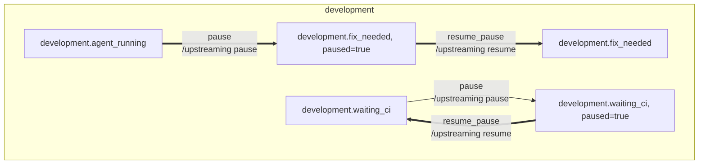

### 2. Park quiescence and the generation fence

How `restart_generation` knows the ended generation is quiescent, and how a late Result of that generation is kept out of the new one.

**Decision.** The generation is part of the Work identity. A Result of another generation is never folded and the publisher refuses it; it takes `record_late_effect`. Work and the pending publication are cleared at park and at abandon, so a publication that was pending when the generation ended never keeps `restart_generation` from applying; a branch its worker run already pushed is recorded by head observation in the phases that observe the head. Quiescence for `restart_generation` is: no open operation and no pending publication.

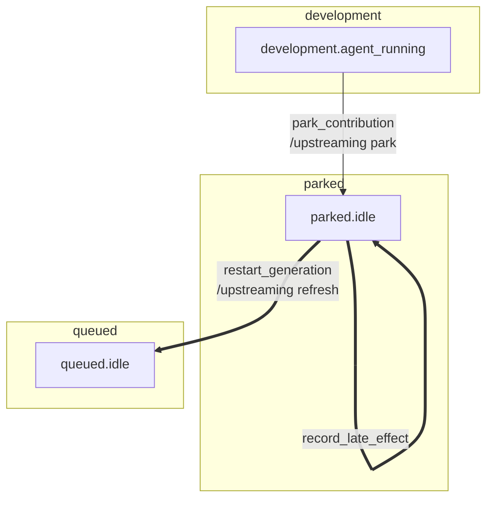

### 3. Resume targets of recorded human waits in upstream review

Where a resume from `upstream_review.waiting_human` leads.

**Decision.** Two verbs, each guarded by the pending action, so exactly one applies. `resume_upstream_review` leads to `upstream_review.waiting_ci` after a closed PR that is observed open again, after a reviewer was answered, and after a head change. `resume_upstream_revision` leads to `upstream_review.fix_needed` only when revision Work failed. Dispatch exhaustion does not park.

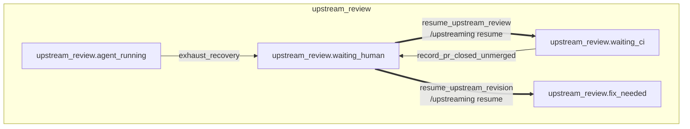

### 4. Handoff entry and the handoff commands

Whether `handoff.awaiting_submission`, `submit_upstream`, and the observed `verify_upstream_pr` replace the `request-handoff`, `approve-handoff`, and `register-upstream-pr` commands.

**Decision.** They do. Nomination enters `handoff.awaiting_submission`, one `submit_upstream` command drives the handoff, and `verify_upstream_pr` is an observation. The three commands are retired. The reminder in `handoff.waiting_upstream_pr` states when an observed PR does not match.

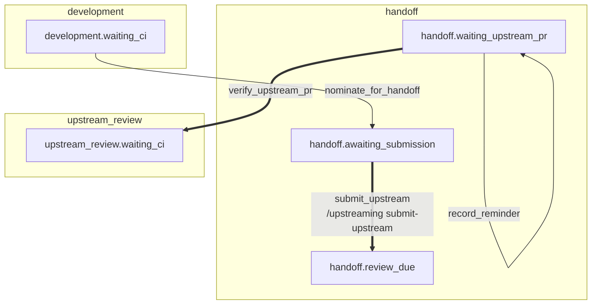

### 5. One terminal phase for work that is not needed

Whether `closed.idle` with `terminal_reason` replaces the separate terminal phases `no_work`, `deferred`, `abandoned`, and `already_released`.

**Decision.** It does: one `closed.idle` with `terminal_reason`. Existing records are migrated.

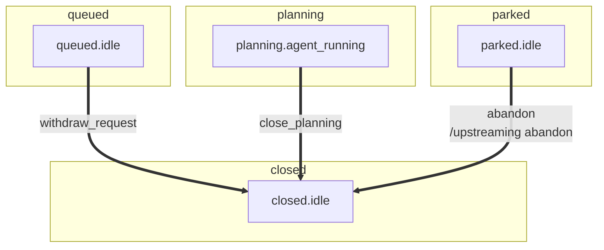

### 6. Capacity waits

Whether lack of capacity, a planned operation, or a pending publication retry is an activity.

**Decision.** It is not. There is no `waiting_capacity` state or flag: the contribution stays in its state while a guard such as a free worker slot or available capacity does not hold, and the status page shows the unmet guard.

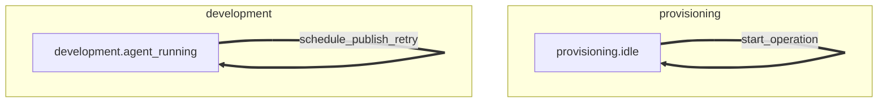

### 7. Repair-budget exhaustion

Where repair-budget exhaustion is decided, and what it does.

**Decision.** Exhaustion is decided at `development.fix_needed` only. The first time `repair_attempts_cluster` or `no_progress` is exhausted in a generation, the tick row `refresh_on_exhaustion` leads to `queued.idle` and starts both counters again, but not `work_total`. Once that automatic refresh is used, `exhaust_repair_attempts` parks.

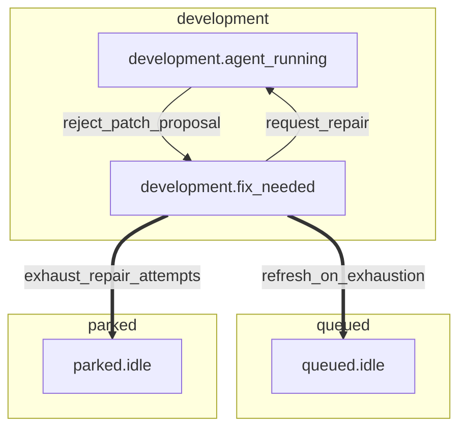

### 8. Planning retry budget

Which budget `reject_plan` charges.

**Decision.** A dedicated `planning_attempts` budget with the key `retries.planning_attempts` (3) and its own counter. A Result without a plan charges it too instead of going straight to `planning.waiting_human`.

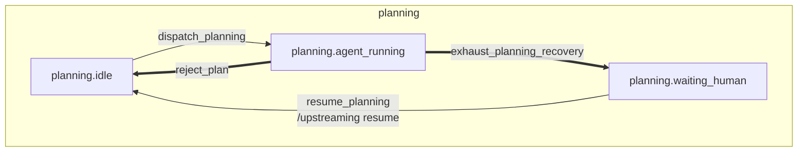

### 9. Publication recovery exhaustion and its resume

From which states the exhaustion of `publish_recovery` (`exhaust_recovery`) is taken, and where `resume_development` leads.

**Decision.** In development, the exhaustion of `publish_recovery` leaves only the states that hold a publication, `development.agent_running` and `development.publishing`. `resume_development` leads to `development.fix_needed`, clears `pending_publication`, and requests fresh Work. Automatic publish retries still reuse the Result.

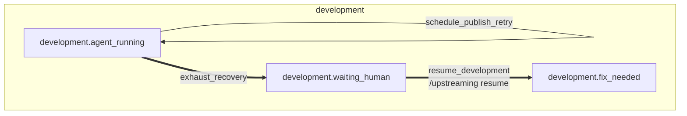

### 10. Dispatch and Work recovery exhaustion targets

Whether dispatch exhaustion and Work exhaustion lead to the same place.

**Decision.** Both wait for a human: the exhaustion of `dispatch_recovery` leads to the phase's `waiting_human` in planning, development, and upstream review, like the exhaustion of `work_recovery` (one row, `exhaust_recovery`). An observed development PR that does not match the record takes `record_pr_mismatch` to `development.waiting_human`.

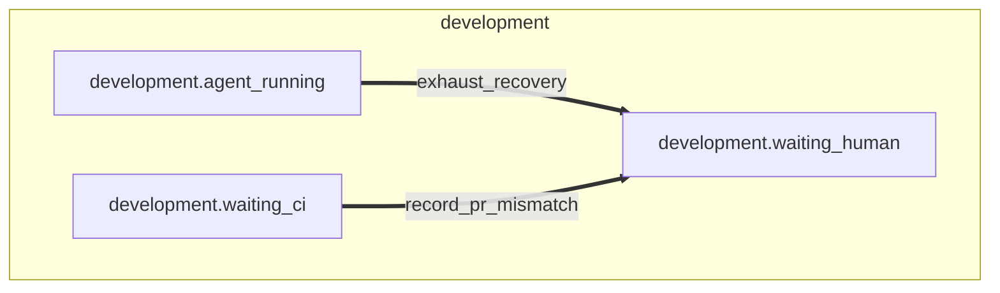

### 11. Where park and refresh apply

From which states `park_contribution` and `refresh_planning` are accepted.

**Decision.** `park_contribution` is one rule: every non-terminal state, guarded by no open operation, except `handoff.waiting_upstream_pr`, `release_wait.*`, and `upstream_review.*` other than `upstream_review.waiting_human`. `refresh_planning` stays explicit: `development.fix_needed`, `development.waiting_ci`, `development.waiting_human`, `handoff.awaiting_submission`, and `handoff.waiting_upstream_pr`. Both are accepted while paused.

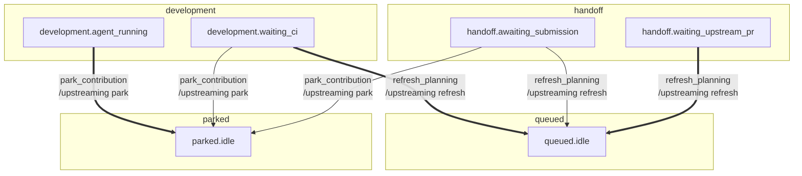

### 12. Return path after refresh

Where a refreshed planning that decides to develop leads.

**Decision.** `readmit_development` leads to `development.fix_needed` on the existing fork. The guard of `admit_development` is the complement: no refresh recorded, or the recorded fork or development PR no longer matches.

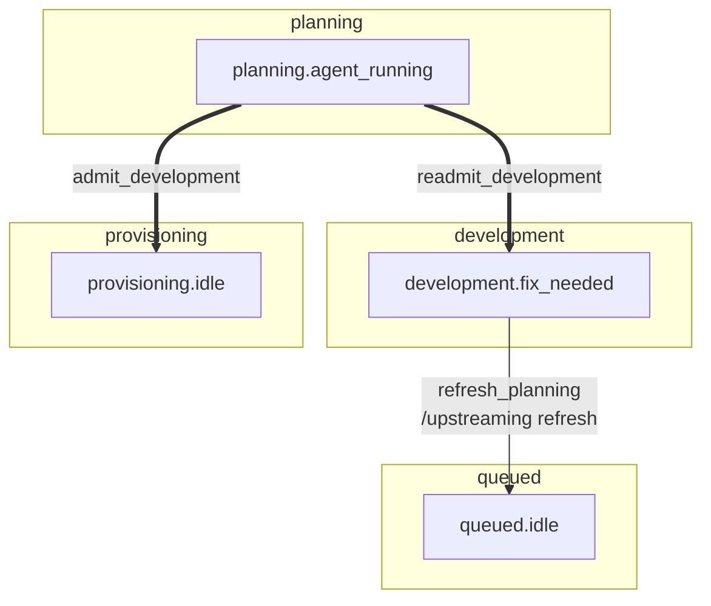

### 13. Park by plan decision and park by command

Whether parking from planning is one verb or two.

**Decision.** Two verbs. `park_planning` is the Result transition taken on a plan decision and no longer carries the `/upstreaming park` label; `park_contribution` is the command.

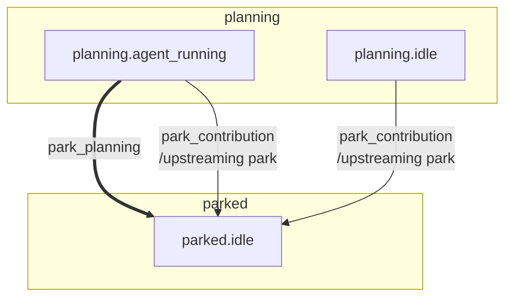

### 14. Beginning the planning

Whether `begin_planning` and `dispatch_planning` are two writes.

**Decision.** Two transitions, written in two commits.

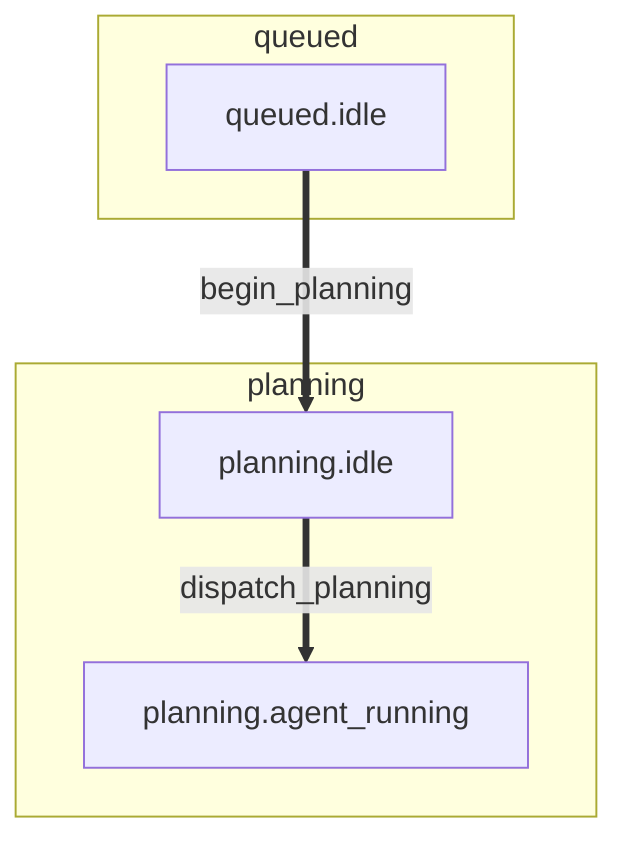

### 15. Provisioning failures

How provisioning failures are recovered, and whether the `approve-scope` and `provision` commands stay.

**Decision.** `approve-scope` and `provision` are retired. The `provisioning_attempts` budget and `exhaust_provisioning_attempts` are removed; a human parks explicitly. `close_planning` no longer leaves `provisioning.idle`. Exhausting `operation_launch` waits for a human and does not park. A definite failure reported by the provisioning workflow waits for a human at once; a failure that is not definite is launched again within `operation_launch`; a refusal before any effect is neither.

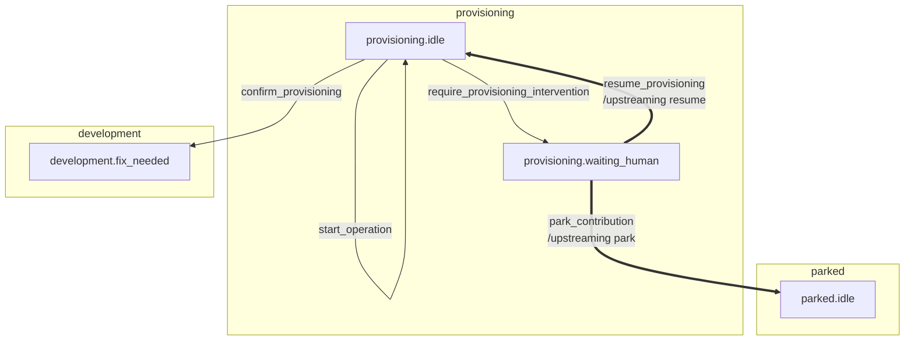

### 16. Upstream revision outcomes

What happens when revision Work in upstream review is rejected or reports no change.

**Decision.** A rejected proposal takes `reject_patch_proposal` to `upstream_review.fix_needed` and charges `no_progress`. When no change is needed, `require_reviewer_answer` leads to `upstream_review.waiting_human` with a pending action to answer the reviewer. `upstream_review.agent_running` has `schedule_publish_retry` and `exhaust_recovery`. Every exhaustion in upstream review leads to `upstream_review.waiting_human`.

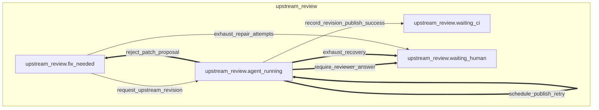

### 17. Commands without table rows

Which commands become table rows and which are retired.

**Decision.** Retired: `request-handoff`, `approve-handoff`, `register-upstream-pr`, `approve-scope`, `provision`, `restart`, `clarify`, `revise-scope`, and `force-develop`. `abandon` leads from `parked.idle` to `closed.idle` with `terminal_reason=abandoned`. `/upstreaming refresh` from `parked.idle` accepts an optional class, paths, and reason, stored as `admission_override`; `restart_generation` still runs the complete planning, and `admit_development` accepts a verified plan decision develop, or a decision park with a recorded override. `authorize-followup` is an intake command outside the table.

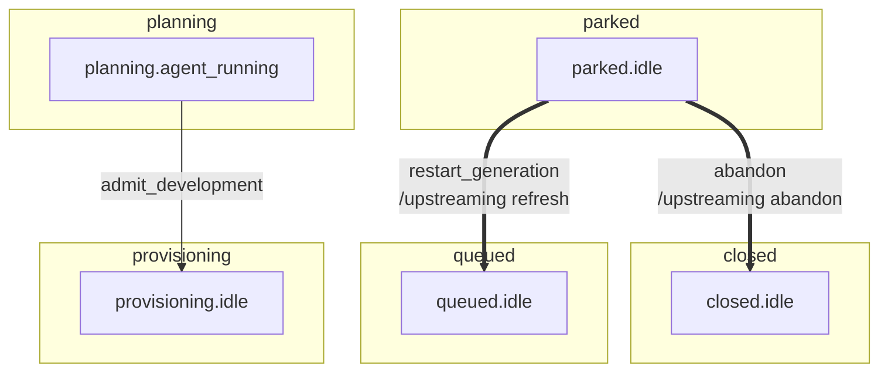

### 18. Observations and outcomes without verbs

Whether CI passing without nomination, a CI access wait, and a withdrawn obsolete repair become table verbs.

**Decision.** None does; all three leave the controller. Green CI without nomination stays in `development.waiting_ci`. A CI access failure is collector health, not contribution state. An obsolete repair is not withdrawn; its Result is judged stale on arrival and takes `record_late_effect`.

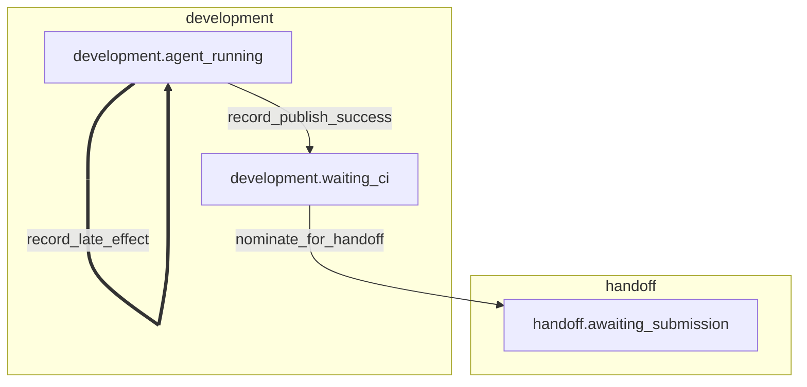

### 19. Late Results during handoff

What a late Result does in the handoff states.

**Decision.** One rule for every state: a Result that does not match the current generation, revision, and requested Work is recorded by `record_late_effect` and never changes state. `record_head_change` leads from `handoff.awaiting_submission` to `development.waiting_ci`, bumps the revision, and clears the CI evidence. `return_for_repair` from `handoff.waiting_ci` also fires when the head differs from the clean head, and then keeps the recorded CI evidence.

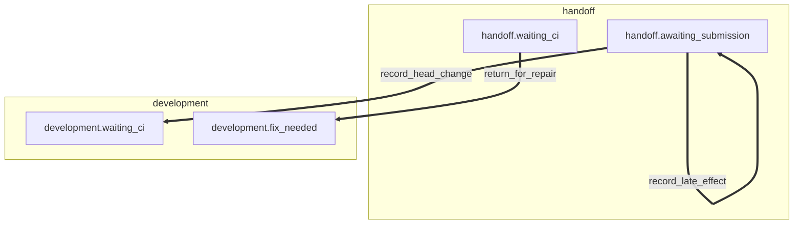

### 20. Budget keys

Whether budgets get their own `policy.json` keys.

**Decision.** Keys are split by what is spent. `work_total` reads `retries.max_attempts_per_contribution`, `work_recovery` reads `retries.work_recovery`, `planning_attempts` reads `retries.planning_attempts`, and the infrastructure budgets share `retries.infrastructure_per_head_failure`. The reminder interval reads `human_sla_business_days.reminder`. Each Result records its token usage in the events.

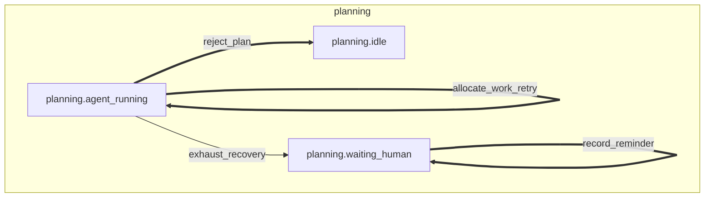

### 21. Flaky CI reruns

How a CI failure is classified before a rerun.

**Decision.** The repair worker classifies. A Result reporting a failure not caused by the patch takes `request_ci_rerun` from `development.agent_running` to `development.waiting_ci` and charges `flaky_reruns`; it replaces `record_no_change`. When `flaky_reruns` is exhausted, or the Work carries feedback, the outcome counts as `reject_patch_proposal`. The collector reruns on its own only jobs that were cancelled or lost their runner, in `development.waiting_ci` and `handoff.waiting_ci`, within `interrupted_reruns` per head. Upstream CI is never rerun.

```mermaid
flowchart TB
    subgraph development["development"]
        development_agent_running["development.agent_running"]
        development_waiting_ci["development.waiting_ci"]
        development_fix_needed["development.fix_needed"]
    end
    subgraph handoff["handoff"]
        handoff_waiting_ci["handoff.waiting_ci"]
    end

    development_agent_running ==>|request_ci_rerun| development_waiting_ci
    development_agent_running -->|reject_patch_proposal| development_fix_needed
    development_waiting_ci -->|record_ci_failure| development_fix_needed
    development_waiting_ci ==>|rerun_interrupted_ci| development_waiting_ci
    handoff_waiting_ci ==>|rerun_interrupted_ci| handoff_waiting_ci
```

### 22. Revision bumps

Which rows bump the revision.

**Decision.** One rule: revision +1 on every transition that invalidates requested or approved work, and on every resume, flags included. No other row bumps; `confirm_provisioning` lost its bump. `python -m lifecycle check` enforces the rule on every row.

```mermaid
flowchart TB
    subgraph provisioning["provisioning"]
        provisioning_idle["provisioning.idle"]
    end
    subgraph development["development"]
        development_fix_needed["development.fix_needed"]
    end
    subgraph handoff["handoff"]
        handoff_building_upstream_branch["handoff.building_upstream_branch"]
        handoff_waiting_human["handoff.waiting_human"]
    end
    subgraph release_wait["release_wait"]
        release_wait_idle["release_wait.idle"]
        release_wait_waiting_human["release_wait.waiting_human"]
    end

    provisioning_idle ==>|confirm_provisioning| development_fix_needed
    handoff_building_upstream_branch -->|exhaust_upstream_branch_retries| handoff_waiting_human
    handoff_waiting_human ==>|resume_upstream_branch<br/>/upstreaming resume| handoff_building_upstream_branch
    release_wait_idle -->|require_release_intervention| release_wait_waiting_human
    release_wait_waiting_human ==>|resume_release_observation<br/>/upstreaming resume| release_wait_idle
```

### 23. Blocked flag

Whether a block changes the activity, and whether `blocked` is a flag of its own.

**Decision.** A block does not change the activity. `blocked` is merged into `paused`: one flag with a reason and who set it, a human or the controller. The controller sets it when the upstream identity changes. The `block` command is retired; `pause` accepts an optional reason.

```mermaid
flowchart TB
    subgraph development["development"]
        development_waiting_ci["development.waiting_ci"]
        development_waiting_ci_paused["development.waiting_ci, paused=true"]
    end

    development_waiting_ci ==>|pause<br/>/upstreaming pause| development_waiting_ci_paused
    development_waiting_ci ==>|pause_on_identity_change| development_waiting_ci_paused
    development_waiting_ci_paused -->|resume_pause<br/>/upstreaming resume| development_waiting_ci
```

### 24. Remote operation states

Whether remote operations get their own table.

**Decision.** They do: an operation table with the states planned, applying, uncertain, confirmed, failed, and not launched, under the same checks. `/upstreaming resolve-operation` lives there. The human waits of the handoff operations are one `handoff.waiting_human`. Later: publication retries move into the operation table.

```mermaid
flowchart TB
    subgraph open_operations["open"]
        op_planned["planned"]
        op_applying["applying"]
        op_uncertain["uncertain"]
    end
    subgraph closed_operations["closed"]
        op_confirmed["confirmed"]
        op_failed["failed"]
        op_not_launched["not_launched"]
    end

    start_1(( )) -->|record_intent| op_planned
    op_planned -->|begin_effect| op_applying
    op_planned -->|resolve_confirmed<br/>/upstreaming resolve-operation| op_confirmed
    op_planned -->|resolve_failed<br/>/upstreaming resolve-operation| op_failed
    op_planned -->|resolve_not_launched<br/>/upstreaming resolve-operation| op_not_launched
    op_applying -->|record_response| op_uncertain
    op_applying -->|record_failure| op_failed
    op_applying -->|resolve_confirmed<br/>/upstreaming resolve-operation| op_confirmed
    op_applying -->|resolve_failed<br/>/upstreaming resolve-operation| op_failed
    op_applying -->|resolve_not_launched<br/>/upstreaming resolve-operation| op_not_launched
    op_uncertain -->|confirm_by_discovery| op_confirmed
    op_uncertain -->|record_discovery| op_uncertain
    op_uncertain -->|resolve_confirmed<br/>/upstreaming resolve-operation| op_confirmed
    op_uncertain -->|resolve_failed<br/>/upstreaming resolve-operation| op_failed
    op_uncertain -->|resolve_not_launched<br/>/upstreaming resolve-operation| op_not_launched
    op_confirmed --> end_2(( ))
    op_failed --> end_3(( ))
    op_not_launched --> end_4(( ))
```

## Settled open items

### O1. Merge `development.idle` and `development.fix_needed`

Whether the two states in which development Work is due become one.

**Decision.** One state, `development.fix_needed`: development Work is due. `confirm_provisioning` enters it. `request_repair` applies while a failing CI job is recorded for the head; `request_patch` applies otherwise. `development.idle` and its own exhaustion row are removed, also from the states that accept `refresh_planning`.

```mermaid
flowchart TB
    subgraph provisioning["provisioning"]
        provisioning_idle["provisioning.idle"]
    end
    subgraph development["development"]
        development_fix_needed["development.fix_needed"]
        development_agent_running["development.agent_running"]
    end
    subgraph parked["parked"]
        parked_idle["parked.idle"]
    end

    provisioning_idle ==>|confirm_provisioning| development_fix_needed
    development_fix_needed ==>|request_patch| development_agent_running
    development_fix_needed ==>|request_repair| development_agent_running
    development_fix_needed -->|exhaust_repair_attempts| parked_idle
```

### O2. State after a pause that clears requested Work

Which state a contribution is in after `pause` cleared its requested Work.

**Decision.** `pause` in an `agent_running` state leads to the state in which the Work is due again: `planning.idle`, `development.fix_needed`, or `upstream_review.fix_needed`. It is the one exception to a flag keeping phase and activity, and the description of the flag states it.

```mermaid
flowchart TB
    subgraph planning["planning"]
        planning_agent_running["planning.agent_running"]
        planning_idle_paused["planning.idle, paused=true"]
    end
    subgraph development["development"]
        development_agent_running["development.agent_running"]
        development_fix_needed_paused["development.fix_needed, paused=true"]
    end
    subgraph upstream_review["upstream_review"]
        upstream_agent_running["upstream_review.agent_running"]
        upstream_fix_needed_paused["upstream_review.fix_needed, paused=true"]
    end

    planning_agent_running ==>|pause<br/>/upstreaming pause| planning_idle_paused
    development_agent_running ==>|pause<br/>/upstreaming pause| development_fix_needed_paused
    upstream_agent_running ==>|pause<br/>/upstreaming pause| upstream_fix_needed_paused
```

### O3. The `block` command after the flag merge

Whether `/upstreaming block` stays a command once `blocked` is merged into `paused`.

**Decision.** It is retired. `pause` accepts an optional reason, and a pause set by the controller always records one.

```mermaid
flowchart TB
    subgraph development["development"]
        development_waiting_ci["development.waiting_ci"]
        development_waiting_ci_paused["development.waiting_ci, paused=true"]
    end

    development_waiting_ci ==>|pause<br/>/upstreaming pause| development_waiting_ci_paused
    development_waiting_ci ==>|pause_on_identity_change| development_waiting_ci_paused
    development_waiting_ci_paused -->|resume_pause<br/>/upstreaming resume| development_waiting_ci
```

### O4. `resume_stale` with an open operation

Whether `resume_stale` needs quiescence, as `refresh_planning` does.

**Decision.** It does: `resume_stale` requires that no Work is requested, no operation is open, and no publication is pending. Until then no resume applies, and the rejection names the open operation.

```mermaid
flowchart TB
    subgraph provisioning["provisioning"]
        provisioning_idle["provisioning.idle"]
        provisioning_idle_paused["provisioning.idle, paused=true"]
    end
    subgraph queued["queued"]
        queued_idle["queued.idle"]
    end

    provisioning_idle_paused -->|resume_pause<br/>/upstreaming resume| provisioning_idle
    provisioning_idle_paused ==>|resume_stale<br/>/upstreaming resume| queued_idle
```

### O5. Resume while paused in a human wait

Which transition one `/upstreaming resume` takes when a contribution is both paused and in a human wait.

**Decision.** Two resumes. The first clears the flag; its reply states that the contribution still waits for a human and names the pending action. The second leaves the human wait.

```mermaid
flowchart TB
    subgraph development["development"]
        development_waiting_human_paused["development.waiting_human, paused=true"]
        development_waiting_human["development.waiting_human"]
        development_fix_needed["development.fix_needed"]
    end

    development_waiting_human_paused ==>|resume_pause<br/>/upstreaming resume| development_waiting_human
    development_waiting_human ==>|resume_development<br/>/upstreaming resume| development_fix_needed
```

### O6. Resume after a budget is exhausted

What a resume does to the counter whose exhaustion caused the human wait.

**Decision.** The resume starts again the one counter named in `pending_human_action.counter`, and no other. The event records the actor, the counter, and its count at that point. It was settled for `exhaust_work_total`, `exhaust_planning_recovery`, and `exhaust_repair_attempts` in upstream review; O14 extends it to every exhaustion that leads to a human wait.

```mermaid
flowchart TB
    subgraph planning["planning"]
        planning_idle["planning.idle"]
        planning_agent_running["planning.agent_running"]
        planning_waiting_human["planning.waiting_human"]
    end
    subgraph upstream_review["upstream_review"]
        upstream_fix_needed["upstream_review.fix_needed"]
        upstream_waiting_human["upstream_review.waiting_human"]
    end

    planning_idle -->|exhaust_work_total| planning_waiting_human
    planning_agent_running -->|exhaust_planning_recovery| planning_waiting_human
    planning_waiting_human ==>|resume_planning<br/>/upstreaming resume| planning_idle
    upstream_fix_needed -->|exhaust_repair_attempts| upstream_waiting_human
    upstream_waiting_human ==>|resume_upstream_revision<br/>/upstreaming resume| upstream_fix_needed
```

### O7. Budget for collector reruns

Whether reruns of cancelled or runner-lost jobs are bounded.

**Decision.** They are: `rerun_interrupted_ci` charges the budget `interrupted_reruns`, counted per head, which reads the shared `retries.infrastructure_per_head_failure`. When it is exhausted, `exhaust_interrupted_reruns` leads to the human wait of the phase with `pending_human_action=ci_interrupted`, and `resume_ci` returns to the CI wait, reruns the jobs, and starts `interrupted_reruns` again for the head (O14).

```mermaid
flowchart TB
    subgraph development["development"]
        development_waiting_ci["development.waiting_ci"]
        development_waiting_human["development.waiting_human"]
    end
    subgraph handoff["handoff"]
        handoff_waiting_ci["handoff.waiting_ci"]
        handoff_waiting_human["handoff.waiting_human"]
    end

    development_waiting_ci -->|rerun_interrupted_ci| development_waiting_ci
    development_waiting_ci ==>|exhaust_interrupted_reruns| development_waiting_human
    development_waiting_human ==>|resume_ci<br/>/upstreaming resume| development_waiting_ci
    handoff_waiting_ci -->|rerun_interrupted_ci| handoff_waiting_ci
    handoff_waiting_ci ==>|exhaust_interrupted_reruns| handoff_waiting_human
    handoff_waiting_human ==>|resume_ci<br/>/upstreaming resume| handoff_waiting_ci
```

### O8. Limits and names chosen without a decision

Values and names the decisions left open.

**Decision.** `retries.max_attempts_per_contribution` stays 24, `retries.work_recovery` stays 2, and the verb names stay. The human waits of handoff are one `handoff.waiting_human`: four resume verbs leave it, each guarded by its `pending_human_action`, so exactly one applies (the submission review, the branch write, CI on the clean head, and the package).

```mermaid
flowchart TB
    subgraph handoff["handoff"]
        handoff_review_due["handoff.review_due"]
        handoff_agent_running["handoff.agent_running"]
        handoff_building_upstream_branch["handoff.building_upstream_branch"]
        handoff_waiting_ci["handoff.waiting_ci"]
        handoff_preparing_submission["handoff.preparing_submission"]
        handoff_waiting_human["handoff.waiting_human"]
    end

    handoff_review_due -->|exhaust_work_total| handoff_waiting_human
    handoff_agent_running -->|exhaust_recovery| handoff_waiting_human
    handoff_building_upstream_branch -->|exhaust_upstream_branch_retries| handoff_waiting_human
    handoff_waiting_ci -->|exhaust_interrupted_reruns| handoff_waiting_human
    handoff_preparing_submission -->|exhaust_comment_retries| handoff_waiting_human
    handoff_waiting_human ==>|resume_submission_review<br/>/upstreaming resume| handoff_review_due
    handoff_waiting_human ==>|resume_upstream_branch<br/>/upstreaming resume| handoff_building_upstream_branch
    handoff_waiting_human ==>|resume_ci<br/>/upstreaming resume| handoff_waiting_ci
    handoff_waiting_human ==>|resume_submission_preparation<br/>/upstreaming resume| handoff_preparing_submission
```

### O9. Reminder of the locked upstream-PR wait

Whether the reminder rule also covers the `locked` kind.

**Decision.** It does: the rule covers the `gate`, `human_wait`, and `locked` kinds, and the separate row is removed. In `handoff.waiting_upstream_pr` the package link is part of the reminder text. The reminder keeps the state, so the locked wait still has exactly its three exits.

```mermaid
flowchart TB
    subgraph handoff["handoff"]
        handoff_awaiting_submission["handoff.awaiting_submission"]
        handoff_waiting_upstream_pr["handoff.waiting_upstream_pr"]
        handoff_waiting_human["handoff.waiting_human"]
    end

    handoff_awaiting_submission -->|record_reminder| handoff_awaiting_submission
    handoff_waiting_upstream_pr ==>|record_reminder| handoff_waiting_upstream_pr
    handoff_waiting_human -->|record_reminder| handoff_waiting_human
```

### O10. Where a development PR mismatch is observed

From which states `record_pr_mismatch` leads to `development.waiting_human`.

**Decision.** From `development.waiting_ci` only, where the development PR is observed.

```mermaid
flowchart TB
    subgraph development["development"]
        development_waiting_ci["development.waiting_ci"]
        development_waiting_human["development.waiting_human"]
    end

    development_waiting_ci ==>|record_pr_mismatch| development_waiting_human
```

### O11. Admission override against a park or close decision

Which plan decisions a recorded `admission_override` overrides.

**Decision.** A decision park only: with a recorded override, `admit_development` accepts a verified plan that decides park. A verified decision close still takes `close_planning`, and the reply states that the override was not applied.

```mermaid
flowchart TB
    subgraph planning["planning"]
        planning_agent_running["planning.agent_running"]
    end
    subgraph provisioning["provisioning"]
        provisioning_idle["provisioning.idle"]
    end
    subgraph parked["parked"]
        parked_idle["parked.idle"]
    end
    subgraph closed["closed"]
        closed_idle["closed.idle"]
    end

    planning_agent_running ==>|admit_development| provisioning_idle
    planning_agent_running -->|park_planning| parked_idle
    planning_agent_running ==>|close_planning| closed_idle
```

### O12. Resume after a reviewer was answered

Where the resume leads when the pending action was to answer the reviewer.

**Decision.** Two verbs. `resume_upstream_review` leads to `upstream_review.waiting_ci` when the pending action is `pr_closed_unmerged` (the PR is observed open again), `answer_reviewer`, or `upstream_head_changed`, and clears the pending feedback: every resume that requests Work again keeps the pending feedback; `resume_upstream_review` is the one resume that clears it, because a human answered it (the other two pending actions are entered from `upstream_review.waiting_ci`, which holds none). `resume_upstream_revision` leads to `upstream_review.fix_needed` only when revision Work failed: dispatch, Work, publication, or budget exhaustion. `record_upstream_ci_failure` fires once per head and CI run, so the failure that was answered does not request a revision again.

```mermaid
flowchart TB
    subgraph upstream_review["upstream_review"]
        upstream_waiting_ci["upstream_review.waiting_ci"]
        upstream_fix_needed["upstream_review.fix_needed"]
        upstream_agent_running["upstream_review.agent_running"]
        upstream_waiting_human["upstream_review.waiting_human"]
    end

    upstream_waiting_ci ==>|record_upstream_ci_failure| upstream_fix_needed
    upstream_agent_running -->|require_reviewer_answer| upstream_waiting_human
    upstream_waiting_human ==>|resume_upstream_review<br/>/upstreaming resume| upstream_waiting_ci
    upstream_waiting_human ==>|resume_upstream_revision<br/>/upstreaming resume| upstream_fix_needed
```

### O13. The revision rule as checked

Which rows count as invalidating requested or approved work.

**Decision.** The rule stays derived from the effects: a resume, a generation bump, a fresh Work graph, a change of scope, feedback, refresh, handoff request, approval, or clean head, a recorded head change (observed, or read back by a Result), and a rejected Result after which the same Work is due again. Under it `replan_development` bumps and `park_planning` does not, because a park is a stop and the restart bumps.

```mermaid
flowchart TB
    subgraph planning["planning"]
        planning_agent_running["planning.agent_running"]
    end
    subgraph parked["parked"]
        parked_idle["parked.idle"]
    end
    subgraph development["development"]
        development_agent_running["development.agent_running"]
        development_fix_needed["development.fix_needed"]
    end

    planning_agent_running ==>|park_planning| parked_idle
    development_agent_running ==>|replan_development| development_fix_needed
```

### O14. The rerun counter after `resume_ci`

Whether `resume_ci` starts `interrupted_reruns` again for the head.

**Decision.** It does, in both `development.waiting_human` and `handoff.waiting_human`. The rule has no exception: every exhaustion that leads to a human wait names its counter in `pending_human_action.counter`, and every resume from that wait starts exactly that counter again. This holds for the budgets spent on infrastructure failures too: `dispatch_recovery`, `work_recovery`, `publish_recovery`, `operation_launch`, `upstream_branch`, `submission_comment`, and `interrupted_reruns`. `require_provisioning_intervention` names `operation_launch` when that budget is the cause and no counter for its other causes. `resume_stale` starts the named counter again like every other resume. The check verifies the rule for every exhaustion and every resume.

```mermaid
flowchart TB
    subgraph development["development"]
        development_waiting_ci["development.waiting_ci"]
        development_waiting_human["development.waiting_human"]
    end
    subgraph handoff["handoff"]
        handoff_waiting_ci["handoff.waiting_ci"]
        handoff_building_upstream_branch["handoff.building_upstream_branch"]
        handoff_waiting_human["handoff.waiting_human"]
    end

    development_waiting_ci -->|exhaust_interrupted_reruns| development_waiting_human
    development_waiting_human ==>|resume_ci<br/>/upstreaming resume| development_waiting_ci
    handoff_waiting_ci -->|exhaust_interrupted_reruns| handoff_waiting_human
    handoff_waiting_human ==>|resume_ci<br/>/upstreaming resume| handoff_waiting_ci
    handoff_building_upstream_branch -->|exhaust_upstream_branch_retries| handoff_waiting_human
    handoff_waiting_human -->|resume_upstream_branch<br/>/upstreaming resume| handoff_building_upstream_branch
```

### O15. The first patch after a rejected proposal

Which verb requests Work when a proposal was rejected before the head had any CI evidence.

**Decision.** `request_patch`: a rejected proposal records no failing CI job for the head. `request_patch` charges `work_total` and requires that `no_progress` remains; it does not charge `repair_attempts_cluster`.

```mermaid
flowchart TB
    subgraph development["development"]
        development_fix_needed["development.fix_needed"]
        development_agent_running["development.agent_running"]
    end
    subgraph queued["queued"]
        queued_idle["queued.idle"]
    end
    subgraph parked["parked"]
        parked_idle["parked.idle"]
    end

    development_fix_needed ==>|request_patch| development_agent_running
    development_agent_running ==>|reject_patch_proposal| development_fix_needed
    development_fix_needed -->|request_repair| development_agent_running
    development_fix_needed -->|refresh_on_exhaustion| queued_idle
    development_fix_needed -->|exhaust_repair_attempts| parked_idle
```

### O16. Exhaustion of `work_total` found while Work is running

Whether the resume after `exhaust_recovery` starts `work_total` again when `work_total` was the exhausted budget.

**Decision.** It does. When a Work retry cannot be allocated because `work_total` is exhausted, `exhaust_recovery` records `pending_human_action.counter=work_total`, and one resume starts it again, in planning, development, and upstream review. When `work_recovery` itself is exhausted, it names `work_recovery`. The slice shows planning and development; in upstream review `resume_upstream_revision` does the same.

```mermaid
flowchart TB
    subgraph planning["planning"]
        planning_agent_running["planning.agent_running"]
        planning_waiting_human["planning.waiting_human"]
        planning_idle["planning.idle"]
    end
    subgraph development["development"]
        development_agent_running["development.agent_running"]
        development_waiting_human["development.waiting_human"]
        development_fix_needed["development.fix_needed"]
    end

    planning_agent_running ==>|exhaust_recovery| planning_waiting_human
    planning_waiting_human ==>|resume_planning<br/>/upstreaming resume| planning_idle
    development_agent_running ==>|exhaust_recovery| development_waiting_human
    development_waiting_human ==>|resume_development<br/>/upstreaming resume| development_fix_needed
```

### O17. Names and values chosen for the settled items

Names and values the decisions left open.

**Decision.** They stay. `interrupted_reruns` allows as many reruns per head as `retries.infrastructure_per_head_failure` (2), without a free first one. Its exhaustion verb is `exhaust_interrupted_reruns`, and `resume_ci` is the resume verb in both `development.waiting_human` and `handoff.waiting_human`. The pending actions of the handoff wait are `upstream_branch_failed`, `upstream_branch_blocked`, `submission_comment_failed`, `ci_interrupted`, and those of the review Work (`work_budget_exhausted`, `dispatch_failed`, `work_failed`). An exhaustion names its counter in `pending_human_action.counter`.

```mermaid
flowchart TB
    subgraph handoff["handoff"]
        handoff_building_upstream_branch["handoff.building_upstream_branch"]
        handoff_waiting_ci["handoff.waiting_ci"]
        handoff_preparing_submission["handoff.preparing_submission"]
        handoff_waiting_human["handoff.waiting_human"]
    end

    handoff_building_upstream_branch -->|exhaust_upstream_branch_retries| handoff_waiting_human
    handoff_waiting_ci ==>|rerun_interrupted_ci| handoff_waiting_ci
    handoff_waiting_ci ==>|exhaust_interrupted_reruns| handoff_waiting_human
    handoff_preparing_submission -->|exhaust_comment_retries| handoff_waiting_human
    handoff_waiting_human ==>|resume_ci<br/>/upstreaming resume| handoff_waiting_ci
```

### O18. Exhaustion of `work_total` found when development Work is due

Where `work_total` exhaustion leads when it is found at `development.fix_needed`.

**Decision.** To the human wait, as in the other phases. At `development.fix_needed`, exhaustion of `work_total` takes `exhaust_work_total` to `development.waiting_human` with `pending_human_action.counter=work_total`, and one resume starts it again. `exhaust_repair_attempts` parks only for `repair_attempts_cluster` and `no_progress`, after `refresh_on_exhaustion` is used. The reply at exhaustion states the number of Work allocations spent and names both `/upstreaming resume` and `/upstreaming park`. The guards of `request_patch`, `request_repair`, `refresh_on_exhaustion`, `exhaust_repair_attempts`, and `exhaust_work_total` are mutually exclusive, and the check verifies it: the first four require that `work_total` remains.

```mermaid
flowchart TB
    subgraph development["development"]
        development_fix_needed["development.fix_needed"]
        development_agent_running["development.agent_running"]
        development_waiting_human["development.waiting_human"]
    end
    subgraph queued["queued"]
        queued_idle["queued.idle"]
    end
    subgraph parked["parked"]
        parked_idle["parked.idle"]
    end

    development_fix_needed -->|request_patch| development_agent_running
    development_fix_needed -->|request_repair| development_agent_running
    development_fix_needed -->|refresh_on_exhaustion| queued_idle
    development_fix_needed ==>|exhaust_repair_attempts| parked_idle
    development_fix_needed ==>|exhaust_work_total| development_waiting_human
    development_waiting_human ==>|resume_development<br/>/upstreaming resume| development_fix_needed
    development_waiting_human -->|park_contribution<br/>/upstreaming park| parked_idle
```

### O19. Pending feedback and the Work that answers it

Which row clears `pending_feedback_evidence_ids` in development and upstream review.

**Decision.** The Work request carries the pending feedback ids present at allocation, in `active_work.feedback_evidence_ids`. `record_publish_success` clears exactly those ids, and `record_revision_publish_success` does the same in upstream review; feedback recorded while the Work ran stays pending. `reject_patch_proposal`, `replan_development`, `record_head_change`, and both refresh verbs keep the pending feedback, and every resume that requests Work again keeps the pending feedback; `resume_upstream_review` is the one resume that clears it, because a human answered it. A fresh Work graph and a publish retry carry the same ids. Work that carries feedback cannot take `request_ci_rerun`: that outcome counts as `reject_patch_proposal`. The check verifies each of these.

```mermaid
flowchart TB
    subgraph development["development"]
        development_fix_needed["development.fix_needed"]
        development_agent_running["development.agent_running"]
        development_waiting_ci["development.waiting_ci"]
    end

    development_waiting_ci -->|record_actionable_review| development_fix_needed
    development_fix_needed -->|request_patch| development_agent_running
    development_fix_needed -->|request_repair| development_agent_running
    development_agent_running ==>|record_publish_success| development_waiting_ci
    development_agent_running ==>|reject_patch_proposal| development_fix_needed
    development_agent_running -->|replan_development| development_fix_needed
    development_agent_running ==>|request_ci_rerun| development_waiting_ci
```

### O20. An actionable review at the submission gate

How a review on the candidate head is recorded when it leaves `handoff.awaiting_submission`.

**Decision.** By its own row. `record_actionable_review` leads from `handoff.awaiting_submission` to `development.fix_needed`: it bumps the revision once, sets `pending_feedback_evidence_ids`, and clears `clean_head_sha`, `handoff_request`, and `pending_human_action`. `return_for_repair` from the gate keeps the CI failure cause only and sets `last_ci_evidence_id`. The two guards are exclusive: a CI failure on the candidate head applies first, and a review observed with it is recorded in the same observation by `record_actionable_review` in `development.fix_needed`, so the repair Work carries both. That row also records a review posted on the recorded head while Work is due.

```mermaid
flowchart TB
    subgraph handoff["handoff"]
        handoff_awaiting_submission["handoff.awaiting_submission"]
    end
    subgraph development["development"]
        development_fix_needed["development.fix_needed"]
        development_agent_running["development.agent_running"]
    end

    handoff_awaiting_submission ==>|return_for_repair| development_fix_needed
    handoff_awaiting_submission ==>|record_actionable_review| development_fix_needed
    development_fix_needed ==>|record_actionable_review| development_fix_needed
    development_fix_needed -->|request_patch| development_agent_running
    development_fix_needed -->|request_repair| development_agent_running
```

### O21. An explanation-only comment at the submission gate

What an explanation-only comment on the development PR does while the contribution waits for `submit-upstream`.

**Decision.** `record_explanation` is a row of `handoff.awaiting_submission` that keeps the state: the comment is recorded and linked from the event log of the website. No Work is requested and nothing is answered automatically; the revision, the candidate head, and the CI evidence are kept, so the pending `submit-upstream` request stays valid.

```mermaid
flowchart TB
    subgraph handoff["handoff"]
        handoff_awaiting_submission["handoff.awaiting_submission"]
        handoff_review_due["handoff.review_due"]
    end

    handoff_awaiting_submission ==>|record_explanation| handoff_awaiting_submission
    handoff_awaiting_submission -->|submit_upstream<br/>/upstreaming submit-upstream| handoff_review_due
```

### O22. Where the rerun counts of a head are kept

Which record field holds the counts of `flaky_reruns` and `interrupted_reruns`.

**Decision.** `budget.reruns = {head_sha, flaky, interrupted}`, for the current head only. It starts again whenever the recorded head changes: on `record_publish_success`, `record_head_change`, and `confirm_clean_head`. `request_ci_rerun` counts `flaky`, `rerun_interrupted_ci` counts `interrupted`, and `resume_ci` starts `interrupted` again. Counts recorded for another head are counts of zero for the current one.

```mermaid
flowchart TB
    subgraph development["development"]
        development_agent_running["development.agent_running"]
        development_waiting_ci["development.waiting_ci"]
        development_waiting_human["development.waiting_human"]
    end
    subgraph handoff["handoff"]
        handoff_building_upstream_branch["handoff.building_upstream_branch"]
        handoff_waiting_ci["handoff.waiting_ci"]
    end

    development_agent_running ==>|record_publish_success| development_waiting_ci
    development_agent_running -->|request_ci_rerun| development_waiting_ci
    development_waiting_ci ==>|record_head_change| development_waiting_ci
    development_waiting_ci -->|rerun_interrupted_ci| development_waiting_ci
    development_waiting_ci -->|exhaust_interrupted_reruns| development_waiting_human
    development_waiting_human -->|resume_ci<br/>/upstreaming resume| development_waiting_ci
    handoff_building_upstream_branch ==>|confirm_clean_head| handoff_waiting_ci
    handoff_waiting_ci -->|rerun_interrupted_ci| handoff_waiting_ci
```

### O23. The budget of a repair driven only by review feedback

Which cluster a repair charges when no CI job failed.

**Decision.** None: `repair_attempts_cluster` is charged only when a failing CI job is recorded for the head. In development, `request_repair` is guarded by that, and `request_patch` by its complement: it covers the first patch, a rejected proposal, and a repair driven only by feedback, and charges `work_total` only. In upstream review, `request_upstream_revision` keeps the failing-job guard and the cluster charge, and `request_review_revision` covers a revision driven only by feedback and charges `work_total` only. All four require that `no_progress` remains. Exhaustion of `repair_attempts_cluster` applies only while a failing CI job is recorded, so in each state exactly one of the rows applies; the check verifies it.

```mermaid
flowchart TB
    subgraph development["development"]
        development_fix_needed["development.fix_needed"]
        development_agent_running["development.agent_running"]
    end
    subgraph upstream_review["upstream_review"]
        upstream_fix_needed["upstream_review.fix_needed"]
        upstream_agent_running["upstream_review.agent_running"]
        upstream_waiting_human["upstream_review.waiting_human"]
    end

    development_fix_needed ==>|request_patch| development_agent_running
    development_fix_needed -->|request_repair| development_agent_running
    upstream_fix_needed -->|request_upstream_revision| upstream_agent_running
    upstream_fix_needed ==>|request_review_revision| upstream_agent_running
    upstream_fix_needed -->|exhaust_repair_attempts| upstream_waiting_human
```

### O24. A proposal before the fork exists

Whether patch Work can be requested before `confirm_provisioning`.

**Decision.** It cannot. Patch Work is requested only from `development.fix_needed`, which is entered after `confirm_provisioning`. The guard of `request_patch` is write admission only. The checks on `scope_paths` and `scope_coverage_complete` are a guard of `admit_development`, so an incomplete patch scope is refused before a fork is provisioned. No proposal is held without a write to the fork, so a stop clears the pending publication and nothing is published after it.

```mermaid
flowchart TB
    subgraph planning["planning"]
        planning_agent_running["planning.agent_running"]
    end
    subgraph provisioning["provisioning"]
        provisioning_idle["provisioning.idle"]
    end
    subgraph development["development"]
        development_fix_needed["development.fix_needed"]
        development_agent_running["development.agent_running"]
        development_fix_needed_paused["development.fix_needed, paused=true"]
    end

    planning_agent_running ==>|admit_development| provisioning_idle
    provisioning_idle -->|confirm_provisioning| development_fix_needed
    development_fix_needed ==>|request_patch| development_agent_running
    development_agent_running -->|pause<br/>/upstreaming pause| development_fix_needed_paused
```

### O25. When a planning run decides close

When a plan may decide close, and who confirms it.

**Decision.** Only when no riscv64 work is needed because PyPI already serves riscv64 for the latest release of every distribution of the request: a riscv64 wheel, or pure-Python wheels only. The reconciler reads PyPI itself before it takes `close_planning` and sets `terminal_reason` `already_released` when a riscv64 wheel is published, else `no_work`; a close that PyPI does not confirm takes `reject_plan` within `planning_attempts`. PyPI is the one registry a close is confirmed from: each PyPI project must name the upstream repository, and a project that is not released on PyPI is parked with the evidence that riscv64 is served. Every other reason to stop is a park, which a human can restart with `/upstreaming refresh`.

```mermaid
flowchart TB
    subgraph planning["planning"]
        planning_agent_running["planning.agent_running"]
        planning_idle["planning.idle"]
        planning_waiting_human["planning.waiting_human"]
    end
    subgraph closed["closed"]
        closed_idle["closed.idle"]
    end

    planning_agent_running ==>|close_planning| closed_idle
    planning_agent_running ==>|reject_plan| planning_idle
    planning_agent_running ==>|exhaust_planning_recovery| planning_waiting_human
```

### O26. Trusted CI rerun

Which credential reruns the jobs of a fork's workflow run, how a rerun is recorded, and which row applies when it fails.

**Decision.** No new workflow and nothing in the dispatcher. A failure the repair worker reports not caused by the patch (`no_change`) is rerun by the trusted publication job of the worker run, or of its publish-only retry, with a token for the one verified fork that carries only `actions: write`, bound to the exact head and attempt. Interrupted CI is rerun by the development PR workflow in `development.waiting_ci`, and in `handoff.waiting_ci` by the handoff workflow, launched by the controller, with the same kind of token; each workflow executes only the reruns of its own phase. A rerun is an operation of kind `ci_rerun` whose receipt is the readback of the new run attempt; the attempt is a monotonic counter, so every retry reads it first and a rerun operation is never left `uncertain`. `request_ci_rerun` is taken only once the rerun is read back or nothing needed rerunning; a rerun that is refused or not read back, and a `no_change` Result without the receipt, is a failed publication (`schedule_publish_retry`, then `exhaust_recovery`), and a moved head takes `replan_development`. A failed interrupted rerun fires no row: the next observation takes `rerun_interrupted_ci` again within `interrupted_reruns`, then `exhaust_interrupted_reruns`; a planned rerun of a paused contribution is closed the same way, since no receipt can arrive while paused. The wait after `request_ci_rerun` has no pending action and no reminder; CI ends it. `resume_ci` launches nothing: it restarts `interrupted_reruns`, and the first observation after it reruns. Interrupted means a required job that was cancelled, or a blocking job that failed with a runner-loss annotation, so a head whose CI the gate would read as failed is never nominated; `timed_out` and every other executed failure are real failures and win over a rerun. Only `development.waiting_ci` and `handoff.waiting_ci` classify lost runners. Each run is rerun with `rerun-failed-jobs`, at most 5 runs per request, and a rerun reserves no runner capacity. The repair attempt charged at allocation is not refunded.

```mermaid
flowchart TB
    subgraph development["development"]
        development_agent_running["development.agent_running"]
        development_waiting_ci["development.waiting_ci"]
        development_waiting_human["development.waiting_human"]
        development_fix_needed["development.fix_needed"]
    end

    development_agent_running ==>|request_ci_rerun| development_waiting_ci
    development_agent_running -->|schedule_publish_retry| development_agent_running
    development_agent_running -->|exhaust_recovery| development_waiting_human
    development_agent_running -->|replan_development| development_fix_needed
    development_waiting_ci ==>|rerun_interrupted_ci| development_waiting_ci
    development_waiting_ci ==>|exhaust_interrupted_reruns| development_waiting_human
    development_waiting_ci -->|record_ci_failure| development_fix_needed
    development_waiting_human -->|resume_ci<br/>/upstreaming resume| development_waiting_ci
```

### O27. Pending feedback when CI passes

What happens in `development.waiting_ci` when CI passes on the exact head while actionable feedback is still pending (after a push while Work was due for a review, or feedback the published Work did not carry).

**Decision.** `return_for_feedback` leads to `development.fix_needed`: it records the passing CI evidence, keeps the revision and the pending feedback, and `request_patch` then requests a repair that carries the feedback. A head change never clears pending feedback; only a published Result does. The guards of `nominate_for_handoff` and `return_for_feedback` are exclusive, and the check verifies that every state that blocks a nomination on pending feedback has such a row.

```mermaid
flowchart TB
    subgraph development["development"]
        development_fix_needed["development.fix_needed"]
        development_waiting_ci["development.waiting_ci"]
        development_agent_running["development.agent_running"]
    end
    subgraph handoff["handoff"]
        handoff_awaiting_submission["handoff.awaiting_submission"]
    end

    development_fix_needed -->|record_head_change| development_waiting_ci
    development_waiting_ci ==>|return_for_feedback| development_fix_needed
    development_waiting_ci -->|nominate_for_handoff| handoff_awaiting_submission
    development_fix_needed -->|request_patch| development_agent_running
    development_agent_running -->|record_publish_success| development_waiting_ci
```

### O28. An uncertain publication in development

What a Result whose push was not read back (`uncertain`) takes in `development.agent_running`.

**Decision.** In development, an uncertain Result is a failed publication, exactly as in upstream review: it takes `schedule_publish_retry` (or `exhaust_recovery`), which clears the Work and holds the Result, so no Work recovery takes its completed graph. `record_publish_success` is taken only when the publication is confirmed: by a `published` Result (its own operation confirmed), by the publish-only retry reading back the head the lost push left (it confirms the open operation of the earlier attempt when its Result is folded), or by the operation of an earlier attempt of the held Result being confirmed in the operation store, including a retry rejected as stale behind it. The row then names the confirmed operation, which the development PR request requires. The retry is bounded by `publish_recovery`, then `exhaust_recovery` leads to `development.waiting_human` with the pending action `publication_infrastructure_failure` and the reminders of every human wait. No new state, verb, budget, flag, or record field.

```mermaid
flowchart TB
    subgraph development["development"]
        development_agent_running["development.agent_running"]
        development_waiting_ci["development.waiting_ci"]
        development_waiting_human["development.waiting_human"]
        development_fix_needed["development.fix_needed"]
    end

    development_agent_running -->|schedule_publish_retry| development_agent_running
    development_agent_running -->|exhaust_recovery| development_waiting_human
    development_agent_running ==>|record_publish_success| development_waiting_ci
    development_agent_running -->|replan_development| development_fix_needed
```

### O29. A CI failure on the clean head

What a blocking CI failure on the clean head of `riscv64` records when it returns the contribution to development.

**Decision.** Its evidence. `return_for_repair` from `handoff.waiting_ci` sets `last_ci_evidence_id` to the failing evidence of the clean head. When the clean head is another commit than the development head, that evidence names the candidate head it was built from (`ci.candidate_head_sha`), so the failing job is the job of the head and `request_repair` charges its cluster. A moved `riscv64` has no CI verdict and keeps the recorded evidence of the candidate head. `return_for_repair` from `handoff.building_upstream_branch` reads no CI and sets none.

```mermaid
flowchart TB
    subgraph handoff["handoff"]
        handoff_waiting_ci["handoff.waiting_ci"]
    end
    subgraph development["development"]
        development_fix_needed["development.fix_needed"]
        development_agent_running["development.agent_running"]
    end

    handoff_waiting_ci ==>|return_for_repair| development_fix_needed
    development_fix_needed ==>|request_repair| development_agent_running
```

### O30. A moved `riscv64` before the package is posted

What a package attempt in `handoff.preparing_submission` takes when its final check finds that `riscv64` no longer resolves to the clean head (moved, deleted, or renamed). The state had no row for it, so the attempt failed as an infrastructure failure and ended in a human wait whose resume led to the same step.

**Decision.** `return_for_repair` to `development.fix_needed`, guarded by `riscv64` of the fork not resolving to the clean head, as from `handoff.building_upstream_branch` and `handoff.waiting_ci`. Nothing is posted and nothing is written to `riscv64`. The row bumps the revision, clears the handoff fields, and keeps the recorded CI evidence, since a moved branch has no CI verdict; it charges no `submission_comment` budget. The workflow reports the failure class `moved`; the reconciler reads `riscv64` again before it fires the row, and a branch read at the clean head, or not read, is folded as an infrastructure failure (`retry_submission_comment`, then `exhaust_comment_retries`). A missing branch counts as moved only when the fork is read under its recorded repository id.

```mermaid
flowchart TB
    subgraph handoff["handoff"]
        handoff_preparing_submission["handoff.preparing_submission"]
        handoff_waiting_human["handoff.waiting_human"]
    end
    subgraph development["development"]
        development_fix_needed["development.fix_needed"]
    end

    handoff_preparing_submission ==>|return_for_repair| development_fix_needed
    handoff_preparing_submission -->|retry_submission_comment| handoff_preparing_submission
    handoff_preparing_submission -->|exhaust_comment_retries| handoff_waiting_human
```

### O31. Series requirements of the plan are met before nomination

Whether a contribution-policy item of the plan that needs a change to the series (for example a changelog entry) blocks the nomination for handoff, or is requested as development Work. Before, nothing checked it until the submission rewrite and its review, which sent the series back after a human had asked for `submit-upstream`.

**Decision.** It is requested as development Work. A plan of schema version 4 records its measurable items as `contribution_guidelines.series_requirements`, each a path the non-debug commits of the series must change, and each path is one of the plan's `allowed_paths`. When CI passes on the exact head without pending feedback, the observation reads the changed paths of the series once: `nominate_for_handoff` requires every requirement met (or none recorded, or a series too large to read, which the event says), and `return_for_feedback` leads to `development.fix_needed` otherwise. That row records the passing CI evidence, records the unmet requirements as `series_requirements` evidence, sets it as pending feedback, and bumps the revision; `request_patch` then requests a repair that carries it, and the trusted worker gate rejects a patch whose non-debug commits still do not change a matching path while the fork head is the head the evidence names. No budget is charged by the row: the Work is bounded by `no_progress` and `work_total`, then the automatic refresh, park, or a human wait. Qualitative items stay with the submission rewrite and its review (`reject_submission_rewrite`, `reject_submission_review`). A plan of an earlier version records none. The check verifies that every state that blocks a nomination on the requirements has such a row.

```mermaid
flowchart TB
    subgraph development["development"]
        development_waiting_ci["development.waiting_ci"]
        development_fix_needed["development.fix_needed"]
        development_agent_running["development.agent_running"]
    end
    subgraph handoff["handoff"]
        handoff_awaiting_submission["handoff.awaiting_submission"]
    end

    development_waiting_ci ==>|nominate_for_handoff| handoff_awaiting_submission
    development_waiting_ci ==>|return_for_feedback| development_fix_needed
    development_fix_needed -->|request_patch| development_agent_running
    development_agent_running -->|reject_patch_proposal| development_fix_needed
    development_agent_running -->|record_publish_success| development_waiting_ci
```

### O32. Result of a completed Work graph

When a Work graph that the queue reports completed is terminal without a usable Result. The graph becomes completed in the `safe_outputs` job of the worker, before its `publish` job uploads the `porting-publication` artifact, and `work_recovery` allows a single retry, so a tick between the two retried healthy Work and the Result that arrived later was recorded as late.

**Decision.** A cancelled graph is terminal without a usable Result at once: the publish job runs only for a completed outcome. A completed graph is when a publication collected in the tick names the Work and left it requested, when the worker run the queue bound to it (`queue_result.work_runs`) ended or is gone without an unexpired `porting-publication` artifact, when the queue binds no run to it, or when the artifact of the ended run was not collected within 60 minutes of the end of the run. While the run has not ended, or was not read in the tick, nothing is decided and nothing is charged: the wait is derived from the queue and the run each tick, with no new state, flag, record field or deadline, and GitHub's job timeouts bound it. The event of `allocate_work_retry` or `exhaust_recovery` names `worker_run`, `run_conclusion` and `result`. A Result collected after the retry still takes `record_late_effect`. The same reading applies in `planning.agent_running` and `upstream_review.agent_running`.

```mermaid
flowchart TB
    subgraph development["development"]
        development_agent_running["development.agent_running"]
        development_waiting_human["development.waiting_human"]
    end
    subgraph handoff["handoff"]
        handoff_agent_running["handoff.agent_running"]
        handoff_reviewing["handoff.reviewing"]
        handoff_waiting_human["handoff.waiting_human"]
    end

    development_agent_running ==>|allocate_work_retry| development_agent_running
    development_agent_running ==>|exhaust_recovery| development_waiting_human
    development_agent_running ==>|record_late_effect| development_agent_running
    handoff_agent_running ==>|allocate_work_retry| handoff_agent_running
    handoff_agent_running ==>|exhaust_recovery| handoff_waiting_human
    handoff_agent_running ==>|record_late_effect| handoff_agent_running
    handoff_reviewing ==>|allocate_work_retry| handoff_reviewing
    handoff_reviewing ==>|exhaust_recovery| handoff_waiting_human
    handoff_reviewing ==>|record_late_effect| handoff_reviewing
```

### O33. Where the development PR operation sits

Which rows of the table take the operation that opens the development PR of a published head (`dev_pr_create`) and the CI bootstrap (`dev_pr_update`), and what happens when its launches never return a verified receipt.

**Decision.** Four rows in `development.waiting_ci` and its wait, with no new state, budget or record field. The controller records the intent and takes `launch_development_pr` in the same tick, and again for each launch after 300 seconds without a verified receipt, charging `operation_launch` (counted on the operation, shared with fork provisioning). A verified receipt with the exact readback takes `confirm_development_pr`, which records `fork.pr_number` without a revision bump; it is also taken while paused. Launches spent without one take `exhaust_development_pr_launches` to `development.waiting_human` with `development_pr_launch_exhausted`, and the operation is closed as failed and released so that `park`, `refresh` and the stale resume apply; `resume_ci` returns to `development.waiting_ci` with a new revision and starts `operation_launch` again, and `resume_development` excludes this pending action. The workflow and the reconciler accept an open `riscv64-dev` PR that carries this contribution's marker of any revision or head, so a PR a lost launch left is adopted. A planned operation of a paused contribution, or one that no longer matches the record, is closed as failed and released without a row, and a receipt outside `development.waiting_ci` closes it and keeps the state. While a `Development PR <operation id>` run is queued or in progress, or the run list is unreadable, the operation is neither launched again nor exhausted, for at most 1800 seconds after its last launch.

```mermaid
flowchart TB
    subgraph development["development"]
        development_agent_running["development.agent_running"]
        development_waiting_ci["development.waiting_ci"]
        development_waiting_human["development.waiting_human"]
        development_fix_needed["development.fix_needed"]
    end

    development_agent_running -->|record_publish_success| development_waiting_ci
    development_waiting_ci ==>|launch_development_pr| development_waiting_ci
    development_waiting_ci ==>|confirm_development_pr| development_waiting_ci
    development_waiting_ci ==>|exhaust_development_pr_launches| development_waiting_human
    development_waiting_human ==>|resume_ci<br/>/upstreaming resume| development_waiting_ci
    development_waiting_human -->|resume_development<br/>/upstreaming resume| development_fix_needed
```

### O34. Who records resolution evidence

Who writes the resolution evidence record with which `/upstreaming resolve-operation` closes an open operation, given that the command cannot name a record a human has no way to write? Without a producer every resolution is refused, and since the provisioning wait after exhausted launches keeps its planned operation open, a stale (or paused and stale) wait has `park` and the stale resume fenced for good.

**Decision.** The controller is the trusted producer. When it accepts `/upstreaming resolve-operation operation=<id> disposition=confirmed|failed|not-launched reason="..."` from an authorized actor on the tracking issue of the operation's contribution, it writes the `resolution` evidence record (`resolution-<operation id>-<comment id>`) from the authenticated command (actor, comment, issue, body digest, disposition, reason) and its own snapshot of the operation (kind, status, revision, launches, discoveries) and the contribution, in the same state commit as the `resolve_*` row; a refused resolution writes none. The guard checks that the record names the operation and states the disposition. The pipeline does not verify the human's statement: the evidence makes it auditable, and the reason is stored as bounded data and never rendered. The provisioning wait keeps its fence instead of closing the operation on exhaustion as `exhaust_development_pr_launches` does, because provisioning has no in-flight run hold and a lost receipt is not proof that nothing launched: a stale or paused wait is left by resolving the operation, then `park` or `resume` (`resume_stale`). The entry and reminders of the wait, the next commands of a wait or pause with an open operation, and the reply to a command fenced in a wait or a pause name the exact resolution. A provisioning operation resolved `not-launched` or `confirmed` in `provisioning.idle` closes without a row, so the controller plans the intent again with a new id (`replan:<n>`, as the development PR operations do), each within its own `operation_launch`, and takes `require_provisioning_intervention` once the re-plans at one revision are spent.

```mermaid
flowchart TB
    subgraph provisioning["provisioning"]
        provisioning_idle["provisioning.idle"]
        provisioning_waiting_human["provisioning.waiting_human"]
    end

    provisioning_idle ==>|require_provisioning_intervention| provisioning_waiting_human
    provisioning_waiting_human -->|resume_provisioning<br/>/upstreaming resume| provisioning_idle
```

### O35. When planning begins

When does a request in `queued.idle` take `begin_planning`, and can it still be withdrawn while it waits for a worker slot?

**Decision.** In the first tick that processes it while it is not paused, whether or not a worker slot is free, and never in the commit that allocates its Work: `dispatch_planning` or `exhaust_work_total` is taken from `planning.idle` in a later tick, as decision 14 states (two transitions, written in two commits). A request that waits for a worker slot waits in `planning.idle`, where `withdraw_request` applies with the same guards as in `queued.idle` (intake label removed, no Work requested, no plan, no fork), so removing the intake label still withdraws it. This completes decision 14.

```mermaid
flowchart TB
    subgraph queued["queued"]
        queued_idle["queued.idle"]
    end
    subgraph planning["planning"]
        planning_idle["planning.idle"]
        planning_agent_running["planning.agent_running"]
    end
    subgraph closed["closed"]
        closed_idle["closed.idle"]
    end

    queued_idle ==>|begin_planning| planning_idle
    planning_idle -->|dispatch_planning| planning_agent_running
    queued_idle -->|withdraw_request| closed_idle
    planning_idle ==>|withdraw_request| closed_idle
```

### O36. What `no_progress` counts and what starts it again

Which outcomes charge `no_progress`, and what starts it again?

**Decision.** Every rejected or blocked worker outcome (`reject_patch_proposal`) charges `no_progress`, whatever `progress` the proposal reports: that field is the worker's own untrusted claim, and letting it stop the streak would let a worker extend its own retries without bound. A published Result starts `no_progress` and `dev_reviews` again as an effect of its row (`record_publish_success` in both development states, `record_revision_publish_success`), which `lifecycle check` enforces; only `scope_paths` stays beside the row. `budget.review_rejections` is cleared by `record_revision_publish_success` as well, although nothing reads it in upstream review. `refresh_on_exhaustion` starts both again too.

```mermaid
flowchart TB
    subgraph development["development"]
        development_agent_running["development.agent_running"]
        development_publishing["development.publishing"]
        development_fix_needed["development.fix_needed"]
        development_waiting_ci["development.waiting_ci"]
    end
    subgraph upstream_review["upstream_review"]
        upstream_agent_running["upstream_review.agent_running"]
        upstream_waiting_ci["upstream_review.waiting_ci"]
    end

    development_agent_running ==>|reject_patch_proposal| development_fix_needed
    development_agent_running -->|record_publish_success| development_waiting_ci
    development_publishing ==>|record_publish_success| development_waiting_ci
    upstream_agent_running -->|record_revision_publish_success| upstream_waiting_ci
```

### O37. The task a development allocation asks for

What does a worker run asked for by `request_patch` or `request_repair` do?

**Decision.** `request_repair` always asks for a repair (`development_repair`). `request_patch` asks for a repair when feedback is pending for the Work to answer, and for a patch (`development_patch`) otherwise: it covers the first patch, the patch after a rejected proposal, and a repair driven only by review feedback. A refreshed plan that returns to the fork (`readmit_development`) with no failing CI job and no pending feedback has nothing to diagnose, so a patch against the new plan is the answer.

```mermaid
flowchart TB
    subgraph development["development"]
        development_fix_needed["development.fix_needed"]
        development_agent_running["development.agent_running"]
    end
    subgraph planning["planning"]
        planning_agent_running["planning.agent_running"]
    end

    development_fix_needed ==>|request_patch| development_agent_running
    development_fix_needed -->|request_repair| development_agent_running
    planning_agent_running -->|readmit_development| development_fix_needed
```

### O38. A command field its row does not read

What happens to a command field that the row taken does not read?

**Decision.** It is refused with the place where it applies, and the record is not changed; it is never ignored, since ignoring it would silently drop what the human asked for, for example a head they meant to bind. `class`, `paths` and `branch` apply only to a refresh from `parked.idle` that starts a generation (`restart_generation`); `head` applies only to a row guarded by the exact candidate head or the exact clean head.

```mermaid
flowchart TB
    subgraph parked["parked"]
        parked_idle["parked.idle"]
    end
    subgraph queued["queued"]
        queued_idle["queued.idle"]
    end

    parked_idle ==>|restart_generation<br/>/upstreaming refresh| queued_idle
```

### O39. A return to development keeps the approval

Which handoff rows keep `handoff_approval` when the contribution returns to development?

**Decision.** All of them except `retract_submission`. `reject_submission_review` and `return_for_repair` (from `handoff.building_upstream_branch`, `handoff.waiting_ci`, and `handoff.preparing_submission`) clear the clean head, the review, `handoff_request`, and the pending action, and keep `handoff_approval`. A failed review, a failed check, or an unusable review Result never posts anything and never writes `riscv64`; the next `submit_upstream` replaces the approval.

```mermaid
flowchart TB
    subgraph handoff["handoff"]
        handoff_reviewing["handoff.reviewing"]
        handoff_building_upstream_branch["handoff.building_upstream_branch"]
        handoff_waiting_ci["handoff.waiting_ci"]
    end
    subgraph development["development"]
        development_fix_needed["development.fix_needed"]
    end

    handoff_reviewing ==>|reject_submission_review| development_fix_needed
    handoff_building_upstream_branch ==>|return_for_repair| development_fix_needed
    handoff_waiting_ci ==>|return_for_repair| development_fix_needed
```

### O40. Where the commit messages of a series are read

From what does each check read the commit messages of a series?

**Decision.** The worker gate reads the commit messages of a proposed series from its mbox as `git am` would: the subject without its `[PATCH]` prefix and the body up to the first `---` line. The submission check reads them from the rebuilt commits.

```mermaid
flowchart TB
    subgraph handoff["handoff"]
        handoff_agent_running["handoff.agent_running"]
        handoff_review_pending["handoff.review_pending"]
        handoff_reviewing["handoff.reviewing"]
        handoff_building_upstream_branch["handoff.building_upstream_branch"]
    end

    handoff_agent_running ==>|accept_submission_rewrite| handoff_review_pending
    handoff_reviewing -->|accept_submission_review| handoff_building_upstream_branch
```

### O41. The attempts of a handoff operation

How are the launches, the count, and the failures of an `upstream_branch` or `submission_comment` attempt read?

**Decision.** The operations are launched without a row, like a `ci_rerun` operation: within `operation_launch`, not while the contribution is paused, and never again within 300 seconds of the last launch. An attempt is held while a `handoff.yml` run of it is not completed, or while the run list could not be read, for at most `handoff.RUN_SECONDS` after the last launch; launches spent without a receipt close it as a definite infrastructure failure that fires the retry or exhaustion row. A receipt that arrives later, or one the workflow refused, is not folded. The counter (`count:<k>` on each attempt) is the number of attempts in the current round: a failed attempt below `retries.infrastructure_per_head_failure` plus one takes the retry row, at that count the exhaustion row; after the resume the next attempt counts from one, and a pause does not start the count again. A reviewed series that does not rebuild, or a lease conflict on `riscv64`, is not charged to `upstream_branch`: it takes `return_for_repair`, whatever the count, and an upstream PR open from `riscv64` takes `require_branch_intervention`.

```mermaid
flowchart TB
    subgraph handoff["handoff"]
        handoff_building_upstream_branch["handoff.building_upstream_branch"]
        handoff_waiting_human["handoff.waiting_human"]
    end
    subgraph development["development"]
        development_fix_needed["development.fix_needed"]
    end

    handoff_building_upstream_branch ==>|retry_upstream_branch| handoff_building_upstream_branch
    handoff_building_upstream_branch -->|exhaust_upstream_branch_retries| handoff_waiting_human
    handoff_building_upstream_branch ==>|return_for_repair| development_fix_needed
    handoff_building_upstream_branch -->|require_branch_intervention| handoff_waiting_human
```

### O42. CI of the clean head when the tree is the candidate's

When is `accept_clean_head_ci` taken for a clean head that has the tree of the candidate head?

**Decision.** CI is a function of the tree: when the reviewed series has the tree of the candidate head, the CI evidence of the candidate head is CI on the clean head, so `accept_clean_head_ci` can be taken in the tick that confirms the clean head, from the evidence already recorded.

```mermaid
flowchart TB
    subgraph handoff["handoff"]
        handoff_building_upstream_branch["handoff.building_upstream_branch"]
        handoff_waiting_ci["handoff.waiting_ci"]
        handoff_preparing_submission["handoff.preparing_submission"]
    end

    handoff_building_upstream_branch -->|confirm_clean_head| handoff_waiting_ci
    handoff_waiting_ci ==>|accept_clean_head_ci| handoff_preparing_submission
```

### O43. The locked wait: the package, the author and the observations

How are the package operation, the author of the upstream PR, and an observation that verifies nothing read in `handoff.waiting_upstream_pr`?

**Decision.** `handoff_request.command_id` names the submission package operation, and the reminder links the comment that operation read back. A compatible human author is a `User` account whose id is in `command_authority.actor_ids`; it need not be the human who requested the submission, and a draft pull request is open. An observation that does not verify the upstream PR is recorded by `record_audit_observation` once per distinct observation (fork head, failing candidates, several matching candidates); every reminder after it states the mismatch the observation of that tick finds.

```mermaid
flowchart TB
    subgraph handoff["handoff"]
        handoff_waiting_upstream_pr["handoff.waiting_upstream_pr"]
    end
    subgraph upstream_review["upstream_review"]
        upstream_waiting_ci["upstream_review.waiting_ci"]
    end

    handoff_waiting_upstream_pr ==>|record_audit_observation| handoff_waiting_upstream_pr
    handoff_waiting_upstream_pr ==>|verify_upstream_pr| upstream_waiting_ci
```

## Further settled changes

### Plan refresh after a stop

When a stop of unknown length makes the plan stale.

**Change.** The plan is refreshed after a park (`restart_generation`, `/upstreaming refresh`, always runs the complete planning) and after a pause or human wait longer than `refresh.stale_after_days` (7) in provisioning or development. There, `resume_stale` (`/upstreaming resume`) leads to `queued.idle` with the effects of `refresh_planning`; the clock is the older of `paused_at` and `pending_human_action.requested_at`, and the normal resume verbs carry the complementary guard, so exactly one applies. `resume_stale` also requires that no Work is requested, no operation is open, and no publication is pending. A pause in planning needs no rule because the Work was cleared. Handoff, upstream review, and release waits are never refreshed automatically; in `handoff.awaiting_submission` and `handoff.waiting_upstream_pr` a human uses `/upstreaming refresh`.

```mermaid
flowchart TB
    subgraph provisioning["provisioning"]
        provisioning_waiting_human["provisioning.waiting_human"]
        provisioning_idle["provisioning.idle"]
    end
    subgraph development["development"]
        development_waiting_ci_paused["development.waiting_ci, paused=true"]
        development_waiting_ci["development.waiting_ci"]
    end
    subgraph queued["queued"]
        queued_idle["queued.idle"]
    end

    provisioning_waiting_human -->|resume_provisioning<br/>/upstreaming resume| provisioning_idle
    provisioning_waiting_human ==>|resume_stale<br/>/upstreaming resume| queued_idle
    development_waiting_ci_paused -->|resume_pause<br/>/upstreaming resume| development_waiting_ci
    development_waiting_ci_paused ==>|resume_stale<br/>/upstreaming resume| queued_idle
```

### Budgets

What each budget counts and where its exhaustion leads.

**Change.** Every row that allocates or reallocates Work charges the per-generation `work_total`. `provisioning_attempts` and `repair_attempts_total` are removed. Exhaustion of an infrastructure budget leads to a human wait of the same phase and never ends the generation. The budgets table of the lifecycle table page lists every budget with its charge, counter, limit, and exhaustion.

```mermaid
flowchart TB
    subgraph planning["planning"]
        planning_idle["planning.idle"]
        planning_agent_running["planning.agent_running"]
        planning_waiting_human["planning.waiting_human"]
    end

    planning_idle ==>|dispatch_planning| planning_agent_running
    planning_idle ==>|exhaust_work_total| planning_waiting_human
    planning_agent_running -->|allocate_work_retry| planning_agent_running
    planning_agent_running ==>|exhaust_recovery| planning_waiting_human
```

### No automatic park from upstream review

A generation restarted after an automatic park would write the fork ref that is the upstream PR head.

**Change.** `exhaust_recovery` and `exhaust_repair_attempts` no longer park from `upstream_review`; they wait for a human. `restart_generation` requires that no upstream PR is open.

```mermaid
flowchart TB
    subgraph upstream_review["upstream_review"]
        upstream_agent_running["upstream_review.agent_running"]
        upstream_fix_needed["upstream_review.fix_needed"]
        upstream_waiting_human["upstream_review.waiting_human"]
    end
    subgraph parked["parked"]
        parked_idle["parked.idle"]
    end
    subgraph queued["queued"]
        queued_idle["queued.idle"]
    end

    upstream_agent_running ==>|exhaust_recovery| upstream_waiting_human
    upstream_fix_needed ==>|exhaust_repair_attempts| upstream_waiting_human
    upstream_waiting_human -->|park_contribution<br/>/upstreaming park| parked_idle
    parked_idle ==>|restart_generation<br/>/upstreaming refresh| queued_idle
```

### Every Work allocation is charged

`request_patch` and `record_no_change` charged nothing, so the first patch could loop without bound, and with CI evidence on the head it had no automatic exit.

**Change.** `request_patch` charges `work_total`, `request_ci_rerun` replaces `record_no_change`, and `replan_development` leads to `development.fix_needed`.

```mermaid
flowchart TB
    subgraph development["development"]
        development_agent_running["development.agent_running"]
        development_waiting_ci["development.waiting_ci"]
        development_fix_needed["development.fix_needed"]
    end

    development_fix_needed ==>|request_patch| development_agent_running
    development_agent_running ==>|replan_development| development_fix_needed
    development_agent_running -->|request_ci_rerun| development_waiting_ci
    development_fix_needed -->|request_repair| development_agent_running
```

### Reminders for every human step

`handoff.awaiting_submission` had no reminder although it is the only mandatory human step.

**Change.** `record_reminder` is a rule of the `gate`, `human_wait`, and `locked` kinds.

```mermaid
flowchart TB
    subgraph handoff["handoff"]
        handoff_awaiting_submission["handoff.awaiting_submission"]
        handoff_review_due["handoff.review_due"]
    end

    handoff_awaiting_submission ==>|record_reminder| handoff_awaiting_submission
    handoff_awaiting_submission -->|submit_upstream<br/>/upstreaming submit-upstream| handoff_review_due
```

### Head change in upstream review

`upstream_review.waiting_ci` had no head-change row.

**Change.** A head change that the pipeline did not publish takes `record_head_change` to `upstream_review.waiting_human`. The head a revision of the pipeline published is recorded by `record_revision_publish_success`, at a new revision, from the head the publisher read back on `riscv64`; a publication whose push was not read back is a failed publication.

```mermaid
flowchart TB
    subgraph upstream_review["upstream_review"]
        upstream_agent_running["upstream_review.agent_running"]
        upstream_waiting_ci["upstream_review.waiting_ci"]
        upstream_waiting_human["upstream_review.waiting_human"]
    end

    upstream_waiting_ci ==>|record_head_change| upstream_waiting_human
    upstream_agent_running -->|record_revision_publish_success| upstream_waiting_ci
```

### Explanations in upstream review

Replies to reviewers are only safe on the development PR.

**Change.** In `upstream_review`, `record_explanation` records the comment and links it from the event log of the website; nothing is posted on the upstream PR.

```mermaid
flowchart TB
    subgraph upstream_review["upstream_review"]
        upstream_waiting_ci["upstream_review.waiting_ci"]
    end

    upstream_waiting_ci ==>|record_explanation| upstream_waiting_ci
```

### Infrastructure failure of the branch write

The handoff state that writes the clean head had no row for an infrastructure failure of the lease write.

**Change.** The lease write retries within its budget and then leads to the human wait `handoff.waiting_human`, like the other handoff operation. The write is now the one of `riscv64` in `handoff.building_upstream_branch`: `retry_upstream_branch` within `upstream_branch`, then `exhaust_upstream_branch_retries`.

```mermaid
flowchart TB
    subgraph handoff["handoff"]
        handoff_building_upstream_branch["handoff.building_upstream_branch"]
        handoff_waiting_human["handoff.waiting_human"]
        handoff_waiting_ci["handoff.waiting_ci"]
    end

    handoff_building_upstream_branch ==>|retry_upstream_branch| handoff_building_upstream_branch
    handoff_building_upstream_branch ==>|exhaust_upstream_branch_retries| handoff_waiting_human
    handoff_waiting_human ==>|resume_upstream_branch<br/>/upstreaming resume| handoff_building_upstream_branch
    handoff_building_upstream_branch -->|confirm_clean_head| handoff_waiting_ci
```

### Resumes of handoff and release waits bump the revision

The resume of the development PR closure (retired since: the development PR is never closed), `resume_submission_preparation`, and `resume_release_observation` did not bump the revision.

**Change.** They bump it, like every resume.

```mermaid
flowchart TB
    subgraph handoff["handoff"]
        handoff_preparing_submission["handoff.preparing_submission"]
        handoff_waiting_human["handoff.waiting_human"]
    end

    handoff_preparing_submission -->|exhaust_comment_retries| handoff_waiting_human
    handoff_waiting_human ==>|resume_submission_preparation<br/>/upstreaming resume| handoff_preparing_submission
```

### Three exits from the locked upstream-PR wait

`handoff.waiting_upstream_pr` was defined as having exactly two exits.

**Change.** It has three: `verify_upstream_pr`, `retract_submission`, and `refresh_planning`, the last with the guards of `retract_submission` (exact revision, exact clean head, quiescent). The check enforces the three exits.

```mermaid
flowchart TB
    subgraph handoff["handoff"]
        handoff_waiting_upstream_pr["handoff.waiting_upstream_pr"]
    end
    subgraph upstream_review["upstream_review"]
        upstream_waiting_ci["upstream_review.waiting_ci"]
    end
    subgraph development["development"]
        development_fix_needed["development.fix_needed"]
    end
    subgraph queued["queued"]
        queued_idle["queued.idle"]
    end

    handoff_waiting_upstream_pr -->|verify_upstream_pr| upstream_waiting_ci
    handoff_waiting_upstream_pr -->|retract_submission<br/>/upstreaming retract-pr| development_fix_needed
    handoff_waiting_upstream_pr ==>|refresh_planning<br/>/upstreaming refresh| queued_idle
```

### An error in one contribution's processing

Whether an unexpected error while the controller processes one contribution stops the tick for every contribution.

**Change.** It does not. Staging is all or nothing per contribution: everything the tick staged for the contribution (record, events, operations, evidence) is discarded, none of its effects is requested, and the tick continues with the other contributions. The controller then takes `pause_on_processing_error` on the record as it was committed before the tick: a set verb of `paused` that applies in every non-terminal state and keeps the state. It records the error class, the message, and the run id in `paused_reason`, `paused_by=controller`, and `paused_at`, and follows the pause semantics: the requested Work and the pending publication are cleared, and `resume_pause` bumps the revision. The error is posted on the tracking issue and listed in the tick report under `alerts`. Errors in two or more contributions in one tick are a pipeline failure: the whole tick stops, nothing is committed, and no contribution is paused. An error outside any contribution (state load, policy, schema validation of the store, the commit) stops the whole tick as before. Expected rejections (a refused transition of a command, a rejected command, an intake error) are rejected with a reason and pause nothing. A collector failure for one contribution skips that contribution for the tick with no state change and no pause, and the report records it. Stop commands are still applied first; when applying one fails, the contribution is treated as errored and nothing is launched for it in that tick.

```mermaid
flowchart TB
    subgraph development["development"]
        development_waiting_ci["development.waiting_ci"]
        development_waiting_ci_paused["development.waiting_ci, paused=true"]
        development_agent_running["development.agent_running"]
        development_fix_needed_paused["development.fix_needed, paused=true"]
        development_fix_needed["development.fix_needed"]
    end

    development_waiting_ci ==>|pause_on_processing_error| development_waiting_ci_paused
    development_agent_running ==>|pause_on_processing_error| development_fix_needed_paused
    development_waiting_ci_paused -->|resume_pause<br/>/upstreaming resume| development_waiting_ci
    development_fix_needed_paused -->|resume_pause<br/>/upstreaming resume| development_fix_needed
```

### Development on `riscv64-dev`, upstreaming from a reviewed `riscv64`

Which branches development and the upstream PR use, whether the development PR is closed at submission, and how the upstream PR follows the project's pull request template, contributing instructions, commit conventions, and reviewers.

**Change.** Development happens on `riscv64-dev`: fork provisioning creates it from the base, and worker Work, publication, the development PR, its CI, and head observation use it. It is never changed for upstreaming, and the development PR is never closed: the development PR closure, its operation, budget, state, and resume are removed. `submit_upstream` leads to `handoff.review_due`, where `request_submission_rewrite` allocates uncredentialed rewrite Work (`handoff.agent_running`). The rewrite reshapes the non-debug commits of the approved series after the plan's measured commit conventions (squashing only where the contributing instructions or reviewers require it) and writes the upstream PR title and description after the pull request template and contributing instructions, which take precedence over the pipeline's instructions for content and style. Trusted code checks every commit, the same final tree, the attribution trailers, the measurable rules, and the template's required sections: `accept_submission_rewrite` bumps the revision and leads to `handoff.review_pending`, where `request_submission_review` allocates separate uncredentialed review Work (`handoff.reviewing`) in a fresh context that reviews exactly the rewritten series and text against the template, the contributing instructions, the commit conventions, and the reviewers' expectations and can change nothing. `accept_submission_review` leads to `handoff.building_upstream_branch`, which creates `riscv64` from the rewritten series or replaces it under a lease, never while an upstream PR is open from it (`require_branch_intervention`). A failed rewrite check (`reject_submission_rewrite`) or a failed review (`reject_submission_review`) returns to development with the reasons as pending feedback and posts nothing; a Result that is not usable is a Work retry (`allocate_work_retry`, `exhaust_recovery`), not a verdict. A rewrite whose artifact expires before `riscv64` is built (`expire_submission_rewrite`) leads back to `handoff.review_due`. CI runs on the clean head of `riscv64` as before, the package names `riscv64` and the reviewed title and description, and verification, reminders, and the retraction refer to `riscv64`. A retraction leaves `riscv64` as it is.

```mermaid
flowchart TB
    subgraph handoff["handoff"]
        handoff_awaiting_submission["handoff.awaiting_submission"]
        handoff_review_due["handoff.review_due"]
        handoff_agent_running["handoff.agent_running"]
        handoff_review_pending["handoff.review_pending"]
        handoff_reviewing["handoff.reviewing"]
    end
    subgraph development["development"]
        development_fix_needed["development.fix_needed"]
    end

    handoff_awaiting_submission -->|submit_upstream<br/>/upstreaming submit-upstream| handoff_review_due
    handoff_review_due ==>|request_submission_rewrite| handoff_agent_running
    handoff_agent_running ==>|accept_submission_rewrite| handoff_review_pending
    handoff_agent_running ==>|reject_submission_rewrite| development_fix_needed
    handoff_review_pending -->|request_submission_review| handoff_reviewing
    handoff_reviewing ==>|reject_submission_review| development_fix_needed
```

### When `riscv64` may not be written

Which states of the fork keep the build of `riscv64` from writing it.

**Change.** `require_branch_intervention` applies when a pull request is open from `riscv64`, upstream or in the fork, when `riscv64-dev` is missing on the fork, or when the record's development branch is not `riscv64-dev`: `riscv64` is not written, the reason is recorded, and a human resolves it and resumes (`resume_upstream_branch`).

```mermaid
flowchart TB
    subgraph handoff["handoff"]
        handoff_building_upstream_branch["handoff.building_upstream_branch"]
        handoff_waiting_human["handoff.waiting_human"]
    end

    handoff_building_upstream_branch ==>|require_branch_intervention| handoff_waiting_human
    handoff_waiting_human -->|resume_upstream_branch<br/>/upstreaming resume| handoff_building_upstream_branch
```

### CI on a clean head of `riscv64` that has no pull request

How CI runs on a rebuilt `riscv64` head that has another tree than the candidate head, and what happens when it never runs.

**Change.** The build of `riscv64` (`confirm_clean_head`) dispatches the project's required CI workflow on `riscv64` when the workflow, read as data at the clean head, accepts `workflow_dispatch` with no required input, and reads its run back by head; the fork token gains `actions: write` on the one fork for it. `confirm_clean_head` records when the wait for CI began (`clean_head_ci_since`). `require_clean_head_ci` leads from `handoff.waiting_ci` to `handoff.waiting_human` with the pending action `clean_head_ci_missing` at once when no run exists and the workflow cannot be dispatched, and in any case when CI is not complete 12 hours after the wait began; reminders apply, and `resume_ci` returns to `handoff.waiting_ci`, observes CI again, and starts the wait again. The wait also starts again when CI is started again: on `rerun_interrupted_ci` there and on `resume_ci` from the human wait.

```mermaid
flowchart TB
    subgraph handoff["handoff"]
        handoff_building_upstream_branch["handoff.building_upstream_branch"]
        handoff_waiting_ci["handoff.waiting_ci"]
        handoff_waiting_human["handoff.waiting_human"]
    end

    handoff_building_upstream_branch -->|confirm_clean_head| handoff_waiting_ci
    handoff_waiting_ci ==>|require_clean_head_ci| handoff_waiting_human
    handoff_waiting_human ==>|resume_ci<br/>/upstreaming resume| handoff_waiting_ci
```

### Head change while development Work is due

`development.fix_needed` had no row for a fork head that moved while Work was due, so no Work could be requested for the recorded head and nothing recorded the new one.

**Change.** A head change in `development.fix_needed` takes `record_head_change` to `development.waiting_ci`: the new head is recorded, the revision is bumped, the rerun counts start again, and CI is awaited for the new head. The pending feedback is kept, and `return_for_feedback` makes Work due again once CI passes on the new head.

```mermaid
flowchart TB
    subgraph development["development"]
        development_fix_needed["development.fix_needed"]
        development_waiting_ci["development.waiting_ci"]
    end

    development_fix_needed ==>|record_head_change| development_waiting_ci
```

### Projects of any language

Whether planning and development serve projects other than Python wheels.

**Change.** They do: a project in any language (Go, Rust, C or C++, Java, JavaScript, Python, or another) is planned and developed for riscv64 on its own build, test, and release tooling, and Python wheels are one case among others. A plan of schema version 3 records the project (languages, build systems, build and test, release channels with their riscv64 status, and the riscv64 toolchain); stored plans of versions 1 and 2 stay readable. The path coverage areas and the admission classes keep their names with a language-neutral meaning. A decision close is still confirmed from PyPI only, and each PyPI project must name the upstream repository.

```mermaid
flowchart TB
    subgraph planning["planning"]
        planning_agent_running["planning.agent_running"]
    end
    subgraph provisioning["provisioning"]
        provisioning_idle["provisioning.idle"]
    end
    subgraph parked["parked"]
        parked_idle["parked.idle"]
    end
    subgraph closed["closed"]
        closed_idle["closed.idle"]
    end

    planning_agent_running -->|admit_development| provisioning_idle
    planning_agent_running -->|park_planning| parked_idle
    planning_agent_running ==>|close_planning| closed_idle
```

### A parked contribution restarts with refresh

Which command starts a new generation from `parked.idle`.

**Change.** In `parked.idle` the clean restart (`restart_generation`) and its admission override are requested with `/upstreaming refresh`, also while paused, and the new generation then stays paused until a resume. `/upstreaming resume` there only ends a pause; on a contribution that is not paused it is rejected with a reply that names the refresh form, and `class` and `paths` on a resume are rejected with the refresh form of the override. A state of kind `generation_end` has a refresh exit and no resume row.

```mermaid
flowchart TB
    subgraph parked["parked"]
        parked_idle["parked.idle"]
    end
    subgraph queued["queued"]
        queued_idle["queued.idle"]
    end
    subgraph closed["closed"]
        closed_idle["closed.idle"]
    end

    parked_idle ==>|restart_generation<br/>/upstreaming refresh| queued_idle
    parked_idle -->|abandon<br/>/upstreaming abandon| closed_idle
```

### Interrupted CI on the clean head

`handoff.waiting_ci` had the rows `rerun_interrupted_ci` and `exhaust_interrupted_reruns`, but CI on the clean head was read unclassified and nothing reran it: a cancelled job waited for `require_clean_head_ci`, and a job that lost its runner read as a failure and returned to development.

**Change.** CI on the clean head is read with lost runners classified. A required job that was cancelled or lost its runner, with no job failed on its own, takes `rerun_interrupted_ci` with a `ci_rerun` operation on the head the runs are on (`riscv64` at the clean head, or `riscv64-dev` at the approved candidate head whose tree it has), executed by the `ci-rerun` job of the handoff workflow with a token of the destination App for the one fork that carries only `actions: write`, minted after a check of the head of `main` and of the operation; `exhaust_interrupted_reruns` waits for a human with `ci_interrupted` once `interrupted_reruns` is spent. The executor's stale fence is that `riscv64` still resolves to the clean head. Interrupted CI takes a row before the bounded wait, which applies only when no row could be taken; `rerun_interrupted_ci` and `resume_ci` start that wait again (`clean_head_ci_since`), so one incident never needs two human resumes. Passing CI behind an open operation keeps the wait. An executed blocking failure still takes `return_for_repair`. The rerun counts stay keyed on the fork head, which `confirm_clean_head` starts again, so no record field changes.

```mermaid
flowchart TB
    subgraph handoff["handoff"]
        handoff_waiting_ci["handoff.waiting_ci"]
        handoff_waiting_human["handoff.waiting_human"]
    end

    handoff_waiting_ci ==>|rerun_interrupted_ci| handoff_waiting_ci
    handoff_waiting_ci ==>|exhaust_interrupted_reruns| handoff_waiting_human
    handoff_waiting_human ==>|resume_ci<br/>/upstreaming resume| handoff_waiting_ci
```

### Reports of successful Work and the history every Work carries

What a worker remembers of the work before it.

**Change.** The owner asked that "the report generated by a successful worker must be fed to subsequent runs of the worker", "so that it remembers everything that was tried before, so it doesn't flip flop", and decided: "I want the report from a successful worker to be saved for future worker only. If a worker failed, you can just discard the report". Every patch, repair, revision, submission rewrite and submission review Work returns a report (`schemas/worker_report.schema.json`, at most 32 KiB, a limit the worker is told); a Work whose payload carries a history and returns an otherwise acceptable Result without a valid report is rejected by the trusted gate (`reject_patch_proposal`, or Work without a usable Result at submission), while a blocked Result stays `worker_blocked` whatever its report. The report is stored as `worker_report` evidence only when one of six rows folds the Result: `record_publish_success`, `record_revision_publish_success`, `accept_submission_rewrite`, `accept_submission_review`, and the two accepted no-change rows `request_ci_rerun` and `require_reviewer_answer`. Such a row never drops the report of Work that carries a history: the reconciler checks the bytes the gate checked, and a report it cannot store pauses the contribution instead of folding the Result without it. A worker counts as successful when its own Result is accepted, whatever CI says afterwards: "if the CI fails after a worker pass, the report from the worker should absolutely be used", so the CI entry of the history names the report of the head it ran on. A Result whose push may have landed (an `uncertain` Result held for a publish-only retry, or a retry rejected as stale behind the operation of an earlier attempt) stores its report when it is folded, with the commit it proposed, since its artifact is never read again whatever ends the hold; a later success fold of the same run upgrades that record. Every other fold discards the report, and the rejection reasons of a failed worker are not fed forward either; a rewrite or review with a fail verdict is a rejection, while its verdict and reasons stay recorded as submission evidence. Planning writes no report: the verified plan is its report. When Work is allocated, the tick records its history (`work_history` evidence, derived from the Work id) in the same commit: the steering of the owner and one chronological timeline of every successful report, the CI runs and reviews that followed, and the submission verdicts, all generations included. It is capped at 64 KiB and condensed deterministically, never dropped uncounted: two reports are kept longest, the newest by the Work it describes and the report of the head CI ran on (so a CI rerun or a reviewer answer, which publish nothing, never displaces the report of the worker whose head failed), with the CI linked to it; the head a report left is the commit of the confirmed operation its row names, and a report whose push was not read back records the commit it proposed, which matches only a head that is that very commit; they take a reduced form, every section kept, before any of the owner's steering is folded, and everything else gives way first, oldest first. The payload names it by pinned commit and SHA-256, and a trusted pre-agent step fetches and verifies it; the dispatcher defers Work whose history is not committed yet, and dispatch recovery charges nothing for it for two hours, after which a history never recorded ends in the human wait of `exhaust_recovery`, whose entry says so; the tick that records a late history launches the dispatcher. No record field changes.

```mermaid
flowchart TB
    subgraph development["development"]
        development_agent_running["development.agent_running"]
        development_waiting_ci["development.waiting_ci"]
    end
    subgraph handoff["handoff"]
        handoff_agent_running["handoff.agent_running"]
        handoff_review_pending["handoff.review_pending"]
        handoff_reviewing["handoff.reviewing"]
        handoff_building_upstream_branch["handoff.building_upstream_branch"]
    end

    development_agent_running ==>|record_publish_success| development_waiting_ci
    development_agent_running -->|request_ci_rerun| development_waiting_ci
    handoff_agent_running ==>|accept_submission_rewrite| handoff_review_pending
    handoff_reviewing ==>|accept_submission_review| handoff_building_upstream_branch
```

### Human steering

How the owner steers the workers and the planner.

**Change.** The owner asked that "every user's comment must also be included (tracking issue description/comments, pr reviews/comments, etc.), to allow the user to stir the work of the worker" and that "the tracking issue's description must of course be included in the planning prompt". The tracking issue description (when edited) and comments, and the reviews, review comments and comments of the development PR and the upstream PR, are collected when Work is allocated and recorded as `human_steering` evidence with author, time and link, the newest pages of each list first; a list with more pages than were read is flagged, never silently cut; every Work, planning included, receives them in its history. Only accounts in the command authority steer. The REST API does not name the editor of a text. On the control repository and the fork, whose write access is part of the authority's trust, an edited description (when the issue author is in the command authority, as at intake), comment or review steers. On the upstream PR, where maintainers outside the authority can edit it, an edited authority comment or a new version of an authority review is shown as an unverified edit and never steers; the version recorded before the edit still does. On the upstream PR, accounts whose association is OWNER, MEMBER or COLLABORATOR are recorded as maintainer feedback, never steering; other accounts and bots are counted, not recorded. Steering is append-only (an edit is a new version naming the one it supersedes; a deleted comment stays recorded), never fires a row, never sets `review_scope_extension`, and can never widen allowed paths, operations or credentials. The frozen intake description stays the request identity and the plan's digest. All of this text is untrusted: redacted, bounded, never rendered on the tracking issue or the status page, and given to agents as a data file separate from their instructions. If GitHub cannot be read for it, the Work is allocated and its history waits: the dispatcher defers it and later ticks read again, and once the Work has waited an hour from its committed request the lists that still fail are read without, with an alert. A list GitHub answers as gone or not accessible (404, 410 or 451) is named as unreadable in the history at once, which no retry would change.

```mermaid
flowchart TB
    subgraph development["development"]
        development_fix_needed["development.fix_needed"]
        development_agent_running["development.agent_running"]
    end
    subgraph planning["planning"]
        planning_idle["planning.idle"]
        planning_agent_running["planning.agent_running"]
    end

    development_fix_needed -->|request_patch| development_agent_running
    development_fix_needed ==>|request_repair| development_agent_running
    planning_idle ==>|dispatch_planning| planning_agent_running
```

### The final check of a handoff effect reads the head of `main`

Whether a pause, a `read_only` policy, or another change of the state committed to `main` after a handoff job checked its checkout stops the write. Before, each job checked that its checkout was the head of `main` before it minted its token, and its final check before the write read that same checkout, so a change committed in the minutes between was not seen.

**Change.** Immediately before each write of `handoff.yml` (the push of `riscv64`, the CI dispatch on it, the post of the package, and the rerun request of the `ci-rerun` job) the head of `main` is read again (`handoff.unchanged_on_main`). The same commit as the checkout passes. Otherwise `main` must contain the checkout, and none of the files that authorize the operation may have changed between the two commits: the policy, the record, the operation (other than its launch count and `updated_at`, which a relaunch changes), and the plan, CI, rewrite, and review evidence the record names. An unrelated commit does not refuse, so other contributions do not spend the launches of a healthy run; a change to code or workflows does not refuse either, since pause and `read_only` are the operator's stops. An unreadable head, a `main` that no longer contains the checkout, or a comparison that is malformed or lists 300 files or more refuses (fail closed). A refusal is a `refused` receipt (no receipt for the rerun) that charges no attempt and is not folded: the operation is launched again within `operation_launch`, not while paused, and spent launches are a failed infrastructure attempt within `upstream_branch` or `submission_comment`, then a human wait. A change committed after that last read is not seen: the table already says that an effect that passed the publisher's final check before a pause may finish, and the reconciler reads every effect back. No row, budget, or record field changes.

```mermaid
flowchart TB
    subgraph handoff["handoff"]
        handoff_building_upstream_branch["handoff.building_upstream_branch"]
        handoff_waiting_ci["handoff.waiting_ci"]
        handoff_preparing_submission["handoff.preparing_submission"]
        handoff_waiting_upstream_pr["handoff.waiting_upstream_pr"]
    end

    handoff_building_upstream_branch ==>|confirm_clean_head| handoff_waiting_ci
    handoff_preparing_submission ==>|confirm_submission_package| handoff_waiting_upstream_pr
```

### A handoff run in flight holds its attempt

Whether a slow or queued but healthy `handoff.yml` run can have its attempt launched again or closed as spent. Before, an attempt was launched again 300 seconds after its last launch without a receipt and closed as failed once its last allowed launch was 300 seconds old, while a run may take 25 minutes and wait behind another run of the concurrency group `porting-fork-writer`.

**Change.** The controller workflow reads the `handoff.yml` runs that are not completed before it collects the receipts, and matches them to operations by their run name `Handoff <operation id>`. A handoff attempt is neither launched again nor closed as spent while a run of it is queued or in progress, or while the run list could not be read in the tick, for at most `handoff.RUN_SECONDS` (3600 seconds) after the last launch; then it is launched again or closed as before, so a stuck queue still ends in `handoff.waiting_human`. A failed dispatch is still launched again after 300 seconds, since the run list then names no run of the attempt. No row, budget, or record field changes.

```mermaid
flowchart TB
    subgraph handoff["handoff"]
        handoff_building_upstream_branch["handoff.building_upstream_branch"]
        handoff_preparing_submission["handoff.preparing_submission"]
    end

    handoff_building_upstream_branch ==>|retry_upstream_branch| handoff_building_upstream_branch
    handoff_preparing_submission ==>|retry_submission_comment| handoff_preparing_submission
```

### The review of every development patch before it is published

Whether a development patch is reviewed by a separate model before it is published, where the unpublished patch lives, what pins it, and what ends successive failed reviews.

**Change.** Every development patch is reviewed before it is published. Development Work carries the review contract; its worker's trusted publication job verifies the patch without a token and pushes nothing, and `hold_patch_for_review` holds it in `development.review_pending`, pinned in `held_patch` to the worker run, the publication artifact that carries the series (30 days) and the run that owns it, the Work, the digest of the series, and the commit it rebuilds to. A separate uncredentialed review Work (`development_review`, on its own `reviewer` workflow and model, read and diff only, no reproduction) reads exactly that patch with the worker's report, the plan, and the history. The verdict is derived from its findings: a blocker or a major finding fails it; minor findings and nits pass and are recorded. A pass takes `accept_patch_review` to `development.publishing`, the one state that publishes a held patch, through the publish-only workflow, which pushes only the held series rebuilt to the reviewed commit. A fail takes `reject_patch_review`: the review is the pending feedback of the next Work, which is given the rejected series (`context.previous_patch`, digest-verified by its trusted pre-agent step, skipped once the artifact expired), amends it, and charges `repair_attempts_cluster` again when CI failed (so `work_total` is 36). `dev_reviews` (1) returns one failed review in succession for repair; the second failed review in succession takes `publish_after_failed_reviews`: there is no human wait and no override command; the patch is published anyway and trusted code posts the latest review and why it failed on the development PR, durably: `record_publish_success` adds the comment to those due (`review_comments`, which a later publication or a new generation keeps), and a failed or lost post is launched again, bounded, then alerted in every tick and launched again daily until it is posted. Nothing about reviews is posted on the tracking issue. Every review, passed or failed, is `patch_review` evidence that the history of every later Work and review carries; the report of the patch is stored at the hold. A stop or an expired artifact discards the held patch, and fresh development Work follows. An exhausted recovery of the review Work keeps it in the human wait (`patch_review_unavailable`, stated in plain words), and the resume asks for the review of the same patch again (`resume_patch_review`) while its artifact is current. Work dispatched before the review keeps publishing in its own run (`record_publish_success` from `development.agent_running` with no review contract). New states `development.review_pending`, `development.reviewing`, and `development.publishing`, the budget `dev_reviews`, and the record field `held_patch`.

```mermaid
flowchart TB
    subgraph development["development"]
        development_fix_needed["development.fix_needed"]
        development_agent_running["development.agent_running"]
        development_review_pending["development.review_pending"]
        development_reviewing["development.reviewing"]
        development_publishing["development.publishing"]
        development_waiting_ci["development.waiting_ci"]
    end

    development_fix_needed -->|request_patch| development_agent_running
    development_agent_running ==>|hold_patch_for_review| development_review_pending
    development_review_pending -->|request_patch_review| development_reviewing
    development_review_pending -->|expire_held_patch| development_fix_needed
    development_reviewing -->|accept_patch_review| development_publishing
    development_reviewing ==>|reject_patch_review| development_fix_needed
    development_reviewing ==>|publish_after_failed_reviews| development_publishing
    development_publishing -->|record_publish_success| development_waiting_ci
    development_agent_running -->|record_publish_success| development_waiting_ci
```

### The comment of a patch published anyway, whatever stops its record

When the comment of a patch published after successive failed reviews becomes due if the record stops before the Result of its push is folded, and whether a pause or a missing development PR holds its post.

**Change.** The comment is due whenever a `published` Result is the publication of a patch published anyway: the `patch_review` evidence with the disposition `publish_anyway` whose pin names the Result's worker run, Work, and commit makes it due in the write that records the Result, once per review, on time (`record_publish_success`) or late (`record_late_effect`, in any state: after a pause, a processing error, a stop, or the exhaustion of `publish_recovery`), since the patch is on the fork either way. Posting the comment is not development Work. A pause holds it on a record that is not terminal, and the resume launches it; a terminal record is never resumed, so its pause holds nothing and the comment is posted. A post waits, spending no attempt, until a development PR is recorded. A held comment is alerted on in every tick once held for 24 hours, and at once on a terminal record. The attempts end at 999, the last the workflow input admits; the comment then stays due and alerted on. No row, state, or budget changes.

```mermaid
flowchart TB
    subgraph development["development"]
        development_publishing["development.publishing"]
        development_waiting_ci["development.waiting_ci"]
        development_waiting_human["development.waiting_human"]
        development_fix_needed["development.fix_needed"]
    end
    subgraph closed["closed"]
        closed_idle["closed.idle"]
    end

    development_publishing ==>|record_publish_success| development_waiting_ci
    development_publishing -->|exhaust_recovery| development_waiting_human
```

### The comment of a patch published anyway, from the branch

When the comment of a patch published after successive failed reviews becomes due if no `published` Result of its publication ever reaches the reconciler, and which head Work is requested on after such a publication.

**Change.** Trusted branch evidence makes the comment due too, in the same write, in any state, once per review: a branch operation of the contribution that becomes `confirmed` (by discovery, which reads the branch in a human wait and while paused too, by the read-back of a publish-only retry, in a Result folded or recorded late, or by a human with `resolve-operation`) at the commit a `publish_anyway` review pinned, a fork head at that commit that `record_head_change` records, or the head this tick's observation read at that commit when a command moves the record out of a state whose observation does not record the head (a resume, a park, or a replan from a human wait), since that head is otherwise never recorded. So an uncertain push, or a retry whose run died before its upload, followed by a pause, a processing error, or the exhaustion of `publish_recovery`, still leaves the comment due once the branch shows the commit, whether the record is resumed, parked or replanned. In a human wait with no stored operation of that push (every retry died before its upload, or its `uncertain` Result arrived after the wait began) the comment becomes due only when a command moves the record: an observed head that no write records would make it due again after every post. The comment names the commit the branch holds, which discovery that confirmed the operation by its tree and parents may read under another SHA than the pinned one. An `uncertain` Result alone makes nothing due, since the comment says the patch was published at that commit. A resume from a human wait requests no development Work while this tick's observation read the branch at another head than the recorded one: the next observation records it by `record_head_change` in `development.fix_needed`, and Work is requested on it. A comment that becomes due beyond the 32 the record holds drops the oldest exhausted comment, else the oldest other one, each with an alert. No row, state, or budget changes.

```mermaid
flowchart TB
    subgraph development["development"]
        development_publishing["development.publishing"]
        development_waiting_human["development.waiting_human"]
        development_fix_needed["development.fix_needed"]
        development_waiting_ci["development.waiting_ci"]
    end
    subgraph parked["parked"]
        parked_idle["parked.idle"]
    end

    development_publishing -->|exhaust_recovery| development_waiting_human
    development_waiting_human -->|resume_development<br/>/upstreaming resume| development_fix_needed
    development_waiting_human -->|park_contribution<br/>/upstreaming park| parked_idle
    development_fix_needed ==>|record_head_change| development_waiting_ci
```

### The Work identity has no pre-identity reading

Whether a Work payload that names neither `generation` nor `dedupe_key`, or requested Work recorded without a generation, is still read as generation 0.

**Change.** No. A Work payload names its identity only with an integer `generation` and a string `dedupe_key`; one that lacks either, also one that names neither, names no Work identity in any generation. Its Result is late and takes `record_late_effect`, and the publisher refuses its write as stale. Requested Work whose recorded generation is absent or not the record's is never dispatched and matches no Result; the field migration carries Work recorded without a generation as generation 0. The Work such a Result leaves requested is terminal without a usable Result and is answered by `allocate_work_retry` within `work_recovery` and `work_total`, then `exhaust_recovery` to the human wait of the phase. This completes decision 2 (the generation fence) and decision 19 (late Results): a Result that differs in the generation, the revision, or the Work id is never folded and never published.

```mermaid
flowchart TB
    subgraph development["development"]
        development_agent_running["development.agent_running"]
        development_waiting_human["development.waiting_human"]
    end

    development_agent_running ==>|record_late_effect| development_agent_running
    development_agent_running ==>|allocate_work_retry| development_agent_running
    development_agent_running -->|exhaust_recovery| development_waiting_human
```

### The review fences are effects of the review row

Whether the processed review and comment ids of a recorded review are written beside `record_actionable_review`, as a separate write of the collector, while `record_explanation` lists them among its effects.

**Change.** The row sets them. Every `record_actionable_review` row (at the submission gate, in `development.waiting_ci`, `development.fix_needed`, and `upstream_review.waiting_ci`) sets `processed_review_ids`, `processed_review_comment_ids`, and `processed_pr_conversation_comment_ids` with the pending feedback, as every `record_explanation` row does, and the collector writes nothing beside it: the record is written once, by the engine, and a caller that does not give the fences is refused. A row the engine refuses leaves the comments unfenced, so they are read again by the next tick. The check reports a review or explanation row that does not set the three fences. No state, verb, budget, or record field changes.

```mermaid
flowchart TB
    subgraph development["development"]
        development_waiting_ci["development.waiting_ci"]
        development_fix_needed["development.fix_needed"]
    end

    development_waiting_ci ==>|record_actionable_review| development_fix_needed
    development_fix_needed ==>|record_actionable_review| development_fix_needed
```

### The scope guard of a readmission

Whether a refreshed develop plan whose patch scope is incomplete (coverage the scope omits, no admission class, or no scope paths) returns to the recorded fork. `readmit_development` had no scope guard, so such a plan was readmitted with `scope_coverage_complete` false, and the next repair Work could change paths outside the admitted scope.

**Change.** No. `readmit_development` has the guard of `admit_development`: "the admitted scope names an admission class and 1 to 64 safe `scope_paths`, and a plan's own scope matches every path of its `path_coverage`". A refreshed plan whose scope is incomplete takes `reject_plan`, which charges `planning_attempts` and keeps the refresh, the fork, and any override, so a new planning run is due; once the attempts are spent `exhaust_planning_recovery` waits for a human, with reminders. The next complete plan returns to the recorded fork. An admission override keeps its reading on both rows. The check reports either admission without the guard. This completes O24 and decision 12: no patch Work is requested without a checked scope, on a new fork or on the recorded one.

```mermaid
flowchart TB
    subgraph planning["planning"]
        planning_agent_running["planning.agent_running"]
        planning_idle["planning.idle"]
    end
    subgraph development["development"]
        development_fix_needed["development.fix_needed"]
    end

    planning_agent_running ==>|readmit_development| development_fix_needed
    planning_agent_running ==>|reject_plan| planning_idle
```

### An identity change while paused

What an upstream identity change observed while the contribution is already paused does, given that `pause_on_identity_change` is guarded by `not paused`.

**Change.** Nothing is set: the pause keeps its reason and who set it, a human or the controller. No Work is selected for the contribution while the identity differs, also in the tick that consumes its resume, so a resume never lets Work run against another repository; the first tick after the resume takes `pause_on_identity_change`, with `paused_by` `controller` and `paused_reason` `upstream_identity_changed`. No row, state, or record field changes.

```mermaid
flowchart TB
    subgraph development["development"]
        development_waiting_ci["development.waiting_ci"]
        development_waiting_ci_paused["development.waiting_ci, paused=true"]
    end

    development_waiting_ci ==>|pause_on_identity_change| development_waiting_ci_paused
    development_waiting_ci_paused -->|resume_pause<br/>/upstreaming resume| development_waiting_ci
```

### Reminders across a pause

How the reminder interval is counted, and what a pause does to it.

**Change.** The interval is counted in whole business days from the exact time of the request or of the last reminder; a day counts when it ends on a weekday in UTC, whatever offset the times carry, and every pending action of a state of kind `gate`, `human_wait`, or `locked` gets reminders. A pause posts nothing but does not restart the interval: a reminder that came due during the pause is posted in the tick that ends it, after the resume, and names the new revision; the next one is due a full interval after it. A stale resume clears the pending action, so no reminder follows it. No row, state, or record field changes.

```mermaid
flowchart TB
    subgraph handoff["handoff"]
        handoff_awaiting_submission["handoff.awaiting_submission"]
    end

    handoff_awaiting_submission ==>|record_reminder| handoff_awaiting_submission
```

### A resume with nothing to resume

What `/upstreaming resume` answers on a contribution that is not paused and not in a human wait.

**Change.** `not paused` in every state that is not a human wait, `parked.idle`, or an end state, the submission gate and the locked upstream-PR wait among them. In `parked.idle` the reply gives the refresh form that starts a new generation. In `closed.idle` and `released.idle` the reply states that the contribution has ended and no command resumes it, and that nothing was changed, instead of calling an ended contribution active. No row, state, or record field changes.

```mermaid
flowchart TB
    subgraph parked["parked"]
        parked_idle["parked.idle"]
    end
    subgraph closed["closed"]
        closed_idle["closed.idle"]
    end

    parked_idle ==>|abandon<br/>/upstreaming abandon| closed_idle
```

### A contribution that ends while paused

Whether a contribution that is paused stays paused when it ends.

**Change.** Every row that ends a contribution (`abandon`, `withdraw_request`, `close_planning`, `verify_release`) clears `paused`, `paused_at`, `paused_reason`, and `paused_by`, so an ended contribution is never shown as paused and no resume is offered for it; `lifecycle check` verifies this. `abandon` is accepted while paused and ends the pause; `terminal_reason` is `abandoned` and the reason the human gave is kept in the event only. A record that is paused and ended all the same, which no row produces, has the flag cleared by a resume (`resume_pause`) and nothing else.

```mermaid
flowchart TB
    subgraph parked["parked"]
        parked_idle_paused["parked.idle, paused=true"]
    end
    subgraph closed["closed"]
        closed_idle["closed.idle"]
    end

    parked_idle_paused ==>|abandon<br/>/upstreaming abandon| closed_idle
```

### Commands of a contribution a tick leaves out

What happens to the commands of a contribution that a tick does not process.

**Change.** Staging is all or nothing per contribution. When a collector failure or an unexpected error leaves a contribution out of a tick, every command on its tracking issue, `resume` included, stays unconsumed and without a reply; the tick report lists each as `deferred` ("the contribution is not processed in this tick"). The first tick that processes the contribution applies or rejects them, so nothing is lost and nothing is applied twice. An error in a contribution that is already stopped, or that the same tick would have created, is reported in the tick report (`controller.alerts`, `processing_errors`) and the workflow annotation only, with no event and no post on the tracking issue: `pause_on_processing_error` requires that the contribution is not paused and not ended, and a request without a committed record has nothing to pause. No row, state, or record field changes.

```mermaid
flowchart TB
    subgraph development["development"]
        development_waiting_ci["development.waiting_ci"]
        development_waiting_ci_paused["development.waiting_ci, paused=true"]
    end

    development_waiting_ci ==>|pause_on_processing_error| development_waiting_ci_paused
    development_waiting_ci_paused -->|resume_pause<br/>/upstreaming resume| development_waiting_ci
```

### Which CI job a repair is charged to

Which job names the cluster that `repair_attempts_cluster` counts.

**Change.** The failing CI job is the first executed blocking job of the evidence at `last_ci_evidence_id` (for the head, or the clean head built from it) that did not succeed, leaving out the publication jobs that run without credentials; else the first job a `limitations` entry of that evidence names as failing the runner-label check; else none, and the Work charges no cluster. The job name is the key of `budget.clusters`: a charge increments only that key, and the counts of other jobs are kept across heads until `refresh_on_exhaustion` or a new generation starts them again. A job named by a limitation is used as a key and in event details only. No row, state, or record field changes.

```mermaid
flowchart TB
    subgraph development["development"]
        development_fix_needed["development.fix_needed"]
        development_agent_running["development.agent_running"]
    end

    development_fix_needed ==>|request_repair| development_agent_running
```

### A fork head that moves while Work runs

Whether a changed fork head is recorded while Work or a held Result is pending.

**Change.** No head row is added to a state that requests Work or holds a Result for publication (`development.agent_running`, `development.review_pending`, `development.reviewing`, `development.publishing`): recording the head there would race the Result and need a second writer of `fork.head_sha`. The moved head heals without a human. The publisher's final check rejects a Result built on the old head as stale, which takes `replan_development` to `development.fix_needed` and charges nothing; the observation that follows, in the same tick, takes `record_head_change` there before any Work is requested. A publish-only retry reads the branch first and never pushes over a push that landed; a confirmed earlier push takes `record_publish_success`, and a later head is recorded by `record_head_change`. Branch operation discovery runs in every state. No row, state, or record field changes.

```mermaid
flowchart TB
    subgraph development["development"]
        development_agent_running["development.agent_running"]
        development_fix_needed["development.fix_needed"]
        development_waiting_ci["development.waiting_ci"]
    end

    development_agent_running ==>|replan_development| development_fix_needed
    development_fix_needed ==>|record_head_change| development_waiting_ci
```

### The counter a failed Work recovery names

Which counter `exhaust_recovery` names for a Work graph terminal without a usable Result when both of its budgets are spent.

**Change.** `pending_human_action.counter` names `work_total` when that budget is exhausted, also when `work_recovery` is exhausted too, and `work_recovery` otherwise. A resume starts exactly the counter the wait names. `work_recovery` is counted in `active_work.attempt`, which the exhaustion clears with the Work, so the next Work starts at attempt 1 anyway; naming `work_total` is the only choice with which one resume makes Work possible again. No row, state, or record field changes.

```mermaid
flowchart TB
    subgraph development["development"]
        development_agent_running["development.agent_running"]
        development_waiting_human["development.waiting_human"]
    end

    development_agent_running ==>|exhaust_recovery| development_waiting_human
```

### The counter an exhausted upstream revision names

Which counter `exhaust_repair_attempts` names in upstream review when several revision budgets are spent at once.

**Change.** It names the first spent counter in the order `no_progress`, `work_total`, `repair_attempts_cluster` (the order of its guard), and its event lists every spent counter. The resume (`resume_upstream_revision`) starts only the named counter again, so with several spent the next tick waits again on the next one: one bounded human decision per budget.

```mermaid
flowchart TB
    subgraph upstream_review["upstream_review"]
        upstream_fix_needed["upstream_review.fix_needed"]
        upstream_waiting_human["upstream_review.waiting_human"]
    end

    upstream_fix_needed ==>|exhaust_repair_attempts| upstream_waiting_human
    upstream_waiting_human -->|resume_upstream_revision<br/>/upstreaming resume| upstream_fix_needed
```

### A human wait always names its pending action

Whether a record in a state of kind `human_wait` may lack its pending action.

**Change.** It may not. Every row into a human wait sets `pending_human_action`, no row clears it there without setting it (`lifecycle check`), and `state validate` refuses a record in a human wait whose pending action is missing or has no kind. A wait for a human (`engine.waits_for_human`) is therefore any state of kind `gate`, `locked`, or `human_wait`: only the rows the table lists for it leave it, observation reads nothing where it has no observation row, and a Result that arrives there takes `record_late_effect`.

```mermaid
flowchart TB
    subgraph development["development"]
        development_fix_needed["development.fix_needed"]
        development_waiting_human["development.waiting_human"]
    end

    development_fix_needed ==>|exhaust_work_total| development_waiting_human
    development_waiting_human -->|resume_development<br/>/upstreaming resume| development_fix_needed
```

### The operation rows a receipt and a push take

How a planned operation run by a trusted workflow, a branch operation stored as `applying`, and a publisher final check that fails go through the operation table.

**Change.** A planned operation that a trusted workflow runs stays `planned` across its launches. Its verified receipt, with the exact readback, takes `begin_effect`, `record_response`, and `confirm_by_discovery` together: the receipt establishes the facts of `begin_effect`, because the workflow's own final check read the record not paused and the operation current, and capacity was admitted when the controller launched it. A push establishes "capacity available" without a runner reservation. A branch operation that the store holds as `applying` lost the response of its push (the publisher hands an operation over only after recording the response): the observation takes `record_response` ("its response was lost") and discovers it, and never pushes again. When the publisher's final re-read of the head before a push fails or finds it moved, no intent is recorded and the outcome carries no operation, because `planned` has no row to `failed` other than a resolution.

```mermaid
flowchart TB
    subgraph open_operations["open"]
        op_planned["planned"]
        op_applying["applying"]
        op_uncertain["uncertain"]
    end
    subgraph closed_operations["closed"]
        op_confirmed["confirmed"]
        op_failed["failed"]
        op_not_launched["not_launched"]
    end

    start_1(( )) -->|record_intent| op_planned
    op_planned -->|begin_effect| op_applying
    op_planned -->|resolve_confirmed<br/>/upstreaming resolve-operation| op_confirmed
    op_planned -->|resolve_failed<br/>/upstreaming resolve-operation| op_failed
    op_planned -->|resolve_not_launched<br/>/upstreaming resolve-operation| op_not_launched
    op_applying -->|record_response| op_uncertain
    op_applying -->|record_failure| op_failed
    op_applying -->|resolve_confirmed<br/>/upstreaming resolve-operation| op_confirmed
    op_applying -->|resolve_failed<br/>/upstreaming resolve-operation| op_failed
    op_applying -->|resolve_not_launched<br/>/upstreaming resolve-operation| op_not_launched
    op_uncertain -->|confirm_by_discovery| op_confirmed
    op_uncertain -->|record_discovery| op_uncertain
    op_uncertain -->|resolve_confirmed<br/>/upstreaming resolve-operation| op_confirmed
    op_uncertain -->|resolve_failed<br/>/upstreaming resolve-operation| op_failed
    op_uncertain -->|resolve_not_launched<br/>/upstreaming resolve-operation| op_not_launched
    op_confirmed --> end_2(( ))
    op_failed --> end_3(( ))
    op_not_launched --> end_4(( ))
```

### The record's reference to its operation

Which write clears `active_operation_id`, given that no operation row lists it.

**Change.** The reference is not lifecycle state: it is kept by the writes beside a row `operation_planned` and `operation_released`, and released in the same write that closes the operation (a receipt, a failure receipt, `resolve-operation`, a closed development PR or `ci_rerun` operation, or `exhaust_development_pr_launches`). `record_merge` is the one row that clears it by an effect, because the merge ends fork work even while an operation is open; that operation still fences through the store and is reported as orphaned.

```mermaid
flowchart TB
    subgraph open_operations["open"]
        op_planned["planned"]
        op_applying["applying"]
        op_uncertain["uncertain"]
    end
    subgraph closed_operations["closed"]
        op_confirmed["confirmed"]
        op_failed["failed"]
        op_not_launched["not_launched"]
    end

    start_1(( )) -->|record_intent| op_planned
    op_planned -->|begin_effect| op_applying
    op_planned -->|resolve_confirmed<br/>/upstreaming resolve-operation| op_confirmed
    op_planned -->|resolve_failed<br/>/upstreaming resolve-operation| op_failed
    op_planned -->|resolve_not_launched<br/>/upstreaming resolve-operation| op_not_launched
    op_applying -->|record_response| op_uncertain
    op_applying -->|record_failure| op_failed
    op_applying -->|resolve_confirmed<br/>/upstreaming resolve-operation| op_confirmed
    op_applying -->|resolve_failed<br/>/upstreaming resolve-operation| op_failed
    op_applying -->|resolve_not_launched<br/>/upstreaming resolve-operation| op_not_launched
    op_uncertain -->|confirm_by_discovery| op_confirmed
    op_uncertain -->|record_discovery| op_uncertain
    op_uncertain -->|resolve_confirmed<br/>/upstreaming resolve-operation| op_confirmed
    op_uncertain -->|resolve_failed<br/>/upstreaming resolve-operation| op_failed
    op_uncertain -->|resolve_not_launched<br/>/upstreaming resolve-operation| op_not_launched
    op_confirmed --> end_2(( ))
    op_failed --> end_3(( ))
    op_not_launched --> end_4(( ))
```

### Launches of a planned operation and their exhaustion

Where `operation_launch` is counted, how often a launch is repeated, and when its exhaustion is taken.

**Change.** `operation_launch` is counted in `external_ids.launch_attempts` of the planned operation and started again by the resume that names it. A launch is repeated only 300 seconds (`LAUNCH_INTERVAL_SECONDS`) after the last one without a verified receipt; each provisioning launch needs available capacity, and a development PR launch (`launch_development_pr`) has no capacity guard. `require_provisioning_intervention` for exhausted launches is found once the last allowed launch is that old without a receipt, and its guard holds only while the contribution is not paused, so the first tick after the pause ends takes it (pending action `provisioning_launch_exhausted`, counter `operation_launch`). A failed provisioning operation (resolved `failed`, or a verified receipt that reports a definite failure) takes the row at once, also while paused, with `provisioning_operation_failed` and no counter.

```mermaid
flowchart TB
    subgraph provisioning["provisioning"]
        provisioning_idle["provisioning.idle"]
        provisioning_waiting_human["provisioning.waiting_human"]
    end

    provisioning_idle -->|start_operation| provisioning_idle
    provisioning_idle ==>|require_provisioning_intervention| provisioning_waiting_human
```

### The resume of a provisioning wait

What establishes "the prerequisite is corrected", and what the resume of exhausted launches relaunches.

**Change.** The authorized human's `/upstreaming resume` is the statement that the prerequisite is corrected. The controller establishes it for every pending action the pipeline writes in `provisioning.waiting_human` (`provisioning_launch_exhausted` with `operation_launch`, `provisioning_operation_failed`, and `base_branch_unavailable` and `upstream_unavailable` with `source_reads` or no counter); any other pending action establishes nothing, so the resume is refused and `park` remains. After the resume of exhausted launches the same open planned operation is launched again from a count of zero at the new revision: the provisioning workflow accepts an operation of an earlier revision when the record names it as active, and its receipt carries the record's revision. A receipt of a launch before the resume carries the earlier revision and is not folded; the receipt of the relaunch, which adopts the fork, is.

```mermaid
flowchart TB
    subgraph provisioning["provisioning"]
        provisioning_waiting_human["provisioning.waiting_human"]
        provisioning_idle["provisioning.idle"]
    end

    provisioning_waiting_human ==>|resume_provisioning<br/>/upstreaming resume| provisioning_idle
    provisioning_idle -->|start_operation| provisioning_idle
```

### A provisioning receipt that reports a failure or a refusal

Which provisioning receipts other than `provisioned` are folded, which of several is folded, and what a receipt or a confirmed resolution does in the provisioning wait.

**Change.** A verified receipt `failed` is a definite failure. It is folded only for a `planned` or `applying` `fork_provision` operation that the record names at its revision; for any other operation it is reported `failure not folded`. From `provisioning.idle` it takes `require_provisioning_intervention` (`provisioning_operation_failed`, no counter); in `provisioning.waiting_human` it closes and releases the operation and keeps the wait, with no event. `refused` and any other status are reported and never folded. Of several foldable receipts for one operation only the newest run's is folded; older ones are reported `superseded`, and a newer refusal does not hide an older foldable receipt. A `provisioned` receipt in the wait closes the operation as confirmed and keeps the wait. A human `resolve-operation disposition=confirmed` fires no row, because `confirm_provisioning` needs the receipt and its readback. This completes decision 15.

```mermaid
flowchart TB
    subgraph provisioning["provisioning"]
        provisioning_idle["provisioning.idle"]
        provisioning_waiting_human["provisioning.waiting_human"]
    end
    subgraph development["development"]
        development_fix_needed["development.fix_needed"]
    end

    provisioning_idle ==>|require_provisioning_intervention| provisioning_waiting_human
    provisioning_idle -->|confirm_provisioning| development_fix_needed
    provisioning_waiting_human -->|resume_provisioning<br/>/upstreaming resume| provisioning_idle
```

### The identity of a retried publication and of a re-planned CI bootstrap

Which attempt makes the operation of a publish-only retry its own, and how a CI bootstrap `dev_pr_update` planned again is told apart from the earlier ones.

**Change.** An operation id is never reused once closed. A publish-only retry adds `publish-attempt:<n>` from the second attempt on, n being the attempt the controller dispatched the retry with (`pending_publication.attempts + 1`, passed as `UPSTREAMING_PUBLISH_ATTEMPT` and read by `fork_publish.dispatched_attempt`, never below 1). The first attempt keeps the id of the Result alone. The `ci_rerun` operation of a publication job always names the attempt. A CI bootstrap `dev_pr_update` planned again after a failed or never-launched one adds `replan:<n>`, n being the number of earlier bootstrap operations for the same head in the store, whatever their revision. A re-plan needs a closed predecessor, which only launch exhaustion with a human resume, a pause, or a human resolution produces, so the number is bounded by human commands.

```mermaid
flowchart TB
    subgraph open_operations["open"]
        op_planned["planned"]
        op_applying["applying"]
        op_uncertain["uncertain"]
    end
    subgraph closed_operations["closed"]
        op_confirmed["confirmed"]
        op_failed["failed"]
        op_not_launched["not_launched"]
    end

    start_1(( )) -->|record_intent| op_planned
    op_planned -->|begin_effect| op_applying
    op_planned -->|resolve_confirmed<br/>/upstreaming resolve-operation| op_confirmed
    op_planned -->|resolve_failed<br/>/upstreaming resolve-operation| op_failed
    op_planned -->|resolve_not_launched<br/>/upstreaming resolve-operation| op_not_launched
    op_applying -->|record_response| op_uncertain
    op_applying -->|record_failure| op_failed
    op_applying -->|resolve_confirmed<br/>/upstreaming resolve-operation| op_confirmed
    op_applying -->|resolve_failed<br/>/upstreaming resolve-operation| op_failed
    op_applying -->|resolve_not_launched<br/>/upstreaming resolve-operation| op_not_launched
    op_uncertain -->|confirm_by_discovery| op_confirmed
    op_uncertain -->|record_discovery| op_uncertain
    op_uncertain -->|resolve_confirmed<br/>/upstreaming resolve-operation| op_confirmed
    op_uncertain -->|resolve_failed<br/>/upstreaming resolve-operation| op_failed
    op_uncertain -->|resolve_not_launched<br/>/upstreaming resolve-operation| op_not_launched
    op_confirmed --> end_2(( ))
    op_failed --> end_3(( ))
    op_not_launched --> end_4(( ))
```

### An operation the tick stages that the store would refuse

What happens when a contribution's processing stages an operation that the state publisher's check would refuse against the committed one.

**Change.** `reconcile.tick` checks every staged operation against the committed one (`recovery.transition_problem`) before the publisher's final guard. A violation is an unexpected error of that contribution in step `operation_check`: its staging is discarded, it takes `pause_on_processing_error`, and the commit goes ahead for the others. Two such contributions in one tick stop the tick, like any two unexpected errors.

```mermaid
flowchart TB
    subgraph development["development"]
        development_waiting_ci["development.waiting_ci"]
        development_waiting_ci_paused["development.waiting_ci, paused=true"]
    end

    development_waiting_ci ==>|pause_on_processing_error| development_waiting_ci_paused
    development_waiting_ci_paused -->|resume_pause<br/>/upstreaming resume| development_waiting_ci
```

### CI evidence the record names but the store does not hold

What a record whose `last_ci_evidence_id` names evidence missing from the store does.

**Change.** Evidence is never removed from the store. A record in a state where Work is allocated or its exhaustion decided, whose `last_ci_evidence_id` names missing evidence, is never deferred silently and never read as "no failing job": `controller.MissingEvidence` in step `work_selection` takes `pause_on_processing_error`, with the missing id in `paused_reason`. States that allocate no Work (gates and waits, such as `handoff.awaiting_submission`) do not read it.

```mermaid
flowchart TB
    subgraph development["development"]
        development_fix_needed["development.fix_needed"]
        development_fix_needed_paused["development.fix_needed, paused=true"]
    end

    development_fix_needed ==>|pause_on_processing_error| development_fix_needed_paused
    development_fix_needed_paused -->|resume_pause<br/>/upstreaming resume| development_fix_needed
```

### What a park decided by the plan records

What `park_planning` records besides the state, and what becomes of a recorded refresh.

**Change.** `park_planning` ends the generation without a revision bump, like every row into `parked.idle`. `previous_phase` is `planning`. `parked_reason` is the plan's rationale, bounded to 2000 characters, or "the plan decided park" when empty. It is worker text, stored as data and never rendered on the tracking issue or status page; the event carries only the decision and the evidence id. A recorded refresh, and the fork it began with, are kept: nothing reads them in `parked.idle`, and `restart_generation` resets them with the generation. This completes decisions 13 and 22.

```mermaid
flowchart TB
    subgraph planning["planning"]
        planning_agent_running["planning.agent_running"]
    end
    subgraph parked["parked"]
        parked_idle["parked.idle"]
    end
    subgraph queued["queued"]
        queued_idle["queued.idle"]
    end

    planning_agent_running ==>|park_planning| parked_idle
    parked_idle -->|restart_generation<br/>/upstreaming refresh| queued_idle
```

### An admission override that names only a class or only paths

What a recorded admission override that names a class without paths, or paths without a class, does against the plan's decision.

**Change.** An override applies against a decision park only when it names a class and 1 to 64 safe paths. `/upstreaming refresh` refuses any other form (`controller.PARTIAL_OVERRIDE`), so only a record written before that refusal can hold a partial one. Such a record is neither admitted nor parked (the guard of `park_planning` is "no admission_override recorded"): the Result takes `reject_plan` within `planning_attempts`, with the override and the refresh kept, then `exhaust_planning_recovery` waits for a human. The exit from that wait is `/upstreaming park` followed by `/upstreaming refresh class=... paths=...`. With a decision develop the plan's class and paths are admitted and the override is cleared (event detail `admission_override_cleared`). With a decision close the override is not applied. This completes O11.

```mermaid
flowchart TB
    subgraph planning["planning"]
        planning_agent_running["planning.agent_running"]
        planning_idle["planning.idle"]
        planning_waiting_human["planning.waiting_human"]
    end
    subgraph provisioning["provisioning"]
        provisioning_idle["provisioning.idle"]
    end
    subgraph parked["parked"]
        parked_idle["parked.idle"]
    end

    planning_agent_running ==>|reject_plan| planning_idle
    planning_agent_running -->|exhaust_planning_recovery| planning_waiting_human
    planning_agent_running -->|admit_development| provisioning_idle
    planning_agent_running -->|park_planning| parked_idle
```

### The scope an admission records

How the scope guard of the admissions is established, and which row writes `scope_coverage_complete`, which the reconciler wrote beside the row.

**Change.** The guard "the admitted scope names an admission class and 1 to 64 safe `scope_paths`, and a plan's own scope matches every path of its `path_coverage`" is established by `plan_gate.scope_problem`; a plan without `path_coverage` is incomplete. Both admissions set `scope_coverage_complete` as an effect of the row, and `lifecycle check` reports an admission that does not. For an override the class and the paths are required and the coverage is recorded but does not refuse them. A record with `scope_coverage_complete` false gives its repair and revision Work `legacy_scope_extension`, under which the trusted publisher admits only exact, safe, additional paths.

```mermaid
flowchart TB
    subgraph planning["planning"]
        planning_agent_running["planning.agent_running"]
        planning_idle["planning.idle"]
    end
    subgraph provisioning["provisioning"]
        provisioning_idle["provisioning.idle"]
    end
    subgraph development["development"]
        development_fix_needed["development.fix_needed"]
    end

    planning_agent_running ==>|admit_development| provisioning_idle
    planning_agent_running ==>|readmit_development| development_fix_needed
    planning_agent_running -->|reject_plan| planning_idle
```

### A worker outcome `proposal`

What a publication artifact whose status is `proposal` does.

**Change.** No trusted publication job writes the status `proposal` any more. An artifact that still carries it (a run on older trusted code within the collection window) is folded as rejected in trusted validation: `reject_patch_proposal` in `development.agent_running` and `upstream_review.agent_running`, charging `no_progress`, with the pending feedback kept and nothing held or published; in `development.publishing` it is folded as a rejected publication. It is bounded by `no_progress`.

```mermaid
flowchart TB
    subgraph development["development"]
        development_agent_running["development.agent_running"]
        development_fix_needed["development.fix_needed"]
    end

    development_agent_running ==>|reject_patch_proposal| development_fix_needed
```

### A Result of Work of another phase

Which Results are late although the record holds Work, and which phase folds the Result of a held publication?

**Change.** Each phase requests its own Work only (`reconcile.WORK_PHASE`): planning Work in `planning`, patch and patch review Work in `development`, revision Work in `upstream_review`, and the submission rewrite and review in `handoff`. A Result of Work the record holds whose task belongs to another phase takes `record_late_effect`, and so do a plan outside `planning`, any other Result in `planning`, a submission Result outside `handoff`, a review of a held patch outside `development.reviewing`, and the Result of a held publication outside `development` and `upstream_review`. The event names why (`late Result: <task> Work is not requested in the <phase> phase`, and so on). This completes decision 2.

```mermaid
flowchart TB
    subgraph development["development"]
        development_agent_running["development.agent_running"]
    end

    development_agent_running ==>|record_late_effect| development_agent_running
```

### An exhausted held publication and the resumes

Does a held publication whose `publish_recovery` is exhausted keep the resumes of its wait from applying?

**Change.** No. A held publication marked `pending_publication.exhausted` by `exhaust_recovery` launches nothing more and is not a pending publication for the guard "quiescent: no open operation and no pending publication" (`engine.publication_pending`). So `resume_development`, `resume_upstream_revision`, `resume_stale`, and `refresh_planning` apply in the wait `exhaust_recovery` entered, and each clears it: the refresh rows list `pending_publication` among their clears like the resumes, and `lifecycle check` verifies the rows of `development.waiting_human`. Fresh Work is requested; the held Result is never reused. A publication that is still pending refuses `resume_stale` and `refresh_planning`. This completes decision 9.

```mermaid
flowchart TB
    subgraph development["development"]
        development_agent_running["development.agent_running"]
        development_waiting_human["development.waiting_human"]
        development_fix_needed["development.fix_needed"]
    end
    subgraph queued["queued"]
        queued_idle["queued.idle"]
    end

    development_agent_running -->|exhaust_recovery| development_waiting_human
    development_waiting_human ==>|resume_development<br/>/upstreaming resume| development_fix_needed
    development_waiting_human ==>|resume_stale<br/>/upstreaming resume| queued_idle
```

### A folded Result ends the held publication

Which rows clear `pending_publication` when the Result of a publish-only retry is folded?

**Change.** The rows themselves. In every state that has `schedule_publish_retry` (`development.agent_running`, `development.publishing`, `upstream_review.agent_running`), every row that folds a Result lists `pending_publication` among its clears: `hold_patch_for_review`, `record_publish_success`, `reject_patch_proposal`, `replan_development`, `request_ci_rerun`, `record_revision_publish_success`, and `require_reviewer_answer`. Only `schedule_publish_retry` (which holds the Result), `exhaust_recovery` (which marks it exhausted), and `record_late_effect` keep it. `lifecycle check` verifies this, and no write beside the row clears it any more; the launch of a retry (`publish_retry_launched`) is still recorded beside the table.

```mermaid
flowchart TB
    subgraph development["development"]
        development_agent_running["development.agent_running"]
        development_waiting_ci["development.waiting_ci"]
        development_fix_needed["development.fix_needed"]
    end

    development_agent_running -->|schedule_publish_retry| development_agent_running
    development_agent_running ==>|record_publish_success| development_waiting_ci
    development_agent_running ==>|reject_patch_proposal| development_fix_needed
    development_agent_running ==>|request_ci_rerun| development_waiting_ci
```

### What a published patch adds to the admitted scope

Which files of a published patch join `scope_paths`?

**Change.** Only the published files that no admitted path matches (matched as the trusted publisher matches them), once each and in order: the scope extension the publisher admitted, as exact paths, for Work backed by a human review or with `legacy_scope_extension`. Files an admitted glob already matches are not added, so a normal publication never overflows the bound of 64 paths (`common.SCOPE_PATHS_MAX`, which the record schema states for `scope_paths` and `admission_override.paths`, and every schema for the `changed_files` of one patch, since they become scope paths once it is published; a plan names at most 32). Every scope check matches with the same rule (`common.scope_covers`), and the extension is `common.widen_scope`. An extension that would leave the scope invalid (over 64 paths, or an unsafe path) is not recorded: the scope is kept, the event names it (`scope_extension_not_recorded`), and the Result is folded; a record without an admitted scope keeps none. The write stays beside `record_publish_success` and `record_revision_publish_success` (`patch_published`), since a row that sets `scope_paths` bumps the revision and these rows keep it (the head change that follows is recorded by `record_head_change`).

```mermaid
flowchart TB
    subgraph development["development"]
        development_agent_running["development.agent_running"]
        development_waiting_ci["development.waiting_ci"]
    end

    development_agent_running ==>|record_publish_success| development_waiting_ci
```

### A `no_change` report of development Work

How is the worker's `no_change` report of development Work folded?

**Change.** As "a failure not caused by the patch": `request_ci_rerun` when the Work carries no feedback (`active_work.feedback_evidence_ids` is empty; the Work's `reason_ids` are not feedback) and `flaky_reruns` remains for the head, and `reject_patch_proposal` otherwise. The rerun row keeps the revision, so from the first rerun on the Work id names the head's rerun count (`.rerun<n>`), and the repair Work requested after a rerun is never the Work whose Result asked for it. A blocked Result's rehearsal evidence is stored and named in the event and is never pending feedback. A rehearsal id that an older record still holds as pending feedback is answered like any feedback (`return_for_feedback` when CI passes, then Work that carries it, cleared when its Result is published), so it heals without a migration. This completes the CI rerun decision.

```mermaid
flowchart TB
    subgraph development["development"]
        development_agent_running["development.agent_running"]
        development_waiting_ci["development.waiting_ci"]
        development_fix_needed["development.fix_needed"]
    end

    development_agent_running ==>|request_ci_rerun| development_waiting_ci
    development_agent_running -->|reject_patch_proposal| development_fix_needed
```

### What `publish_recovery` counts

Is `publish_recovery` charged per launch of a publish-only retry, or per failed publication?

**Change.** Per failed publication of the held Result (`pending_publication.attempts`), the worker's own publication being the first, each charged by `schedule_publish_retry`. The launch of a retry charges nothing (`publish_retry_launched`, beside the table). A Result is therefore published at most `retries.infrastructure_per_head_failure` plus two times (4 with the policy) before `exhaust_recovery`, and the retries are launched 15, 60, then 240 minutes after each failure.

```mermaid
flowchart TB
    subgraph development["development"]
        development_agent_running["development.agent_running"]
        development_waiting_human["development.waiting_human"]
    end

    development_agent_running ==>|schedule_publish_retry| development_agent_running
    development_agent_running -->|exhaust_recovery| development_waiting_human
```

### A publish-only retry that returns no Result

What happens to a launched publish-only retry whose Result never arrives, and to its Result when it arrives late?

**Change.** A launched retry whose Result is not folded within `PUBLISH_RESULT_WAIT_MINUTES` (60) of `pending_publication.launched_at` is "publication failed with an infrastructure error": `schedule_publish_retry`, or `exhaust_recovery` once the budget is spent. Its Result arriving later is folded by its row while the Result is still held and no human is waited for, and takes `record_late_effect` in the wait, which is kept. An `infra_error` it reports was already charged (`reconcile._charged_launch`: its attempt is not above `attempts`, or no retry is launched) and takes `record_late_effect` without a charge.

```mermaid
flowchart TB
    subgraph development["development"]
        development_agent_running["development.agent_running"]
        development_waiting_human["development.waiting_human"]
    end

    development_agent_running ==>|schedule_publish_retry| development_agent_running
    development_agent_running -->|exhaust_recovery| development_waiting_human
    development_agent_running ==>|record_late_effect| development_agent_running
```

### An allocation that names a spent Work graph

What happens when a row that keeps the revision allocates Work whose graph already returned a Result or is terminal in the queue?

**Change.** That Work is "the Work graph is terminal without a usable Result": the allocation row is taken, and then `allocate_work_retry` or `exhaust_recovery` in the same tick. The allocation charges `work_total` (and its own budgets), and the fresh graph charges `work_recovery` and `work_total` again; the spent graph is never submitted.

```mermaid
flowchart TB
    subgraph development["development"]
        development_fix_needed["development.fix_needed"]
        development_agent_running["development.agent_running"]
        development_waiting_human["development.waiting_human"]
    end

    development_fix_needed -->|request_repair| development_agent_running
    development_agent_running ==>|allocate_work_retry| development_agent_running
    development_agent_running -->|exhaust_recovery| development_waiting_human
```

### What `dispatch_recovery` counts and a launch that shows no run

Which dispatcher runs does `dispatch_recovery` count, and what happens to a launch that never shows up as a run?

**Change.** It counts the dispatcher runs created since the Work was requested, or since its history was recorded or the queue's retry time (`retry_not_before`) when later; every counted run has ended. Each ended run is decided once: `retry_dispatch` records the run it decided in `active_work.dispatched_run_id` as an effect of the row, and `exhaust_recovery` is taken once the count reaches the limit (`retries.infrastructure_per_head_failure` plus one). A dispatcher launch that never shows up as a run is launched again after `DISPATCH_LAUNCH_GRACE_MINUTES` (15) and then on every tick until a run shows up, without a row and without a charge, also for a queue retry (15 minutes after the retry time): such a launch is lost to the control plane, not to the Work. A Work whose `retry_not_before` is not representable is left out of the retries and reported.

```mermaid
flowchart TB
    subgraph development["development"]
        development_agent_running["development.agent_running"]
        development_waiting_human["development.waiting_human"]
    end

    development_agent_running ==>|retry_dispatch| development_agent_running
    development_agent_running -->|exhaust_recovery| development_waiting_human
```

### A review observed with a CI failure while CI is awaited

In `development.waiting_ci`, which row applies when an actionable review and an executed CI failure on the exact head are observed in the same tick?

**Change.** The failure first, as at the submission gate (O20): `record_ci_failure` is taken, and the review is recorded in the same observation by `record_actionable_review` in `development.fix_needed`, so the repair Work carries the failing job and the review (`request_repair` charges `repair_attempts_cluster` for the failing job). `record_actionable_review` in `development.waiting_ci` is guarded by "no executed blocking failure on the exact head", exclusive with the guard of `record_ci_failure`, which `lifecycle check` verifies; a review observed while CI is pending, passed, interrupted, or behind a confirmed rerun takes it alone, and nothing else is decided from CI in that observation. This completes O20.

```mermaid
flowchart TB
    subgraph development["development"]
        development_waiting_ci["development.waiting_ci"]
        development_fix_needed["development.fix_needed"]
        development_agent_running["development.agent_running"]
    end

    development_waiting_ci ==>|record_ci_failure| development_fix_needed
    development_waiting_ci -->|record_actionable_review| development_fix_needed
    development_fix_needed ==>|record_actionable_review| development_fix_needed
    development_fix_needed -->|request_repair| development_agent_running
```

### What an executed blocking failure is

Whether a required job that was cancelled, skipped, or lost its runner is a CI failure when the project's contract names a runner label.

**Change.** No. An executed blocking failure is a blocking job that executed without success, or an executed required job that ran on a runner without the contract's runner label. The runner-label check counts only for a job that executed: a job that was cancelled, skipped, or lost its runner did not execute, so it is never a failure, with or without a label contract. A cancelled or runner-lost job takes `rerun_interrupted_ci` within `interrupted_reruns`, and a skipped job waits. An executed job on the wrong runner stays a failure (`record_ci_failure`, `return_for_repair`), so a repair fixes the workflow's runner.

```mermaid
flowchart TB
    subgraph development["development"]
        development_waiting_ci["development.waiting_ci"]
        development_fix_needed["development.fix_needed"]
    end

    development_waiting_ci ==>|record_ci_failure| development_fix_needed
    development_waiting_ci ==>|rerun_interrupted_ci| development_waiting_ci
```

### A closed development PR

Whether a closed or merged development PR still matches the record.

**Change.** It does not. The observation of `development.waiting_ci` reads the development PR and takes `record_pr_mismatch` to `development.waiting_human` (`development_pr_mismatch`, with reminders) when it is closed, because `pull_request`-triggered CI would never run for later heads. The check is skipped while an operation of the contribution is open: the trusted CI bootstrap closes and reopens the PR. The pipeline does not reopen the PR itself: a human reopens it and posts `/upstreaming resume` (`resume_development`).

```mermaid
flowchart TB
    subgraph development["development"]
        development_waiting_ci["development.waiting_ci"]
        development_waiting_human["development.waiting_human"]
        development_fix_needed["development.fix_needed"]
    end

    development_waiting_ci ==>|record_pr_mismatch| development_waiting_human
    development_waiting_human -->|resume_development<br/>/upstreaming resume| development_fix_needed
```

### Open operations and the rows that wait for them

Which rows wait while an operation of the contribution is open.

**Change.** Every row that allocates Work carries the guard `no open operation` (or the quiescence guard), and so does every row of `development.waiting_ci` that acts on passing CI: `nominate_for_handoff`, `return_for_feedback` (also for unmet series requirements), and the Work allocations `request_patch`, `request_repair`, `request_upstream_revision`, and `request_review_revision`. The observation keeps the contribution in its state and reports `handoff_deferred` naming the operation, and the engine refuses the row while an operation is open. `lifecycle check` verifies both. Rows that reallocate Work (Work recovery) do not wait.

```mermaid
flowchart TB
    subgraph development["development"]
        development_waiting_ci["development.waiting_ci"]
        development_fix_needed["development.fix_needed"]
        development_agent_running["development.agent_running"]
    end
    subgraph upstream_review["upstream_review"]
        upstream_fix_needed["upstream_review.fix_needed"]
        upstream_agent_running["upstream_review.agent_running"]
    end
    subgraph handoff["handoff"]
        handoff_awaiting_submission["handoff.awaiting_submission"]
    end

    development_waiting_ci ==>|nominate_for_handoff| handoff_awaiting_submission
    development_waiting_ci -->|return_for_feedback| development_fix_needed
    development_fix_needed ==>|request_patch| development_agent_running
    development_fix_needed -->|request_repair| development_agent_running
    upstream_fix_needed -->|request_upstream_revision| upstream_agent_running
    upstream_fix_needed -->|request_review_revision| upstream_agent_running
```

### Work held where no row folds a Result

What happens to a Result of Work the record holds in a state without a row that folds a Result.

**Change.** It is late. Only a state with a Result row folds a Result; Work a record holds in any other state (for example `development.fix_needed`) has no row for its Result, which takes `record_late_effect`: the artifact is marked processed once and the state, the Work, and the budgets are kept. No row produces such a record. This completes the decision on late Results.

```mermaid
flowchart TB
    subgraph development["development"]
        development_fix_needed["development.fix_needed"]
    end

    development_fix_needed ==>|record_late_effect| development_fix_needed
```

### What `submit_upstream` records

What the approval of the submission records, and when the rewrite Work is allocated.

**Change.** `submit_upstream` records `handoff_approval` (command, actor, exact revision and head, and `evidence_ids`: the CI evidence, then the plan the approval saw), clears the pending action, and plans no operation. The rewrite Work is allocated in `handoff.review_due` by `request_submission_rewrite` in the same tick when a worker slot is free, and in a later tick otherwise.

```mermaid
flowchart TB
    subgraph handoff["handoff"]
        handoff_awaiting_submission["handoff.awaiting_submission"]
        handoff_review_due["handoff.review_due"]
        handoff_agent_running["handoff.agent_running"]
    end

    handoff_awaiting_submission ==>|submit_upstream<br/>/upstreaming submit-upstream| handoff_review_due
    handoff_review_due -->|request_submission_rewrite| handoff_agent_running
```

### What the submission rewrite may reshape, and its revision

Whether the rewrite may squash or split, and which revision its review runs at.

**Change.** Whether a squash is required is the rewrite model's judgment, checked by the separate review Work. Trusted code checks every commit, the unchanged final tree, the measurable rules including `max_commits`, and that every reviewed tree is a tree of the approved series without its debug commits, later than the previous one: a squash and a reword pass; a reorder, a resurrection, and a split into trees the series never has fail. A split the project requires fails the rewrite (`reject_submission_rewrite` to `development.fix_needed` with the reasons as pending feedback), so the split commits are made and approved in development. `accept_submission_rewrite` bumps the revision, since the review is new Work of the next revision; `accept_submission_review` does not. The package marker, the `upstream_branch` operation marker, and the headline name the approval's revision.

```mermaid
flowchart TB
    subgraph handoff["handoff"]
        handoff_review_due["handoff.review_due"]
        handoff_agent_running["handoff.agent_running"]
        handoff_review_pending["handoff.review_pending"]
        handoff_reviewing["handoff.reviewing"]
    end
    subgraph development["development"]
        development_fix_needed["development.fix_needed"]
    end

    handoff_review_due -->|request_submission_rewrite| handoff_agent_running
    handoff_agent_running ==>|accept_submission_rewrite| handoff_review_pending
    handoff_agent_running ==>|reject_submission_rewrite| development_fix_needed
    handoff_review_pending -->|request_submission_review| handoff_reviewing
```

### Feedback on the upstream PR from outside the command authority

Whose review of the upstream PR steers a revision?

**Change.** Only an account in the command authority steers a revision of the upstream PR, as on the development PR. Feedback from any other account, an upstream maintainer's included, is not recorded: it reaches the pipeline only through an authorized human, normally the author of the upstream PR (a User in the command authority, whom GitHub notifies of every review), who restates it on the upstream PR. No untrusted maintainer text drives Work.

```mermaid
flowchart TB
    subgraph upstream_review["upstream_review"]
        upstream_waiting_ci["upstream_review.waiting_ci"]
        upstream_fix_needed["upstream_review.fix_needed"]
    end

    upstream_waiting_ci ==>|record_actionable_review| upstream_fix_needed
```

### What identifies a recorded upstream CI failure

When is a failure of upstream CI "not yet recorded for this head and CI run"?

**Change.** The evidence id names the newest run of the head, not the failing run, so comparing it would miss a rerun of the failing run whenever another run has a higher id, and would make an old failure look new after a passing run. A failure is recorded when every failing job of it failed in the recorded evidence of the same head: GitHub gives each run attempt new job ids, so a rerun that fails again is recorded anew and a new passing run leaves the failure recorded. When the recorded evidence is missing or the failure names no job, the evidence ids are compared. Only `record_head_change` clears `last_ci_evidence_id` in upstream review. Development and handoff compare evidence ids.

```mermaid
flowchart TB
    subgraph upstream_review["upstream_review"]
        upstream_waiting_ci["upstream_review.waiting_ci"]
        upstream_fix_needed["upstream_review.fix_needed"]
        upstream_waiting_human["upstream_review.waiting_human"]
    end

    upstream_waiting_ci ==>|record_upstream_ci_failure| upstream_fix_needed
    upstream_waiting_ci -->|record_head_change| upstream_waiting_human
```

### A no_change report of revision Work

What happens when revision Work in upstream review reports that no change is needed, or its proposal is stale?

**Change.** A stale proposal takes `reject_patch_proposal`, as every other rejection there, since no row replans in upstream review. A `no_change` report takes `require_reviewer_answer` also when the Work answered an upstream CI failure: the pipeline never reruns upstream CI, so a human judges the failure and resumes. The failure stays recorded, so the resume requests no revision for it, and a rerun that fails again is recorded anew. The pending action stays `answer_reviewer`; the row description tells the human what to do. This completes decision 16.

```mermaid
flowchart TB
    subgraph upstream_review["upstream_review"]
        upstream_agent_running["upstream_review.agent_running"]
        upstream_waiting_human["upstream_review.waiting_human"]
        upstream_waiting_ci["upstream_review.waiting_ci"]
        upstream_fix_needed["upstream_review.fix_needed"]
    end

    upstream_agent_running ==>|require_reviewer_answer| upstream_waiting_human
    upstream_agent_running -->|reject_patch_proposal| upstream_fix_needed
    upstream_waiting_human -->|resume_upstream_review<br/>/upstreaming resume| upstream_waiting_ci
```

### A closed upstream PR merged while a human is awaited

What ends the wait after `pr_closed_unmerged` when the PR is merged after it was closed?

**Change.** The upstream PR is read without any change in this wait and in `parked.idle` with an upstream PR, and the facts of a command come from that read of the same tick. The resume accepts a PR observed open again or merged, and the observation of `upstream_review.waiting_ci` then takes `record_merge`; before, a PR merged while the wait was open could never satisfy "observed open again" and the wait could only end in a park. A refresh from `parked.idle` still needs no open PR, and a merged PR is not open. This completes decision 3 and O12.

```mermaid
flowchart TB
    subgraph upstream_review["upstream_review"]
        upstream_waiting_human["upstream_review.waiting_human"]
        upstream_waiting_ci["upstream_review.waiting_ci"]
    end
    subgraph release_wait["release_wait"]
        release_wait_idle["release_wait.idle"]
    end
    subgraph parked["parked"]
        parked_idle["parked.idle"]
    end
    subgraph queued["queued"]
        queued_idle["queued.idle"]
    end

    upstream_waiting_human ==>|resume_upstream_review<br/>/upstreaming resume| upstream_waiting_ci
    upstream_waiting_ci -->|record_merge| release_wait_idle
    parked_idle -->|restart_generation<br/>/upstreaming refresh| queued_idle
```

### The expiry of a submission rewrite

When is the rewritten series held in a publication artifact treated as expired?

**Change.** At the earliest of the expiry GitHub reported for its artifact, recorded as `artifact.expires_at` of the rewrite evidence when the controller collected it, and the retention (30 days or `GH_AW_DEFAULT_ARTIFACT_RETENTION_DAYS`) after it was collected, a day before (half the retention for a retention of one day), as for a held patch. A rewrite recorded without a reported expiry uses the retention only. The trusted workflow refuses an artifact GitHub reports expired, as an infrastructure failure of that attempt, and the next plan finds the rewrite expired, even under a repository or organization retention limit below the variable.

```mermaid
flowchart TB
    subgraph handoff["handoff"]
        handoff_review_pending["handoff.review_pending"]
        handoff_building_upstream_branch["handoff.building_upstream_branch"]
        handoff_review_due["handoff.review_due"]
    end

    handoff_review_pending ==>|expire_submission_rewrite| handoff_review_due
    handoff_building_upstream_branch ==>|expire_submission_rewrite| handoff_review_due
```

### The submission check of a plan without measurable rules, and template sections

What does the submission check apply for a plan of schema version 1, and how is a template section matched?

**Change.** A plan of schema version 1 records no measurable rules and no template sections: the check applies the rules and sections the review reports having found in the project. They are untrusted, so they can only refuse a submission, never admit one. A required template section is present when the description has a Markdown heading with the same words, case and emphasis ignored. Checklists are not parsed: whether every checklist item is answered honestly is the review's judgment.

```mermaid
flowchart TB
    subgraph handoff["handoff"]
        handoff_agent_running["handoff.agent_running"]
        handoff_review_pending["handoff.review_pending"]
    end
    subgraph development["development"]
        development_fix_needed["development.fix_needed"]
    end

    handoff_agent_running ==>|accept_submission_rewrite| handoff_review_pending
    handoff_agent_running ==>|reject_submission_rewrite| development_fix_needed
```

### CI on the clean head and the recorded head of upstream review

Which workflow is dispatched on the clean head, and which head upstream review records.

**Change.** The build of `riscv64` dispatches exactly the workflow of the recorded required CI run (`workflow_path` of `last_ci_evidence_id`), read at the clean head as data, only when it can be dispatched. Other workflows holding required jobs run only if a push triggers them; otherwise `require_clean_head_ci` asks a human, at once when dispatch is unsupported and no run exists, else after 12 hours. In upstream review the recorded head is `upstream_pr.head_sha`, which `record_head_change` updates; `fork.head_sha` keeps the approved head of `riscv64-dev`.

```mermaid
flowchart TB
    subgraph handoff["handoff"]
        handoff_building_upstream_branch["handoff.building_upstream_branch"]
        handoff_waiting_ci["handoff.waiting_ci"]
        handoff_waiting_human["handoff.waiting_human"]
    end
    subgraph upstream_review["upstream_review"]
        upstream_waiting_ci["upstream_review.waiting_ci"]
        upstream_waiting_human["upstream_review.waiting_human"]
    end

    handoff_building_upstream_branch -->|confirm_clean_head| handoff_waiting_ci
    handoff_waiting_ci ==>|require_clean_head_ci| handoff_waiting_human
    handoff_waiting_human -->|resume_ci<br/>/upstreaming resume| handoff_waiting_ci
    upstream_waiting_ci ==>|record_head_change| upstream_waiting_human
```

### CI on the clean head by its tree

When is CI on the candidate head CI on the clean head?

**Change.** CI is a function of the tree: when the reviewed series has the tree of the candidate head, the CI evidence of the candidate head on `riscv64-dev` is CI on the clean head (`handoff.ci_head`), and `accept_clean_head_ci` records it. The end-to-end handoff test pins it.

```mermaid
flowchart TB
    subgraph handoff["handoff"]
        handoff_waiting_ci["handoff.waiting_ci"]
        handoff_building_upstream_branch["handoff.building_upstream_branch"]
        handoff_preparing_submission["handoff.preparing_submission"]
    end

    handoff_waiting_ci ==>|accept_clean_head_ci| handoff_preparing_submission
```

### An upstream PR open from riscv64

What does "an upstream PR is open from `riscv64`" mean?

**Change.** The upstream repository lists an open pull request whose head is `riscv64` of the fork owner, whoever opened it. It blocks a write of `riscv64` and is checked only then: a `riscv64` that already resolves to the reviewed head is read back without a write and without that check, and such a PR is then verified in the locked wait.

```mermaid
flowchart TB
    subgraph handoff["handoff"]
        handoff_building_upstream_branch["handoff.building_upstream_branch"]
        handoff_waiting_ci["handoff.waiting_ci"]
        handoff_waiting_human["handoff.waiting_human"]
    end
    subgraph development["development"]
        development_fix_needed["development.fix_needed"]
    end

    handoff_building_upstream_branch -->|confirm_clean_head| handoff_waiting_ci
    handoff_building_upstream_branch ==>|require_branch_intervention| handoff_waiting_human
```

### Rows are taken through one call with a closed set of refusals

How a caller takes a row and what it does when the row is refused (the owner's decision of 2026-11-24: one public call, no two-step process, a fixed set of errors that every caller handles).

**Change.** `engine.try_apply_transition` is the only public way to take a row: when the pure `engine.preconditions` holds it applies the row, else it returns one refusal of the closed set `engine.Refusal` (`not_applicable`, `paused`, `command_mismatch`, `fenced`, `budget_exhausted`, `fact_missing`, `guard_unmet`, `source_invalid`, `target_invalid`), with the record untouched and nothing emitted. A row whose guard is `always` always applies. The kind of a refusal is registered with each predicate, never read from its wording, and the effects are simulated on a copy, so a record the schema refuses is `target_invalid` before anything is applied. Every call site declares in `engine.HANDLING` what it does with each kind (`Skip`, `Take` of a row of the same state, `LateEffect`, `Reply`, `Bug`) and acts on it in a `match` over `engine.dispatch`; the "try one row, else another" chains are `Take` entries (the exhaustion row of a spent budget), the choice among exclusive rows is `engine.try_apply_one_of`, and commands take `engine.try_apply_command`. A read-only query of the guards, `engine.row_admitted`, is asked only by the trusted CI rerun workflow and by the fold of a patch Result. Tests check the table and every call site, and `lifecycle check` fails on a use of the private names outside the engine.

```mermaid
flowchart TB
    subgraph development["development"]
        development_fix_needed["development.fix_needed"]
        development_agent_running["development.agent_running"]
        development_waiting_human["development.waiting_human"]
    end

    development_fix_needed ==>|request_patch| development_agent_running
    development_fix_needed -->|exhaust_work_total| development_waiting_human
```

### Every state names the invariants of its records

What a record in a state always holds, and how the table proves that no row breaks it.

**Change.** Each state names its invariants (`State.requires`, from `lifecycle.REQUIRES`): the bound upstream, the verified plan and scope and the fork from development on, the development PR and the candidate head at the submission gate, the requested Work in the states that run it, the pending action of a wait and none elsewhere, no held patch where none can be held, and no stop in the states a stop leaves. `lifecycle check` proves for every row, the rules and the flag included, that each requirement of the target is kept from the source, implied by a guard (`lifecycle.IMPLIES`), established by the effects, or (`not_paused`) assured by the mask of the flag; fact guards never count. The proof found four rows to change: `nominate_for_handoff` requires the development PR and head it nominates, `resume_patch_review` is taken only once the contribution is not paused (the first resume of a paused wait clears the flag), and `resume_ci`, `rearm_dispatch` and `resume_upstream_read` of `development.waiting_human` discard a held patch, which those waits never keep. The engine refuses a row from a record that breaks its state (`source_invalid`), but for the stops, a late Result and the row that heals the invariant, and a row whose record after it breaks its target (`target_invalid`). A row whose guard is `always` is proved to refuse with no kind.

```mermaid
flowchart TB
    subgraph development["development"]
        development_waiting_ci["development.waiting_ci"]
        development_waiting_human["development.waiting_human"]
        development_review_pending["development.review_pending"]
    end
    subgraph handoff["handoff"]
        handoff_awaiting_submission["handoff.awaiting_submission"]
    end

    development_waiting_ci ==>|nominate_for_handoff| handoff_awaiting_submission
    development_waiting_human ==>|resume_patch_review<br/>/upstreaming resume| development_review_pending
    development_waiting_human ==>|resume_ci<br/>/upstreaming resume| development_waiting_ci
```

### CI is awaited only on a development PR

Which state opens the development PR of a published head, now that `development.waiting_ci` requires one (the owner's decision D1 of 2026-11-24).

**Change.** `development.waiting_ci` requires an existing development PR (the invariant `dev_pr`), so the PR of a published head is opened from the state the head is in, before CI is awaited, by the rows the CI wait already had: `launch_development_pr`, `confirm_development_pr` and `exhaust_development_pr_launches`, with no new verb. In `development.publishing` the controller plans the `dev_pr_create` operation once a branch operation confirmed the push of the held patch; the Result of the publication is folded by `record_publish_success` only once the PR is recorded (until then the reconciler defers it and reads it again, and no publish-only retry is launched). In `development.fix_needed`, a head on the branch that no PR shows (a human push before the first PR, or a record that names a head without one) gets its PR first, and the receipt takes `confirm_development_pr` to `development.waiting_ci`; Work and the exhaustion rows there wait while the operation is open. The rows that entered the CI wait without a PR (`record_publish_success`, `request_ci_rerun`, `record_head_change` of `development.fix_needed`, `resume_ci` of `development.waiting_human`) are guarded by "development PR and head recorded". Launches spent without a PR wait for a human with the new pending action `development_pr_not_opened`; `resume_development` returns to `development.fix_needed`, which plans the operation again and adopts a PR a lost launch created. `development.waiting_ci` keeps only the CI bootstrap of a PR created at the recorded head. A first publication by Work dispatched before the review of development patches is a known gap.

```mermaid
flowchart TB
    subgraph development["development"]
        development_publishing["development.publishing"]
        development_fix_needed["development.fix_needed"]
        development_waiting_ci["development.waiting_ci"]
        development_waiting_human["development.waiting_human"]
    end

    development_publishing ==>|launch_development_pr| development_publishing
    development_publishing -->|confirm_development_pr| development_publishing
    development_publishing -->|record_publish_success| development_waiting_ci
    development_publishing -->|exhaust_development_pr_launches| development_waiting_human
    development_fix_needed -->|launch_development_pr| development_fix_needed
    development_fix_needed ==>|confirm_development_pr| development_waiting_ci
    development_fix_needed ==>|exhaust_development_pr_launches| development_waiting_human
    development_waiting_human -->|resume_development<br/>/upstreaming resume| development_fix_needed
```

### A pause holds back what would move the record

What still runs while a contribution is paused (the owner's decision D2 of 2026-11-24).

**Change.** While paused, observations and receipts still converge, but no new outward work starts and no observation moves the record to its next state; the resume takes that step. The mask of the flag (`lifecycle.masked_while_paused`) refuses, besides the commands other than the stops, the tick rows and the Result rows other than `record_late_effect`, an observation that would move the record to another state (but one that ends the contribution), bump the revision, or charge a budget; it is read again after the resume. An observation that keeps the state and the revision is folded and saved. A head pushed during the pause, CI that fails or passes, and actionable review feedback are therefore recorded by the first observation after the resume. The owner decided on 2026-11-24 (option B) that the one exception is the receipt of an operation launched before the pause: its row (trigger `operation`) is never masked and completes its transition even when it moves the state (a development PR confirmed in `development.publishing`, a fork provisioned, a clean head confirmed) or bumps the revision, because the effect it reports already happened and leaving it open would fence `park` and the stale resume; nothing new starts with it. The development PR and `ci_rerun` operations a pause finds launched are therefore held, and launched no more, for the time their run needs (`controller.DEV_PR_RUN_SECONDS`, `handoff.RUN_SECONDS` for the rerun in `handoff.waiting_ci`) before the controller closes them as failed; one planned and never launched is closed at once. The revision a resume names is the revision the pause saw unless a stop or a receipt changed it.

```mermaid
flowchart TB
    subgraph development["development"]
        development_waiting_ci["development.waiting_ci"]
        development_waiting_ci_paused["development.waiting_ci, paused=true"]
        development_fix_needed["development.fix_needed"]
    end

    development_waiting_ci -->|pause<br/>/upstreaming pause| development_waiting_ci_paused
    development_waiting_ci_paused ==>|resume_pause<br/>/upstreaming resume| development_waiting_ci
    development_waiting_ci -->|record_ci_failure| development_fix_needed
```

### The controller resumes its own stop once the pipeline code changed

How a contribution the controller paused after a processing error is retried, with no new verb (the owner's decision D3 of 2026-11-24).

**Change.** The existing `resume_pause` gets a second variant under the trigger `tick` (`Flag.variants`), with the effects of the command and the guards "paused", "paused by the controller after a processing error", "the pipeline code changed since the pause", the guard against a stale stop, and "no open operation". `pause_on_processing_error` records the version of the pipeline code that ran (`paused_at_commit`); an absent one counts as changed. The bound is one retry per change of the code, with no counter, budget or policy key: a retry that fails again is stopped again at the new version in the same tick (this row, then `pause_on_processing_error` on the committed record), and a contribution that is already paused never counts toward the tick's limit of one processing error. The version is not a commit: the controller checks out one commit (`fetch-depth: 1`), where the last commit that touched the code cannot be read, so it is the SHA-256 of the top-level git tree of `HEAD` without `.state` (`reconcile.pipeline_version`), which the state commit of every tick does not change. The field is the one optional field of the record schema (`engine.OPTIONAL_RECORD_FIELDS`), so no record is migrated for it. The guard of `pause` becomes "not paused, or paused by the controller": a human pause takes the controller's stop over and ends the automatic resume. This replaces the parked `resume_after_processing_error` and `take_over_pause`.

```mermaid
flowchart TB
    subgraph development["development"]
        development_waiting_ci["development.waiting_ci"]
        development_waiting_ci_paused["development.waiting_ci, paused=true"]
    end

    development_waiting_ci -->|pause_on_processing_error| development_waiting_ci_paused
    development_waiting_ci_paused ==>|resume_pause<br/>/upstreaming resume| development_waiting_ci
```

### A loaded record that breaks its state is healed by a row

What the tick does with a committed record that breaks an invariant of its state (the owner's default D6 of 2026-11-24).

**Change.** The invariants are soft at load and hard at write. At the start of every tick, after the controller's resume of its own stop, a record for which `engine.invariant_problems` names a broken invariant is listed under `invariant_violations` in the tick report, with an alert, and takes the row that heals it: the existing verbs the invariant names (`Invariant.heal`, which a record that breaks it may still take; the last is the one taken at load) when its state has that row, else the controller's stop `pause_on_processing_error` with the reason `invariant_violation: <state> requires <invariant>: <why>`, which the controller resumes after the next change of the code. The development PR of `development.waiting_ci` heals by the development PR rows `launch_development_pr` and `confirm_development_pr`, with `record_pr_mismatch` as the fallback: a record that waits for CI on a head that is not the base takes no row at load, the report and the alert say that the development PR of the head is planned, and the same tick plans `dev_pr_create` for it from the stored report of the Work that pushed the head and launches it; the verified receipt records the PR in place. Launches spent without a receipt, or `MAX_REPLANS` re-plans all closed, take `record_pr_mismatch` (whose resume `resume_development` opens the PR again from `development.fix_needed`) and not `exhaust_development_pr_launches`, whose resume `resume_ci` needs a PR. A record whose head is the base cannot get one and takes the wait `development_pr_mismatch` at once, which explains in plain words that CI is awaited only on a development PR. A paused record is healed by the first tick after its resume. Nothing is added to `state.validate`, so one broken record never blocks the commit of the others; every other row refuses it (`source_invalid`). The live record luhenry--d2vm/3 (paused by the controller in `development.waiting_ci` at revision 4 without a PR) heals this way in its first tick, with no hand edit: it resumes, and its development PR is planned and launched in that tick.

```mermaid
flowchart TB
    subgraph development["development"]
        development_waiting_ci["development.waiting_ci"]
        development_waiting_human["development.waiting_human"]
        development_fix_needed["development.fix_needed"]
    end

    development_waiting_ci ==>|launch_development_pr| development_waiting_ci
    development_waiting_ci -->|confirm_development_pr| development_waiting_ci
    development_waiting_ci ==>|record_pr_mismatch| development_waiting_human
    development_waiting_human -->|resume_development<br/>/upstreaming resume| development_fix_needed
    development_fix_needed -->|confirm_development_pr| development_waiting_ci
```

### Seven verbs merged into three

Which verbs of the table name the same transition under two names, and may be one row each (the owner's decision of 2026-11-24)?

**Change.** Seven verbs are merged into three, so a caller handles one verb per transition and a failure case that an existing verb covers gets no new one. `resume_clean_head_ci` and `resume_development_pr` are `resume_ci`: in `handoff.waiting_human` it returns to `handoff.waiting_ci` after `ci_interrupted` or `clean_head_ci_missing`, in `development.waiting_human` to `development.waiting_ci` after `ci_interrupted` or `development_pr_launch_exhausted`, starting again the one counter the wait names (`interrupted_reruns` or `operation_launch`). `resume_renamed_upstream` is `resume_upstream_read`, guarded by "the wait was entered because reads kept failing, or because GitHub named the recorded repository otherwise"; the event names the cause. `exhaust_dispatch_recovery`, `exhaust_work_recovery` and `exhaust_publish_recovery` are `exhaust_recovery`, one row per state for the recovery budgets of the failures that can occur there: the caller establishes the failure (a lost dispatch, a Work graph terminal without a usable Result, a failed publication), and the engine derives the pending action and the counter from it (`engine.recovery_exhaustion`); the set `pending_human_action=a|b` names the actions it may record, and `pending_publication.exhausted` is set only while a publication is pending (`lifecycle.QUALIFIED_SETS`). It is a tick row; the exhaustion of `publish_recovery` was a Result row, and its event is now caused by the tick. `return_for_series_requirements` is `return_for_feedback`, guarded by "pending actionable feedback, or a series requirement of the verified plan is unmet on the exact head": it records the pending feedback (with the unmet requirements) and so bumps the revision also when only feedback was pending. Committed events keep the names they were written with, and every reader translates them (`lifecycle.HISTORIC_NAMES`, `lifecycle.current_name`).

```mermaid
flowchart TB
    subgraph development["development"]
        development_agent_running["development.agent_running"]
        development_waiting_ci["development.waiting_ci"]
        development_waiting_human["development.waiting_human"]
        development_fix_needed["development.fix_needed"]
    end
    subgraph handoff["handoff"]
        handoff_waiting_ci["handoff.waiting_ci"]
        handoff_waiting_human["handoff.waiting_human"]
    end

    development_agent_running ==>|exhaust_recovery| development_waiting_human
    development_waiting_human ==>|resume_ci<br/>/upstreaming resume| development_waiting_ci
    development_waiting_ci ==>|return_for_feedback| development_fix_needed
    handoff_waiting_human ==>|resume_ci<br/>/upstreaming resume| handoff_waiting_ci
    development_waiting_human ==>|resume_upstream_read| development_fix_needed
```
