<!-- Generated by scripts/generate_state_machine_doc.py from the lifecycle table in lifecycle.py. Do not edit; change the table and regenerate. -->

# Contribution state machine
{: .no_toc }

The contribution lifecycle is defined by one table in `lifecycle.py`. That table is the source of truth: every diagram on this page, the [lifecycle table]({{ '/state-machine/table/' | relative_url }}) reference, and the [decisions]({{ '/state-machine/decisions/' | relative_url }}) page are generated from it by `scripts/generate_state_machine_doc.py`, and a test fails when a page no longer matches the table.

`uv run --locked python -m lifecycle check` verifies that the table is consistent, and the Agent Validation workflow runs it on every pull request and every push to `main`. It checks the structure: every target exists, every state is reachable from `queued.idle`, an end state (kind `terminal`) is reachable from every state, end states have no exits and every other state has one that leaves it, a verb leads from a state to one target only, and every transition names its trigger and its guard (`always` when unconditional), every command transition its command and the revision it accepts. It also checks the rules of the lifecycle:

- every transition that allocates Work charges `work_total`, and every charged budget has a `policy.json` key and an exhaustion transition;
- every transition that allocates Work, or a fresh graph for it, is guarded by `upstream identity and base bound`: the Work names the verified upstream repository and base;
- exhaustion of an infrastructure budget leads to a human wait of the same phase, and nothing ends the generation from `upstream_review` without a command;
- the revision is bumped by every resume and by every transition that invalidates requested or approved work, and by no other transition;
- `resume_stale` and the other resumes of the same states carry complementary guards, so exactly one applies, and `resume_stale` requires the quiescence of `refresh_planning`;
- the resumes of one human wait are guarded by `pending_human_action` so that exactly one applies for every pending action with which the wait is entered;
- every budget exhaustion that leads to a human wait names its counter in `pending_human_action.counter`, every resume from that wait starts exactly that counter again, and no other transition starts a counter again;
- every state of kind `gate`, `human_wait`, or `locked` has a reminder from the rule, and a late Result is recorded in every state without changing it;
- `handoff.waiting_upstream_pr` has exactly its three exits;
- a stop set by the controller records its reason, and every stop clears the pending publication;
- every row that allocates patch or revision Work carries the pending feedback, only a published Result clears the feedback its Work carried, and Work that carries feedback takes no CI rerun;
- patch Work is requested only from a `fix_needed` state under write admission, `repair_attempts_cluster` is charged exactly when a failing CI job is recorded for the head, and the rows that apply when Work is due exclude each other;
- exactly the rows that record a new head start the rerun counts of `budget.reruns` again, and a CI failure and a review at the submission gate exclude each other;
- review feedback is recorded as pending feedback and never as CI evidence, a CI failure at the submission gate records its evidence and no feedback, an explanation keeps the CI evidence, a revision driven only by review feedback charges no `no_progress` and requires the controlled fork ref, the first patch is admitted by write admission only, and the resume of development does not reuse a held publication;
- the operation table has the same structure, and every state, transition, rule, and flag is drawn below and every decision slice uses table entries.

A state is `phase.activity`. Each arrow is a transition verb of the table, labelled with its `/upstreaming` command when a command triggers it; the other transitions are taken on a Result, an observation, an operation receipt, or a controller tick, as the table records.

<details open markdown="block">
  <summary>Contents</summary>
  {: .text-delta }
1. TOC
{:toc}
</details>

## Simplified state diagram

This is the expected path when planning finds useful work, provisioning succeeds, development CI becomes green, upstream accepts the contribution, and an official release publishes the required artifacts.

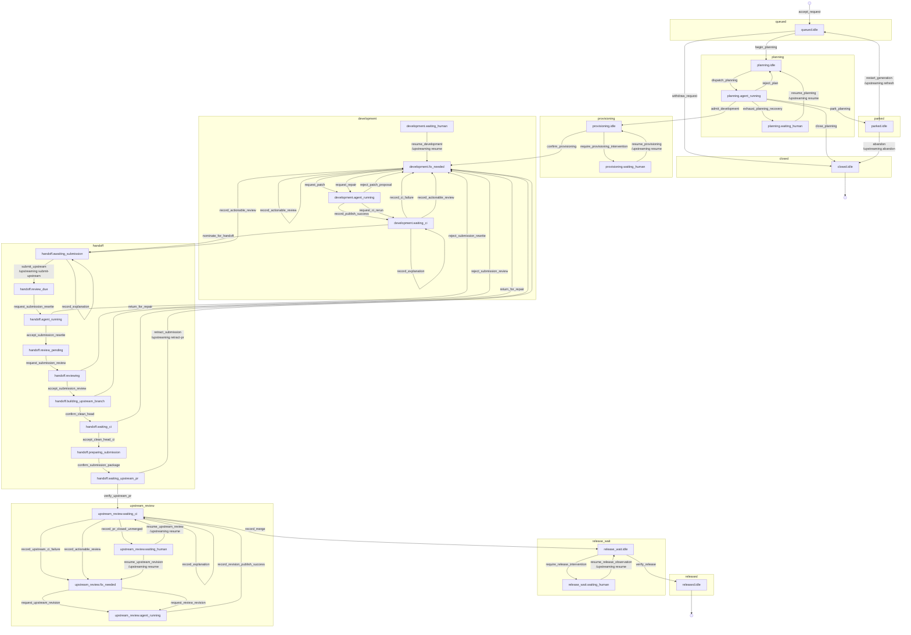

On both the development PR and the upstream PR, a CI failure keeps the contribution in its phase while a bounded repair is prepared and tested, and an actionable review comment is included in the next repair. An explanation-only comment is answered on the development PR; at the submission gate and on the upstream PR it is recorded and linked from the event log of the website, and nothing is answered automatically. Transitions that apply in many states (`park_contribution`, `resume_stale`, `record_reminder`, `record_late_effect`) are drawn once, under the rules below.

## Planning and provisioning failure cases

Planning and provisioning fail in different ways, and each case has its own recovery path. An infrastructure failure that exhausts its retries waits for a human in the same phase; it never ends the generation.

### Failure case 1: planning finds no development path

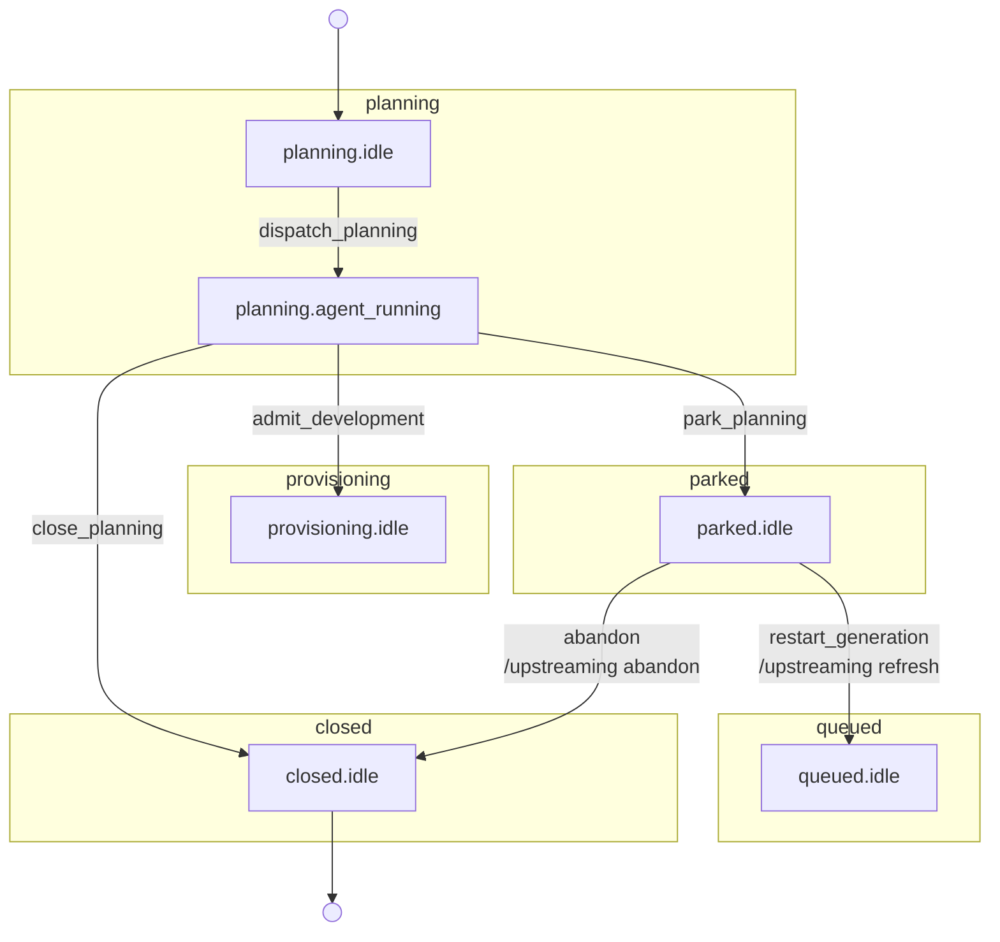

The verified plan decides between development, park, and close; a close is confirmed from PyPI by the reconciler, so a project that is not released on PyPI is parked instead. `closed` is the single terminal phase for work that is not needed; the reason is `terminal_reason`. A restart may record an `admission_override`; the new generation still runs complete planning.

### Failure case 2: the Result has no usable plan

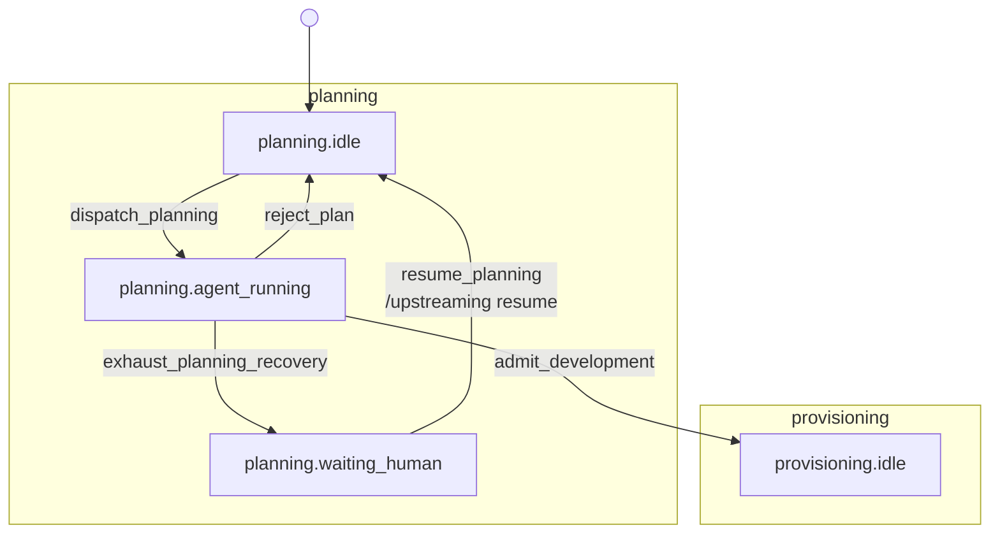

`reject_plan` retries automatically while `planning_attempts` remains; a Result without a plan counts like an invalid one. An incomplete artifact is never adopted by hand.

### Failure case 3: the planner or dispatcher has an infrastructure failure

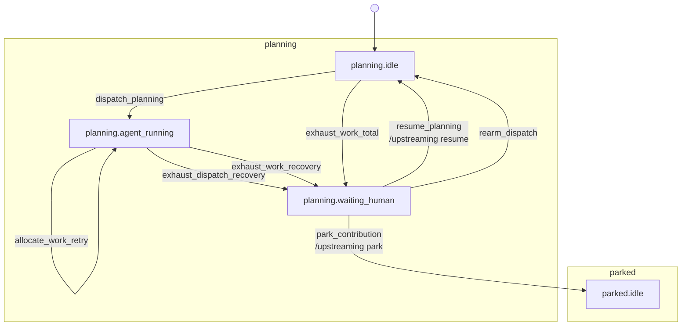

Dispatch and terminal-Work recovery are automatic within `dispatch_recovery` and `work_recovery`. A terminal Work graph is never submitted again under the same identity. Every Work allocation also charges `work_total`. While the installed work-queue Policy refuses every dispatch, a dispatch is not decided until the queue is quiescent, where the dispatcher reinstalls the compiled policy; a dispatch that failed before the reinstall is re-armed by `rearm_dispatch`.

### Failure case 4: fork provisioning fails or its outcome is uncertain

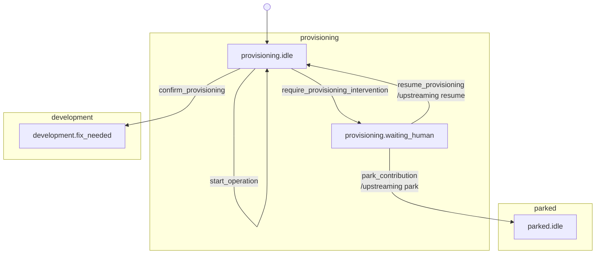

`confirm_provisioning` follows fork creation, configuration, receipt validation, and exact readback. `start_operation` relaunches within `operation_launch`. A lost receipt is not proof that an operation did not launch; an uncertain effect is resolved by discovery or `/upstreaming resolve-operation`, never repeated blindly. A human corrects the prerequisite and resumes, or parks.

## Development and repair cases

Development is one bounded loop around the same development PR. A worker proposes a patch, trusted code validates and publishes it, and CI plus authorized review evaluate the exact head. Only `nominate_for_handoff` leaves development forward.

### Success case: patch, publish, CI, and handoff

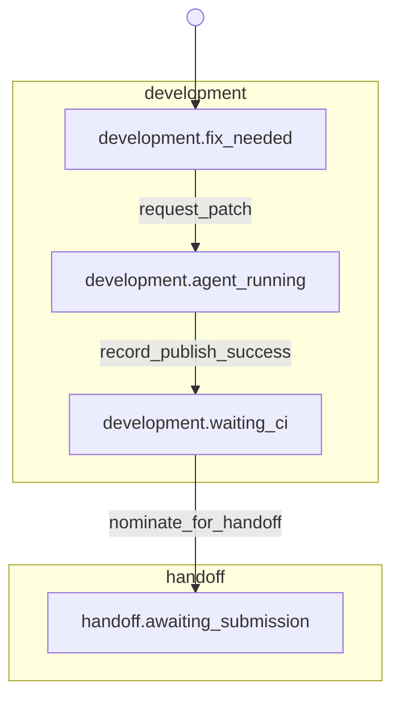

`development.fix_needed` is the one state in which development Work is due, and it is entered only after `confirm_provisioning`: no patch is proposed before the fork exists. `request_repair` applies while a failing CI job is recorded for the head and charges `repair_attempts_cluster` for that job; `request_patch` applies otherwise (the first patch, a rejected proposal, a repair driven only by review feedback) and charges `work_total` only. Both need write admission. Every applicable build and test job must execute and pass on the exact head.

### Failure case 1: patch proposal, dispatch, or Work failure

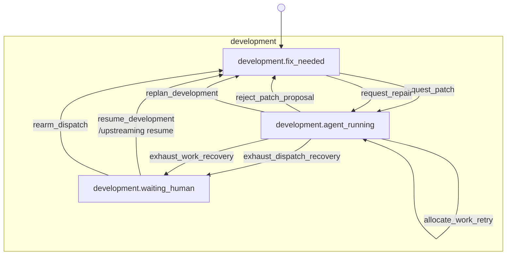

Dispatch recovery and bounded repair are automatic. Dispatch and Work exhaustion wait for a human in development. A rejected proposal, a replan, and a resume keep the pending feedback. A dispatch that failed while the installed work-queue Policy refused every dispatch is re-armed by `rearm_dispatch` once the dispatcher has reinstalled the compiled policy.

### Failure case 2: trusted publication failure

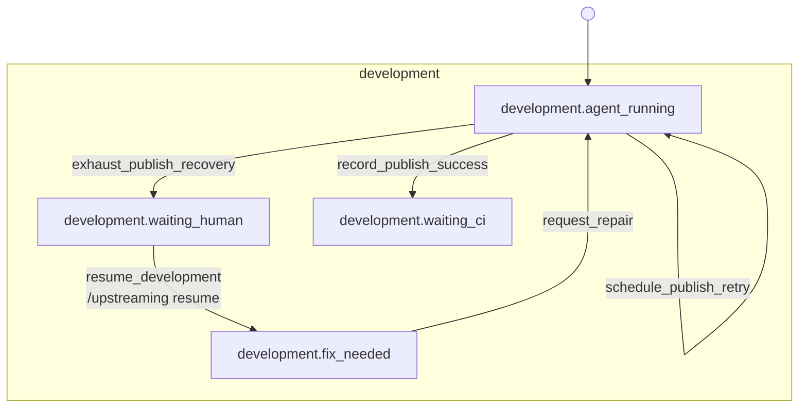

An infrastructure failure publishes the same verified Result again within `publish_recovery`. After exhaustion and a resume, fresh Work is requested; the held Result is not reused.

### Failure case 3: internal PR CI or review failure

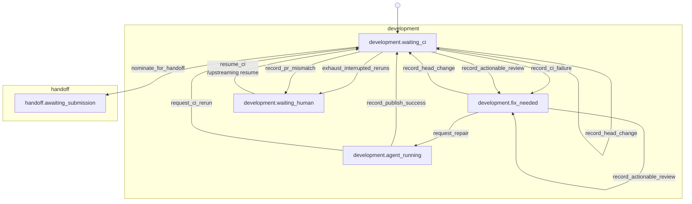

Build and test failures and actionable comments request repair automatically. The repair worker classifies a failure: one not caused by the patch takes `request_ci_rerun` within `flaky_reruns`. The collector reruns on its own only jobs that were cancelled or lost their runner, within `interrupted_reruns` per head; after that a human resumes with `resume_ci`, after which the collector reruns the jobs again. Both rerun counts are kept for the current head in `budget.reruns` and start again whenever the recorded head changes. The Work request carries the pending feedback present at allocation, and `record_publish_success` clears exactly that feedback. Work that carries feedback never takes `request_ci_rerun`. Explanation-only comments do not bump the revision, invalidate CI, or request repair. A push to the development branch while CI is awaited or Work is due records the new head and waits for its CI.

### Failure case 4: a repair budget is exhausted

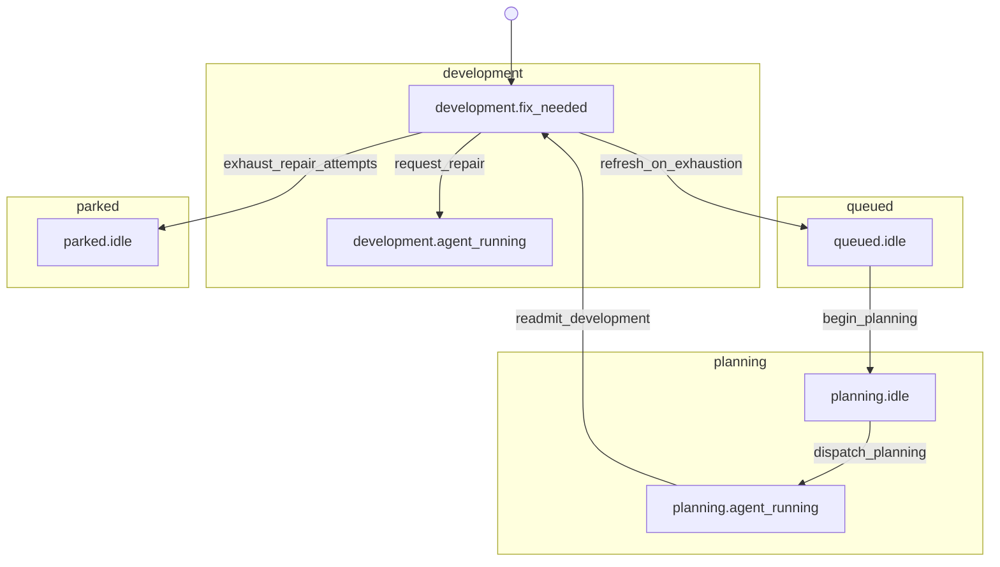

Exhaustion is decided at `development.fix_needed`. The first time `repair_attempts_cluster` or `no_progress` is exhausted in a generation, `refresh_on_exhaustion` runs complete planning again on the existing fork. After that, `exhaust_repair_attempts` parks. Both apply only while `work_total` remains. `repair_attempts_cluster` counts only while a failing CI job is recorded for the head.

### Failure case 5: the Work budget is exhausted

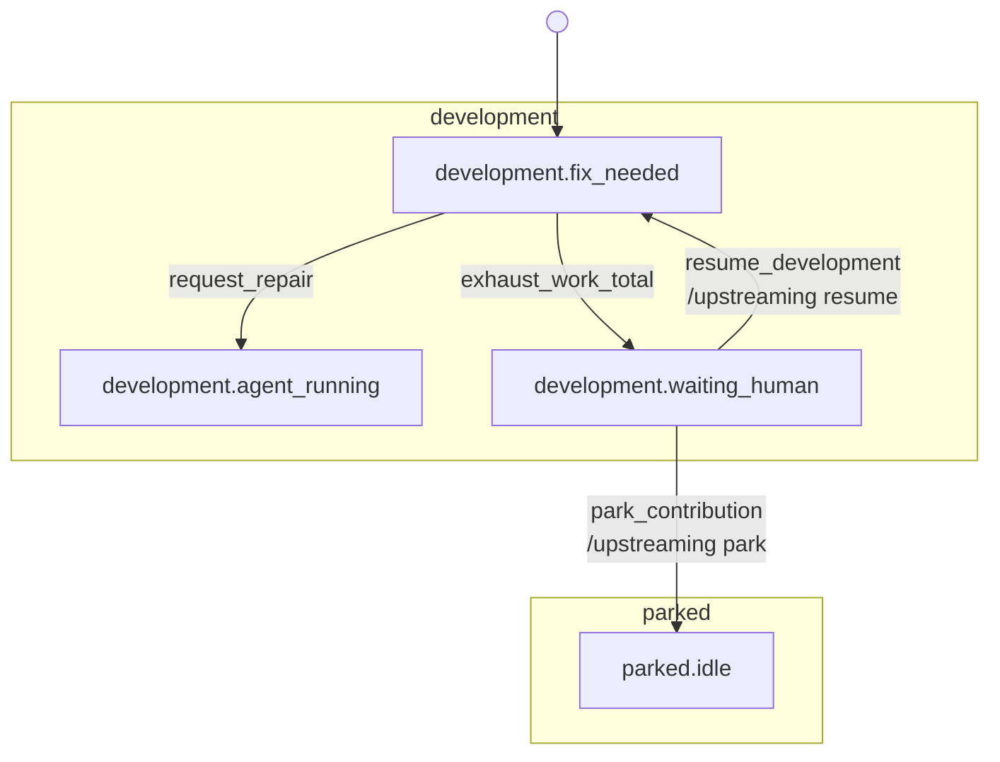

When `work_total` is exhausted at `development.fix_needed`, `exhaust_work_total` waits for a human and names `work_total` in `pending_human_action.counter`, whatever the repair budgets hold. The reply states the number of Work allocations spent in this generation and names both `/upstreaming resume` and `/upstreaming park`. One resume starts `work_total` again and returns to `development.fix_needed`; the repair budgets are not started again.

### Failure case 6: development must be re-planned

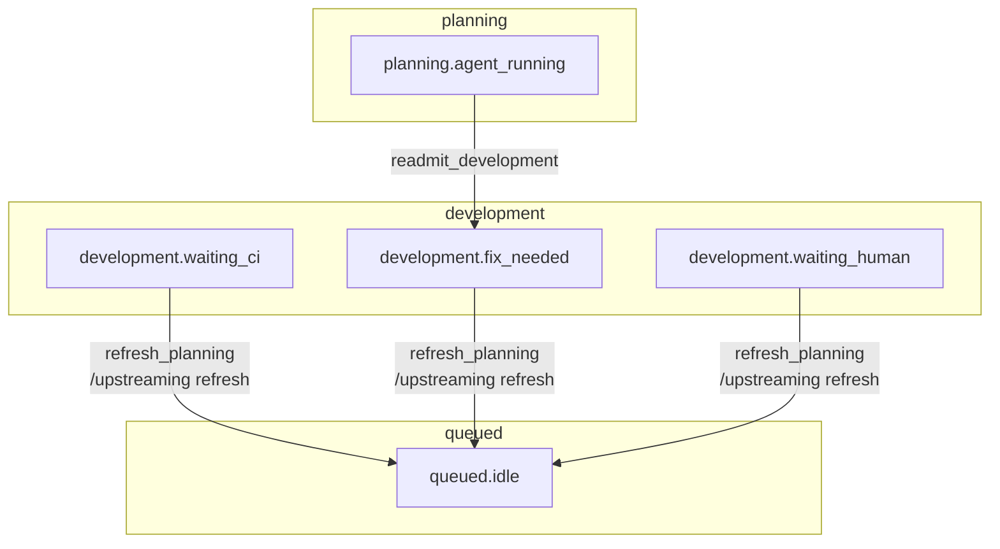

`refresh` runs complete planning without deleting the fork or development PR. A refreshed plan that decides to develop returns to `development.fix_needed` on the existing fork.

## Pause, waiting-human, and park cases

Pause keeps the lifecycle phase and activity. `waiting_human` is entered automatically when a specific failure or external prerequisite needs operator action. Park means the approach is not working or a human said stop; it ends the current generation, and refresh from parked performs a clean reset. A Result is reused only while the pipeline ran continuously: after a pause, a human wait, or a park, the next step is fresh Work. A stop therefore clears the requested Work and the pending publication, so nothing is published after it.

### Success case 1: temporary pause and resume

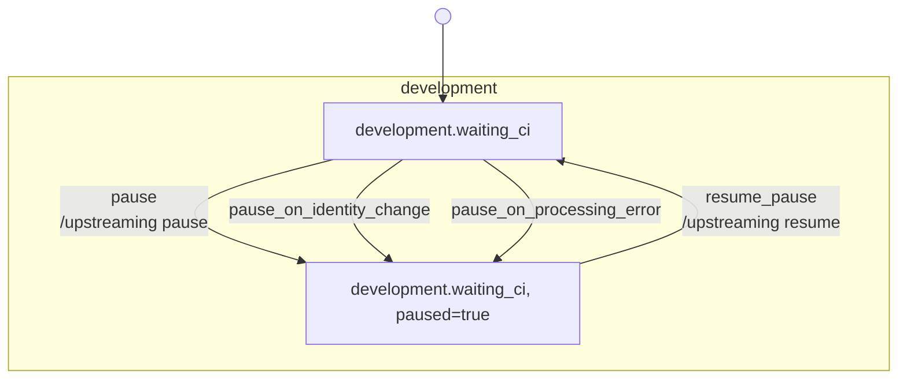

There is one flag, `paused`, with its reason and who set it. A human sets it with `pause`, with an optional reason; the controller sets it when the upstream identity changes, and after an unexpected error while it processed the contribution, and always records the reason. `resume_pause` bumps the revision. An effect that passed its final publication check before the pause may finish and is reconciled normally.

### Success case 2: pause while Work is requested

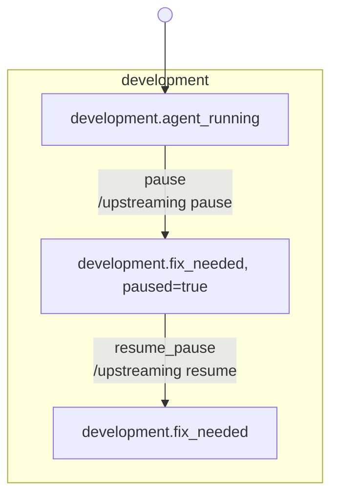

Pause clears the requested Work, so the state in which that Work is due again is entered. A Result that lands during the pause takes `record_late_effect`; after the resume, fresh Work is requested.

### Success case 3: resume after a long stop refreshes the plan

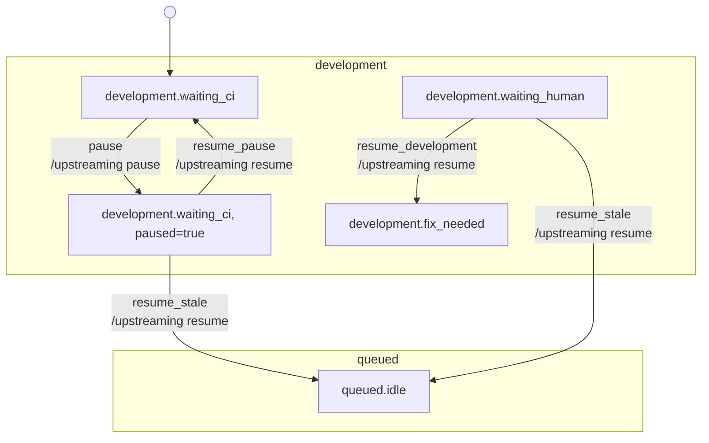

In provisioning and development, a pause or human wait longer than `refresh.stale_after_days` days resumes through `resume_stale`, which runs the planning again. The normal resume verbs carry the complementary guard, so exactly one applies. Handoff, upstream review, and release waits are never refreshed automatically.

### Failure case 1: waiting for operator action or an external prerequisite

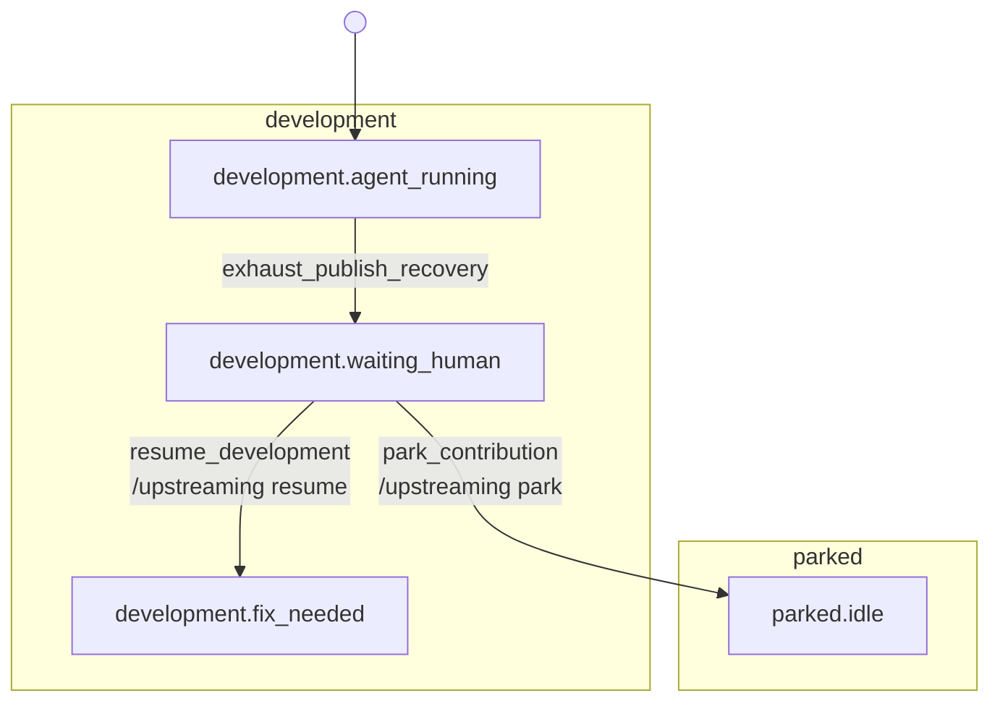

The controller records the concrete reason in `pending_human_action`. Correct the stated problem first, then resume with the exact revision. A contribution that is also paused needs two resumes: the first clears the flag and its reply names the pending action, the second leaves the wait. When an exhausted budget caused the wait, the resume starts again the one counter named in `pending_human_action.counter`.

### Failure case 2: the upstream base branch is missing or cannot be read

```mermaid
flowchart TB
    subgraph queued["queued"]
        queued_idle["queued.idle"]
    end
    subgraph planning["planning"]
        planning_idle["planning.idle"]
        planning_waiting_human["planning.waiting_human"]
    end
    subgraph provisioning["provisioning"]
        provisioning_idle["provisioning.idle"]
        provisioning_waiting_human["provisioning.waiting_human"]
    end
    subgraph development["development"]
        development_fix_needed["development.fix_needed"]
        development_waiting_human["development.waiting_human"]
    end
    subgraph handoff["handoff"]
        handoff_review_due["handoff.review_due"]
        handoff_review_pending["handoff.review_pending"]
        handoff_waiting_human["handoff.waiting_human"]
    end
    subgraph upstream_review["upstream_review"]
        upstream_fix_needed["upstream_review.fix_needed"]
        upstream_waiting_human["upstream_review.waiting_human"]
    end

    queued_idle -->|require_base_branch| planning_waiting_human
    queued_idle -->|exhaust_source_reads| planning_waiting_human
    planning_idle -->|require_base_branch| planning_waiting_human
    planning_idle -->|exhaust_source_reads| planning_waiting_human
    planning_waiting_human -->|resume_planning<br/>/upstreaming resume| planning_idle
    provisioning_idle -->|require_base_branch| provisioning_waiting_human
    provisioning_idle -->|exhaust_source_reads| provisioning_waiting_human
    provisioning_waiting_human -->|resume_provisioning<br/>/upstreaming resume| provisioning_idle
    development_fix_needed -->|require_base_branch| development_waiting_human
    development_fix_needed -->|exhaust_source_reads| development_waiting_human
    development_waiting_human -->|resume_development<br/>/upstreaming resume| development_fix_needed
    handoff_review_due -->|require_base_branch| handoff_waiting_human
    handoff_review_due -->|exhaust_source_reads| handoff_waiting_human
    handoff_review_pending -->|require_base_branch| handoff_waiting_human
    handoff_review_pending -->|exhaust_source_reads| handoff_waiting_human
    handoff_waiting_human -->|resume_submission_review<br/>/upstreaming resume| handoff_review_due
    upstream_fix_needed -->|require_base_branch| upstream_waiting_human
    upstream_fix_needed -->|exhaust_source_reads| upstream_waiting_human
    upstream_waiting_human -->|resume_upstream_revision<br/>/upstreaming resume| upstream_fix_needed
```

Where Work or the fork provisioning is due, the collector reads the upstream base branch. When GitHub answers that it does not exist, or redirects it to the branch it was renamed to, the contribution waits for a human in its phase at once; a read that fails otherwise (network, server error, rate limit) is retried within `source_reads`, which is exhausted only once both its count of consecutive failed reads and its minimum time have passed, and its exhaustion leads to the same wait. While it waits the upstream is not read, until an authorized resume is posted. A resume once the branch exists again continues; to target another branch, the contribution is parked first and then restarted with `/upstreaming refresh branch=NAME`. In upstream review, a branch renamed while the upstream PR is open is followed without a human (failure case 6 of upstream review).

### Failure case 3: the upstream repository cannot be read

```mermaid
flowchart TB
    subgraph queued["queued"]
        queued_idle["queued.idle"]
    end
    subgraph planning["planning"]
        planning_idle["planning.idle"]
        planning_waiting_human["planning.waiting_human"]
    end
    subgraph provisioning["provisioning"]
        provisioning_idle["provisioning.idle"]
        provisioning_waiting_human["provisioning.waiting_human"]
    end
    subgraph development["development"]
        development_fix_needed["development.fix_needed"]
        development_waiting_human["development.waiting_human"]
    end
    subgraph handoff["handoff"]
        handoff_review_due["handoff.review_due"]
        handoff_review_pending["handoff.review_pending"]
        handoff_waiting_human["handoff.waiting_human"]
    end
    subgraph upstream_review["upstream_review"]
        upstream_fix_needed["upstream_review.fix_needed"]
        upstream_waiting_human["upstream_review.waiting_human"]
    end

    queued_idle -->|require_upstream_access| planning_waiting_human
    planning_idle -->|require_upstream_access| planning_waiting_human
    planning_waiting_human -->|resume_planning<br/>/upstreaming resume| planning_idle
    provisioning_idle -->|require_upstream_access| provisioning_waiting_human
    provisioning_waiting_human -->|resume_provisioning<br/>/upstreaming resume| provisioning_idle
    development_fix_needed -->|require_upstream_access| development_waiting_human
    development_waiting_human -->|resume_development<br/>/upstreaming resume| development_fix_needed
    handoff_review_due -->|require_upstream_access| handoff_waiting_human
    handoff_review_pending -->|require_upstream_access| handoff_waiting_human
    handoff_waiting_human -->|resume_submission_review<br/>/upstreaming resume| handoff_review_due
    upstream_fix_needed -->|require_upstream_access| upstream_waiting_human
    upstream_waiting_human -->|resume_upstream_revision<br/>/upstreaming resume| upstream_fix_needed
```

When reading the upstream repository itself keeps failing (it was renamed or transferred, or the token lost access), the exhaustion of `source_reads` leads to the same waits with the pending action `upstream_unavailable`. A resume once the repository can be read again continues; a repository that moved is parked and abandoned, and a new request names its new name.

### Failure case 4: park, then restart as a clean generation or abandon


`restart_generation` is accepted only when no operation is open, no publication is pending, and no upstream PR is open. It bumps the generation, clears mutable lifecycle state, and starts at `queued.idle`. Requested Work carries its generation, so a Result of the ended generation is never folded or published. Nothing here closes PRs, deletes branches, or deletes repositories.

## Handoff, upstream review, and release cases

The submission request is bound to one exact revision and candidate head. Development happens on `riscv64-dev`, which the handoff never changes, and the development PR stays open. An uncredentialed review shapes the series and the pull request text after the project's guidelines; trusted code checks it, builds `riscv64` from it, and prepares the submission package. The Apps do not open the upstream PR.

### Success case 1: one command reviews the series, builds `riscv64`, and publishes a prefilled PR package that a human submits

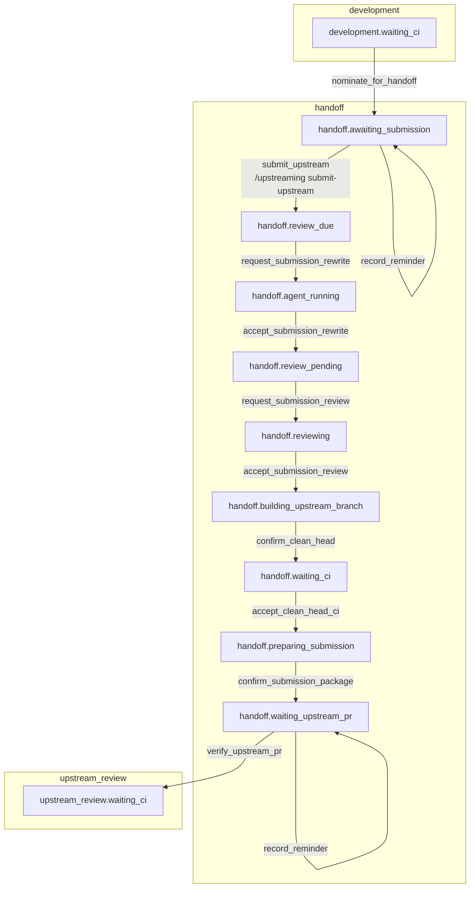

`submit-upstream` is the only submission command. The rewrite Work reads the plan's contribution guidelines and the non-debug commits of the approved `riscv64-dev` series; the project's contributing instructions take precedence over the pipeline's for content and style. It returns the reshaped series and the upstream PR title and description written after the pull request template. Trusted code checks that every commit of the series is valid upstream, that its tree is the tree of the approved series without its debug commits, the attribution trailers, the plan's measurable commit rules, and the template's required sections. A separate review Work, in a fresh context, reviews exactly that series and text against the reviewers' expectations and blocks on failure. Trusted code then creates `riscv64` from the series, or replaces it under a lease, never while an upstream PR is open from it. The human follows the prefilled link and opens the PR under their own identity; observation verifies it before `upstream_review`. Both human steps are reminded.

### Failure case 1: pre-submission changes versus the locked upstream-PR wait

```mermaid
flowchart TB
    subgraph handoff["handoff"]
        handoff_awaiting_submission["handoff.awaiting_submission"]
        handoff_review_due["handoff.review_due"]
        handoff_agent_running["handoff.agent_running"]
        handoff_review_pending["handoff.review_pending"]
        handoff_reviewing["handoff.reviewing"]
        handoff_building_upstream_branch["handoff.building_upstream_branch"]
        handoff_waiting_ci["handoff.waiting_ci"]
        handoff_waiting_upstream_pr["handoff.waiting_upstream_pr"]
    end
    subgraph development["development"]
        development_fix_needed["development.fix_needed"]
        development_waiting_ci["development.waiting_ci"]
    end
    subgraph queued["queued"]
        queued_idle["queued.idle"]
    end

    start_1(( )) --> handoff_awaiting_submission
    handoff_awaiting_submission -->|submit_upstream<br/>/upstreaming submit-upstream| handoff_review_due
    handoff_review_due -->|request_submission_rewrite| handoff_agent_running
    handoff_agent_running -->|accept_submission_rewrite| handoff_review_pending
    handoff_review_pending -->|request_submission_review| handoff_reviewing
    handoff_reviewing -->|accept_submission_review| handoff_building_upstream_branch
    handoff_building_upstream_branch -->|confirm_clean_head| handoff_waiting_ci
    handoff_waiting_ci -->|rerun_interrupted_ci| handoff_waiting_ci
    handoff_awaiting_submission -->|return_for_repair| development_fix_needed
    handoff_awaiting_submission -->|record_actionable_review| development_fix_needed
    development_fix_needed -->|record_actionable_review| development_fix_needed
    handoff_awaiting_submission -->|record_explanation| handoff_awaiting_submission
    handoff_awaiting_submission -->|record_head_change| development_waiting_ci
    handoff_agent_running -->|reject_submission_rewrite| development_fix_needed
    handoff_reviewing -->|reject_submission_review| development_fix_needed
    handoff_building_upstream_branch -->|return_for_repair| development_fix_needed
    handoff_waiting_ci -->|return_for_repair| development_fix_needed
    handoff_awaiting_submission -->|refresh_planning<br/>/upstreaming refresh| queued_idle
    handoff_waiting_upstream_pr -->|record_audit_observation| handoff_waiting_upstream_pr
    handoff_waiting_upstream_pr -->|retract_submission<br/>/upstreaming retract-pr| development_fix_needed
    handoff_waiting_upstream_pr -->|refresh_planning<br/>/upstreaming refresh| queued_idle
```

Before the package is posted, a changed candidate head, a rewrite that fails the trusted check, a failed review, a reviewed series that does not rebuild, a lease conflict on `riscv64`, or blocking CI on the clean head returns to development; a failed review records its reasons as the pending feedback of the next development Work, and nothing is posted. At the gate, a CI failure on the candidate head takes `return_for_repair` and records the failing evidence; an actionable review takes `record_actionable_review` and records the feedback; the guards are exclusive, and the failure applies first; a review observed with the failure is then recorded in `development.fix_needed`. An explanation-only comment takes `record_explanation` and keeps the gate. `handoff.waiting_upstream_pr` is locked: only `verify_upstream_pr`, `retract_submission`, and `refresh_planning` leave it, and none of them changes `riscv64`.

### Failure case 2: a handoff step fails repeatedly or needs a human

```mermaid
flowchart TB
    subgraph handoff["handoff"]
        handoff_review_due["handoff.review_due"]
        handoff_agent_running["handoff.agent_running"]
        handoff_review_pending["handoff.review_pending"]
        handoff_reviewing["handoff.reviewing"]
        handoff_building_upstream_branch["handoff.building_upstream_branch"]
        handoff_waiting_ci["handoff.waiting_ci"]
        handoff_preparing_submission["handoff.preparing_submission"]
        handoff_waiting_human["handoff.waiting_human"]
        handoff_waiting_upstream_pr["handoff.waiting_upstream_pr"]
    end

    start_1(( )) --> handoff_review_due
    handoff_review_due -->|exhaust_work_total| handoff_waiting_human
    handoff_agent_running -->|retry_dispatch| handoff_agent_running
    handoff_agent_running -->|exhaust_dispatch_recovery| handoff_waiting_human
    handoff_agent_running -->|allocate_work_retry| handoff_agent_running
    handoff_agent_running -->|exhaust_work_recovery| handoff_waiting_human
    handoff_waiting_human -->|resume_submission_review<br/>/upstreaming resume| handoff_review_due
    handoff_waiting_human -->|rearm_dispatch| handoff_review_due
    handoff_review_due -->|request_submission_rewrite| handoff_agent_running
    handoff_agent_running -->|accept_submission_rewrite| handoff_review_pending
    handoff_review_pending -->|expire_submission_rewrite| handoff_review_due
    handoff_review_pending -->|exhaust_work_total| handoff_waiting_human
    handoff_review_pending -->|request_submission_review| handoff_reviewing
    handoff_reviewing -->|retry_dispatch| handoff_reviewing
    handoff_reviewing -->|exhaust_dispatch_recovery| handoff_waiting_human
    handoff_reviewing -->|allocate_work_retry| handoff_reviewing
    handoff_reviewing -->|exhaust_work_recovery| handoff_waiting_human
    handoff_reviewing -->|accept_submission_review| handoff_building_upstream_branch
    handoff_building_upstream_branch -->|expire_submission_rewrite| handoff_review_due
    handoff_building_upstream_branch -->|retry_upstream_branch| handoff_building_upstream_branch
    handoff_building_upstream_branch -->|exhaust_upstream_branch_retries| handoff_waiting_human
    handoff_building_upstream_branch -->|require_branch_intervention| handoff_waiting_human
    handoff_waiting_human -->|resume_upstream_branch<br/>/upstreaming resume| handoff_building_upstream_branch
    handoff_building_upstream_branch -->|confirm_clean_head| handoff_waiting_ci
    handoff_waiting_ci -->|exhaust_interrupted_reruns| handoff_waiting_human
    handoff_waiting_human -->|resume_ci<br/>/upstreaming resume| handoff_waiting_ci
    handoff_waiting_ci -->|require_clean_head_ci| handoff_waiting_human
    handoff_waiting_human -->|resume_clean_head_ci<br/>/upstreaming resume| handoff_waiting_ci
    handoff_waiting_ci -->|accept_clean_head_ci| handoff_preparing_submission
    handoff_preparing_submission -->|retry_submission_comment| handoff_preparing_submission
    handoff_preparing_submission -->|exhaust_comment_retries| handoff_waiting_human
    handoff_waiting_human -->|resume_submission_preparation<br/>/upstreaming resume| handoff_preparing_submission
    handoff_preparing_submission -->|confirm_submission_package| handoff_waiting_upstream_pr
```

The rewrite and review Work, the lease write of `riscv64`, the reruns of interrupted CI, and the package each retry within their budget and then wait for a human in the one `handoff.waiting_human`; a pull request that is open from `riscv64`, or a missing `riscv64-dev`, waits there at once. A rewritten series whose artifact expires before `riscv64` is built leads back to a fresh rewrite, never to an endless wait. `pending_human_action` names the step, and exactly one of the five resume verbs applies: it returns to that step. CI that never runs on the clean head of `riscv64` waits there too, after a bounded wait. Recovery does not need another `submit-upstream`.

### Success case 2: upstream review, merge, and release

```mermaid
flowchart TB
    subgraph upstream_review["upstream_review"]
        upstream_waiting_ci["upstream_review.waiting_ci"]
    end
    subgraph release_wait["release_wait"]
        release_wait_idle["release_wait.idle"]
    end
    subgraph released["released"]
        released_idle["released.idle"]
    end

    start_1(( )) --> upstream_waiting_ci
    upstream_waiting_ci -->|record_merge| release_wait_idle
    release_wait_idle -->|verify_release| released_idle
    released_idle --> end_2(( ))
```

Merge enters `release_wait`; it is not terminal success. Only verified release coverage enters `released`.

### Failure case 3: upstream CI or actionable review needs a revision

```mermaid
flowchart TB
    subgraph upstream_review["upstream_review"]
        upstream_waiting_ci["upstream_review.waiting_ci"]
        upstream_fix_needed["upstream_review.fix_needed"]
        upstream_agent_running["upstream_review.agent_running"]
        upstream_waiting_human["upstream_review.waiting_human"]
    end

    start_1(( )) --> upstream_waiting_ci
    upstream_waiting_ci -->|record_upstream_ci_failure| upstream_fix_needed
    upstream_waiting_ci -->|record_actionable_review| upstream_fix_needed
    upstream_waiting_ci -->|record_explanation| upstream_waiting_ci
    upstream_fix_needed -->|request_upstream_revision| upstream_agent_running
    upstream_fix_needed -->|request_review_revision| upstream_agent_running
    upstream_agent_running -->|record_revision_publish_success| upstream_waiting_ci
    upstream_agent_running -->|reject_patch_proposal| upstream_fix_needed
    upstream_agent_running -->|require_reviewer_answer| upstream_waiting_human
    upstream_fix_needed -->|exhaust_repair_attempts| upstream_waiting_human
    upstream_waiting_human -->|resume_upstream_review<br/>/upstreaming resume| upstream_waiting_ci
    upstream_waiting_human -->|resume_upstream_revision<br/>/upstreaming resume| upstream_fix_needed
```

Automated upstream revisions require that the upstream PR head is the controlled fork ref. `request_upstream_revision` applies while a failing CI job is recorded for the head and charges `repair_attempts_cluster`; `request_review_revision` applies to a revision driven only by review feedback and charges `work_total` only. A published revision clears exactly the feedback its Work carried. A rejected proposal is repaired within `no_progress`. When the worker reports that no change is needed, a human answers the reviewer; `resume_upstream_review` then clears the pending feedback and returns to `upstream_review.waiting_ci` without requesting Work. After a budget is exhausted, `resume_upstream_revision` starts again the one counter named in `pending_human_action.counter`. A CI failure is recorded once per head and CI run. Upstream CI is never rerun by the pipeline.

### Failure case 4: revision Work or its publication fails

```mermaid
flowchart TB
    subgraph upstream_review["upstream_review"]
        upstream_agent_running["upstream_review.agent_running"]
        upstream_waiting_human["upstream_review.waiting_human"]
        upstream_fix_needed["upstream_review.fix_needed"]
    end

    start_1(( )) --> upstream_agent_running
    upstream_agent_running -->|retry_dispatch| upstream_agent_running
    upstream_agent_running -->|allocate_work_retry| upstream_agent_running
    upstream_agent_running -->|schedule_publish_retry| upstream_agent_running
    upstream_agent_running -->|exhaust_dispatch_recovery| upstream_waiting_human
    upstream_agent_running -->|exhaust_work_recovery| upstream_waiting_human
    upstream_agent_running -->|exhaust_publish_recovery| upstream_waiting_human
    upstream_waiting_human -->|resume_upstream_revision<br/>/upstreaming resume| upstream_fix_needed
    upstream_waiting_human -->|rearm_dispatch| upstream_fix_needed
```

Every exhaustion in upstream review waits for a human in `upstream_review.waiting_human`; nothing parks from upstream review automatically.

### Failure case 5: the upstream PR is closed or its head changes

```mermaid
flowchart TB
    subgraph upstream_review["upstream_review"]
        upstream_waiting_ci["upstream_review.waiting_ci"]
        upstream_waiting_human["upstream_review.waiting_human"]
    end
    subgraph parked["parked"]
        parked_idle["parked.idle"]
    end

    start_1(( )) --> upstream_waiting_ci
    upstream_waiting_ci -->|record_pr_closed_unmerged| upstream_waiting_human
    upstream_waiting_ci -->|record_head_change| upstream_waiting_human
    upstream_waiting_human -->|resume_upstream_review<br/>/upstreaming resume| upstream_waiting_ci
    upstream_waiting_human -->|park_contribution<br/>/upstreaming park| parked_idle
```

The pipeline does not reopen the PR or create a replacement. `resume_upstream_review` returns to `upstream_review.waiting_ci` after a head change, and after a closed PR once it is observed open again. `resume_upstream_revision` applies only when revision Work failed. Human triage either resumes or parks.

### Failure case 6: the base branch is renamed while the upstream PR is open

```mermaid
flowchart TB
    subgraph upstream_review["upstream_review"]
        upstream_waiting_ci["upstream_review.waiting_ci"]
        upstream_fix_needed["upstream_review.fix_needed"]
        upstream_waiting_human["upstream_review.waiting_human"]
    end

    start_1(( )) --> upstream_waiting_ci
    upstream_waiting_ci -->|follow_renamed_base| upstream_waiting_ci
    upstream_fix_needed -->|follow_renamed_base| upstream_fix_needed
    upstream_waiting_human -->|resume_renamed_base| upstream_fix_needed
```

GitHub retargets an open PR when its base branch is renamed. Once the verified upstream PR targets the new name and that branch still contains the recorded base commit, the record follows the rename and the tracking issue states it. A contribution that already waits because of the rename leaves the wait the same way, without a resume.

### Failure case 7: release is missing, incomplete, or waiting for operator action

```mermaid
flowchart TB
    subgraph release_wait["release_wait"]
        release_wait_idle["release_wait.idle"]
        release_wait_waiting_human["release_wait.waiting_human"]
    end
    subgraph released["released"]
        released_idle["released.idle"]
    end

    start_1(( )) --> release_wait_idle
    release_wait_idle -->|record_release_incomplete| release_wait_idle
    release_wait_idle -->|require_release_intervention| release_wait_waiting_human
    release_wait_waiting_human -->|resume_release_observation<br/>/upstreaming resume| release_wait_idle
    release_wait_idle -->|verify_release| released_idle
```

Release observation waits without invoking a worker until the evidence satisfies the frozen acceptance contract.

## Rules that apply in many states

Five transitions apply in many states. Each is written once as a rule and expanded into the table; each is drawn once here, from a single node that stands for every state the rule applies in.

### Rule: park by command

```mermaid
flowchart TB
    any["every non-terminal state except parked.idle, handoff.waiting_upstream_pr, release_wait.*, and upstream_review.* other than upstream_review.waiting_human"]
    subgraph parked["parked"]
        parked_idle["parked.idle"]
    end

    any -->|park_contribution<br/>/upstreaming park| parked_idle
```

Nothing parks from `upstream_review` automatically, and `handoff.waiting_upstream_pr` and `release_wait` cannot be parked.

### Rule: resume after a long stop

```mermaid
flowchart TB
    any["every provisioning.* and development.* state"]
    subgraph queued["queued"]
        queued_idle["queued.idle"]
    end

    any -->|resume_stale<br/>/upstreaming resume| queued_idle
```

### Rule: reminders of a pending human step

```mermaid
flowchart TB
    any["every state of kind gate, human_wait, or locked"]

    any -->|record_reminder| any
```

The rule covers the `gate`, `human_wait`, and `locked` kinds. In `handoff.waiting_upstream_pr` the reminder text carries the package link.

### Rule: late Results

```mermaid
flowchart TB
    any["every state"]

    any -->|record_late_effect| any
```

### Rule: the upstream base branch cannot be read

```mermaid
flowchart TB
    any["every state in which the controller needs the upstream base branch: queued.idle, planning.idle, provisioning.idle, development.fix_needed, handoff.review_due, handoff.review_pending, and upstream_review.fix_needed"]

    any -->|record_source_unavailable| any
```

A read that fails without a definitive answer charges `source_reads` and keeps the state; its exhaustion takes `exhaust_source_reads`, or `require_upstream_access` when the repository itself could not be read, drawn with the human waits.

## Remote operations

Every remote effect is an operation with its own small table, held to the same checks. The intent is recorded before the effect, and the receipt is confirmed by discovering the actual resource. While an operation is open (`planned`, `applying`, `uncertain`) it fences its contribution: no park, no refresh, and no second writer. `/upstreaming resolve-operation` closes an open operation with a resolution evidence record.

```mermaid
flowchart TB
    subgraph open_operations["open"]
        op_planned["planned"]
        op_applying["applying"]
        op_uncertain["uncertain"]
    end
    subgraph closed_operations["closed"]
        op_confirmed["confirmed"]
        op_failed["failed"]
        op_not_launched["not_launched"]
    end

    start_1(( )) -->|record_intent| op_planned
    op_planned -->|begin_effect| op_applying
    op_planned -->|resolve_confirmed<br/>/upstreaming resolve-operation| op_confirmed
    op_planned -->|resolve_failed<br/>/upstreaming resolve-operation| op_failed
    op_planned -->|resolve_not_launched<br/>/upstreaming resolve-operation| op_not_launched
    op_applying -->|record_response| op_uncertain
    op_applying -->|record_failure| op_failed
    op_applying -->|resolve_confirmed<br/>/upstreaming resolve-operation| op_confirmed
    op_applying -->|resolve_failed<br/>/upstreaming resolve-operation| op_failed
    op_applying -->|resolve_not_launched<br/>/upstreaming resolve-operation| op_not_launched
    op_uncertain -->|confirm_by_discovery| op_confirmed
    op_uncertain -->|record_discovery| op_uncertain
    op_uncertain -->|resolve_confirmed<br/>/upstreaming resolve-operation| op_confirmed
    op_uncertain -->|resolve_failed<br/>/upstreaming resolve-operation| op_failed
    op_uncertain -->|resolve_not_launched<br/>/upstreaming resolve-operation| op_not_launched
    op_confirmed --> end_2(( ))
    op_failed --> end_3(( ))
    op_not_launched --> end_4(( ))
```

## Command impact summary

Every `/upstreaming` command that the tables accept, with the transitions it triggers.

| Command | Verb | From | To |
|:--------|:-----|:-----|:---|
| `/upstreaming abandon` | `abandon` | `parked.idle` | `closed.idle` |
| `/upstreaming park` | `park_contribution` | every non-terminal state except `parked.idle`, `handoff.waiting_upstream_pr`, `release_wait.*`, and `upstream_review.*` other than `upstream_review.waiting_human` | `parked.idle` |
| `/upstreaming pause` | `pause` | every non-terminal state | same state |
| `/upstreaming refresh` | `refresh_planning` | `development.waiting_ci`, `development.fix_needed`, `development.waiting_human`, `handoff.awaiting_submission`, `handoff.waiting_upstream_pr` | `queued.idle` |
| `/upstreaming refresh` | `restart_generation` | `parked.idle` | `queued.idle` |
| `/upstreaming resolve-operation` | `resolve_confirmed` | operation `planned`, operation `applying`, operation `uncertain` | operation `confirmed` |
| `/upstreaming resolve-operation` | `resolve_failed` | operation `planned`, operation `applying`, operation `uncertain` | operation `failed` |
| `/upstreaming resolve-operation` | `resolve_not_launched` | operation `planned`, operation `applying`, operation `uncertain` | operation `not_launched` |
| `/upstreaming resume` | `resume_ci` | `development.waiting_human` | `development.waiting_ci` |
| `/upstreaming resume` | `resume_ci` | `handoff.waiting_human` | `handoff.waiting_ci` |
| `/upstreaming resume` | `resume_clean_head_ci` | `handoff.waiting_human` | `handoff.waiting_ci` |
| `/upstreaming resume` | `resume_development` | `development.waiting_human` | `development.fix_needed` |
| `/upstreaming resume` | `resume_pause` | every non-terminal state | same state |
| `/upstreaming resume` | `resume_planning` | `planning.waiting_human` | `planning.idle` |
| `/upstreaming resume` | `resume_provisioning` | `provisioning.waiting_human` | `provisioning.idle` |
| `/upstreaming resume` | `resume_release_observation` | `release_wait.waiting_human` | `release_wait.idle` |
| `/upstreaming resume` | `resume_stale` | every `provisioning.*` and `development.*` state | `queued.idle` |
| `/upstreaming resume` | `resume_submission_preparation` | `handoff.waiting_human` | `handoff.preparing_submission` |
| `/upstreaming resume` | `resume_submission_review` | `handoff.waiting_human` | `handoff.review_due` |
| `/upstreaming resume` | `resume_upstream_branch` | `handoff.waiting_human` | `handoff.building_upstream_branch` |
| `/upstreaming resume` | `resume_upstream_review` | `upstream_review.waiting_human` | `upstream_review.waiting_ci` |
| `/upstreaming resume` | `resume_upstream_revision` | `upstream_review.waiting_human` | `upstream_review.fix_needed` |
| `/upstreaming retract-pr` | `retract_submission` | `handoff.waiting_upstream_pr` | `development.fix_needed` |
| `/upstreaming submit-upstream` | `submit_upstream` | `handoff.awaiting_submission` | `handoff.review_due` |
