<!-- Generated by scripts/generate_state_machine_doc.py from the lifecycle table in lifecycle.py. Do not edit; change the table and regenerate. -->

# Contribution state machine
{: .no_toc }

The contribution lifecycle is defined by one table in `lifecycle.py`. That table is the source of truth: every diagram on this page, the [lifecycle table]({{ '/state-machine/table/' | relative_url }}) reference, and the [open decisions]({{ '/state-machine/decisions/' | relative_url }}) page are generated from it by `scripts/generate_state_machine_doc.py`, and a test fails when a page no longer matches the table.

`uv run --locked python -m lifecycle check` verifies that the table is consistent, and the Agent Validation workflow runs it on every pull request and every push to `main`. It checks that every target exists, every state is reachable from `queued.idle`, and an end state (kind `terminal`) is reachable from every state; that end states have no exits and every other state has one that leaves it; that every transition names its trigger and its guard (`always` when unconditional), every command transition its command and the revision it accepts, and every charged budget a `policy.json` key and an exhaustion transition; that a verb leads from a state to one target only; that revision bumps follow the revision rule; and that every state, transition, and flag is drawn below and every decision slice uses table entries.

A state is `phase.activity`. Each arrow is a transition verb of the table, labelled with its `/upstreaming` command when a command triggers it; the other transitions are taken on a Result, an observation, an operation receipt, or a controller tick, as the table records.

<details open markdown="block">
  <summary>Contents</summary>
  {: .text-delta }
1. TOC
{:toc}
</details>

## Simplified state diagram

This is the expected path when investigation finds useful work, provisioning succeeds, development CI becomes green, upstream accepts the contribution, and an official release publishes the required artifacts.

```mermaid
flowchart TB
    subgraph queued["queued"]
        queued_idle["queued.idle"]
    end
    subgraph investigation["investigation"]
        investigation_idle["investigation.idle"]
        investigation_agent_running["investigation.agent_running"]
        investigation_waiting_human["investigation.waiting_human"]
    end
    subgraph provisioning["provisioning"]
        provisioning_idle["provisioning.idle"]
        provisioning_waiting_human["provisioning.waiting_human"]
    end
    subgraph development["development"]
        development_idle["development.idle"]
        development_agent_running["development.agent_running"]
        development_waiting_ci["development.waiting_ci"]
        development_fix_needed["development.fix_needed"]
        development_waiting_human["development.waiting_human"]
    end
    subgraph handoff["handoff"]
        handoff_awaiting_submission["handoff.awaiting_submission"]
        handoff_cleaning_debug["handoff.cleaning_debug"]
        handoff_waiting_ci["handoff.waiting_ci"]
        handoff_closing_internal_pr["handoff.closing_internal_pr"]
        handoff_preparing_submission["handoff.preparing_submission"]
        handoff_waiting_upstream_pr["handoff.waiting_upstream_pr"]
    end
    subgraph upstream_review["upstream_review"]
        upstream_waiting_ci["upstream_review.waiting_ci"]
        upstream_fix_needed["upstream_review.fix_needed"]
        upstream_agent_running["upstream_review.agent_running"]
        upstream_waiting_human["upstream_review.waiting_human"]
    end
    subgraph release_wait["release_wait"]
        release_wait_idle["release_wait.idle"]
        release_wait_waiting_human["release_wait.waiting_human"]
    end
    subgraph released["released"]
        released_idle["released.idle"]
    end
    subgraph parked["parked"]
        parked_idle["parked.idle"]
    end
    subgraph closed["closed"]
        closed_idle["closed.idle"]
    end

    start_1(( )) -->|accept_request| queued_idle
    queued_idle -->|begin_investigation| investigation_idle
    queued_idle -->|withdraw_request| closed_idle
    investigation_idle -->|dispatch_investigation| investigation_agent_running
    investigation_agent_running -->|reject_dossier| investigation_idle
    investigation_agent_running -->|exhaust_investigation_recovery| investigation_waiting_human
    investigation_waiting_human -->|resume_investigation<br/>/upstreaming resume| investigation_idle
    investigation_agent_running -->|admit_development| provisioning_idle
    investigation_agent_running -->|park_investigation<br/>/upstreaming park| parked_idle
    investigation_agent_running -->|close_investigation| closed_idle
    provisioning_idle -->|require_provisioning_intervention| provisioning_waiting_human
    provisioning_waiting_human -->|resume_provisioning<br/>/upstreaming resume| provisioning_idle
    provisioning_idle -->|confirm_provisioning| development_idle
    development_idle -->|request_patch| development_agent_running
    development_fix_needed -->|request_repair| development_agent_running
    development_agent_running -->|record_publish_success| development_waiting_ci
    development_agent_running -->|reject_patch_proposal| development_fix_needed
    development_waiting_ci -->|record_ci_failure| development_fix_needed
    development_waiting_ci -->|record_actionable_review| development_fix_needed
    development_waiting_ci -->|record_explanation| development_waiting_ci
    development_waiting_human -->|resume_development<br/>/upstreaming resume| development_fix_needed
    development_waiting_ci -->|nominate_for_handoff| handoff_awaiting_submission
    handoff_awaiting_submission -->|submit_upstream<br/>/upstreaming submit-upstream| handoff_cleaning_debug
    handoff_cleaning_debug -->|confirm_clean_head| handoff_waiting_ci
    handoff_waiting_ci -->|accept_clean_head_ci| handoff_closing_internal_pr
    handoff_closing_internal_pr -->|confirm_internal_pr_closed| handoff_preparing_submission
    handoff_preparing_submission -->|confirm_submission_package| handoff_waiting_upstream_pr
    handoff_waiting_upstream_pr -->|verify_upstream_pr| upstream_waiting_ci
    handoff_cleaning_debug -->|return_for_repair| development_fix_needed
    handoff_waiting_ci -->|return_for_repair| development_fix_needed
    handoff_waiting_upstream_pr -->|retract_submission<br/>/upstreaming retract-pr| development_fix_needed
    upstream_waiting_ci -->|record_upstream_ci_failure| upstream_fix_needed
    upstream_waiting_ci -->|record_actionable_review| upstream_fix_needed
    upstream_waiting_ci -->|record_explanation| upstream_waiting_ci
    upstream_fix_needed -->|request_upstream_revision| upstream_agent_running
    upstream_agent_running -->|record_revision_publish_success| upstream_waiting_ci
    upstream_waiting_ci -->|record_pr_closed_unmerged| upstream_waiting_human
    upstream_waiting_human -->|resume_upstream_review<br/>/upstreaming resume| upstream_waiting_ci
    upstream_waiting_ci -->|record_merge| release_wait_idle
    release_wait_idle -->|require_release_intervention| release_wait_waiting_human
    release_wait_waiting_human -->|resume_release_observation<br/>/upstreaming resume| release_wait_idle
    release_wait_idle -->|verify_release| released_idle
    parked_idle -->|restart_generation<br/>/upstreaming resume| queued_idle
    released_idle --> end_2(( ))
    closed_idle --> end_3(( ))
```

On both the development PR and the upstream PR, a CI failure keeps the contribution in its phase while a bounded repair is prepared and tested; an actionable review comment is answered and included in the next repair; an explanation-only comment is answered or recorded without requesting a change.

## Investigation and provisioning failure cases

Investigation and provisioning fail in different ways, and each case has its own recovery path.

### Failure case 1: investigation finds no development path

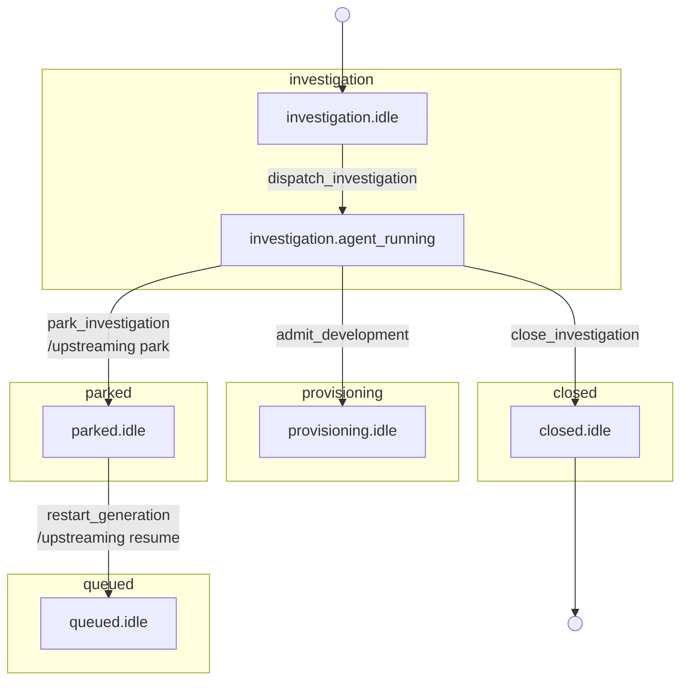

The verified dossier decides between development, park, and close. `closed` is the single terminal phase for work that is not needed; the reason is `terminal_reason`.

### Failure case 2: the dossier is incomplete or invalid

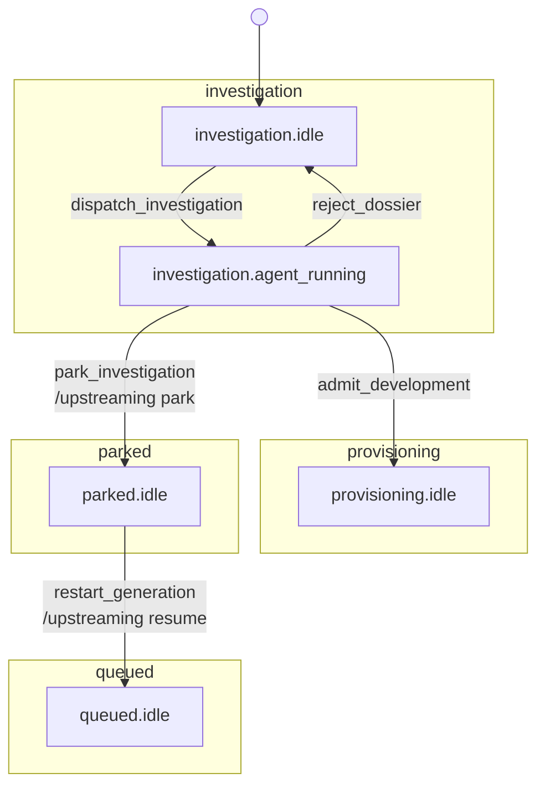

`reject_dossier` retries automatically while `investigation_attempts` remains. An incomplete artifact is never adopted by hand.

### Failure case 3: the investigator or dispatcher has an infrastructure failure

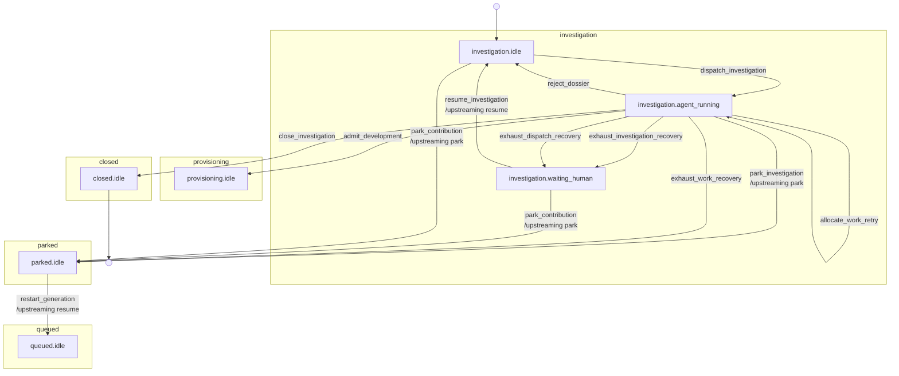

Dispatch and terminal-Work recovery are automatic within `dispatch_recovery` and `work_recovery`. A terminal Work graph is never submitted again under the same identity.

### Failure case 4: fork provisioning has a transient failure

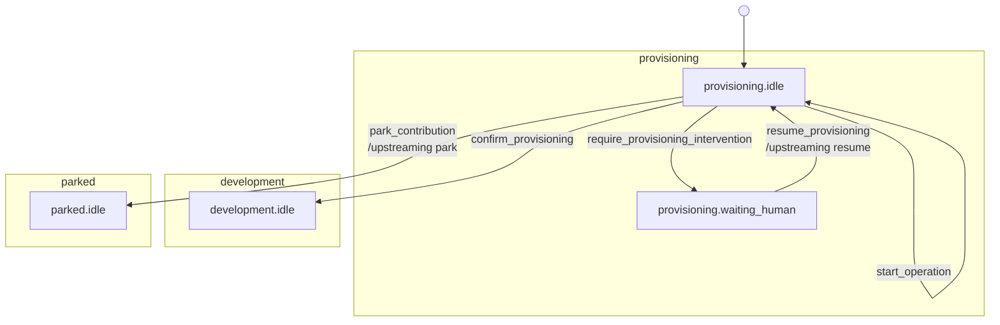

`confirm_provisioning` follows fork creation, configuration, receipt validation, and exact readback. `start_operation` relaunches within `operation_launch`.

### Failure case 5: provisioning outcome is uncertain

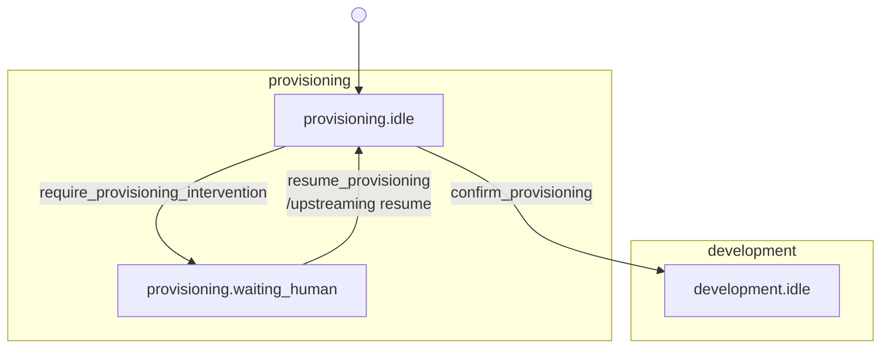

A lost receipt is not proof that an operation did not launch; an uncertain effect is resolved by discovery or `/upstreaming resolve-operation`, never repeated blindly.

### Failure case 6: provisioning cannot safely satisfy a prerequisite

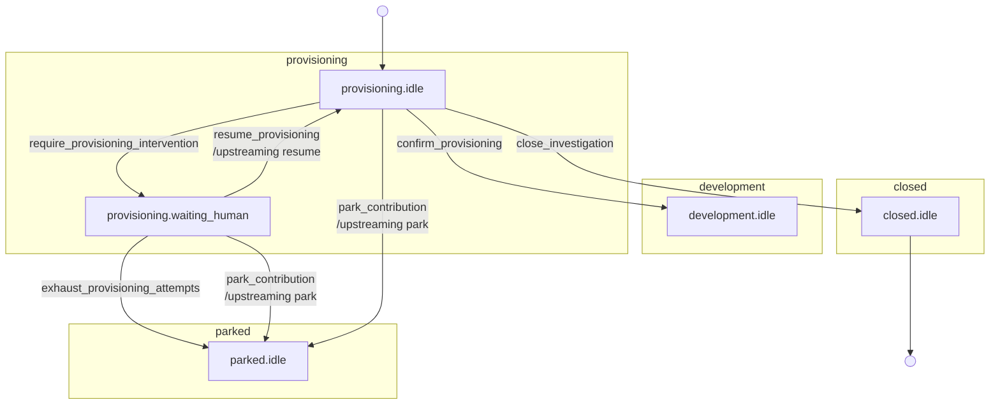

Correct the external permission or identity problem first, then resume. `exhaust_provisioning_attempts` parks after `provisioning_attempts`.

## Development and repair cases

Development is one bounded loop around the same development PR. A worker proposes a patch, trusted code validates and publishes it, and CI plus authorized review evaluate the exact head. Only `nominate_for_handoff` leaves development forward.

### Success case: patch, publish, CI, and handoff

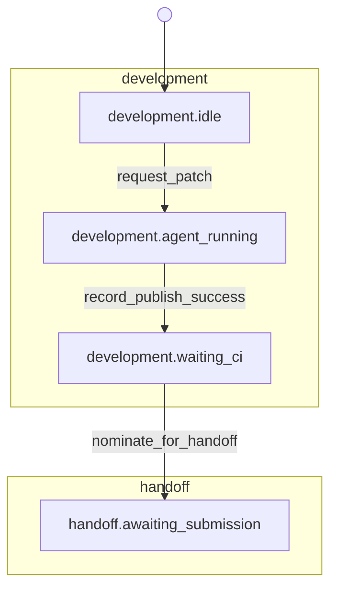

Every applicable build and test job must execute and pass on the exact head.

### Failure case 1: patch proposal or dispatch failure

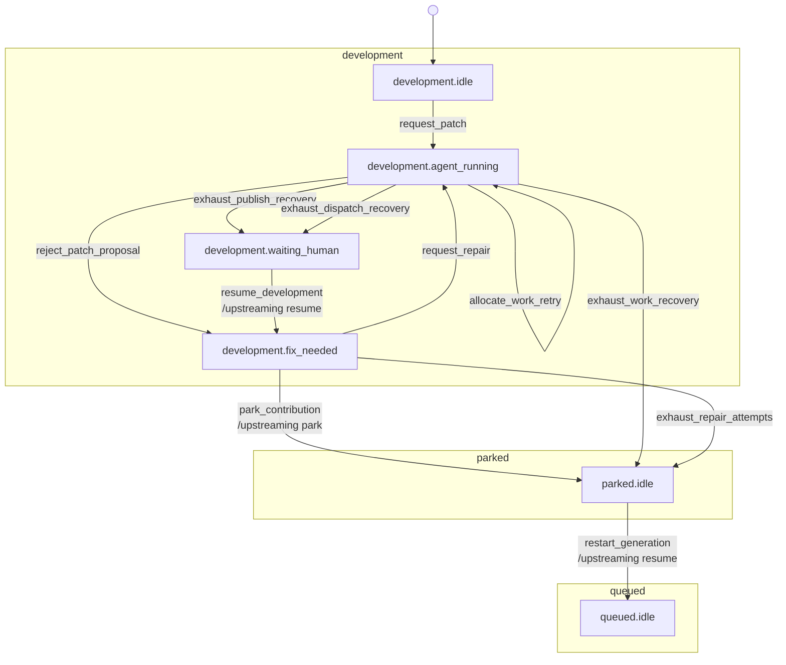

Dispatch recovery and bounded repair are automatic. Repair-budget exhaustion parks; `restart_generation` starts a clean generation that cannot bypass dossier validation.

### Failure case 2: trusted publication failure

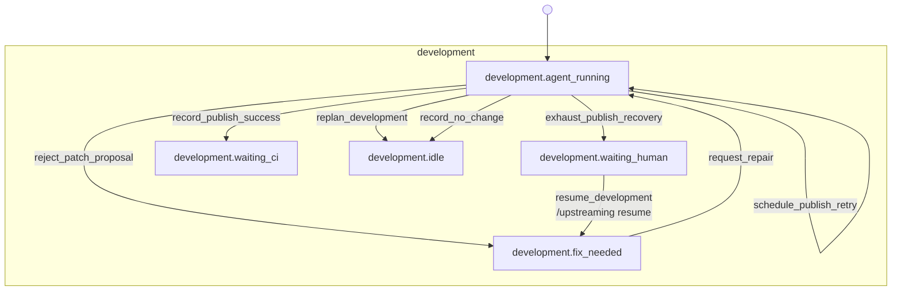

A validation failure needs new bounded repair Work. An infrastructure failure publishes the same verified Result again within `publish_recovery`.

### Failure case 3: internal PR CI or review failure

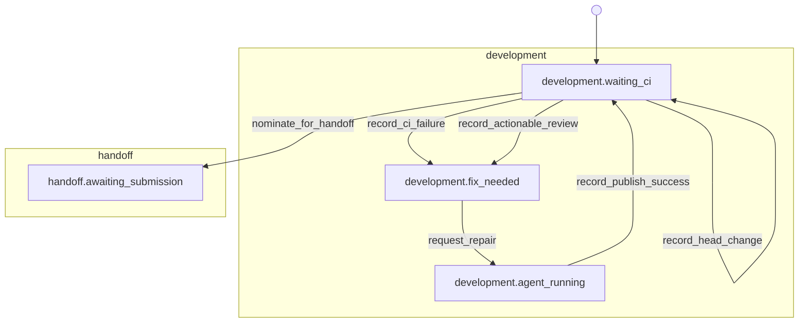

Build and test failures and actionable comments request repair automatically. Explanation-only comments do not bump the revision, invalidate CI, or request repair.

### Failure case 4: development must be re-investigated or stopped

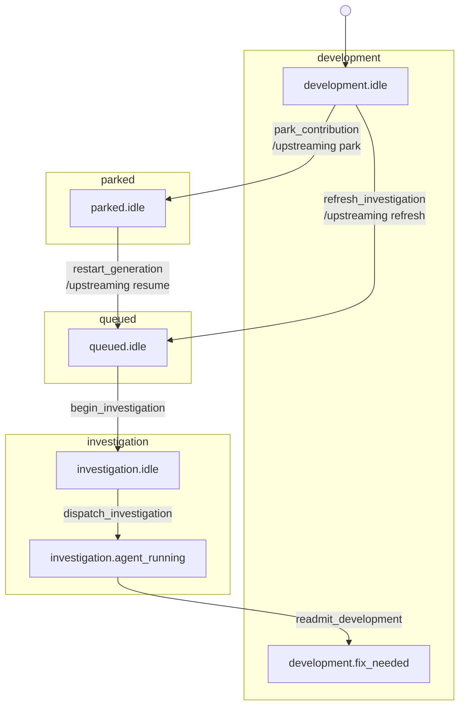

`refresh` runs a complete investigation without deleting the fork or development PR. `park` ends the current generation.

## Pause, waiting-human, and park cases

Pause and block keep the lifecycle phase and activity. `waiting_human` is entered automatically when a specific failure or external prerequisite needs operator action. Park ends the current generation; resume from parked performs a clean reset.

### Success case 1: temporary pause and successful resume

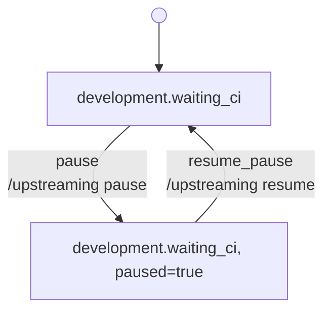

Pause stops new Work and writer admission. An effect that passed its final publication check before the pause may finish and is reconciled normally.

### Success case 2: block and resume

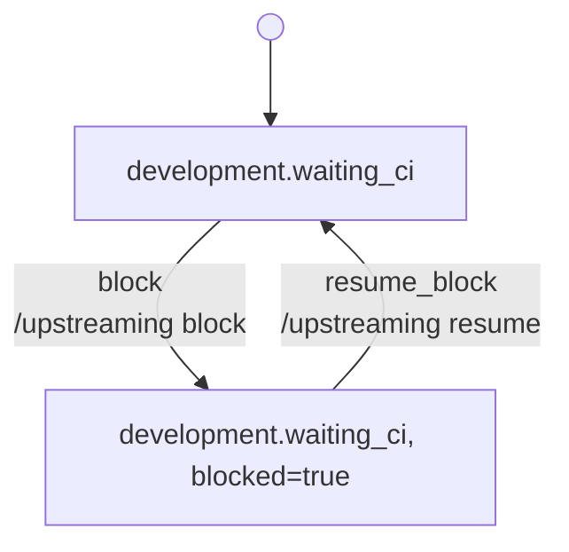

Block records a reason and fences launches like pause. Resuming a block names the exact revision and bumps it.

### Failure case 1: waiting for operator action or an external prerequisite

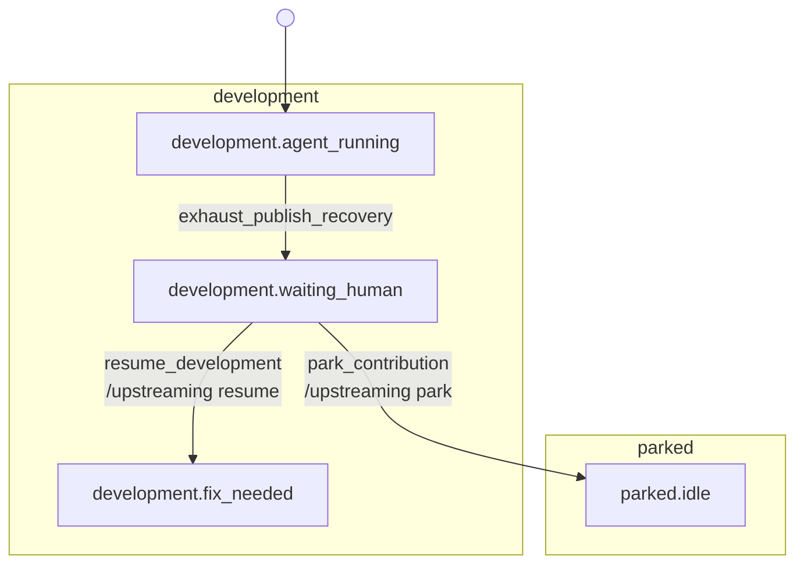

The controller records the concrete reason in `pending_human_action`. Correct the stated problem first, then resume with the exact revision.

### Failure case 2: park and later resume as a clean generation

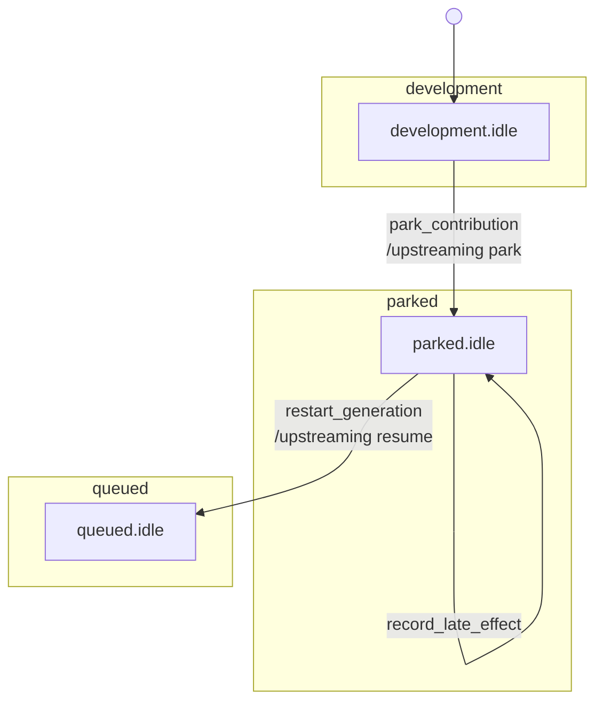

`restart_generation` is accepted only when the contribution is quiescent. It bumps the generation, clears mutable lifecycle state, and starts at `queued.idle`. It does not close PRs, delete branches, or delete repositories.

## Handoff, upstream review, and release cases

The submission request is bound to one exact revision and candidate head. Trusted preparation derives and verifies the clean head; the Apps prepare the submission package but do not open the upstream PR.

### Success case 1: one command publishes a prefilled PR package and a human submits it

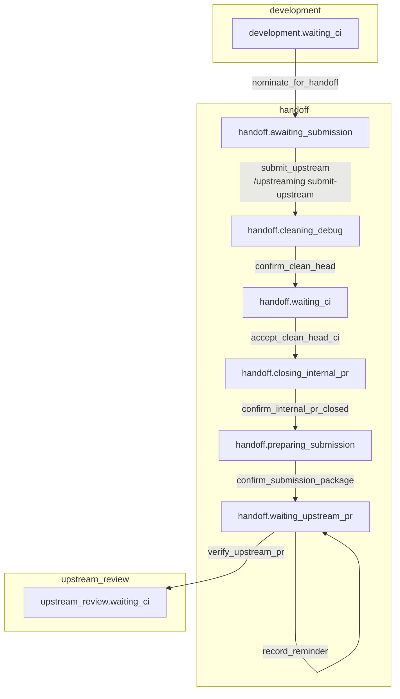

`submit-upstream` is the only submission command. The human follows the prefilled link and opens the PR under their own identity; observation verifies it before `upstream_review`.

### Failure case 1: pre-submission changes versus the locked upstream-PR wait

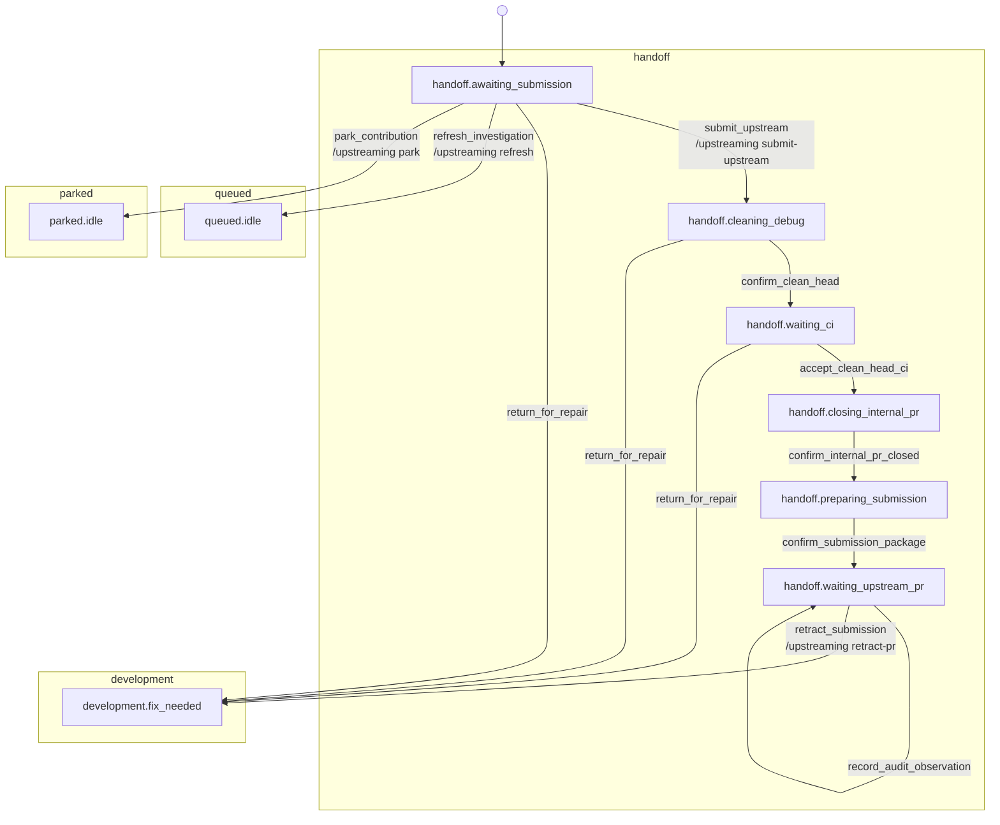

Before the package is posted, cleanup validation, an exact-head lease conflict, or blocking CI on the clean head returns to development. `handoff.waiting_upstream_pr` is locked: only `verify_upstream_pr` and `retract_submission` leave it.

### Failure case 2: submission-package publication or PR verification fails

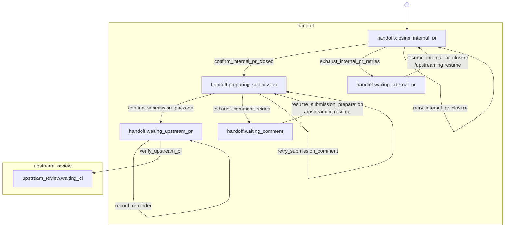

Closure and package recovery happen before the locked wait and do not need another `submit-upstream`.

### Success case 2: upstream review, merge, and release

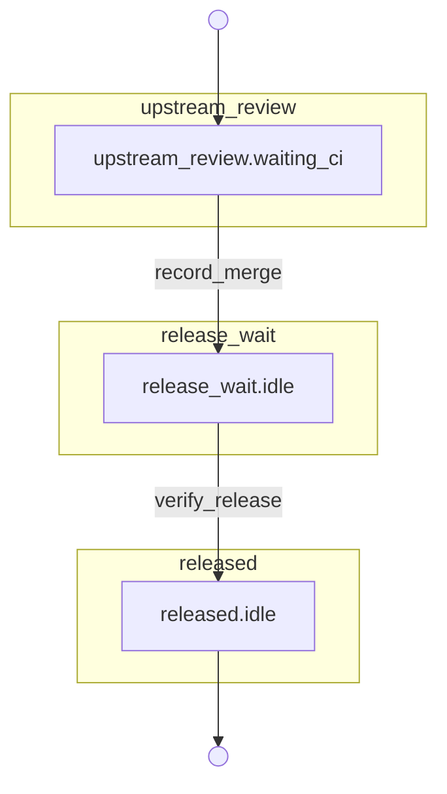

Merge enters `release_wait`; it is not terminal success. Only verified release coverage enters `released`.

### Failure case 3: upstream CI or actionable review needs a revision

```mermaid
flowchart TB
    subgraph upstream_review["upstream_review"]
        upstream_waiting_ci["upstream_review.waiting_ci"]
        upstream_fix_needed["upstream_review.fix_needed"]
        upstream_agent_running["upstream_review.agent_running"]
        upstream_waiting_human["upstream_review.waiting_human"]
    end
    subgraph release_wait["release_wait"]
        release_wait_idle["release_wait.idle"]
    end
    subgraph parked["parked"]
        parked_idle["parked.idle"]
    end

    start_1(( )) --> upstream_waiting_ci
    upstream_waiting_ci -->|record_upstream_ci_failure| upstream_fix_needed
    upstream_waiting_ci -->|record_actionable_review| upstream_fix_needed
    upstream_waiting_ci -->|record_explanation| upstream_waiting_ci
    upstream_fix_needed -->|request_upstream_revision| upstream_agent_running
    upstream_agent_running -->|record_revision_publish_success| upstream_waiting_ci
    upstream_waiting_ci -->|record_merge| release_wait_idle
    upstream_agent_running -->|retry_dispatch| upstream_agent_running
    upstream_agent_running -->|allocate_work_retry| upstream_agent_running
    upstream_agent_running -->|exhaust_dispatch_recovery| upstream_waiting_human
    upstream_agent_running -->|exhaust_work_recovery| parked_idle
    upstream_fix_needed -->|exhaust_repair_attempts| parked_idle
```

Automated upstream revisions require that the registered PR head is the controlled fork ref. Otherwise patches go to the submitter.

### Failure case 4: upstream PR is closed or maintainer intent is unclear

```mermaid
flowchart TB
    subgraph upstream_review["upstream_review"]
        upstream_waiting_ci["upstream_review.waiting_ci"]
        upstream_waiting_human["upstream_review.waiting_human"]
    end
    subgraph parked["parked"]
        parked_idle["parked.idle"]
    end

    start_1(( )) --> upstream_waiting_ci
    upstream_waiting_ci -->|record_pr_closed_unmerged| upstream_waiting_human
    upstream_waiting_human -->|resume_upstream_review<br/>/upstreaming resume| upstream_waiting_ci
    upstream_waiting_human -->|park_contribution<br/>/upstreaming park| parked_idle
```

The pipeline does not reopen the PR or create a replacement. Human triage either resumes or parks.

### Failure case 5: release is missing, incomplete, or waiting for operator action

```mermaid
flowchart TB
    subgraph release_wait["release_wait"]
        release_wait_idle["release_wait.idle"]
        release_wait_waiting_human["release_wait.waiting_human"]
    end
    subgraph released["released"]
        released_idle["released.idle"]
    end

    start_1(( )) --> release_wait_idle
    release_wait_idle -->|record_release_incomplete| release_wait_idle
    release_wait_idle -->|require_release_intervention| release_wait_waiting_human
    release_wait_waiting_human -->|resume_release_observation<br/>/upstreaming resume| release_wait_idle
    release_wait_idle -->|verify_release| released_idle
```

Release observation waits without invoking a worker until the evidence satisfies the frozen acceptance contract.

## Command impact summary

Every `/upstreaming` command that the table accepts, with the transitions it triggers.

| Command | Verb | From | To |
|:--------|:-----|:-----|:---|
| `/upstreaming block` | `block` | every non-terminal state | same state |
| `/upstreaming park` | `park_contribution` | `investigation.idle`, `investigation.waiting_human`, `provisioning.idle`, `provisioning.waiting_human`, `development.idle`, `development.fix_needed`, `development.waiting_human`, `handoff.awaiting_submission`, `upstream_review.waiting_human` | `parked.idle` |
| `/upstreaming park` | `park_investigation` | `investigation.agent_running` | `parked.idle` |
| `/upstreaming pause` | `pause` | every non-terminal state | same state |
| `/upstreaming refresh` | `refresh_investigation` | `development.idle`, `handoff.awaiting_submission` | `queued.idle` |
| `/upstreaming resume` | `restart_generation` | `parked.idle` | `queued.idle` |
| `/upstreaming resume` | `resume_block` | every non-terminal state | same state |
| `/upstreaming resume` | `resume_development` | `development.waiting_human` | `development.fix_needed` |
| `/upstreaming resume` | `resume_internal_pr_closure` | `handoff.waiting_internal_pr` | `handoff.closing_internal_pr` |
| `/upstreaming resume` | `resume_investigation` | `investigation.waiting_human` | `investigation.idle` |
| `/upstreaming resume` | `resume_pause` | every non-terminal state | same state |
| `/upstreaming resume` | `resume_provisioning` | `provisioning.waiting_human` | `provisioning.idle` |
| `/upstreaming resume` | `resume_release_observation` | `release_wait.waiting_human` | `release_wait.idle` |
| `/upstreaming resume` | `resume_submission_preparation` | `handoff.waiting_comment` | `handoff.preparing_submission` |
| `/upstreaming resume` | `resume_upstream_review` | `upstream_review.waiting_human` | `upstream_review.waiting_ci` |
| `/upstreaming retract-pr` | `retract_submission` | `handoff.waiting_upstream_pr` | `development.fix_needed` |
| `/upstreaming submit-upstream` | `submit_upstream` | `handoff.awaiting_submission` | `handoff.cleaning_debug` |
