<!-- Generated by scripts/generate_state_machine_doc.py from the lifecycle table in lifecycle.py. Do not edit; change the table and regenerate. -->

# Contribution state machine
{: .no_toc }

The contribution lifecycle is defined by one table in `lifecycle.py`. That table is the source of truth: every diagram on this page, the [lifecycle table]({{ '/state-machine/table/' | relative_url }}) reference, and the [decisions]({{ '/state-machine/decisions/' | relative_url }}) page are generated from it by `scripts/generate_state_machine_doc.py`, and a test fails when a page no longer matches the table.

`uv run --locked python -m lifecycle check` verifies that the table is consistent, and the Agent Validation workflow runs it on every pull request and every push to `main`. It checks the structure: every target exists, every state is reachable from `queued.idle`, an end state (kind `terminal`) is reachable from every state, end states have no exits and every other state has one that leaves it, a verb leads from a state to one target only, and every transition names its trigger and its guard (`always` when unconditional), every command transition its command and the revision it accepts. It also checks the rules of the lifecycle:

- every transition that allocates Work charges `work_total`, and every charged budget has a `policy.json` key and an exhaustion transition;
- exhaustion of an infrastructure budget leads to a human wait of the same phase, and nothing ends the generation from `upstream_review` without a command;
- the revision is bumped by every resume and by every transition that invalidates requested or approved work, and by no other transition;
- `resume_stale` and the other resumes of the same states carry complementary guards, so exactly one applies, and `resume_stale` requires the quiescence of `refresh_investigation`;
- the resumes of one human wait are guarded by `pending_human_action` so that exactly one applies for every pending action with which the wait is entered;
- every budget exhaustion that leads to a human wait names its counter in `pending_human_action.counter`, every resume from that wait starts exactly that counter again, and no other transition starts a counter again;
- every state of kind `gate`, `human_wait`, or `locked` has a reminder from the rule, and a late Result is recorded in every state without changing it;
- `handoff.waiting_upstream_pr` has exactly its three exits;
- a stop set by the controller records its reason, and every stop clears the pending publication and a held proposal that is not published;
- every row that allocates patch or revision Work carries the pending feedback, only a published Result clears the feedback its Work carried, and Work that carries feedback takes no CI rerun;
- patch Work is requested only from a `fix_needed` state under write admission, `repair_attempts_cluster` is charged exactly when a failing CI job is recorded for the head, and the rows that apply when Work is due exclude each other;
- exactly the rows that record a new head start the rerun counts of `budget.reruns` again, and a CI failure and a review at the submission gate exclude each other;
- the operation table has the same structure, and every state, transition, rule, and flag is drawn below and every decision slice uses table entries.

A state is `phase.activity`. Each arrow is a transition verb of the table, labelled with its `/upstreaming` command when a command triggers it; the other transitions are taken on a Result, an observation, an operation receipt, or a controller tick, as the table records.

<details open markdown="block">
  <summary>Contents</summary>
  {: .text-delta }
1. TOC
{:toc}
</details>

## Simplified state diagram

This is the expected path when investigation finds useful work, provisioning succeeds, development CI becomes green, upstream accepts the contribution, and an official release publishes the required artifacts.

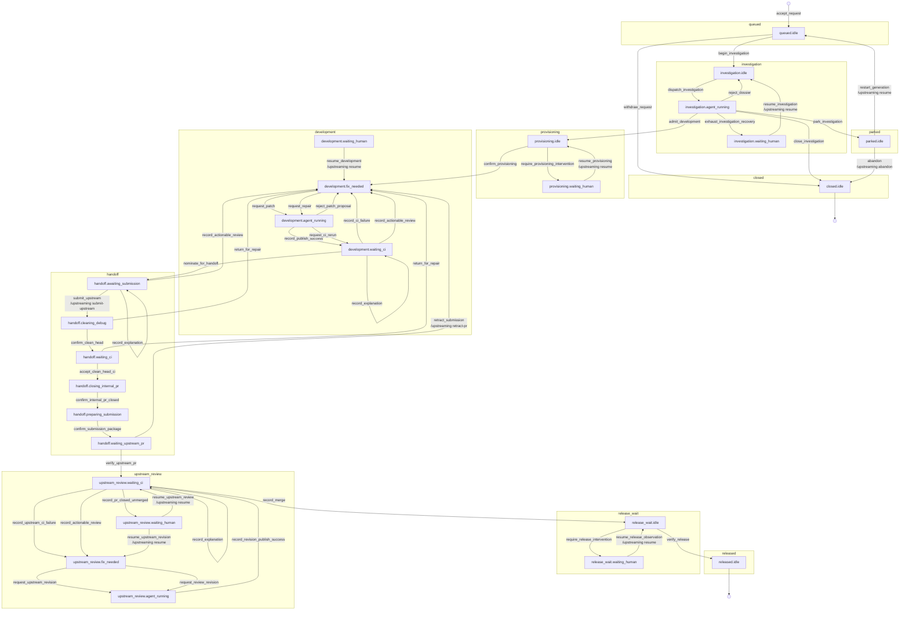

On both the development PR and the upstream PR, a CI failure keeps the contribution in its phase while a bounded repair is prepared and tested, and an actionable review comment is included in the next repair. An explanation-only comment is answered on the development PR; at the submission gate and on the upstream PR it is recorded and surfaced on the tracking issue, and nothing is answered automatically. Transitions that apply in many states (`park_contribution`, `resume_stale`, `record_reminder`, `record_late_effect`) are drawn once, under the rules below.

## Investigation and provisioning failure cases

Investigation and provisioning fail in different ways, and each case has its own recovery path. An infrastructure failure that exhausts its retries waits for a human in the same phase; it never ends the generation.

### Failure case 1: investigation finds no development path

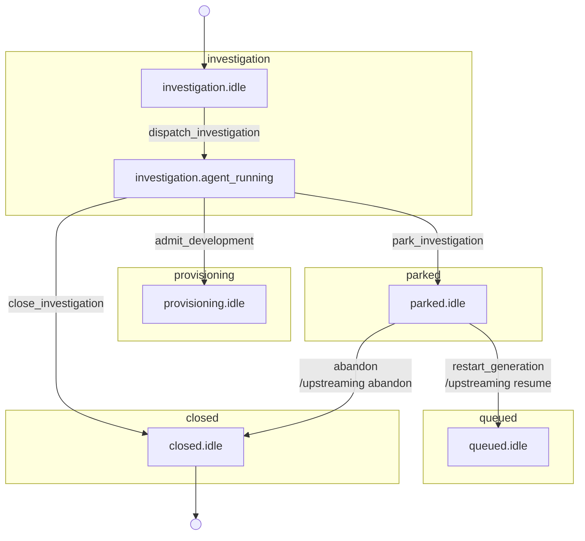

The verified dossier decides between development, park, and close. `closed` is the single terminal phase for work that is not needed; the reason is `terminal_reason`. A restart may record an `admission_override`; the new generation still runs the complete investigation.

### Failure case 2: the Result has no usable dossier

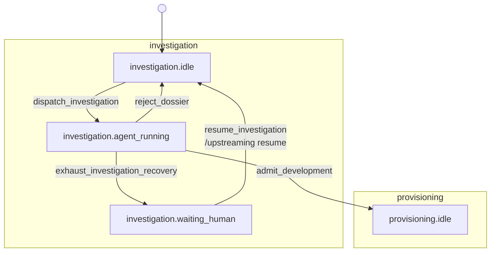

`reject_dossier` retries automatically while `investigation_attempts` remains; a Result without a dossier counts like an invalid one. An incomplete artifact is never adopted by hand.

### Failure case 3: the investigator or dispatcher has an infrastructure failure

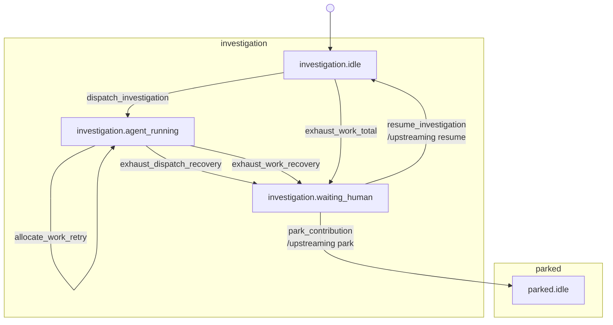

Dispatch and terminal-Work recovery are automatic within `dispatch_recovery` and `work_recovery`. A terminal Work graph is never submitted again under the same identity. Every Work allocation also charges `work_total`.

### Failure case 4: fork provisioning fails or its outcome is uncertain

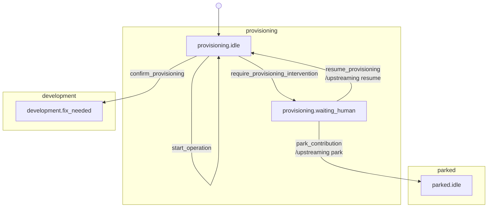

`confirm_provisioning` follows fork creation, configuration, receipt validation, and exact readback. `start_operation` relaunches within `operation_launch`. A lost receipt is not proof that an operation did not launch; an uncertain effect is resolved by discovery or `/upstreaming resolve-operation`, never repeated blindly. A human corrects the prerequisite and resumes, or parks.

## Development and repair cases

Development is one bounded loop around the same development PR. A worker proposes a patch, trusted code validates and publishes it, and CI plus authorized review evaluate the exact head. Only `nominate_for_handoff` leaves development forward.

### Success case: patch, publish, CI, and handoff

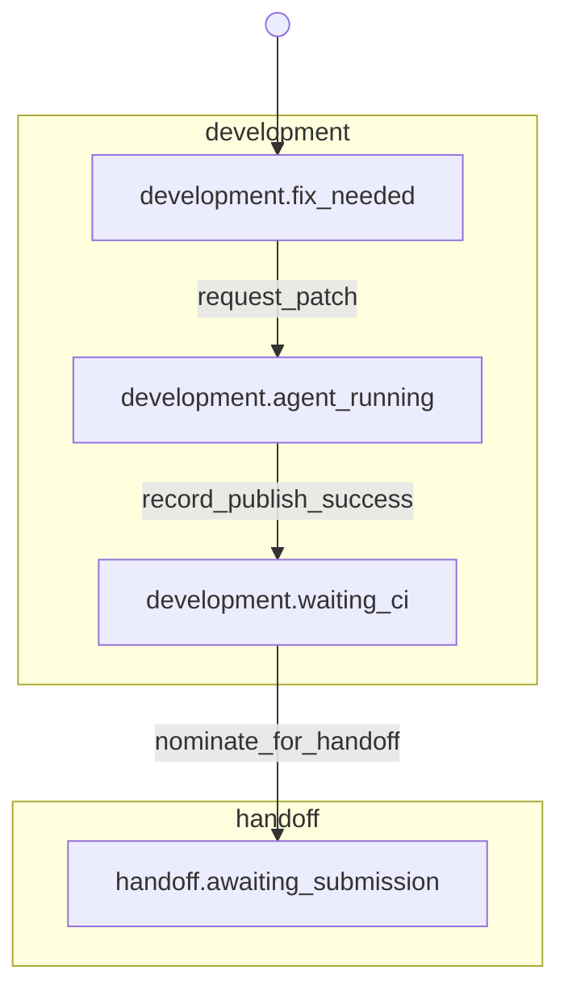

`development.fix_needed` is the one state in which development Work is due, and it is entered only after `confirm_provisioning`: no patch is proposed before the fork exists. `request_repair` applies while a failing CI job is recorded for the head and charges `repair_attempts_cluster` for that job; `request_patch` applies otherwise (the first patch, a rejected proposal, a repair driven only by review feedback) and charges `work_total` only. Both need write admission. Every applicable build and test job must execute and pass on the exact head.

### Failure case 1: patch proposal, dispatch, or Work failure

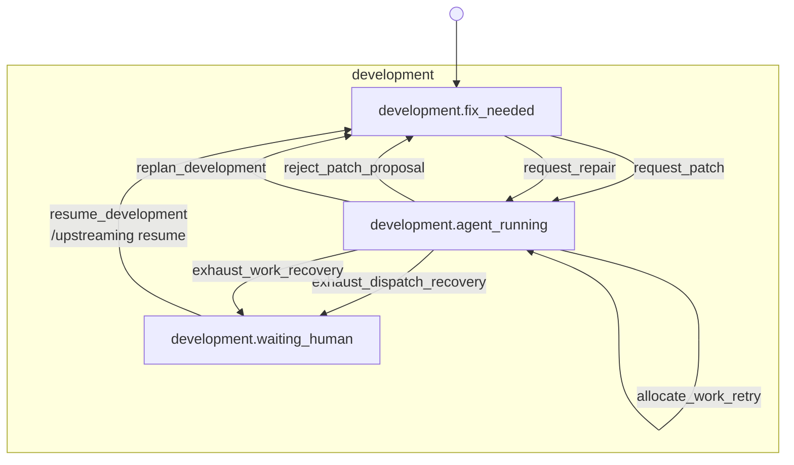

Dispatch recovery and bounded repair are automatic. Dispatch and Work exhaustion wait for a human in development. A rejected proposal, a replan, and a resume keep the pending feedback.

### Failure case 2: trusted publication failure

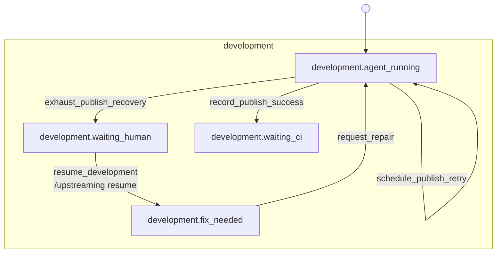

An infrastructure failure publishes the same verified Result again within `publish_recovery`. After exhaustion and a resume, fresh Work is requested; the held Result is not reused.

### Failure case 3: internal PR CI or review failure

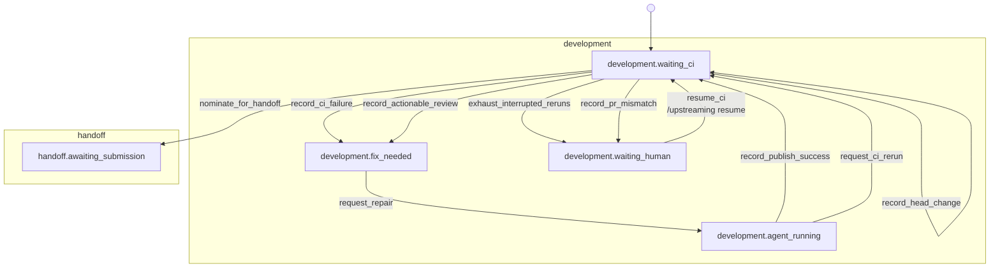

Build and test failures and actionable comments request repair automatically. The repair worker classifies a failure: one not caused by the patch takes `request_ci_rerun` within `flaky_reruns`. The collector reruns on its own only jobs that were cancelled or lost their runner, within `interrupted_reruns` per head; after that a human resumes with `resume_ci`, which reruns the jobs. Both rerun counts are kept for the current head in `budget.reruns` and start again whenever the recorded head changes. The Work request carries the pending feedback present at allocation, and `record_publish_success` clears exactly that feedback. Work that carries feedback never takes `request_ci_rerun`. Explanation-only comments do not bump the revision, invalidate CI, or request repair.

### Failure case 4: a repair budget is exhausted

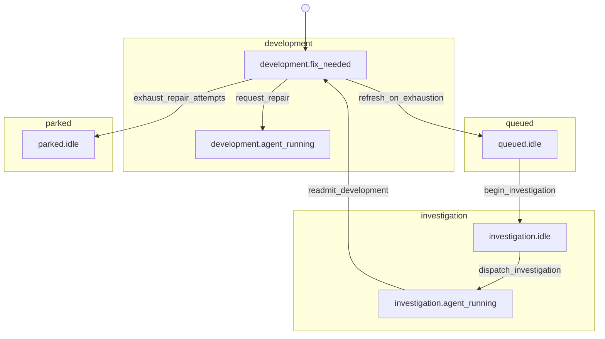

Exhaustion is decided at `development.fix_needed`. The first time `repair_attempts_cluster` or `no_progress` is exhausted in a generation, `refresh_on_exhaustion` runs a complete investigation again on the existing fork. After that, `exhaust_repair_attempts` parks. Both apply only while `work_total` remains. `repair_attempts_cluster` counts only while a failing CI job is recorded for the head.

### Failure case 5: the Work budget is exhausted

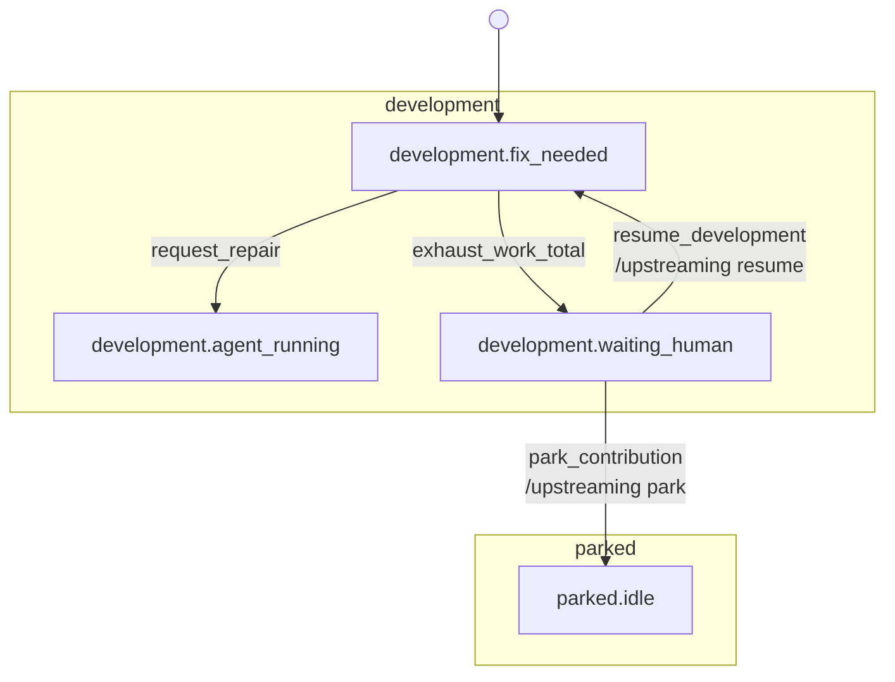

When `work_total` is exhausted at `development.fix_needed`, `exhaust_work_total` waits for a human and names `work_total` in `pending_human_action.counter`, whatever the repair budgets hold. The reply states the number of Work allocations spent in this generation and names both `/upstreaming resume` and `/upstreaming park`. One resume starts `work_total` again and returns to `development.fix_needed`; the repair budgets are not started again.

### Failure case 6: development must be re-investigated

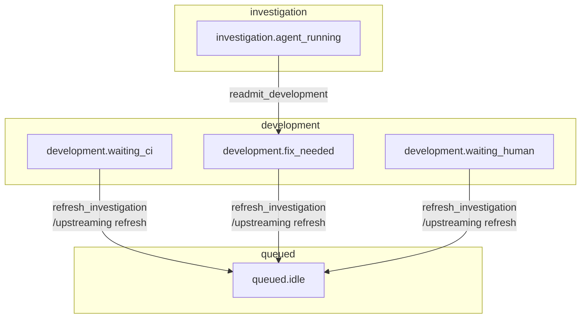

`refresh` runs a complete investigation without deleting the fork or development PR. A refreshed dossier that decides to develop returns to `development.fix_needed` on the existing fork.

## Pause, waiting-human, and park cases

Pause keeps the lifecycle phase and activity. `waiting_human` is entered automatically when a specific failure or external prerequisite needs operator action. Park means the approach is not working or a human said stop; it ends the current generation, and resume from parked performs a clean reset. A Result is reused only while the pipeline ran continuously: after a pause, a human wait, or a park, the next step is fresh Work. A stop therefore clears the requested Work, the pending publication, and a held proposal that is not published, so nothing is published after it.

### Success case 1: temporary pause and resume

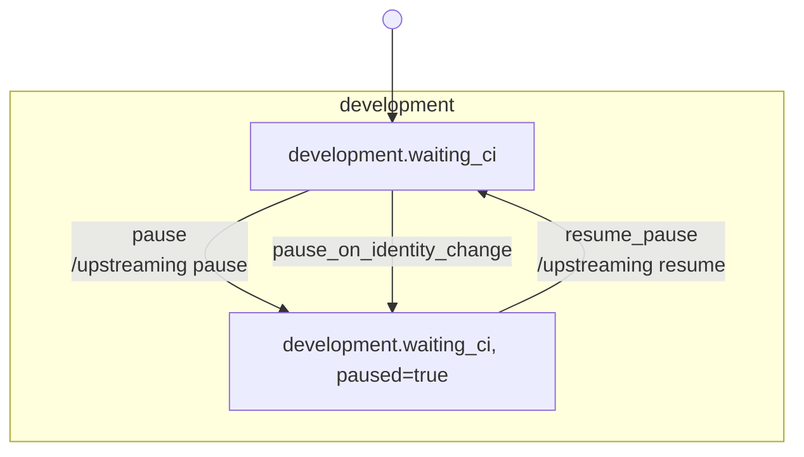

There is one flag, `paused`, with its reason and who set it. A human sets it with `pause`, with an optional reason; the controller sets it when the upstream identity changes and always records the reason. `resume_pause` bumps the revision. An effect that passed its final publication check before the pause may finish and is reconciled normally.

### Success case 2: pause while Work is requested

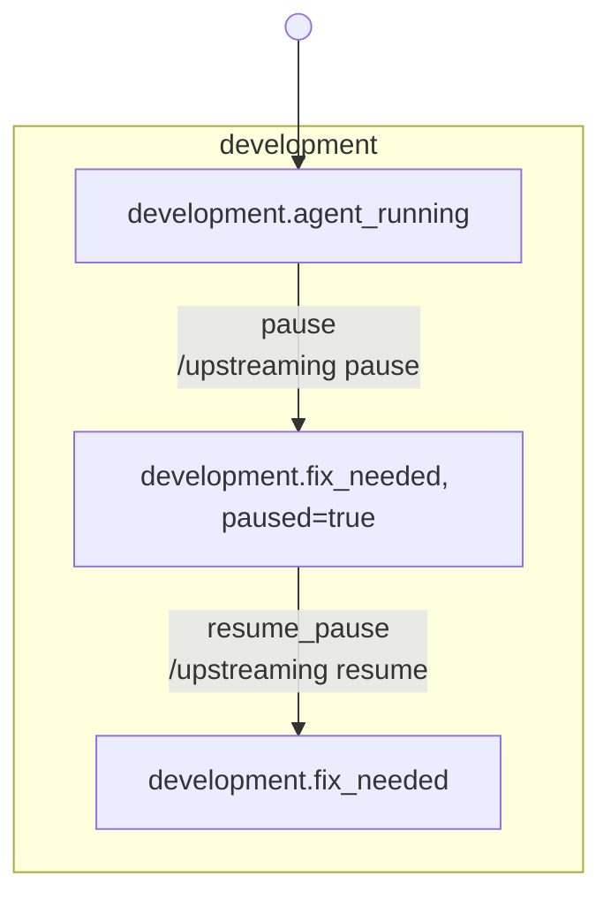

Pause clears the requested Work, so the state in which that Work is due again is entered. A Result that lands during the pause takes `record_late_effect`; after the resume, fresh Work is requested.

### Success case 3: resume after a long stop refreshes the dossier

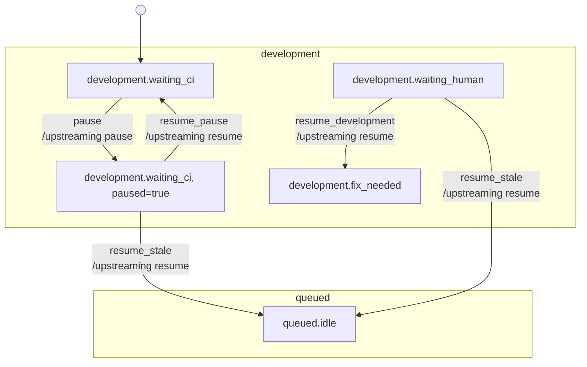

In provisioning and development, a pause or human wait longer than `refresh.stale_after_days` days resumes through `resume_stale`, which runs the investigation again. The normal resume verbs carry the complementary guard, so exactly one applies. Handoff, upstream review, and release waits are never refreshed automatically.

### Failure case 1: waiting for operator action or an external prerequisite

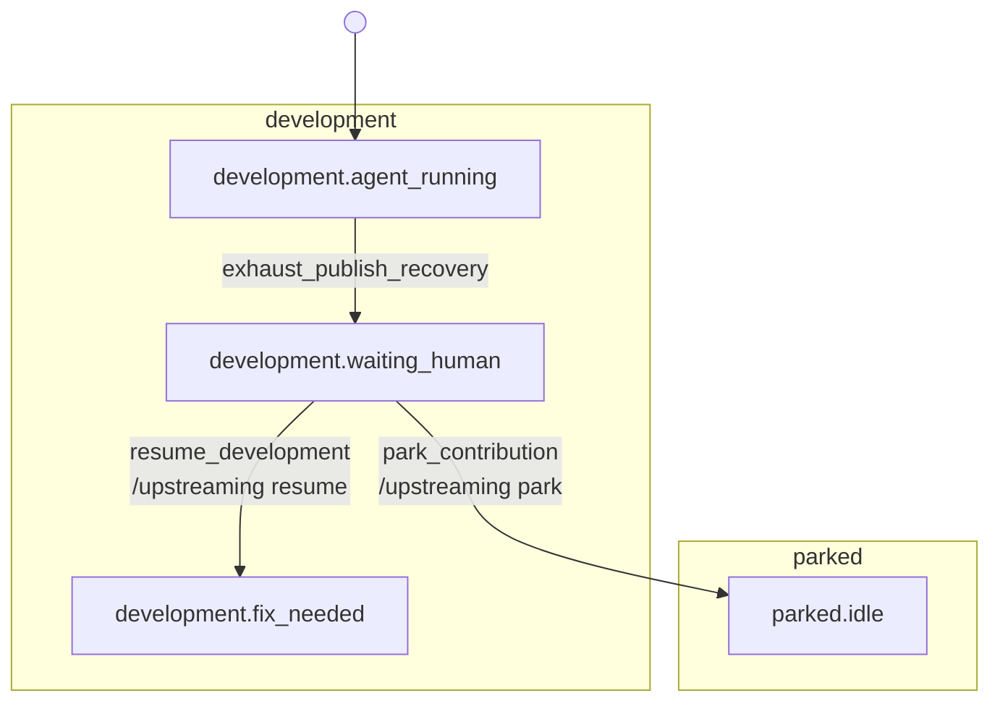

The controller records the concrete reason in `pending_human_action`. Correct the stated problem first, then resume with the exact revision. A contribution that is also paused needs two resumes: the first clears the flag and its reply names the pending action, the second leaves the wait. When an exhausted budget caused the wait, the resume starts again the one counter named in `pending_human_action.counter`.

### Failure case 2: park, then restart as a clean generation or abandon

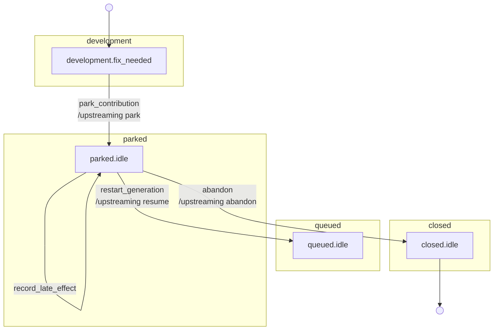

`restart_generation` is accepted only when no operation is open, no publication is pending, and no upstream PR is open. It bumps the generation, clears mutable lifecycle state, and starts at `queued.idle`. Requested Work carries its generation, so a Result of the ended generation is never folded or published. Nothing here closes PRs, deletes branches, or deletes repositories.

## Handoff, upstream review, and release cases

The submission request is bound to one exact revision and candidate head. Trusted preparation derives and verifies the clean head; the Apps prepare the submission package but do not open the upstream PR.

### Success case 1: one command publishes a prefilled PR package and a human submits it

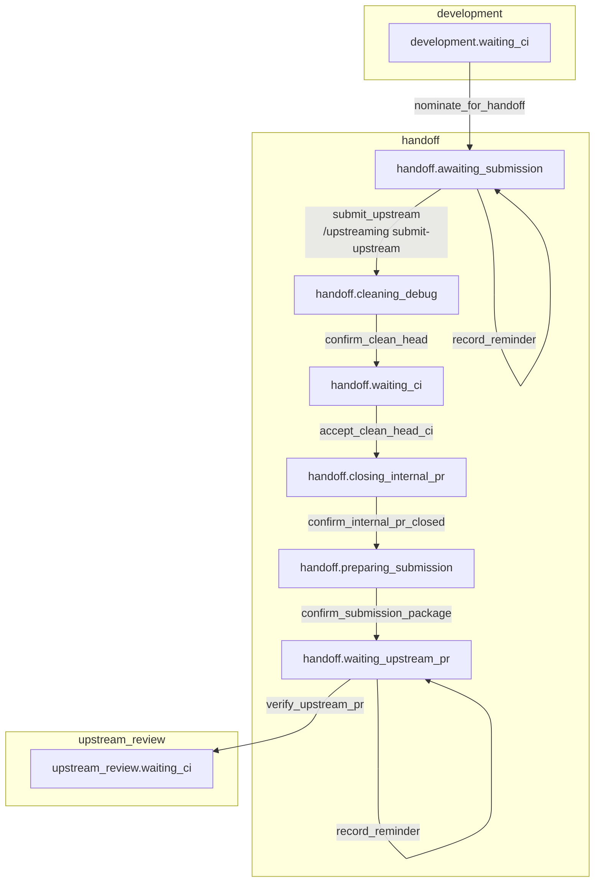

`submit-upstream` is the only submission command. The human follows the prefilled link and opens the PR under their own identity; observation verifies it before `upstream_review`. Both human steps are reminded.

### Failure case 1: pre-submission changes versus the locked upstream-PR wait

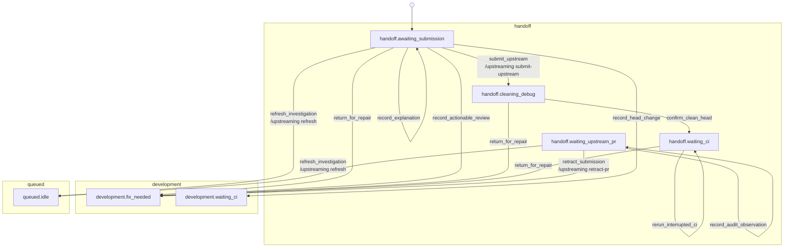

Before the package is posted, a changed head, cleanup validation, an exact-head lease conflict, or blocking CI on the clean head returns to development. At the gate, a CI failure on the candidate head takes `return_for_repair` and records the failing evidence; an actionable review takes `record_actionable_review` and records the feedback; the guards are exclusive, and the failure applies first. An explanation-only comment takes `record_explanation` and keeps the gate. `handoff.waiting_upstream_pr` is locked: only `verify_upstream_pr`, `retract_submission`, and `refresh_investigation` leave it.

### Failure case 2: a handoff operation fails repeatedly

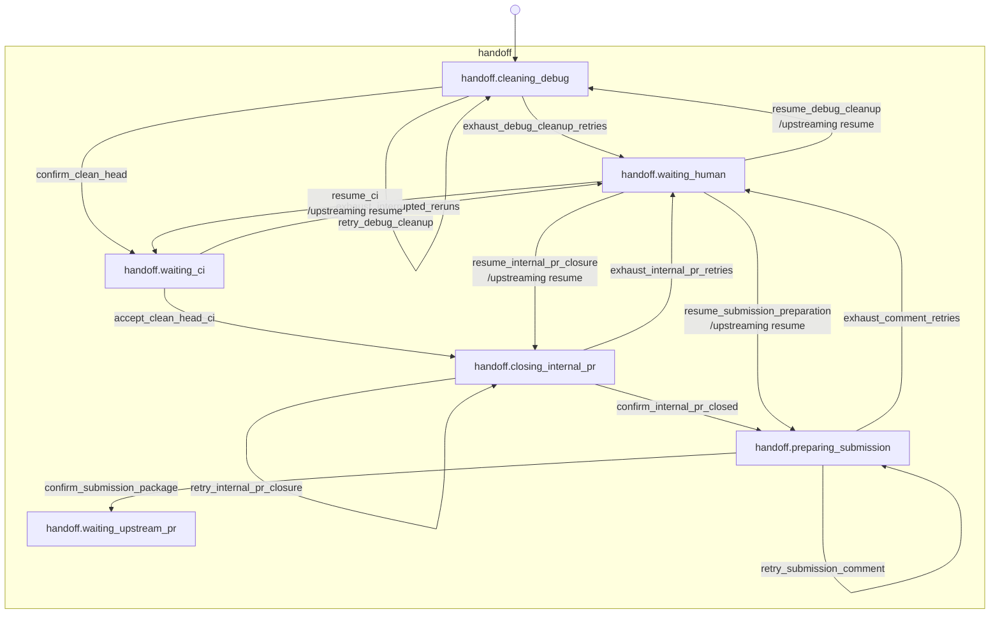

The lease write, the reruns of interrupted CI, the closure, and the package each retry within their budget and then wait for a human in the one `handoff.waiting_human`. `pending_human_action` names the step that failed, and exactly one of the four resume verbs applies: it returns to that step. Recovery does not need another `submit-upstream`.

### Success case 2: upstream review, merge, and release

```mermaid
flowchart TB
    subgraph upstream_review["upstream_review"]
        upstream_waiting_ci["upstream_review.waiting_ci"]
    end
    subgraph release_wait["release_wait"]
        release_wait_idle["release_wait.idle"]
    end
    subgraph released["released"]
        released_idle["released.idle"]
    end

    start_1(( )) --> upstream_waiting_ci
    upstream_waiting_ci -->|record_merge| release_wait_idle
    release_wait_idle -->|verify_release| released_idle
    released_idle --> end_2(( ))
```

Merge enters `release_wait`; it is not terminal success. Only verified release coverage enters `released`.

### Failure case 3: upstream CI or actionable review needs a revision

```mermaid
flowchart TB
    subgraph upstream_review["upstream_review"]
        upstream_waiting_ci["upstream_review.waiting_ci"]
        upstream_fix_needed["upstream_review.fix_needed"]
        upstream_agent_running["upstream_review.agent_running"]
        upstream_waiting_human["upstream_review.waiting_human"]
    end

    start_1(( )) --> upstream_waiting_ci
    upstream_waiting_ci -->|record_upstream_ci_failure| upstream_fix_needed
    upstream_waiting_ci -->|record_actionable_review| upstream_fix_needed
    upstream_waiting_ci -->|record_explanation| upstream_waiting_ci
    upstream_fix_needed -->|request_upstream_revision| upstream_agent_running
    upstream_fix_needed -->|request_review_revision| upstream_agent_running
    upstream_agent_running -->|record_revision_publish_success| upstream_waiting_ci
    upstream_agent_running -->|reject_patch_proposal| upstream_fix_needed
    upstream_agent_running -->|require_reviewer_answer| upstream_waiting_human
    upstream_fix_needed -->|exhaust_repair_attempts| upstream_waiting_human
    upstream_waiting_human -->|resume_upstream_review<br/>/upstreaming resume| upstream_waiting_ci
    upstream_waiting_human -->|resume_upstream_revision<br/>/upstreaming resume| upstream_fix_needed
```

Automated upstream revisions require that the upstream PR head is the controlled fork ref. `request_upstream_revision` applies while a failing CI job is recorded for the head and charges `repair_attempts_cluster`; `request_review_revision` applies to a revision driven only by review feedback and charges `work_total` only. A published revision clears exactly the feedback its Work carried. A rejected proposal is repaired within `no_progress`. When the worker reports that no change is needed, a human answers the reviewer; `resume_upstream_review` then clears the pending feedback and returns to `upstream_review.waiting_ci` without requesting Work. After a budget is exhausted, `resume_upstream_revision` starts again the one counter named in `pending_human_action.counter`. A CI failure is recorded once per head and CI run. Upstream CI is never rerun by the pipeline.

### Failure case 4: revision Work or its publication fails

```mermaid
flowchart TB
    subgraph upstream_review["upstream_review"]
        upstream_agent_running["upstream_review.agent_running"]
        upstream_waiting_human["upstream_review.waiting_human"]
        upstream_fix_needed["upstream_review.fix_needed"]
    end

    start_1(( )) --> upstream_agent_running
    upstream_agent_running -->|retry_dispatch| upstream_agent_running
    upstream_agent_running -->|allocate_work_retry| upstream_agent_running
    upstream_agent_running -->|schedule_publish_retry| upstream_agent_running
    upstream_agent_running -->|exhaust_dispatch_recovery| upstream_waiting_human
    upstream_agent_running -->|exhaust_work_recovery| upstream_waiting_human
    upstream_agent_running -->|exhaust_publish_recovery| upstream_waiting_human
    upstream_waiting_human -->|resume_upstream_revision<br/>/upstreaming resume| upstream_fix_needed
```

Every exhaustion in upstream review waits for a human in `upstream_review.waiting_human`; nothing parks from upstream review automatically.

### Failure case 5: the upstream PR is closed or its head changes

```mermaid
flowchart TB
    subgraph upstream_review["upstream_review"]
        upstream_waiting_ci["upstream_review.waiting_ci"]
        upstream_waiting_human["upstream_review.waiting_human"]
    end
    subgraph parked["parked"]
        parked_idle["parked.idle"]
    end

    start_1(( )) --> upstream_waiting_ci
    upstream_waiting_ci -->|record_pr_closed_unmerged| upstream_waiting_human
    upstream_waiting_ci -->|record_head_change| upstream_waiting_human
    upstream_waiting_human -->|resume_upstream_review<br/>/upstreaming resume| upstream_waiting_ci
    upstream_waiting_human -->|park_contribution<br/>/upstreaming park| parked_idle
```

The pipeline does not reopen the PR or create a replacement. `resume_upstream_review` returns to `upstream_review.waiting_ci` after a head change, and after a closed PR once it is observed open again. `resume_upstream_revision` applies only when revision Work failed. Human triage either resumes or parks.

### Failure case 6: release is missing, incomplete, or waiting for operator action

```mermaid
flowchart TB
    subgraph release_wait["release_wait"]
        release_wait_idle["release_wait.idle"]
        release_wait_waiting_human["release_wait.waiting_human"]
    end
    subgraph released["released"]
        released_idle["released.idle"]
    end

    start_1(( )) --> release_wait_idle
    release_wait_idle -->|record_release_incomplete| release_wait_idle
    release_wait_idle -->|require_release_intervention| release_wait_waiting_human
    release_wait_waiting_human -->|resume_release_observation<br/>/upstreaming resume| release_wait_idle
    release_wait_idle -->|verify_release| released_idle
```

Release observation waits without invoking a worker until the evidence satisfies the frozen acceptance contract.

## Rules that apply in many states

Four transitions apply in many states. Each is written once as a rule and expanded into the table; each is drawn once here, from a single node that stands for every state the rule applies in.

### Rule: park by command

```mermaid
flowchart TB
    any["every non-terminal state except parked.idle, handoff.waiting_upstream_pr, release_wait.*, and upstream_review.* other than upstream_review.waiting_human"]
    subgraph parked["parked"]
        parked_idle["parked.idle"]
    end

    any -->|park_contribution<br/>/upstreaming park| parked_idle
```

Nothing parks from `upstream_review` automatically, and `handoff.waiting_upstream_pr` and `release_wait` cannot be parked.

### Rule: resume after a long stop

```mermaid
flowchart TB
    any["every provisioning.* and development.* state"]
    subgraph queued["queued"]
        queued_idle["queued.idle"]
    end

    any -->|resume_stale<br/>/upstreaming resume| queued_idle
```

### Rule: reminders of a pending human step

```mermaid
flowchart TB
    any["every state of kind gate, human_wait, or locked"]

    any -->|record_reminder| any
```

The rule covers the `gate`, `human_wait`, and `locked` kinds. In `handoff.waiting_upstream_pr` the reminder text carries the package link.

### Rule: late Results

```mermaid
flowchart TB
    any["every state"]

    any -->|record_late_effect| any
```

## Remote operations

Every remote effect is an operation with its own small table, held to the same checks. The intent is recorded before the effect, and the receipt is confirmed by discovering the actual resource. While an operation is open (`planned`, `applying`, `uncertain`) it fences its contribution: no park, no refresh, and no second writer. `/upstreaming resolve-operation` closes an open operation with a resolution evidence record.

```mermaid
flowchart TB
    subgraph open_operations["open"]
        op_planned["planned"]
        op_applying["applying"]
        op_uncertain["uncertain"]
    end
    subgraph closed_operations["closed"]
        op_confirmed["confirmed"]
        op_failed["failed"]
        op_not_launched["not_launched"]
    end

    start_1(( )) -->|record_intent| op_planned
    op_planned -->|begin_effect| op_applying
    op_planned -->|resolve_confirmed<br/>/upstreaming resolve-operation| op_confirmed
    op_planned -->|resolve_failed<br/>/upstreaming resolve-operation| op_failed
    op_planned -->|resolve_not_launched<br/>/upstreaming resolve-operation| op_not_launched
    op_applying -->|record_response| op_uncertain
    op_applying -->|record_failure| op_failed
    op_applying -->|resolve_confirmed<br/>/upstreaming resolve-operation| op_confirmed
    op_applying -->|resolve_failed<br/>/upstreaming resolve-operation| op_failed
    op_applying -->|resolve_not_launched<br/>/upstreaming resolve-operation| op_not_launched
    op_uncertain -->|confirm_by_discovery| op_confirmed
    op_uncertain -->|record_discovery| op_uncertain
    op_uncertain -->|resolve_confirmed<br/>/upstreaming resolve-operation| op_confirmed
    op_uncertain -->|resolve_failed<br/>/upstreaming resolve-operation| op_failed
    op_uncertain -->|resolve_not_launched<br/>/upstreaming resolve-operation| op_not_launched
    op_confirmed --> end_2(( ))
    op_failed --> end_3(( ))
    op_not_launched --> end_4(( ))
```

## Command impact summary

Every `/upstreaming` command that the tables accept, with the transitions it triggers.

| Command | Verb | From | To |
|:--------|:-----|:-----|:---|
| `/upstreaming abandon` | `abandon` | `parked.idle` | `closed.idle` |
| `/upstreaming park` | `park_contribution` | every non-terminal state except `parked.idle`, `handoff.waiting_upstream_pr`, `release_wait.*`, and `upstream_review.*` other than `upstream_review.waiting_human` | `parked.idle` |
| `/upstreaming pause` | `pause` | every non-terminal state | same state |
| `/upstreaming refresh` | `refresh_investigation` | `development.waiting_ci`, `development.fix_needed`, `development.waiting_human`, `handoff.awaiting_submission`, `handoff.waiting_upstream_pr` | `queued.idle` |
| `/upstreaming resolve-operation` | `resolve_confirmed` | operation `planned`, operation `applying`, operation `uncertain` | operation `confirmed` |
| `/upstreaming resolve-operation` | `resolve_failed` | operation `planned`, operation `applying`, operation `uncertain` | operation `failed` |
| `/upstreaming resolve-operation` | `resolve_not_launched` | operation `planned`, operation `applying`, operation `uncertain` | operation `not_launched` |
| `/upstreaming resume` | `restart_generation` | `parked.idle` | `queued.idle` |
| `/upstreaming resume` | `resume_ci` | `development.waiting_human` | `development.waiting_ci` |
| `/upstreaming resume` | `resume_ci` | `handoff.waiting_human` | `handoff.waiting_ci` |
| `/upstreaming resume` | `resume_debug_cleanup` | `handoff.waiting_human` | `handoff.cleaning_debug` |
| `/upstreaming resume` | `resume_development` | `development.waiting_human` | `development.fix_needed` |
| `/upstreaming resume` | `resume_internal_pr_closure` | `handoff.waiting_human` | `handoff.closing_internal_pr` |
| `/upstreaming resume` | `resume_investigation` | `investigation.waiting_human` | `investigation.idle` |
| `/upstreaming resume` | `resume_pause` | every non-terminal state | same state |
| `/upstreaming resume` | `resume_provisioning` | `provisioning.waiting_human` | `provisioning.idle` |
| `/upstreaming resume` | `resume_release_observation` | `release_wait.waiting_human` | `release_wait.idle` |
| `/upstreaming resume` | `resume_stale` | every `provisioning.*` and `development.*` state | `queued.idle` |
| `/upstreaming resume` | `resume_submission_preparation` | `handoff.waiting_human` | `handoff.preparing_submission` |
| `/upstreaming resume` | `resume_upstream_review` | `upstream_review.waiting_human` | `upstream_review.waiting_ci` |
| `/upstreaming resume` | `resume_upstream_revision` | `upstream_review.waiting_human` | `upstream_review.fix_needed` |
| `/upstreaming retract-pr` | `retract_submission` | `handoff.waiting_upstream_pr` | `development.fix_needed` |
| `/upstreaming submit-upstream` | `submit_upstream` | `handoff.awaiting_submission` | `handoff.cleaning_debug` |
